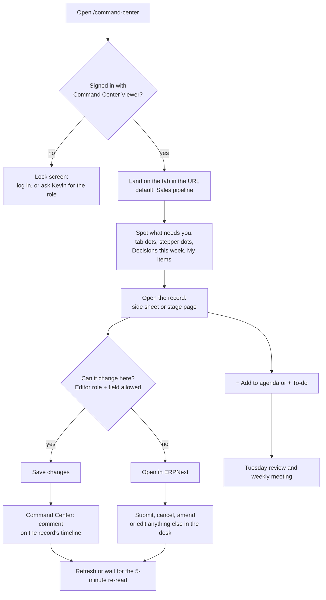

# Module 01: Command Center orientation

**Audience:** everyone. **Length:** 90-120 minutes (two sittings work well: Lessons 1.0-1.6, then 1.7-1.12). **Prerequisite:** an ERPNext login with at least the Command Center Viewer role.

## Purpose

By the end, a new team member can:

- open the Command Center and know why their screen may look different from a colleague's;
- find their stage of the pipeline and their own to-dos;
- open any record in the side sheet, read it, and (with the Editor role) change the few fields the page allows;
- tell a loading, empty, locked or failed screen apart, and know what to do about each;
- know when to leave the Command Center for the ERPNext desk, the dealer portal or Helpdesk.

**Rule of thumb for the whole module:** look and decide in the Command Center; commit in the desk.

Sources for this module: `illumenate_lighting/command_center/page/cc.js` and `cc.css` (the page), `ss/cc_gateway.py` (the "ilL Command Center Gateway" server script), `illumenate_lighting/command_center/README.md`, and `illumenate_lighting/command_center_sync.py`. Field labels were checked on staging with `getdoctype` on 2026-11-24.

## Where to go

| What | URL | Who |
|---|---|---|
| Command Center | `/command-center` | Command Center Viewer and up |
| A tab or stage directly (bookmarkable) | `/command-center#exec`, `#inbox`, `#tasks`, `#agenda`, `#wb`, `#purch` … | same |
| A Workbench list, pre-filtered | `/command-center#wb/Sales Order/To Deliver` | same |
| One sales order page | `/command-center#so-<sales order>` | same |
| One fixture schedule page | `/command-center#design/<schedule>` | same |
| One project board | `/command-center#p-<project>` | same |
| One meeting agenda | `/command-center#agenda/<MTG-…>` | same |
| ERPNext desk home (ilLumenate Lighting workspace) | `/app/illumenate-lighting` | any desk user |
| Portal Operations (staff queues for dealer requests) | `/app/ill-portal-operations` | Sales, Support, Accounts |
| Helpdesk (agent view) | `/helpdesk/tickets` | Helpdesk agents |
| Dealer portal (what dealers see) | `/portal` | Dealer portal users |
| HR self-service | `/hrms` | every employee |
| Catalog Builder, full screen | `/catalog-builder` | ilL Catalog Publisher, System Manager |
| Kevin's Desk (owner only) | `/kd/<private slug>` | Kevin only; everyone else gets a 404 |

---

## Process map: a working session in the Command Center

The same loop every day, whatever your role:

1. Open `/command-center`. If you are a guest or lack the Viewer role, you get a lock screen (Lesson 1.0).
2. The page opens on the tab named in the URL after `#`. With no `#`, it opens **Sales pipeline**.
3. Look for signals: coloured dots and counts on the tabs, dots on the pipeline stepper, the **Decisions this week** cards, your **My items** list.
4. Open the record. On Manufacturing, Shipping and the Workbench a click opens the **side sheet**; on most other pages a link opens ERPNext in a new tab.
5. If you hold **Command Center Editor** and the field is editable here, change it and **Save changes**. The gateway writes a "Command Center:" comment on the record's timeline.
6. Anything else (submit, cancel, amend, line items, a field the sheet doesn't offer): **Open in ERPNext**.
7. Park anything that needs a group decision with **+ Add to agenda**, or make a to-do.
8. The page re-reads ERPNext every 5 minutes while it is visible; **Refresh** does it now.

---

## Lesson 1.0: Getting in, and the frame around every page

**Objective:** sign in, recognise the lock screens, and use the parts of the page that never change: header, search, Meeting mode, Refresh, Add task and the footer.

### Getting in

- The Command Center is an ERPNext **Web Page** (`illumenate-command-center`, route `/command-center`). A logged-out visitor still gets the page shell, but no data: every call behind it checks your login and role.
- If you're not logged in, the page shows **"Log in to view the Command Center"** with a **Log in** button that returns you to `/command-center` afterwards.
- If you're logged in without the **Command Center Viewer** role, it shows **"You don't have access yet"**: "You're signed in as <you>, but this account isn't on the Command Center list. Ask Kevin to add the Command Center Viewer role to your user." The button is **Go to ERPNext**.
- While locked, the search box, the action buttons and the tab bar are hidden, and the status line reads **Restricted**.
- Roles are never handed out automatically after the first deploy. Kevin Schern (Systems Administrator) adds them in the desk: User → Roles.

### The header (top bar)

| Region | What it is | Notes |
|---|---|---|
| Brand and status line | "ilLumenate Command Center" and "Live from ERPNext · updated 1:56 PM" | Shows "Connecting to ERPNext…" while the first load runs, "Restricted" on a lock screen. The time is when the main feed last answered. |
| Search box | "Search dealers, items, orders, tasks…" | Filters the rows on the page you are on, as you type (any text in the row). It is not a global ERPNext search. Workbench lists and the agenda picker have their own search boxes. |
| Meeting mode | Switch, tooltip "Hide Kevin's email-derived tasks for screen sharing" | Hides to-dos tagged `[email]` everywhere: Tasks list, Workbench To-do lists, the activity feed, agenda items linked to them. The **kevins@** source filter disappears while it's on. |
| Refresh | Pulls the latest from ERPNext now | Spins while loading, then a toast: "Up to date with ERPNext". Also re-reads the agenda and your access (a new role shows without reloading). |
| Add task | Opens the **Add task** dialog | Signed-in users only; a guest gets "Log in to ERPNext to add tasks · Log in". |

### The footer

- Left: "Signed in as <your login>" (or "Viewing as guest · Log in to add tasks, close ToDos and draft orders").
- Right: "Read-only for guests · nothing is ever submitted from this page".

### The Add task dialog (field reference)

"Saved to ERPNext as a ToDo. Each owner gets their own copy and a notification."

| Field (as shown) | Meaning | Required | Where it goes |
|---|---|---|---|
| Title | What needs to happen | Yes | ToDo description (bold first line) |
| Owners | Tick one or more people (the team list, system accounts left out) | Yes, at least one | First owner = ToDo **Allocated To**; all owners listed in an `[ad-hoc] Owners: …` line |
| Due date | Optional | No | ToDo **Date** |
| Priority | Medium (default), High, Low | No | ToDo **Priority** |
| Project | None, or an open ERPNext Project | No | ToDo reference (Project) |
| Notes | Optional context | No | Second paragraph of the description |

- **Save to ERPNext** writes the ToDo, shows "Saved to ERPNext · N owner(s) notified", and jumps to the Tasks list.
- Missing title or owner: "Add a title and at least one owner."
- (Confirm on capture: the page inserts one ToDo allocated to the first owner and lists every owner in the description. Check that each owner sees it before teaching "each owner gets their own copy".)

### Phone and print

- At phone width the tab bar stays pinned at the top and scrolls sideways; cards stack in one column.
- **Print / PDF** buttons (Executive, Review, Agenda) hide the header, tab bar, footer, buttons and quick links, so the printout is just the content.

> **SS-01-26** · Header close-up: brand, live status line, search, Meeting mode, Refresh, Add task
> **URL:** `/command-center` · **Role:** training.lead (Editor + Finance) · **State:** page fully loaded
> **Highlight:** "Live from ERPNext · updated …"; the search placeholder; the Meeting mode switch; Refresh; Add task

> **SS-01-27** · (pair) Refresh before and after
> **URL:** `/command-center#pipeline` · **Role:** training.lead · **State:** -a click Refresh and capture while it spins; -b after the toast appears
> **Highlight:** -a the spinning Refresh button; -b the "Up to date with ERPNext" toast and the new "updated" time

> **SS-01-28** · Lock screen for a logged-out visitor
> **URL:** `/command-center` · **Role:** none (private window, signed out) · **State:** not logged in
> **Highlight:** "Log in to view the Command Center"; the Log in button; no tab bar or search

> **SS-01-29** · Lock screen for a signed-in user without the Viewer role
> **URL:** `/command-center` · **Role:** training.dealer (portal user, no Command Center role) · **State:** signed in
> **Highlight:** "You don't have access yet"; the sentence naming the user and "Command Center Viewer"; Go to ERPNext; status line "Restricted"

> **SS-01-30** · (pair) Header search filtering the page
> **URL:** `/command-center#tasks` · **Role:** training.lead · **State:** -a no search; -b type "CRM" in the search box
> **Highlight:** -b the typed text; the Open tasks count dropping; only matching rows left

> **SS-01-31** · (pair) Meeting mode off vs on
> **URL:** `/command-center#tasks` · **Role:** training.lead · **State:** at least one to-do tagged `[email]` exists (confirm on staging; if none, capture the Source dropdown only)
> **Highlight:** -a "kevins@" in the source dropdown; -b the switch on, kevins@ gone from the dropdown and its rows hidden

> **SS-01-32** · Add task dialog with the validation message
> **URL:** `/command-center` then **Add task** · **Role:** training.lead · **State:** type a title, tick no owner, click Save to ERPNext. Do not complete the save
> **Highlight:** the six fields; the message "Add a title and at least one owner."

> **SS-01-33** · Command Center at phone width (phone)
> **URL:** `/command-center#exec` · **Role:** training.lead · **State:** 390×844
> **Highlight:** the pinned, sideways-scrolling tab bar; KPI tiles stacked in one column

---

## Lesson 1.1: The four places you work, and when to use each

**Objective:** know which screen to use for each kind of task.

- **Command Center** (`/command-center`): see the whole pipeline, triage, make quick edits, create drafts. It never submits, cancels or deletes ERPNext documents. The only delete it does is removing an item from a meeting agenda, and that never touches the linked record.
- **ERPNext desk** (`/app/...`): create, submit, cancel and amend documents. Run reports. Change settings.
- **Dealer portal** (`/portal/...`): the dealer's side. Staff use it to see what the dealer sees, and to test.
- **Helpdesk** (`/helpdesk/tickets`): write replies to customer tickets. The Command Center triages tickets but never writes a reply; its **Reply in Helpdesk** button opens `/helpdesk/tickets/<ticket>`.
- **Rule of thumb:** look and decide in the Command Center; commit in the desk.

| I need to… | Go to |
|---|---|
| See what's late across the business | Command Center → Executive |
| Change an estimated ship date or floor note on a submitted sales order | Command Center side sheet (Editor) |
| Submit a sales order, delivery note, work order or invoice | ERPNext desk |
| Add or change line items | ERPNext desk |
| Reassign a ticket or link it to a quote | Command Center → Inbox → Manage (Editor) |
| Reply to a customer | Helpdesk |
| See exactly what a dealer sees | Dealer portal, signed in as a test dealer |
| Change a setting (production weights, purchasing defaults) | ERPNext desk (the Command Center links to it) |

> **SS-01-01** · Command Center landing page, full width
> **URL:** `/command-center` · **Role:** Command Center Editor + Finance · **State:** default landing (Sales pipeline › Overview)
> **Highlight:** the top tab bar; the pipeline stepper; the Refresh button

*What you see:*
- Header: "ilLumenate Command Center", "Live from ERPNext · updated 1:56 PM", the search box, Meeting mode, **Refresh**, **Add task**.
- Tab bar: Sales pipeline (underlined), Executive, Inbox **57**, Finance, Projects & tasks **700**, Review, Agenda, Workbench, Catalog, Recommendations.
- "In ERPNext:" quick links: Customers, Sales orders, Sales invoices, Sales partners (reps), Customer groups (tiers).
- The eight-stage stepper from Overview (1/8 new dealers) to Service (56 tickets our move).
- "Pipeline right now" bars and the "Break-even this month" ring (1 new dealer, on pace 5.9, $0 of $41,000).

> **SS-01-02** · ERPNext desk, ilLumenate Lighting workspace
> **URL:** `/app/illumenate-lighting` · **Role:** System Manager
> **Highlight:** "Needs Attention" number cards; "Start Here" shortcuts; "New Product Setup Guide" cards

*What you see:*
- Business Overview cards: Open Quotations, Open Sales Orders, AR Outstanding, Open Purchase Orders, AP Outstanding.
- Needs Attention: Quotes Awaiting Staff, Drawings Awaiting Review, Orders Needing Acknowledgment, Products Not Ready, Failed Publish Jobs.
- Start Here shortcuts: Portal Operations, Quote Requests, Quote Offers, Order Intake, Order Changes, Portal Messages, Project, Document Request.
- The "New Product Setup Guide" cards are further down the page (not in this crop).

> **SS-01-03** · Dealer portal home as a dealer
> **URL:** `/portal` · **Role:** Dealer (sample dealer user)
> **Highlight:** the main navigation (Overview, Projects, Quotes, Orders, Drawings, Products, Resources, Support, Account)

*What you see:*
- Portal tabs: Overview, Projects, Quotes, Orders, Drawings, Products, Resources, Support, Account, and a bell.
- Greeting banner with **+ New project**, **Configure product**, **Request drawing**.
- "Needs your attention" empty state: "You're all caught up."
- Recent activity: one project ("Active") and one order ("Approved").

> **SS-01-04** · Helpdesk ticket list, agent view
> **URL:** `/helpdesk/tickets` · **Role:** support agent

*What you see:*
- Columns: ID, Subject, Status, First response, Resolution, Assigned To, Customer.
- SLA badges ("Failed", "1 day 23h") in the response and resolution columns.
- Left menu: Tickets, Knowledge Base, Customers, Contacts and saved views (My Inbox, SLA Alerts…).
- Redact before publishing: ticket subjects.

---

## Lesson 1.2: The top tabs

**Objective:** know what each top tab is for, what its dot and number mean, and what the page remembers.

| Tab | Route | What it is for | Module |
|---|---|---|---|
| Sales pipeline | `#pipeline` (and every stage: `#design`, `#quotes`, `#orders`, `#purch`, `#mfg`, `#ship`, `#service`) | The 8 business stages (Lesson 1.3) | 01-10 |
| Executive | `#exec` | KPIs, pipeline value, break-even, "Decisions this week" | 01 |
| Inbox | `#inbox` | Helpdesk triage: needs a reply, routing, linking | 02 |
| Finance | `#finance` | Invoiced vs break-even, receivables, aging | 09 |
| Projects & tasks | `#work` (projects), `#tasks` (every to-do and task) | Company projects and one master task list | 01, 02 |
| Review | `#review` | The Tuesday walk-through, one page per project | 01 |
| Agenda | `#agenda` | The weekly meeting agenda (replaces the Google Doc) | 01 |
| Workbench | `#wb` | Browse and edit any record type | 01 |
| Catalog | `#catalog` | Catalog Builder, embedded (Restricted: ilL Catalog Publisher or System Manager) | 11 |
| Recommendations | `#rec` | "This week" and "Recommendations" notes | 01 |

### Dots and numbers on the tabs

| Tab | Number | Dot |
|---|---|---|
| Inbox | Open tickets (customer wrote last) | Red when more than 3 open tickets are over 2 business days old; amber for 1-3; green for none |
| Finance | none | Green when invoiced this month is at or above the on-pace target; amber when behind |
| Projects & tasks | Overdue tasks and to-dos | Amber when any are overdue; green when none |
| Agenda | Open items on the next open meeting | none |
| Catalog | none | Amber when a Catalog Builder draft hasn't been imported |
| Recommendations | none | Always blue (information) |
| Sales pipeline, Executive, Review, Workbench | none | none |

### What the page remembers

The **top tab is not stored**: it lives in the URL after `#`, so you can bookmark it or paste it to a colleague. With no `#`, the page opens on Sales pipeline. An unknown route falls back to Sales pipeline, and the retired `#requests` link redirects there too.

These are remembered **per person, per browser** (localStorage, keyed by your login). They don't follow you to another computer and are lost if you clear site data:

| Remembered | Where | Key |
|---|---|---|
| Purchasing sub-tab (Overview, To order, Requests…) | `#purch` | `cc.purch.tab.<you>` |
| Manufacturing sub-tab (Flow, Schedule board, Material requests…) | `#mfg` | `cc.mfg.tab.<you>` |
| Workbench area (Pipeline or ilLumenate) | `#wb` | `cc.wb.area.<you>` |
| Saved views on Tasks and every Workbench list | the "Saved views…" dropdown | `cc.views.<you>.<list>` |
| Catalog Builder drafts | Catalog tab | the builder's own storage |

Filters on the Tasks list and Inbox (person, source, status, My items) are **not** remembered between visits unless you save a view.

> **SS-01-05** · Close-up of the top tab bar with dots and counts
> **URL:** `/command-center` · **Role:** Editor + Finance · **State:** at least one overdue task and open tickets so counts show
> **Highlight:** an Inbox count, a coloured dot, the Catalog tab present

*What you see:*
- Red dot on Inbox with **57** open tickets.
- Amber dots on Finance (behind pace) and Projects & tasks (**700** overdue).
- Blue dot on Recommendations.
- **Catalog** present between Workbench and Recommendations.

> **SS-01-06** · (pair) Top tab bar as Viewer-only vs as Catalog Publisher
> **Role:** -a Viewer, -b Catalog Publisher · **Highlight:** the Catalog tab appears only in -b

*What you see:*
- -a: nine tabs; Workbench is followed directly by Recommendations. Finance still shows (the known gap, Lesson 1.5).
- -b: ten tabs; **Catalog** sits between Workbench and Recommendations.

> **SS-01-34** · A deep link opens a pre-filtered Workbench list
> **URL:** `/command-center#wb/Sales Order/To Deliver and Bill` · **Role:** training.lead · **State:** at least one order To Deliver and Bill
> **Highlight:** the address bar with the hash; the "To Deliver and Bill" chip selected

> **SS-01-35** · (pair) Purchasing remembers its sub-tab per browser
> **URL:** `/command-center#purch` · **Role:** training.buyer · **State:** -a click the **Bills** tab; -b reload the page
> **Highlight:** -b the page reopens on Bills

---

## Lesson 1.3: The sales pipeline stepper

**Objective:** follow one job through the eight stages, know who owns each, and read the stepper's numbers and dots.

Overview → Design → Quotes → Sales orders → Purchasing → Manufacturing → Shipping → Service

| Stage | Route | Owner (typical) | Module |
|---|---|---|---|
| Overview | `#pipeline` | Owner | 01 |
| Design | `#design` | Sales / applications engineering (drawings: Kevin and Jay) | 02 |
| Quotes | `#quotes` | Sales | 03 |
| Sales orders | `#orders` | Sales review / order approver | 04 |
| Purchasing | `#purch` | Buyer | 07, 08 |
| Manufacturing | `#mfg` | Production lead | 05 |
| Shipping | `#ship` | Shipping lead | 06 |
| Service | `#service` | Support | 10 |

- Each fixture schedule sits in exactly one stage: the furthest one it has reached. Earlier steps show as chips on the schedule page.
  - An order request, a sales order, or schedule status ORDER_REQUESTED / ORDERED → **Sales orders**.
  - An active quote request, an issued or accepted offer, or QUOTED → **Quotes**.
  - Otherwise → **Design**.
- The stepper mirrors the dealer portal's own steps, so staff and dealers talk about the same stages.
- Each stage page has **quick links** ("In ERPNext:") to the desk lists behind it. Links starting with "+" open a new blank document in the desk.
- The Design, Quotes, Sales orders and Service lanes come from the gateway's `stages` call. If it fails, each stage shows "Portal requests couldn't load from the Command Center gateway (…). Showing what the older data feed has." and falls back to the older request lane.

### What each stepper tile counts, and when its dot turns

| Stage | Big number | Small line | Dot |
|---|---|---|---|
| Overview | New dealers this month out of 8 | "new dealers" | Green on pace, red behind |
| Design | Fixture schedules in Design | "N drawings open" | Amber when a drawing request is over 2 business days old (not Waiting on Customer) |
| Quotes | Quote requests waiting + quotes out | "N quotes out" | Amber when a quote request or quote ticket is over 2 business days old |
| Sales orders | Open sales orders | "N new requests" or "$ open" | Amber when an order needs correcting or an order request is over 2 business days old |
| Purchasing | Lines short | "N late · N POs overdue" | Red when any line is late or PO overdue; amber when anything is short |
| Manufacturing | Open work orders (once the Flow has loaded) | "open WOs · N lines need one" | Red when lines need a work order; amber for draft or waiting-for-parts work orders |
| Shipping | Ready / open orders | "ready · N past due" | Red when any open order is past its delivery date |
| Service | Open service tickets + account requests | "tickets our move" or "N account requests" | Red when a ticket or request is over 2 business days old |

### Stage page tours (what's on each)

| Stage | Header text on the page | Main regions |
|---|---|---|
| Overview | "From first inquiry to invoice, and how far we are from break-even. Click a stage to dig in." | Pipeline right now (bars per stage, click to jump); Break-even this month; Existing dealers, last 90 days vs the 90 before; Invoiced by month; New dealers; SPIF candidates |
| Design | "Fixture schedules, projects and drawing requests from the dealer portal…" | Schedule board (Drafting, Ready for quote, Drawing in progress, Waiting on customer, Review); drawing request list with SLA, assignee, age; Design tickets |
| Quotes | "Quote requests from the portal, the offers and quotations we've sent…" | Quote request lanes (Requested, Under review, Information needed, Issued); Dealer responded lane; Quotes waiting on dealers |
| Sales orders | "Order requests from the portal, then every open order…" | Order request lanes; open order rows with progress dots; Draft sales orders; Order change requests |
| Purchasing | "What to order, vendor quotes, purchase orders, inbound shipments, receipts, bills and landed cost. Buttons create drafts; submit in ERPNext." | Flow strip; ten sub-tabs (Module 07) |
| Manufacturing | "Flow: every open order and work order at the step it is waiting on…" | Flow tab and the workbook reports (Module 05); Weights & capacity; Work order clean-up |
| Shipping | "What to pick and ship now, then which open sales orders can go out this week and which are at risk." | Pick list; delivery timeline; Can it go out? (Module 06) |
| Service | "After shipping: customer requests from the portal … and tech support tickets from sales@." | Customer requests lane; Service tickets (Our move, waiting on customer); Age of open tickets; Who has them |

Lane cards on Design, Quotes, Sales orders and Service carry **Details** (side sheet), **+ To-do**, **↗** (open in ERPNext) and, for drawing and quote requests, **Reassign** (Editor).

> **SS-01-07** · Pipeline stepper with counts on each stage
> **URL:** `/command-center#pipeline` · **Role:** Editor + Finance
> **Highlight:** the 8 stages; the count on each

*What you see:*
- Overview highlighted dark: **1/8** new dealers, red dot.
- Design **126** (0 drawings open, green); Quotes **6** (amber); Sales orders **22** ($36K open, amber).
- Purchasing **35** (35 late, red); Manufacturing **17** (28 lines need WO, amber).
- Shipping **7/22** (ready · 21 past …, red); Service **56** (tickets our move, red).

> **SS-01-08** · Overview stage body
> **URL:** `/command-center#pipeline` · **Highlight:** the "Pipeline right now" bars; Break-even card; the SPIF candidates table

*What you see:*
- "Pipeline right now" bars: Quotes out 6, Sales orders 22, Need materials 13, In production 9, Ready to ship 7, Service 56, Invoiced this month 0.
- Break-even side panel: SPIF qualifying orders 1, Rep payouts owed $0, Active dealers (90 days) 21, Dealers with no pricing tier 56.
- "Existing dealers, last 90 days vs the 90 before": Down (orange) and Up (blue) bars, capped at ±100%.
- "Invoiced by month" columns against the dashed **Target $41K** line.
- Redact before publishing: customer names.

> **SS-01-09** · Quick links strip on any stage (use Purchasing; it has the most)
> **URL:** `/command-center#purch` · **Highlight:** the quick-link buttons

*What you see:*
- "In ERPNext:" with two "+" links (+ New material request, + New purchase order) styled as new-document buttons.
- List links with ↗: Material requests, RFQs, Supplier quotations, Purchase orders, Inbound shipments, Purchase receipts, Purchase invoices, Landed cost vouchers, Suppliers, Customs tariff numbers, Stock balance, Items.
- Page buttons on the right: **+ New**, **Settings**, **Refresh**.

> **SS-01-36** · Design stage page
> **URL:** `/command-center#design` · **Role:** training.lead · **State:** at least one schedule in Drafting
> **Highlight:** the schedule board columns; a card's project and dealer; the drawing request list's SLA column

> **SS-01-37** · Quotes stage page
> **URL:** `/command-center#quotes` · **Role:** training.lead · **State:** at least one quote request on staging
> **Highlight:** the Requested / Under review / Information needed / Issued lanes; Details, + To-do and ↗ on a card

> **SS-01-38** · Sales orders stage, then one order page
> **URL:** `/command-center#orders`, then click an order to open `#so-<name>` · **Role:** training.lead · **State:** an open sales order
> **Highlight:** the order progress steps (Ordered, Materials, Production, Shipped, Billed); "Needs correcting"; "← All sales orders"

> **SS-01-39** · Manufacturing stage on its Flow tab
> **URL:** `/command-center#mfg` · **Role:** training.floor · **State:** open work orders on staging
> **Highlight:** the Flow tab selected; "Weights & capacity"; the "Work order clean-up" summary at the bottom

> **SS-01-40** · Shipping stage
> **URL:** `/command-center#ship` · **Role:** training.lead · **State:** open sales orders past delivery date
> **Highlight:** the delivery timeline's "Today" line; the "Can it go out?" table's Ship? column

> **SS-01-41** · Service stage
> **URL:** `/command-center#service` · **Role:** training.support · **State:** open service tickets
> **Highlight:** the Customer requests lane; "Our move" count; "Age of open tickets" bars

> **SS-01-42** · Stage fallback note when the gateway's stage call fails
> **URL:** `/command-center#design` · **Role:** training.lead · **State:** (needs the gateway to fail; lead decides whether to stage it, otherwise skip)
> **Highlight:** the "Portal requests couldn't load…" callout

---

## Lesson 1.4: Opening a record: the side sheet

**Objective:** open, read and edit a record without leaving the Command Center, and know what each click does.

### Where a click goes

| You click | On | What opens |
|---|---|---|
| A document link | Manufacturing (every tab) and Shipping | The **side sheet** (Workbench doctypes). Ctrl/⌘/Shift-click opens ERPNext in a new tab instead |
| A document link | Every other page (Overview, Finance, Tasks, Inbox tables…) | ERPNext, in a new tab |
| A row | Any Workbench list | The side sheet |
| **Details** | Lane cards on Design, Quotes, Sales orders, Service; agenda items | The side sheet |
| **Manage** or a ticket subject | Inbox and Service | The ticket sheet (Lesson 1.11) |
| A task | Review and project boards | The task edit sheet |
| A doctype the Workbench doesn't cover (Customer, BOM, Bin…) | anywhere | ERPNext |
| A sales order number with `#so-` | Sales orders, Inbox | The Command Center's own order page |

### What the side sheet shows, top to bottom

1. **Title:** the record ID. **Subtitle:** the doctype, its status badge, and "Read-only here" for generated or audit records.
2. **Key facts:** the list columns for that doctype (customer, grand total, dates…).
3. **Line items:** the first 8 rows ("+ N more · open in ERPNext to see all").
4. **Child tables (read-only):** every other table, first 25 rows each, collapsible ("Change these rows in ERPNext.").
5. **Edit:** the fields you may change. Required fields first, the rest under "N more fields". A submitted document shows "Submitted: only these fields can change after submit. Open it in ERPNext for anything else."
6. If you can't edit, one line says why:
   - "A generated or audit record, so it is read-only here."
   - "View only. Ask Kevin for the Command Center Editor role to edit."
   - "Submitted or cancelled, so it is read-only here. Open it in ERPNext to amend."
7. **Recent changes from the Command Center:** this record's "Command Center:" comments.
8. **Footer buttons:** **Open in ERPNext**, **Edit in Catalog Builder** (catalog records, Publishers only), **Activate / Deactivate** (masters with an Active checkbox), **+ Add to agenda** (Editor), and **Save changes** (when something is editable).

- Close with ×, a click outside the sheet, or Esc.
- Link fields suggest matching records as you type.
- **Saving** needs Command Center Editor. It shows "Saved <record> · N field(s) updated" and leaves a "Command Center: edited by <user> (<field>: <old> -> <new>)" comment on the record's timeline.
- "No changes to save." means nothing differed from what was loaded.

### Fields that can change on a submitted document (labels as on staging)

Only these, and only when ERPNext marks them "allow on submit":

| Doctype | Field (label) | Type / options | Typical owner | Flows to |
|---|---|---|---|---|
| Sales Order | Estimated Ship Date | Date | Production lead | Production board ship date, Flow, Executive late orders |
| Sales Order | Stage Override | Select: Pending Approval, Hold for Release, Hold for Confirmation, Needs Work Orders, Pend-Prod, Waiting for parts, In-Prod, Paint, Held, Pend-Ship, Hold for Ship, Will Call - Ready, Proforma - Awaiting Payment, Partially Shipped, Shipped / In Transit, Delivered | Production lead | Production board status (the floor override wins), Flow step |
| Sales Order | Hold Reason | Select: Hold for Release, Hold for Confirmation, Hold for Ship | Order approver | Releases & holds report; Flow "On hold" |
| Sales Order | Likely Ship Date | Date | Production lead | Releases & holds report |
| Sales Order | Proforma / Will Call | Select: Proforma, Will Call | Sales review | Proforma & will call report |
| Sales Order | Floor Notes | Small Text | Floor | Production board order queue |
| Work Order | Planned Start Date | Datetime | Production lead | Work order lanes |
| Work Order | Expected Delivery Date | Date | Production lead | Work order lanes |
| Delivery Note | Carrier | Select: UPS, FedEx, USPS, Freight, Other | Shipping | Shipped emails and tracking (Module 06) |
| Delivery Note | Tracking Number | Data | Shipping | Shipped emails and tracking |
| Delivery Note | Late, Not Warehouse Fault | Check | Shipping lead | On-time % on the production board |
| Delivery Note | Why Was This Late | Small Text | Shipping lead | "Shipped this month" reasons |

Anything else on a submitted document: amend it in the desk. **Purchase Order** tracking fields (vendor status, sent and confirmed dates, ack #, lead time, ETA, promised ship date, freight mode, notes) are edited from the PO sheet on the **Purchasing** page, which has its own save (Module 07), not from this generic sheet.

> **SS-01-10** · Side sheet open on a submitted Sales Order
> **URL:** `/command-center#mfg` (or `#ship`), then click a sales order link · **Role:** Editor
> **Highlight:** the editable fields (Estimated Ship Date, Hold Reason); the read-only facts; + Add to agenda and Open in ERPNext

*What you see:*
- Sheet title "ilL-SAL-ORD-Garrett Integrated Systems-00002", subtitle "Sales Order · To Deliver and Bill".
- Key facts: Customer, Grand Total $336, Delivery Date Jul 31, Modified Oct 27.
- Line items: Item Code, Item Name, Qty, UOM, Rate, Amount (7 rows).
- "Child tables (read-only)": Sales Taxes and Charges 1.
- Opened from the Manufacturing Flow's "Submitted sales orders" table (blurred behind). The Edit section and footer buttons are below this crop: SS-01-43 covers them.

> **SS-01-11** · The "Command Center:" comment on the record's desk timeline after a save
> **URL:** `/app/sales-order/<name>` · **State:** a field saved from the side sheet first (a write on staging; lead decides) · **Highlight:** the timeline comment

*What you see:*
- The desk Sales Order form ("To Deliver and Bill") with Comments and the Activity timeline.
- Timeline rows: submitted, status changed, delivery date changes, "Jeremy Test created this".
- No "Command Center:" comment yet: nothing had been saved from the Command Center on this order. Recapture after a save.

> **SS-01-43** · Side sheet Edit section on a submitted Sales Order
> **URL:** `/command-center#mfg`, click a sales order link, scroll the sheet to the bottom · **Role:** training.lead
> **Highlight:** "Submitted: only these fields can change after submit…"; Estimated Ship Date, Stage Override, Hold Reason; Save changes; + Add to agenda

> **SS-01-44** · Side sheet as a Viewer
> **URL:** `/command-center#wb/Sales Order`, click a row · **Role:** training.viewer
> **Highlight:** "View only. Ask Kevin for the Command Center Editor role to edit."; no Save changes or + Add to agenda

> **SS-01-45** · Side sheet on a generated record
> **URL:** `/command-center#wb/ilL-Configured-Fixture`, click a row · **Role:** training.lead
> **Highlight:** the "Read-only here" badge; "A generated or audit record, so it is read-only here."

> **SS-01-46** · (pair) A save from the side sheet
> **URL:** `/command-center#wb/Sales Order`, open a TRAINING DEMO order, change Floor Notes · **Role:** training.lead · **State:** a write on staging (no email); lead decides
> **Highlight:** -a the changed Floor Notes before Save changes; -b the toast "Saved … · 1 field updated" and the entry under "Recent changes from the Command Center"

---

## Lesson 1.5: Roles: what you can see and do

**Objective:** understand why two people see different things on the same page.

| Role | Unlocks |
|---|---|
| Command Center Viewer | Opening the page at all; reading everything the gateway shows (still limited by your ERPNext permissions) |
| Command Center Editor | Saving edits in sheets, creating drafts (+ New), reassigning, linking tickets, starting and changing agendas, + To-do from the agenda |
| Command Center Finance | Dollar tiles on Executive; the Finance section in the Workbench (Sales Invoice, Purchase Invoice, Landed Cost Voucher); dollar columns on Manufacturing and Purchasing |
| ilL Catalog Publisher | The Catalog tab; "Edit in Catalog Builder"; + New on templates, specs, maps and Items |
| System Manager | Catalog tab; the "Logs & system (read-only)" group in the Workbench |
| Standard ERPNext roles (Purchase, Stock, Accounts, Manufacturing…) | Which records appear on the Purchasing, Manufacturing and Shipping boards, and the desk documents behind them; dollar columns on the production board (Manufacturing Manager, Accounts Manager) and purchasing board (Purchase Manager, Accounts Manager) |

- The gateway acts **as you**: if your ERPNext user can't read a doctype, the Workbench hides it and Decisions cards for it disappear. ERPNext's own permissions are always the final word.
- **Projects & tasks** writes (Add task, ✓ Done, New project, New task, moving task cards) go straight to ERPNext under your own ToDo, Task and Project permissions. They don't need the Editor role.
- **Known gap:** the older Finance tab and finance figures on the Sales pipeline page come from an older feed (the "ilL Command Center API" script) that shows them to every Viewer. Don't share screenshots of those pages outside the company (decision 9).
- Roles are never assigned automatically after a role is first created. Ask Kevin Schern, the Systems Administrator.

### Role and permission matrix

| Action on these screens | Viewer | + Editor | + Finance | + Catalog Publisher | Guest |
|---|---|---|---|---|---|
| Open the page and every tab except Catalog | Yes | Yes | Yes | Yes | Lock screen |
| See Invoiced this month and Receivables on Executive | Locked tile | Locked tile | Yes | (needs Finance) | No |
| See the Finance tab and Overview finance figures | Yes (known gap) | Yes | Yes | Yes | No |
| Open Sales Invoice / Purchase Invoice / LCV in the Workbench | "🔒 Locked" card | Locked | Yes | (needs Finance) | No |
| Save fields in a side sheet | No | Yes | Yes | Yes | No |
| + New (draft) in the Workbench | No | Yes | Yes | Yes | No |
| Reassign requests, route and link tickets | No | Yes | Yes | Yes | No |
| Start, edit, close an agenda; + To-do from an agenda | Read only | Yes | Yes | Yes | No |
| Add task, ✓ Done, project boards | With ERPNext ToDo/Task rights | Same | Same | Same | Log in prompt |
| Catalog tab | No | No | No | Yes | No |

### Who holds what (decision 8)

| Person | Command Center roles | So their screen shows |
|---|---|---|
| Kevin | Viewer, Editor, Finance; ilL Catalog Publisher; System Manager | Everything, including Catalog and Logs & system |
| Jay | Editor, Finance | Dollars and editing; no Catalog tab unless given Publisher |
| Charlotte | Viewer, Finance, plus Editor (not seeded; she needs it for Draft bill and Draft LCV) | Dollars; editing once Editor is added |
| Ryan | Editor | Editing; no dollar tiles on Executive |
| Regina | Editor; ilL Catalog Publisher | Catalog tab; no dollar tiles |

When `command_center_sync.py` first created the roles it seeded Editor for kevins, jay, ryanb and Regina, and Finance for charlotte, jay and kevins. After that, the desk (User → Roles) is the only authority: removing someone is never undone by a later deploy.

> **SS-01-12** · (pair) Executive tab as Viewer vs as Finance
> **URL:** `/command-center#exec` · **Role:** -a Viewer, -b Editor + Finance
> **Highlight:** locked finance tiles in -a; dollar figures in -b

*What you see:*
- -a: "Invoiced this month" and "Receivables" tiles show 🔒 and "Needs the Command Center Finance role". "Pipeline value by stage" has only Quotes out and Open sales orders. No Catalog tab.
- -b: Invoiced this month **$0** (0% of $41,000 target) and Receivables **$7,804** (8 open invoices). Pipeline value adds Open purchase orders (spend) $2.9K and Invoices outstanding $7.8K.
- Both: New dealers 1/8, Quotes out 11, Open sales orders 19, Tickets waiting over 2 days **43** (red).

> **SS-01-47** · Workbench Pipeline area as a Viewer without Finance
> **URL:** `/command-center#wb/~pipeline` · **Role:** training.viewer
> **Highlight:** the Finance card "🔒 Locked · Needs the Command Center Finance role. Ask Kevin."; the "View only" badge

> **SS-01-48** · Finance tab as a Viewer (the known gap)
> **URL:** `/command-center#finance` · **Role:** training.viewer · **State:** internal training use only; do not publish outside the company
> **Highlight:** dollar figures visible without the Finance role

---

## Lesson 1.6: Executive tab and "Decisions this week"

**Objective:** use the Executive tab as the daily start page for leads.

- **Header:** "Executive overview", with **Refresh** and **Print / PDF**.
- **KPI row:** New dealers this month (out of 8, with a pace marker), Quotes out, Open sales orders, Invoiced this month and Receivables (Finance only), Tickets waiting over 2 days.
- **Pipeline value by stage:** open records only (Quotes out, Open sales orders, Open purchase orders (spend), Invoices outstanding). Click a bar to see the records in the Workbench.
- **Break-even this month:** 8 new dealers, each ordering $3K+; also At $3K+ this month, Active dealers (90 days), SPIF qualifying orders.
- **Decisions this week:** "Late, expiring or stuck. Click one to see the records." Red cards first, then amber, then blue, then clear (green, count 0); within a colour, biggest first.
- **How long tickets have waited** (0-2, 3-5, 6-10, over 10 business days), the **This week** note, and **Recent changes** (the last 12 "Command Center:" comments you can see).
- **When it re-reads:** when you open the tab and its data is over 2 minutes old, and on the tab's own Refresh ("Executive view refreshed"). The header Refresh re-reads the rest of the page.
- Finance tiles fail closed: they show "Loading…" until the gateway confirms the Finance role, and "Unavailable right now" if the check fails.

### Every Decisions card

| Card | Counts | Tone | Click goes to |
|---|---|---|---|
| Drawing requests past their SLA | Document requests Submitted or In Progress past their SLA deadline | Red | Workbench, Document Request |
| Quote requests waiting on us | Quote requests REQUESTED or UNDER_REVIEW, created over 2 days ago | Amber | Workbench, Quote Request |
| Order requests waiting on us | Order intakes SUBMITTED or UNDER_REVIEW, over 2 days old | Amber | Workbench, Order Intake |
| Customer account requests pending | Account requests in Pending | Amber | Workbench, Account Request › Pending |
| Quotes expiring within 7 days | Open quotations with Valid Till in the next 7 days | Amber | Workbench, Quotation › Open |
| Open orders past delivery date | To Deliver (and Bill) orders past their delivery date | Red | Workbench, Sales Order |
| Purchase orders past their date | To Receive (and Bill) POs past their ETA (or Required By) | Red | Workbench, Purchase Order |
| Purchase orders not sent to the vendor | Submitted open POs with vendor status "Not sent" | Amber | Workbench, Purchase Order |
| Purchase orders the vendor hasn't confirmed | Vendor status "Sent", sent over 3 days ago | Amber | Workbench, Purchase Order |
| Supplier quotes expiring within 7 days | Submitted supplier quotations expiring in 7 days | Amber | Workbench, Supplier Quotation › Submitted |
| Receipts with no vendor bill after 14 days | Purchase receipts To Bill, posted over 14 days ago | Amber | Workbench, Purchase Receipt › To Bill |
| Delivered shipments waiting for landed cost | Inbound shipments in Delivered | Amber | Workbench, Inbound Shipment › Delivered |
| Material requests past required date | Pending or Partially Ordered, past their required date | Amber | Workbench, Material Request |
| Work orders still in Draft | Work orders in Draft | Amber | Workbench, Work Order › Draft |
| Tickets open more than 2 days | Open tickets created over 2 days ago | Red | Workbench, HD Ticket › Open |
| Overdue project tasks | Tasks not Completed or Cancelled past their end date | Amber | Workbench, Task |
| Overdue invoices | Sales invoices in Overdue (Finance role only) | Red | Workbench, Sales Invoice › Overdue |
| Material lines past their order-by date | From the page's purchasing data | Red | Purchasing stage |
| Quote drafts not sent yet | Draft quotations (test parties left out) | Amber | Quotes stage |
| Duplicate or stale work orders | From the page's manufacturing data | Amber | Manufacturing stage |
| Orders qualifying for SPIF | $3K+ orders since the SPIF start | Blue | Sales pipeline |

- Cards with a single status (marked ›) open the Workbench list with that status chip pre-selected. Others open the list unfiltered, sorted by last modified: you still have to find the late ones (sort by the date column).
- A card disappears when your ERPNext user can't read its doctype, or the doctype or field doesn't exist on the site. That's by design, not an error.

> **SS-01-13** · Executive tab, full page
> **URL:** `/command-center#exec` · **Role:** Editor + Finance
> **Highlight:** KPI row; Decisions this week cards; activity feed

*What you see:*
- KPI row with Invoiced this month $0 and Receivables $7,804 (Finance role).
- Decisions this week, red first: 35 Material lines past their order-by date, 18 Open orders past delivery date, 8 Overdue invoices, 4 Purchase orders past their date.
- Amber: 44 Quote drafts not sent yet, 40 Receipts with no vendor bill after 14 days, 21 Work orders still in Draft, 4 Quotes expiring within 7 days…; blue: 1 Orders qualifying for SPIF; then the zero (green) cards.
- Bottom row: "How long tickets have waited" (30 over 10 days, orange), "This week" (No note yet), "Recent changes" (No changes made from the Command Center yet).
- Footer: "Signed in as training.lead@example.com".

> **SS-01-14** · (pair) Click a Decisions card → Workbench list filtered to that status
> **Highlight:** the pre-selected status filter in -b

*What you see:*
- -a: the Decisions grid (3 Quotes expiring within 7 days, 3 Purchase orders not sent to the vendor…) and Recent changes now listing two "Training" edits on ILL-SHP-2026-0001 and a purchase order.
- -a quirk: the arrow in "status: Planned -&gt; In transit" shows as "-&gt;" in the feed. It's a display bug in the feed, not bad data.
- -b: Workbench › Quotes › **Quotation** with the **Open** chip selected; tiles Records 10, Value $6,493, In progress 10, Touched this week 0; columns ID, Party, Status, Grand Total, Date, Modified ▼.
- -b: siblings Quotation, Quote Request, Quote Offer; **Open in ERPNext** and **+ New Quotation**.

> **DATA-01-01** · Real counts for a worked example of "Decisions this week"
> **API:** `GET /api/resource/Sales Order?filters=[["docstatus","=",1],["status","in",["To Deliver","To Deliver and Bill"]],["delivery_date","<","<today>"]]&fields=["count(name) as n"]`
> **Use:** "This morning we had N late orders" talking point

> **DATA-01-02** · Open tickets older than 2 days (the red Inbox dot)
> **API:** `GET /api/method/frappe.client.get_count?doctype=HD Ticket&filters=[["status","=","Open"],["creation","<","<today minus 2>"]]`
> **Use:** match the "Tickets open more than 2 days" card and explain the Inbox dot

> **SS-01-49** · Executive with Print / PDF preview
> **URL:** `/command-center#exec`, click **Print / PDF** · **Role:** training.lead · **State:** browser print preview open (cancel; do not print)
> **Highlight:** no header, tab bar or buttons in the preview

---

## Lesson 1.7: Projects & tasks: your to-do list

**Objective:** find everything assigned to you in one place and close it out.

- **Projects & tasks** has two views, switched under the header: **Projects** (`#work`) and **All tasks & to-dos** (`#tasks`).
- `#work` lists company projects (cards with % done, overdue count, next milestone, team). Click one for its board (`#p-<project>`): **Board**, **Timeline**, **List**. Drag a card to another column to change its status.
  - Buttons: **+ New task**, **+ New project**, and on a project **+ Add task** and **Open in ERPNext**.
  - "Who's on what": a heat map of open tasks per person per project.
- `#tasks` is the master list: ERPNext ToDos, project Tasks and open Helpdesk tickets together, overdue first, then by due date. A task with several owners shows once.
- **Source filter:** ERPNext, sales@ (help desk), ad hoc, meeting, kevins@ (email-derived; hidden in meeting mode).
- Filters: person ("All people"), status (All / Overdue / Open), **My items**. Tiles: Open tasks, Overdue, Due in the next 7 days.
- Row buttons: **✓ Done** (closes the ToDo in ERPNext, "Marked done in ERPNext") and **Edit** (opens it in the desk). Help desk rows have no ✓ Done: resolve them in Helpdesk.
- 30 rows at a time: "Show 30 more of N remaining".
- **Saved views:** **Save view** asks "Name this view (for example "Overdue, mine")"; the view joins the **Saved views…** dropdown; ✕ deletes the selected one. Stored in your browser only.
- Tags in to-do descriptions tell you where a to-do came from: `[ad-hoc]` (Add task, + To-do on a lane), `[meeting]` (agenda + To-do), `[review]`, `[cleanup]`, `[email]` (Kevin's mailbox).

> **SS-01-15** · Tasks list filtered to My items
> **URL:** `/command-center#tasks` · **Role:** Editor
> **Highlight:** source filter; My items; ✓ Done; Save view

*What you see:*
- Toolbar: All people, All sources, All / Overdue / Open, **My items** switch, Saved views…, **Save view**, ✕.
- "Projects | All tasks & to-dos" switch, with All tasks & to-dos selected.
- Tiles: Open tasks 714, Overdue **700** (red), Due in the next 7 days 0.
- Master task list rows (CRM Deal, CRM Lead to-dos) with owner avatar, red due dates, source "ERPNext", **✓ Done** and **Edit**.
- My items is off in this capture; switch it on for the final image.

> **SS-01-16** · Saving a view (the name prompt) and the saved view in the dropdown
> **URL:** `/command-center#tasks`

*Not yet captured: needs a scripted step (the name is asked in a browser prompt).*

> **SS-01-17** · Projects list and one project board
> **URL:** `/command-center#work` then a project

*What you see:*
- **+ New task** and **+ New project** buttons; quick links Projects, Tasks, To-dos, Project templates.
- Tiles all 0: Active projects 0 ("29 more have no tasks yet"), Open project tasks, Overdue, Due in the next 7 days.
- Empty state: "No active projects with tasks yet. Create one with "New project"."
- Collapsed "Open projects with no tasks yet (29)" with **Show**. Staging has no project with tasks, so no board yet (SS-01-50).

> **SS-01-50** · A project board with tasks
> **URL:** `/command-center#p-<project>` · **Role:** training.lead · **State:** a TRAINING DEMO project with 5+ tasks across Open, Working, Completed (tasks must be created in the desk first; lead decides)
> **Highlight:** Board / Timeline / List switch; columns Open, Working, Pending Review, Completed; "Drag a card to another column…"; the Everyone / person filter

> **SS-01-51** · New task sheet
> **URL:** `/command-center#work`, click **+ New task** · **Role:** training.lead · **State:** do not click Create task
> **Highlight:** Task, Project, Owners, Start, Due, Priority, Status, Details; "Creates an ERPNext Task. Each owner is assigned and notified."

> **SS-01-52** · Saved views dropdown with two saved views
> **URL:** `/command-center#tasks` · **Role:** training.lead · **State:** two views saved in this browser ("Overdue, mine", "Meeting to-dos"); needs the browser prompt, so scripted
> **Highlight:** the open Saved views… list; ✕ delete button

---

## Lesson 1.8: Review (Tuesday walk-through) and Agenda (weekly meeting)

**Objective:** run the weekly review and meeting in the Command Center.

### Review (`#review`)

- Header "Project review": "Walk through every active project for the Tuesday review: what is overdue, what is due, who has too much, who has nothing."
- Step 0 is the **Overview** of every active project (projects that are Open and have tasks), most overdue first: Progress, Overdue, Due in 7 days, No owner, Next milestone, Team. Click a row to review it.
- Then one page per project: Done, Overdue, Due in 7 days, No owner tiles; lists **Overdue** ("Decide: re-date, reassign or drop"), **Due in the next 7 days**, **Needs an owner**, **Waiting on other tasks**; **Team load**; **Recent changes**; About this project; Completed.
- Navigation: **◀ Previous**, the project picker, **Next ▶**, or the ← → keys (not while typing). **All projects on one page** lays them out together.
- Tasks open the edit sheet. **Print / PDF** prints every project, one per page.

### Agenda (`#agenda`)

- One agenda per meeting, stored in ERPNext (`ilL-Meeting-Agenda`, named `MTG-<date>-<nn>`). Everyone sees the same one; it re-reads every 30 seconds while open (not while you're typing, and not while a sheet is open).
- With no meeting picked, the page opens the next Open meeting from today on, otherwise the most recent.
- Add items as free text ("Add an item and press Enter", plus **Who brings it?**), or with **+ Add from ERPNext**:
  - *Suggested*: overdue to-dos and tasks, at-risk sales orders, quotes expiring this week, tickets waiting over 2 days, and (with purchasing data) overdue POs, POs the vendor hasn't confirmed, shipments waiting for landed cost. Up to 15 per group.
  - *Search all records*: pick a record type, search by ID, name or customer.
- Any Workbench sheet has **+ Add to agenda** (adds to the next open meeting; "No open meeting agenda yet · Start one" if there's none).
- In the meeting: tick **Discussed**, type the **outcome**, reorder with ↑ ↓, **Edit** an item, **Details** on a linked item.
- Linked items show the record's live status, value and date ("details not available to you" if you can't read it).
- **+ To-do** turns an outcome into ToDos, one per owner, due a week after the meeting by default, tagged `[meeting]`. The item then lists its to-dos with live status.
- **+ New meeting** defaults to a week after the last one and can carry its still-Open items over (the old copies become "Carried over").
- **Close meeting** / **Reopen**; **Meeting notes**; **Copy as text** for email or chat; **Print / PDF**.
- Viewers read only: "View only. Ask Kevin for the Command Center Editor role to add items."

### Agenda field reference (labels as on staging)

**Meeting** (`ilL-Meeting-Agenda`)

| Field | Meaning | Required | Set by |
|---|---|---|---|
| Title | Defaults to the last meeting's title, or "Weekly meeting" | Yes | + New meeting |
| Meeting Date | Defaults to a week after the last meeting (never in the past) | Yes | + New meeting |
| Status | Open, Closed | | Close meeting / Reopen |
| Meeting Notes | "Anything that isn't tied to one item" | | Meeting notes box |

**Item** (`ilL-Meeting-Agenda-Item`)

| Field | Meaning | Required | Set by / flows to |
|---|---|---|---|
| Agenda | The meeting it belongs to | Yes | automatic |
| Item | The topic (up to 140 characters) | Yes | Add box or Edit |
| Details | Longer context | | Edit |
| Status | Open, Discussed, Carried over | | Discussed tick, Edit, carry-over |
| Who brings it | A user | | Add box or Edit; default owner for + To-do |
| Order | Position in the list | | ↑ ↓ |
| Record Type / Record | Optional linked record | | + Add from ERPNext, + Add to agenda |
| Carried Over From | The item it was copied from | | automatic (read-only) |
| Outcome / decision | What was decided | | Outcome box or Edit; written to the linked record's timeline |
| To-dos Created | The ToDos made from it | | automatic (read-only) |

### Status lifecycles

| Record | Status | Moves in when | Who | Unlocks |
|---|---|---|---|---|
| Meeting | Open | Created with + New meeting, or Reopen | Editor | Adding and changing items; + Add to agenda targets it |
| Meeting | Closed | Close meeting | Editor | Read-only record of the meeting; + Add to agenda skips it |
| Item | Open | Added, carried over to a new meeting, or unticked | Editor | Counts on the Agenda tab; carried over next week |
| Item | Discussed | Discussed ticked (or set in Edit) | Editor | Linked record gets "Command Center: discussed at the <date> meeting: <outcome>"; not carried over |
| Item | Carried over | A new meeting carried it forward | automatic | The old copy stays as history |
| ToDo | Open → Closed | ✓ Done on Tasks, or closed in the desk | Owner | Drops off Tasks and the agenda item shows ✓ |

> **SS-01-18** · Review overview, then one project page
> **URL:** `/command-center#review` · **Highlight:** overdue / no owner / blocked sections

*What you see:*
- "Project review" with **Print / PDF**.
- Navigation: ◀ Previous, the Overview picker, Next ▶, "All projects on one page" switch, "Tip: use the ← → keys".
- Tiles all 0: Active projects, Open tasks, Overdue, Due in the next 7 days.
- "Every active project" table (Project, Progress, Overdue, Due in 7 days, No owner, Next milestone, Team) with the empty state "Nothing here right now". A project page needs SS-01-53.

> **SS-01-19** · Agenda during a meeting: items with Discussed ticks and outcomes
> **URL:** `/command-center#agenda` · **State:** an agenda with 5+ items, 2 linked to records
> **Highlight:** live status on a linked item; Discussed; outcome; + To-do

*What you see:*
- Meeting picker "Mon, Nov 23, 2026 · Weekly meeting · 0 items", **+ New meeting**, **Copy as text**, **Print / PDF**.
- Meeting card: date, "Weekly meeting", "0 items · 0 discussed", **Open** badge, **Close meeting**, Meeting notes box.
- Add row: "Add an item and press Enter", Training Lead as Who brings it, **Add**, **+ Add from ERPNext**.
- Empty state "Nothing on this agenda yet…" and the toast "Agenda created". The populated state still needs items (SS-01-54).

> **SS-01-20** · "+ Add from ERPNext" dialog, Suggested tab
> **URL:** `/command-center#agenda`

*What you see:*
- Sheet "Add from ERPNext", subtitle "Mon, Nov 23, 2026 · Weekly meeting".
- Switch: **Suggested** | Search all records.
- Group "Overdue to-dos and tasks": HD Ticket rows with the ToDo ID, due date and owner (Kevin, Jay), each with **+ Add**.

> **SS-01-21** · "+ New meeting" with carry-over option
> **URL:** `/command-center#agenda`, click **+ New meeting** (or "Start this week's agenda")

*What you see:*
- Sheet "New meeting agenda", "Saved in ERPNext. Open items left from the last meeting can come along."
- Title "Weekly meeting", Meeting date 11/23/2026, **Create agenda**.
- The carry-over box is unticked and generic ("Carry over open items from the last meeting") because no earlier meeting existed; with one, it reads "Carry over the N open items from <date>" and is ticked.
- Behind the sheet: the empty-agenda button "Start this week's agenda".

> **SS-01-53** · One project page in Review
> **URL:** `/command-center#review`, then Next ▶ · **Role:** training.lead · **State:** the TRAINING DEMO project from SS-01-50 with an overdue and an unowned task
> **Highlight:** "Project 1 of N"; Overdue ("Decide: re-date, reassign or drop"); Needs an owner; Team load

> **SS-01-54** · Agenda with items mid-meeting
> **URL:** `/command-center#agenda` · **Role:** training.lead · **State:** 5 items on the TRAINING DEMO meeting, 2 linked to records, 2 ticked Discussed with outcomes (writes comments on the linked records; lead decides)
> **Highlight:** a linked item's status badge and Details; a ✓ discussed item; the progress meter; ↑ ↓; Edit

> **SS-01-55** · Agenda item Edit sheet
> **URL:** `/command-center#agenda`, click **Edit** on an item · **Role:** training.lead · **State:** do not save or remove
> **Highlight:** Item, Details, Who brings it, Status, Outcome / decision; "Remove from agenda"; the note about the linked record's timeline

> **SS-01-56** · Agenda "+ To-do" sheet
> **URL:** `/command-center#agenda`, click **+ To-do** on an item · **Role:** training.lead · **State:** do not click Create to-do (it would notify owners)
> **Highlight:** owner ticks (presenter pre-ticked); Due date one week after the meeting; "Each owner gets their own to-do in ERPNext…"

> **SS-01-57** · Agenda as a Viewer
> **URL:** `/command-center#agenda` · **Role:** training.viewer
> **Highlight:** no Add row, Discussed ticks or outcome boxes; "View only. Ask Kevin for the Command Center Editor role to add items."

---

## Lesson 1.9: Workbench: browse any record

**Objective:** find, filter and edit any record type from one place.

- Two areas: **Pipeline** (`#wb/~pipeline`, one card per stage) and **ilLumenate** (`#wb/~ill`, every app doctype grouped like the desk workspace). `#wb` opens the area you used last in this browser.
- The landing shows an **Editor** or **View only** badge.
- Pipeline cards: Sales, Design, Quotes, Sales orders, Purchasing, Manufacturing, Shipping, Service, Projects & tasks, Finance (Finance is "🔒 Locked" without the Finance role).
- ilLumenate groups: Product templates, Specifications, Attributes, Relationships & maps, Submittal mappings, Configured products, Projects & design, Dealer portal, Purchasing & inbound, Catalog & Webflow publishing, Product finder, Meetings, Logs & system (read-only; System Manager only), plus a **Settings** card whose links open the desk. The "Filter doctypes…" box narrows the cards. Counts load as each card scrolls into view.
- A list page has: breadcrumb (Workbench › section), sibling doctypes as a switch, **Open in ERPNext**, **+ New <doctype>**, a search box, Saved views…, tiles (Records, Value or Outstanding, In progress, Touched this week), a status mix bar with chips, and a sortable table (click a header; ▲ ▼). 50 rows at a time, **Load more**.
- **+ New** creates **drafts only**: "Saved as a draft in ERPNext. Nothing is submitted." Required fields first; "Fill in: …" lists what's missing. Doctypes that need line items show "This needs line items (…), which are added in ERPNext. Create it in ERPNext ›".
- Product templates, specs, maps, submittal mappings and Items are created in the Catalog Builder instead (+ New opens the Catalog tab). Without ilL Catalog Publisher you get a banner saying so.
- Generated and audit records (configured products, receipts, logs, publish jobs) are read-only.
- Masters with an Active checkbox show Active / Inactive and get one-click **Activate / Deactivate**.

### Status chip colours (every Workbench list)

| Colour | Status words that get it |
|---|---|
| Red | cancelled, rejected, lost, expired, stopped, overdue, blocked, failed, spam |
| Green | completed, paid, closed, resolved, delivered, approved, won, done, ordered, received, submitted; Active |
| Amber | draft, open, pending, hold, partly, "To …", unpaid, replied, waiting, working, new, review |
| Grey | Inactive, and anything else |

The **In progress** tile counts the amber rows among those loaded.

> **SS-01-22** · Workbench Pipeline area
> **URL:** `/command-center#wb/~pipeline`

*What you see:*
- "Workbench" with the green **Editor** badge; Pipeline | ilLumenate switch.
- Cards with counts: Sales (Customer 104), Design (Project 118, Project Fixture Schedule 138, Document Request 0), Quotes (Quotation 180, Quote Request 7, Quote Offer 5), Sales orders (Sales Order 235, Order Intake 2, Order Change 0).
- Purchasing (Material Request, RFQ, Supplier Quotation, Purchase Order 56, Purchase Receipt 47, Inbound Shipment, Supplier 16), Manufacturing (Work Order 216, Item 2795), Shipping (Delivery Note 214, Pick List 3), Service (HD Ticket 0, Account Request 5).
- Projects & tasks and Finance cards start below the fold.

> **SS-01-23** · Workbench ilLumenate area with the filter box in use
> **URL:** `/command-center#wb/~ill` · **Highlight:** group cards; filter box; Settings card

*What you see:*
- "Workbench · ilLumenate" with the Editor badge and the explanation that templates, specs and maps are created in the Catalog Builder.
- "Filter doctypes…" box (empty in this capture; type "spec" for the final image).
- Group cards with totals: Product templates 6, Specifications 10, Attributes 28, Relationships & maps 11, each doctype with its record count.

> **SS-01-24** · A Workbench list with status mix and a saved view
> **URL:** `/command-center#wb/...` (Tasks or Quotation)

*What you see:*
- Workbench › Sales orders › **Sales Order**; siblings Sales Order, Order Intake, Order Change; **Open in ERPNext**, **+ New Sales Order**.
- Tiles: Records 235, Value $49,361 ("first 50 loaded"), In progress 3, Touched this week 0.
- Status mix bar and chips: All, Closed 12, To Deliver and Bill 10, To Deliver 9, Completed 9, Cancelled 7, On Hold 2, To Bill 1.
- Columns ID, Customer, Status, Grand Total, Delivery Date, Modified ▼. "Saved views…" is still empty here.

> **SS-01-58** · (pair) Workbench remembers the area
> **URL:** `/command-center#wb/~ill`, then go to `#exec`, then click the Workbench tab · **Role:** training.lead
> **Highlight:** -a ilLumenate selected; -b the Workbench tab reopens on ilLumenate

> **SS-01-59** · + New draft sheet in the Workbench
> **URL:** `/command-center#wb/Task`, click **+ New Task** · **Role:** training.lead · **State:** leave Subject blank and click Create draft; do not create
> **Highlight:** "Saved as a draft in ERPNext. Nothing is submitted."; required fields with *; "N more fields"; "Fill in: Subject"

> **SS-01-60** · + New on a Catalog Builder doctype without the Publisher role
> **URL:** `/command-center#wb/ilL-Fixture-Template`, click + New · **Role:** a user with Editor but not ilL Catalog Publisher (confirm which training user)
> **Highlight:** the banner "… records are created in the Catalog Builder so every change is checked and logged. It needs the ilL Catalog Publisher role."

> **SS-01-61** · Workbench list empty state and error state
> **URL:** `/command-center#wb/Quotation`, search "zzzz" · **Role:** training.lead
> **Highlight:** "Nothing matches."; "Showing 0 of 0"

---

## Lesson 1.10: Recommendations and Kevin's Desk

- **Recommendations (`#rec`):** page "This week & recommendations": "What the team has to decide or do, and the actions the data points to." Two ERPNext Notes side by side, **Command Center – This week** and **Command Center – Recommendations**. Quick links: All notes, Edit "This week", Edit "Recommendations". Leads write what the team must decide and what the data suggests, each with an owner and a reason. Edit them in the desk; the page only shows them. The "This week" note also appears on Executive.
- An empty note shows "No note yet". On staging neither note exists yet.
- **Kevin's Desk** (`/kd/<slug>`, (Restricted) owner only; everyone else gets a 404): Kevin's personal cockpit. NOW bar (current time block and "hat"), Decisions, a priority pipeline (late SOs/POs, quotes open over 3 days, SOs to deliver by Sunday, tickets waiting on us), My ToDos, and one ranked list that mixes ERPNext items, ToDos and Gmail threads (metadata only). Mention it so the team knows why Kevin's to-dos carry `[email]` tags; don't train on it. Its settings (`ilL-Desk-Settings`) are never shown in the Workbench.

> **SS-01-25** · Recommendations tab with both notes filled
> **URL:** `/command-center#rec`

*What you see:*
- "This week & recommendations" with quick links All notes, Edit "This week", Edit "Recommendations".
- Two cards, "This week" and "Recommendations", both "No note yet" (the notes don't exist on staging). Recapture once both notes are written.
- Blue dot on the Recommendations tab.

> **SS-01-62** · Kevin's Desk refuses anyone else
> **URL:** `/kd/anything` · **Role:** training.lead
> **Highlight:** the 404 page

> **DATA-01-03** · Do the Command Center notes exist yet?
> **API:** `GET /api/resource/Note?filters=[["title","like","Command Center%"]]&fields=["name","title","modified"]`
> **Use:** before capturing SS-01-25; on 2026-11-24 staging returned none

---

## Lesson 1.11: Inbox and Finance tabs at a glance

**Objective:** know what these two tabs are for and where they're taught in full (Inbox: Module 02; Finance: Module 09).

### Inbox (`#inbox`), "Inbox (sales@)"

- "The help desk, managed from here: triage, reassign, link quotes, orders, projects and schedules, change status. Anything that needs a written reply opens in Helpdesk."
- Three views: **All tickets**, **Needs a reply** (Open tickets: the customer wrote last), **Routing** (unassigned or untyped), each with a count.
- Tiles: Needs a reply, Waiting on customer, Unassigned or untyped, Tickets this week. Chart: Tickets by type, this week vs last.
- All tickets filters: Open + replied / Open / Replied / Resolved / Closed / Any status; type; Anyone / Unassigned / a person; Linked or not; Oldest or Newest first.
- Each row: ticket, type, status, owners, the **pipeline stage** it belongs to, linked records, age (red when Open over 2 days or Replied and quiet over 10), **Manage** and **Reply in Helpdesk**.
- **Manage** opens the ticket sheet: Status (Open, Replied, Paused, Resolved, Closed), Priority, Type, Team, Owners, and links to a Quotation, Sales order, Project or Fixture schedule. Editors only; a Viewer sees "View only. Reassigning, linking and status changes need the Command Center Editor role."

### Finance (`#finance`)

- "Owner: Charlotte. Built from ERPNext Sales Invoices. Cash, payables and true margin need QuickBooks exports."
- Tiles: Invoiced this month (with pace marker and % of target), On-pace target to date, Receivables outstanding, Cash · payables · margin ("Needs a QuickBooks export").
- Invoiced by month (break-even target ≈ $17K current business + 8 new dealers × $3K), Customer concentration, Receivables aging.
- Remember the known gap: this tab shows dollars to every Viewer.

> **SS-01-63** · Inbox, All tickets view
> **URL:** `/command-center#inbox` · **Role:** training.support · **State:** open tickets on staging
> **Highlight:** All tickets / Needs a reply / Routing switch; the filter row; a Stage pill; Manage and Reply in Helpdesk
> Redact before publishing: ticket subjects and requester emails

> **SS-01-64** · Inbox ticket sheet (Manage)
> **URL:** `/command-center#inbox`, click **Manage** · **Role:** training.lead · **State:** do not save
> **Highlight:** Requester, Opened, Stage, Last activity; Status, Priority, Type, Team; Owners; Linked records with Unlink; Reply in Helpdesk; Desk view

> **SS-01-65** · Finance tab, full page
> **URL:** `/command-center#finance` · **Role:** training.lead (Editor + Finance) · **State:** internal use only
> **Highlight:** the four tiles; Invoiced by month with the target line; Receivables aging

---

## Lesson 1.12: The Catalog tab

**Objective:** know that the Catalog Builder lives inside the Command Center for publishers, and what survives switching tabs.

- Shown only to **ilL Catalog Publisher** or **System Manager**. The builder page re-checks access on the server, so a hand-typed `#catalog` without the role falls back to Sales pipeline.
- "Catalog Builder: Builds sync to ERPNext through Check → Import, with the same permissions and audit receipts as the standalone builder. Drafts are kept in this browser and carry over to full screen."
- Toolbar: **Open full screen ↗**, **Import history** (`/app/ill-catalog-import`), **Reload builder** (asks first if a draft isn't imported: "Reload the builder? Your draft is kept in this browser, but undo history and the last Check are lost.").
- The builder is created on your first visit and only hidden on other tabs, so the grid, undo history and a passing Check survive a trip to Inbox and back.
- An amber dot on the Catalog tab means "Catalog draft not imported yet". Closing the browser tab then asks you to confirm.
- After an import: a toast "Imported N records to ERPNext (receipt …)" and the Workbench counts refresh.
- Full training: Module 11.

> **SS-01-66** · Catalog tab with the builder loaded
> **URL:** `/command-center#catalog` · **Role:** Catalog Publisher (Administrator if no training user has it) · **State:** builder loaded, no draft
> **Highlight:** Open full screen ↗, Import history, Reload builder; the builder grid below

> **SS-01-67** · Catalog tab dot for an unimported draft
> **URL:** `/command-center#catalog` · **Role:** Catalog Publisher · **State:** edit one cell in the builder; do not Check or Import
> **Highlight:** the amber dot on the Catalog tab and its tooltip

---

## Refresh, loading, empty and error states

### When the page re-reads ERPNext

| What | When |
|---|---|
| Whole page (main feed) | On open; on header **Refresh**; every 5 minutes while the browser tab is visible and no dialog or sheet is open |
| Executive | When you open the tab and its data is over 2 minutes old; its own **Refresh** |
| Review's change log | When you open the tab and it is over 2 minutes old |
| Agenda | Every 30 seconds while open (not while typing or with a sheet open); on header Refresh |
| Purchasing board | On demand and when older than 2 minutes; its own **Refresh** |
| Manufacturing and Shipping | Their own **Refresh** buttons; after a save from a sheet on those pages |
| Your access (Catalog tab) | At start; on header Refresh |

### Loading and empty states

| You see | It means |
|---|---|
| "Loading live data…" / "Connecting to ERPNext…" | First load is running |
| "Loading…", "Loading workbench…", "Loading the rest…" | That section's call is still running |
| "Nothing here right now" | A table with no rows right now |
| "Nothing to show" | A bar chart with no data |
| "Nothing here" | An empty lane |
| "No note yet" | The ERPNext Note doesn't exist or is empty |
| "No changes made from the Command Center yet." | The activity feed is empty |
| "No active projects with tasks yet. Create one with "New project"." | No Open project has tasks |
| "Nothing on this agenda yet." / "No meeting agendas yet" | Empty agenda / none ever made |
| "Nothing matches." / "No doctype matches." | Your search or filter found nothing |
| "Nothing overdue, at risk or expiring right now. Use "Search all records"." | The agenda Suggested tab is empty |
| A 🔒 tile or card | Your role doesn't include that (Finance, System Manager) |

---

## Behind the scenes

| Trigger | What happens | Visible where |
|---|---|---|
| Save changes in a side sheet | Gateway `save` updates the document as you, then writes an Info comment "Command Center: edited by <user> (<field>: <old> -> <new>)" | Record timeline; sheet's Recent changes; Executive Recent changes |
| + New (Workbench) | Gateway `create` inserts a draft, comment "Command Center: created by <user>" | Same |
| Activate / Deactivate | Saves the Active checkbox, with the same comment | Same |
| Reassign / ticket owners | Gateway `assign` adds an open ToDo per new owner (as the desk does) and cancels a removed owner's open ToDo; comment on the record | Record timeline; owner's to-do list |
| Add task / + To-do on a lane | A ToDo tagged `[ad-hoc] Owners: …`, assigned by you; ERPNext's own assignment notification | Tasks list (source "ad hoc") |
| ✓ Done | The ToDo's status set to Closed | Disappears from Tasks |
| New project / New task / moving a card | ERPNext Project or Task written directly; new task owners assigned through ERPNext's assign-to (notifies them) | Project board |
| Add a linked record to an agenda | Comment "Command Center: added to the <date> meeting agenda by <user>" | Linked record's timeline |
| Tick Discussed on a linked item (or reword its outcome afterwards) | Comment "Command Center: discussed at the <date> meeting: <outcome>" | Linked record's timeline |
| Agenda + To-do | One ToDo per owner, description "From the <date> meeting: <item>" and `[meeting] Owners: …`, linked to the item's record (or the item) | Tasks list (source "meeting"); the agenda item |
| + New meeting with carry-over | Open items copied to the new meeting; the old ones set to Carried over | Agenda |
| Remove from agenda | Deletes the agenda item only, never the linked record | Agenda |
| Every deploy (`bench migrate`) | `command_center_sync.py`: creates missing roles, grants agenda/inbound shipment/purchasing settings permissions once, copies `cc_gateway.py` into the Server Script, copies `cc.js`/`cc.css` into the Web Page (backing up the old ones as private `cc.backup-<timestamp>` files), keeps the page noindex and out of the sitemap | Deploy log lines "Command Center sync: …"; Error Log "Command Center sync failed: …" |

The Command Center sends no emails of its own. Notifications come from ERPNext's normal ToDo assignment.

### Where the data comes from

| Feed | Used for | Gated by |
|---|---|---|
| "ilL Command Center API" server script (`ill_command_center`, the older feed) | Tickets, quotes, orders, shipping, finance figures, notes, the Tasks list | Viewer role only (gives finance to every Viewer: the known gap) |
| "ilL Command Center Gateway" server script (`ill_cc_gateway`) | Workbench, side sheets, Executive values and Decisions, Review feed, Agenda, stage lanes, all saves | Viewer to read, Editor to write, Finance and System Manager per section; your ERPNext permissions |
| App endpoints `purchasing_board`, `production_board`, `warehouse_flow` | Purchasing, Manufacturing and Shipping pages | Their own role checks (money by role) |
| Catalog Builder (`/catalog-builder?embed=1`) | Catalog tab | ilL Catalog Publisher or System Manager |

---

## Worked examples

### Example A: Ryan's Monday morning (production lead, Editor)

1. Ryan opens `/command-center#exec`. Decisions this week shows **18 Open orders past delivery date** in red.
2. He clicks it. The Workbench opens Sales Order, sorted by Modified. He clicks the **Delivery Date** header to sort oldest first.
3. He switches to `#mfg`, where links open the side sheet, and clicks the oldest order.
4. In the sheet's Edit section he sets **Estimated Ship Date** to next Friday and **Stage Override** to Waiting for parts, then **Save changes**. Toast: "Saved … · 2 fields updated".
5. The order's desk timeline now reads "Command Center: edited by ryan… (ill_estimated_ship_date: … -> …; ill_stage_override: … -> Waiting for parts)".
6. He needs a customer's sign-off on the delay, so he clicks **+ Add to agenda**. Toast: "Added to the <date> agenda · Open agenda".

### Example B: Charlotte checks receivables (Finance)

1. Charlotte opens `#exec`. Her Receivables tile shows the dollar total because she has Command Center Finance.
2. She clicks **Overdue invoices**. The Workbench opens Sales Invoice with **Overdue** pre-selected and an Outstanding tile.
3. She saves the filter as a view named "Overdue invoices" (Save view).
4. To send a reminder or record a payment she uses **Open in ERPNext**: the Command Center never submits payments.

### Example C: Jay at the Tuesday meeting (Editor)

1. Jay opens `#review`, walks each project with the → key, and notes two overdue tasks with no owner.
2. In `#agenda` he uses **+ Add from ERPNext › Suggested** and adds a late sales order.
3. In the meeting he ticks **Discussed**, types the outcome "Ship partial Friday; balance next week", then **+ To-do** for Ryan, due a week out.
4. The sales order's timeline gets "Command Center: discussed at the <date> meeting: Ship partial Friday…". Ryan's to-do appears on `#tasks` under source "meeting".
5. After the meeting: **Copy as text** and paste into the team chat; **Close meeting**.

---

## Troubleshooting

| Symptom | Cause | Fix |
|---|---|---|
| "Log in to view the Command Center" | Not logged in, or the session expired | Click **Log in**; it returns you to the Command Center |
| "You don't have access yet" | No Command Center Viewer role | Ask Kevin to add the role (desk: User → Roles), then Refresh |
| "Couldn't load data from ERPNext: ERPNext answered 500. Try Refresh." | The older feed failed | Refresh; if it repeats, tell Kevin (Error Log) |
| "Couldn't load the workbench: … If this says the endpoint is missing, the "ilL Command Center Gateway" Server Script hasn't been added yet." | Gateway missing or failing | Kevin checks the Server Script and the deploy's "Command Center sync" lines |
| "Portal requests couldn't load from the Command Center gateway (…)" | The `stages` call failed | The page falls back to the older feed; Refresh later |
| Invoiced / Receivables tiles show 🔒 "Needs the Command Center Finance role" | No Finance role | Ask Kevin, if your job needs it |
| "Unavailable right now" on finance tiles; "Some counts are missing: …" | The Executive call failed | Executive's Refresh |
| A Decisions card you expect is missing | Your ERPNext user can't read that doctype, or the field doesn't exist on this site | Expected; ask Kevin if you need that doctype |
| Catalog tab missing | No ilL Catalog Publisher role | Ask Kevin; or use the standalone builder if you have access |
| "Not saved: You have view-only access. Ask Kevin for the Command Center Editor role." | Viewer only | Ask for Editor, or make the change in the desk if you have rights there |
| "Not saved: Submitted, so only these can change here: … Not: …" | The field isn't allowed after submit | Amend the document in the desk |
| "This document is cancelled and is read-only here." | Cancelled document | Work on the amended copy in the desk |
| "Not editable from the Command Center: <fields>" | Read-only, hidden, higher-permission or system field | Edit in the desk |
| "<doctype> records are generated or audit records, so they are read-only here." | Configured products, receipts, logs | They're made by the system; don't edit |
| "Create <X> in the Catalog Builder so it's checked and logged." | + New on a catalog doctype | Use the Catalog tab (ilL Catalog Publisher) |
| "Give the new <X> a name." / "<doctype> is named automatically; leave the name out." | Naming rules of that doctype | Fill the Name box only when asked |
| "Fill in: …" | Required fields empty on + New | Fill them |
| "You don't have access to the Finance section." / "Your ERPNext user can't read <doctype>." | Section role or ERPNext permission missing | Ask Kevin |
| "No changes to save." | Nothing differed | None |
| "Not saved: please log in to ERPNext first" | No security token (page opened before signing in to the desk) | Open `/app` once, then retry; or reload |
| "Add a title and at least one owner." | Add task / + To-do incomplete | Fill title, tick an owner |
| "due date is before the start date" | New or edited task dates | Fix the dates |
| "pick a customer from the list, or leave it blank" | New project with a typed customer that doesn't exist | Pick from the suggestions |
| "No open meeting agenda yet · Start one" | + Add to agenda with no Open meeting | Start one on `#agenda` (Editor) |
| "This browser would not save the view" | Private window or blocked storage | Use a normal window |
| "This browser would not copy. Use Print / PDF instead." | Clipboard blocked | Use Print / PDF |
| "Not created: Pick at least one owner." / "Give the to-do a title." / "Priority must be High, Medium or Low." | Agenda + To-do incomplete | Fill the sheet |
| "Not saved: A linked record needs both its type and its ID." / "… doesn't exist or you can't see it." | Agenda link to a missing or hidden record | Pick the record from the picker |
| A saved view vanished | Different browser or computer, or site data cleared | Saved views are per browser; save it again |
| The page opened on Sales pipeline, not my tab | The URL had no `#` | Bookmark the tab's URL (e.g. `/command-center#tasks`) |
| Recent changes shows "-&gt;" | Display bug in the feed | Read it as "→"; the timeline in the desk shows it correctly |
| Numbers look stale | Last read was a while ago | Check the "updated" time; Refresh |

---

## Tips and shortcuts

- Bookmark your tab: `/command-center#tasks`, `#exec`, `#agenda`. Bookmark a filtered list: `#wb/Work Order/Draft`.
- Esc closes any sheet or dialog. ← → move between projects in Review.
- Ctrl/⌘/Shift-click a link on Manufacturing or Shipping to open the desk instead of the sheet.
- Turn **Meeting mode** on before sharing your screen.
- Click a Workbench column header to sort; click again to reverse.
- Use **My items** plus status **Overdue**, then **Save view**, for a one-click "what's late for me" list.
- Use the header search to narrow any table on the page; clear it before switching tabs if numbers look low.
- **Copy as text** gives an agenda you can paste into email with record links.

## Common mistakes

- Expecting the Command Center to submit or cancel. It never does: use **Open in ERPNext**.
- Treating a Decisions card count as a filtered list. Cards without a single status open the whole list; sort by the date.
- Sharing a screenshot of Finance or the Overview finance figures outside the company (known gap).
- Assuming a saved view will be on your laptop too. It's per browser.
- Leaving the header search filled in and then thinking records are missing.
- Replying to customers from the Command Center. Replies go in Helpdesk.
- Creating catalog records with + New instead of the Catalog Builder.
- Ticking Discussed before typing the outcome: the timeline comment is written when Discussed is ticked (it's written again if you change the outcome later).

---

## Exercises (on staging)

Use the training users. Don't save on records not labelled TRAINING DEMO.

| # | Task | Sign in as | Expected result |
|---|---|---|---|
| 1 | Open `/command-center` in a private window without signing in | none | "Log in to view the Command Center" |
| 2 | Compare the tab bar as training.viewer and training.lead | both | Catalog only for the lead (if the lead has Publisher); Finance visible to both |
| 3 | Open Executive as training.viewer and name the two locked tiles | training.viewer | Invoiced this month and Receivables, "Needs the Command Center Finance role" |
| 4 | Click "Work orders still in Draft" | training.lead | Workbench › Work Order with **Draft** selected; same count as the card |
| 5 | On Purchasing pick the Bills sub-tab, reload | training.buyer | Reopens on Bills |
| 6 | On `#mfg`, click a sales order link, then Ctrl/⌘-click the same link | training.floor | Side sheet; then the desk in a new tab |
| 7 | Open a submitted sales order in the sheet and list the editable fields | training.lead | Estimated Ship Date, Stage Override, Hold Reason, Likely Ship Date, Proforma / Will Call, Floor Notes (those the site allows) |
| 8 | Do the same as training.viewer | training.viewer | "View only. Ask Kevin for the Command Center Editor role to edit." |
| 9 | On `#tasks`, filter Overdue + My items, save it as "Overdue, mine", reload, pick it | training.lead | The view reapplies |
| 10 | Open `#wb/~pipeline` as training.viewer | training.viewer | Finance card shows 🔒 Locked |
| 11 | Open `#agenda`, open + Add from ERPNext › Suggested, close without adding | training.lead | The suggestion groups; nothing added |
| 12 | Type "zzzz" in a Workbench list search | training.lead | "Nothing matches." |

## Slide deck beats

1. Title: "The Command Center: where the whole business lives"
2. Four places you work (Command Center, desk, portal, Helpdesk) and the rule of thumb
3. Getting in: the two lock screens, and who to ask (Kevin)
4. The frame: header, search, Meeting mode, Refresh, Add task (SS-01-26)
5. The top tabs at a glance, with what the dots and numbers mean
6. What the page remembers (URL vs browser) and how to bookmark
7. The 8-stage pipeline with owners and stepper dots
8. One job's journey across the stepper (use a real schedule from DATA-02-01)
9. Where a click goes, and the side sheet: open, edit, comment trail
10. Fields you can change on a submitted document
11. Roles: why your screen looks different from your colleague's (matrix + the known gap)
12. Executive and Decisions this week: the daily start page
13. Your to-dos: Tasks, sources, saved views
14. The weekly rhythm: Tuesday Review → Agenda → meeting to-dos
15. Workbench: two areas, lists, drafts only
16. When things go wrong: loading, empty, locked, error, and the fix

## Check yourself

1. You need to change the ship date on a submitted sales order. Where can you do it, and what record of the change is left?
2. Where would you find every to-do assigned to you, including ones from the last meeting?
3. A colleague sees dollar figures on the Executive tab and you don't. Why?
4. What does the Command Center never do to an ERPNext document?
5. Which tab do you use to add a late PO to Tuesday's meeting?
6. You set up a saved view at the office. Why isn't it there on your laptop?
7. You click "Open orders past delivery date". Is the list already filtered to late orders? What do you do next?
8. A link on the Shipping page opened a side sheet, but you wanted the desk form. How do you get there in one click?
9. You see "You don't have access yet". What's missing and who fixes it?
10. Which screen do you use to reply to a customer's ticket?
