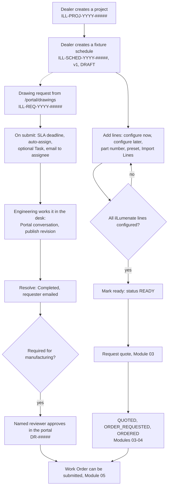
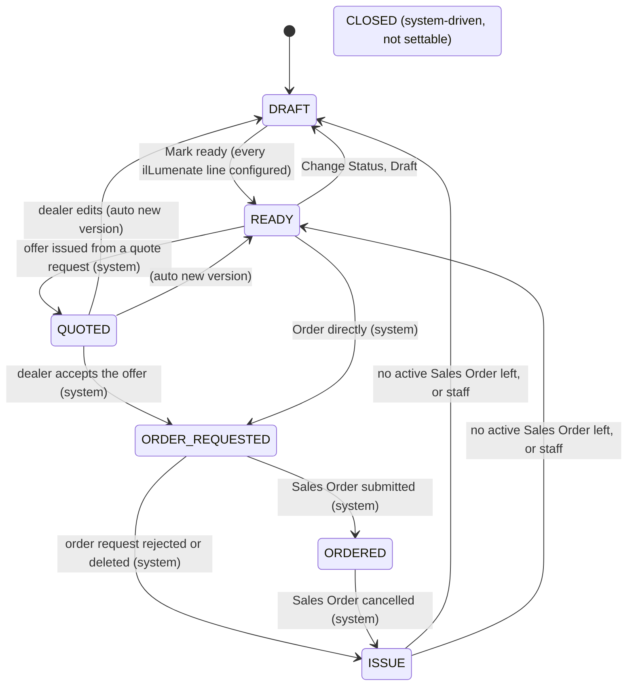
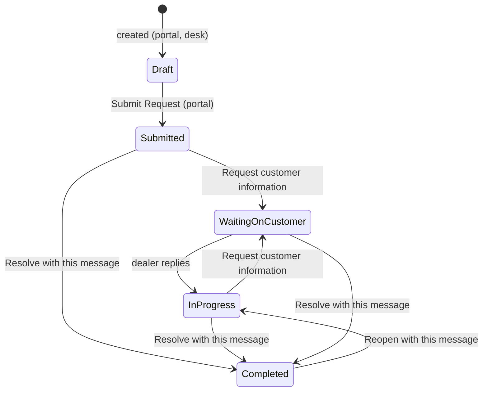

# Module 02: Design, tickets & tasks

**Audience:** sales, applications engineering, support, owner. **Length:** 2 × 75 minutes (session 1: Design, Lessons 2.1-2.8; session 2: Tickets, tasks and meetings, Lessons 2.9-2.13).
**Roles used:** ilL Sales Review, ilL Engineering, ilL Applications Engineer, ilL Support, ilL Operations, Command Center Viewer / Editor, System Manager (setup only), Dealer (portal views).
**People (decision 8):** Kevin and Jay produce drawings and review system designs (ilL Engineering + ilL Applications Engineer). Kevin Schern is the systems administrator. Jay is the Helpdesk agent who clears the Inbox.

## Purpose

Trainees learn where design work starts (a dealer's project and fixture schedule), how drawing requests move from the portal to a finished, approved drawing inside their SLA, why a drawing can hold a work order, how the System Designer and spec submittals fit in, and how Helpdesk tickets, tasks and the weekly meeting agenda keep every job owned and linked.

By the end, a trainee can:

1. Read a schedule's status, version and lock, and say what moves it next.
2. Work a drawing request from Submitted to Completed using the Portal conversation panel, and publish a revision.
3. Explain the SLA clock (weekday hours, company holidays skipped) and where its hours are set.
4. Release a manufacturing drawing hold, or explain why it cannot be released yet.
5. Clear the Inbox: route, link and reply.
6. Find every task that design work created, and run the weekly meeting from the Agenda tab.

## Where to go

| What | Where | Who |
|---|---|---|
| Design board | `/command-center#design` | Command Center Viewer (read), Editor (reassign, to-dos) |
| One schedule's drill-down | `/command-center#design/<schedule>` | same |
| Help desk triage (Inbox) | `/command-center#inbox` | same; replies need a Helpdesk agent |
| Master task list | `/command-center#tasks` | same |
| Projects & tasks tab | `/command-center#work` | same |
| Tuesday project review | `/command-center#review` | same |
| Weekly meeting agenda | `/command-center#agenda` | Viewer reads, Editor changes |
| Projects (desk) | `/app/ill-project` | staff |
| Fixture schedules (desk) | `/app/ill-project-fixture-schedule` | staff |
| Drawing / document requests | `/app/ill-document-request` | ilL Engineering; ilL Applications Engineer (System Design Review only); ilL Operations (manufacturing ones, read-only) |
| Drawing reviews (read-only) | `/app/ill-drawing-review` | System Manager |
| Request types (setup) | `/app/ill-request-type` | System Manager |
| Staff queues | `/app/ill-portal-operations` | each queue shows only to the roles that work it |
| Submittal readiness | `/app/submittal-readiness` | engineering, catalog |
| System Designer settings | `/app/ill-system-designer-settings` | System Manager |
| Helpdesk agent app | `/helpdesk/tickets` | Helpdesk agents |
| Ticket types, saved replies, teams | `/app/hd-ticket-type`, `/app/hd-saved-reply`, `/app/hd-team` | System Manager |
| Dealer side | `/portal/projects`, `/portal/projects/<project>`, `/portal/projects/<project>/collaborators`, `/portal/schedules/<schedule>`, `/portal/drawings`, `/portal/drawings/<request>`, `/portal/schedules/<schedule>/design` | Dealer |

## Process map: one job through design

1. The dealer (or staff) creates a **project** on the portal, then a **fixture schedule** under it. The schedule starts as version 1 in DRAFT.
2. Lines are added and configured. Any ilLumenate line still unconfigured blocks READY.
3. **Mark ready** sets READY. The Design board moves the card to "Ready for quote".
4. Drawings run in parallel: the dealer files a **drawing request**; on submit the SLA clock starts, the request is assigned, an optional Task is created and the assignee is emailed.
5. Engineering works the request in the desk, publishes a revision, and resolves it (Completed). The requester is emailed.
6. If the request is marked **required for manufacturing**, the named technical reviewer must approve the current revision in the portal before any work order for that order can be submitted.
7. The schedule moves on to Quotes (Module 03) and Sales orders (Module 04). The Design board stops showing it once a quote request is open.

---

## Part A: Design

### Lesson 2.1: Projects and fixture schedules, the spine of every job

**Objective:** explain how a project and its fixture schedule carry a job from design to order.

- **Project** (`ILL-PROJ-YYYY-#####`): customer (the dealer company), end client, architect, lighting designer, general contractor, project manager, collaborators. Status ACTIVE / ON_HOLD / COMPLETED / ARCHIVED (portal labels: Active, On hold, Completed, Archived).
  - Public projects are visible to everyone at the dealer company. **Private** projects only to the owner and active collaborators.
  - External collaborators (designers, GCs) get Website User access, VIEW or EDIT, per project. The portal page says: "For architects, designers and anyone outside your company. They get an email with a one-use link."
- **Fixture schedule** (`ILL-SCHED-YYYY-#####`): the list of lines for a project. It has a version, a lock, and a status.
- **Status path:** DRAFT → READY → QUOTED → ORDER_REQUESTED → ORDERED. Exceptions: ISSUE, CLOSED.
- **Portal progress bar** on every schedule: 1. Build · 2. Ready · 3. Quote requested · 4. Quoted · 5. Order requested · 6. Ordered. A READY schedule with an open quote request shows step 3.

#### Schedule status lifecycle

| Status | Portal label and badge | What moves a record into it | Who can move it | What it unlocks |
|---|---|---|---|---|
| DRAFT | Draft (yellow), "Being configured" | New schedule; Change Status → Draft; leaving QUOTED; ISSUE recovery | Dealer or staff with write access | Add Line, Import Lines, editing |
| READY | Ready (blue), "Ready for quote or order" | **Mark ready**, or Change Status → Ready. Blocked while any ilLumenate line is unconfigured | Dealer or staff | Request quote; Order directly (if the dealer may order); desk **Actions → Request Quote for Dealer**, **Convert to Sales Order** |
| QUOTED | Quoted, "Quote provided" | System, when a portal offer is issued (Module 03) | System only | Review quote; Convert to Sales Order (desk) |
| ORDER_REQUESTED | Order Requested, "Order request submitted and awaiting approval by ilLumenate" | System, when the dealer accepts an offer or orders directly | System only | "View order request" link |
| ORDERED | Ordered (green), "Order approved" | System, on Sales Order submit | System only | "This schedule has been ordered. View order" |
| ISSUE | Issue (red), "Please contact sales@illumenate.lighting" | System, on SO cancel or a deleted/rejected order request | Dealer back to DRAFT/READY once no active Sales Order remains; staff any time | "Return to draft" |
| CLOSED | Closed (grey) | System-driven | Not settable from the portal | nothing |

- **Versions:** leaving QUOTED automatically makes a new version (version note "Auto-versioned: leaving QUOTED to continue editing"). The quoted copy is locked and its issued offer is marked superseded. **Create New Version** (portal "..." menu) does the same by hand: it locks the current version (Is Locked, Locked At, Locked By), copies every line and collaborator into version N+1 in DRAFT, and points **Version Parent** at version 1. A locked version can't be edited or converted, and the portal shows "This is Version 1 (locked). You can view and export but not modify. Create a new version to make changes."
- Desk users see the yellow dashboard note "**Note:** N line(s) have pending fixture configuration: L1-3, ..." on any schedule with unconfigured lines, and an orange headline "Quote ... is open for the customer until .... Changing this schedule will invalidate it." while an issued offer exists.

> **SS-02-01** · (pair) Dealer portal: project list, then one project page
> **URL:** `/portal/projects` and `/portal/projects/<project>` · **Role:** Dealer (training.dealer) · **State:** at least one project with a schedule
> **Highlight:** schedules on the project; Collaborators button

*Captured (SS-02-01-a, SS-02-01-b).* What you see:
- **a:** the portal top nav (Overview, Projects, Quotes, Orders, Drawings, Products, Resources, Support, Account); the "Dealer portal / Projects" banner with **+ Create Project**; filters "Project or customer", Show = Active, Sort by = Recent activity, **Find projects**; one project row with end client and company chip, Schedules 1, Last activity, an **Ordered** badge and **Archive**.
- **b:** the project page: **Edit**, **Collaborators**, **Archive**; "End client:" and an **Active** badge; tabs Fixture Schedules / Files / Photos; **+ Create Schedule**; "Main Schedule v1 · 23 line(s)" with an **Ordered** badge, edit and delete icons.

> **SS-02-02** · Dealer portal schedule page with lines
> **URL:** `/portal/schedules/<schedule>` · **Role:** Dealer · **State:** DRAFT or READY schedule, 6+ lines across families
> **Highlight:** progress bar; Add Line; Import Lines; Mark ready; the "..." menu (Create New Version, Change Status); stat tiles

*Captured.* What you see:
- The breadcrumb Projects › Beth Residence › TRAINING DEMO Schedule and the six-step bar with **1. Build** current.
- **+ Add Line**, **Import Lines**, **Mark ready**, and the "..." (More schedule actions) button.
- "v1", "Project: Beth Residence", a **Draft** badge and **Show Dealer Pricing**.
- Tiles: 23 Total Lines, 24 Total Qty, 12 ilLumenate Fixtures, 0 Other Fixtures; the "Stock availability unavailable" note.
- The Fixture Lines table header: Fixture Type, Type, Qty, Location, Fixture Details, Unit Price, Line Total, Actions; "Filter lines (press /)" and **Shortcuts**.

> **SS-02-03** · Desk fixture schedule form
> **URL:** `/app/ill-project-fixture-schedule/<schedule>` · **Role:** ilL Sales Review (training.lead) · **State:** DRAFT schedule with unconfigured lines
> **Highlight:** Status, Version, Is Locked; toolbar menus Collaborators, Support, Open in portal, CAD; the pending-configuration note

*Captured.* What you see:
- Title ILL-SCHED-2026-00144 with a **DRAFT** indicator; toolbar **Collaborators**, **Support**, **Open in portal**, **CAD**, "...", **Save**.
- The yellow note "Note: 5 line(s) have pending fixture configuration: L1-3, L2-2, L3-1, L3-1, L3-2".
- The Support section with an "HD Ticket" connection and +.
- Schedule Name, Customer, ilL Project, Status = DRAFT, Sales Order (help text "Sales Order created from this schedule. Draft = order request awaiting approval; submitted = ordered.").
- Versioning: Version 1, Version Parent, Is Locked (unticked), Version Notes; collapsed Privacy; Notes.
- No **Actions** menu: it appears only on unlocked DRAFT/READY schedules for sales roles (Request Quote for Dealer) and on READY/QUOTED (Convert to Sales Order). See SS-02-41.

> **SS-02-04** · "Cannot Set Status to Ready" dialog listing unconfigured lines
> **URL:** desk schedule form · **Role:** ilL Sales Review · **State:** a DRAFT schedule with one or more unconfigured lines; set Status = READY and press Save

*Captured.* What you see:
- The red-dot dialog title **Cannot Set Status to Ready**.
- The message "The following lines are not fully configured: L1-3, L2-2, L3-1, L3-1, L3-2. Please configure all ilLumenate fixtures before setting status to Ready."
- Behind it: "Not Saved", Status = READY, and the version already locked (Locked At, Locked By training.lead).

> **SS-02-05** · (pair) Create New Version: before (v1 unlocked) and after (v1 locked)
> **URL:** desk schedule form (version is created from the portal "..." menu) · **Role:** ilL Sales Review

*Captured (SS-02-05-a, SS-02-05-b).* What you see:
- **a:** Versioning section with Version 1, empty Version Parent, **Is Locked** unticked, empty Version Notes.
- **b:** the same schedule after Create New Version: **Is Locked** ticked, **Locked At** 11-23-2026 05:05:11 (America/Los_Angeles), **Locked By** training.lead@example.com. The new v2 (ILL-SCHED-2026-00145) is a separate record; see SS-02-43.

> **SS-02-34** · Portal "Create Project" form, filled but not saved
> **URL:** `/portal/projects` → **+ Create Project** · **Role:** Dealer · **State:** dialog open; do not save
> **Highlight:** project name; end client; private toggle

> **SS-02-35** · Project collaborators page
> **URL:** `/portal/projects/<project>/collaborators` · **Role:** Dealer · **State:** project with at least one collaborator, Add Collaborator form open (do not submit: it emails an invitation)
> **Highlight:** Access level (Can view but not edit / Can view and edit the project); "Company Visible"; Add Collaborator

> **SS-02-36** · Desk project form
> **URL:** `/app/ill-project/<project>` · **Role:** ilL Sales Review · **State:** ILL-PROJ-2026-00118
> **Highlight:** Status; Owner Company; Project Contacts (Architect, Lighting Designer, General Contractor); Privacy & Access (Is Private, Collaborators table); Support → Link Helpdesk Tickets

> **SS-02-37** · Portal schedule header at phone width (phone)
> **URL:** `/portal/schedules/<schedule>` · **Role:** Dealer · **State:** DRAFT schedule; 390×844
> **Highlight:** the progress steps wrapping; Mark ready; the "..." menu button

> **SS-02-38** · Portal "..." menu open
> **URL:** `/portal/schedules/<v2 schedule>` · **Role:** Dealer · **State:** unlocked DRAFT schedule (ILL-SCHED-2026-00145); menu open, nothing clicked
> **Highlight:** Create New Version; Change Status header; Ready "Ready for quote/order"

> **SS-02-39** · Locked-version banner on the portal
> **URL:** `/portal/schedules/ILL-SCHED-2026-00144` · **Role:** Dealer · **State:** the locked v1
> **Highlight:** the "Locked" badge next to v1; the yellow "This is Version 1 (locked)..." banner; no Add Line button

> **SS-02-40** · Desk schedule list by status
> **URL:** `/app/ill-project-fixture-schedule?status=READY` · **Role:** ilL Sales Review · **State:** at least 3 READY schedules
> **Highlight:** the Status filter chip; the sidebar "Assigned To" / group-by counts; the Version column

> **SS-02-41** · Desk Actions menu on a READY schedule
> **URL:** `/app/ill-project-fixture-schedule/<READY schedule>` · **Role:** ilL Sales Review · **State:** an unlocked READY schedule; Actions menu open, nothing clicked
> **Highlight:** Request Quote for Dealer; Convert to Sales Order

> **SS-02-42** · "Request Quote for Dealer" dialog
> **URL:** same as SS-02-41 → Actions → Request Quote for Dealer · **Role:** ilL Sales Review · **State:** dialog filled, then **Cancel** (Create Quote Request starts the quote flow)
> **Highlight:** "What the dealer asked for" (up to 4,000 characters, the dealer can read it); Contact instructions; Quote needed by; Create Quote Request

> **SS-02-43** · Version 2 in the desk
> **URL:** `/app/ill-project-fixture-schedule/ILL-SCHED-2026-00145` · **Role:** ilL Sales Review
> **Highlight:** Version 2; Version Parent = ILL-SCHED-2026-00144; Is Locked unticked; Status DRAFT

> **DATA-02-01** · A real schedule that has reached ORDERED, with its project, for the end-to-end example used across Modules 02-06
> **API:** `GET /api/resource/ilL-Project-Fixture-Schedule?filters=[["status","=","ORDERED"]]&fields=["name","ill_project","customer","version","sales_order","modified"]&order_by=modified desc&limit_page_length=5`
> **Use:** pick one with a submitted SO, a delivery note and a tracking number. This is "our job" for every later module. Redact the dealer name.

> **DATA-02-02** · Count of schedules by status (pipeline snapshot)
> **API:** `GET /api/resource/ilL-Project-Fixture-Schedule?fields=["status",{"COUNT":"*","as":"n"}]&group_by=status`
> **Use:** staging on 24 Nov 2026 returned DRAFT 119, READY 9, QUOTED 5, ORDERED 6, CLOSED 1. The older `count(name) as n` string form is refused by this Frappe version ("SQL functions are not allowed as strings in SELECT").

#### Field reference: ilL-Project (desk labels as deployed)

| Field (label) | Meaning | Who fills it | Required | Flows to |
|---|---|---|---|---|
| Series | `ILL-PROJ-.YYYY.-.#####` | system | yes | the project ID |
| Project Name | Name the dealer uses | dealer or staff | yes | portal lists, Design board cards, ticket pills |
| Customer | The dealer company | dealer (own company) or staff | yes | copied to every schedule |
| End Client | The building owner (an ilL-Project-Party) | dealer | no | Sales Order remarks "End-Client: ..." |
| Status | ACTIVE / ON_HOLD / COMPLETED / ARCHIVED | dealer (Archive) or staff | no | Design board "Active projects" stat |
| Owner Company | Company that owns the project for access checks | system | no | portal access, drawing request customer check |
| Estimated Start Date, Location | Job facts | dealer | no | drill-down Project card |
| Project Manager | A Contact | dealer | no | |
| Architect, Lighting Designer, General Contractor | Project parties | dealer | no | Design board card "Architect: ... · Lighting designer: ... · GC: ..." |
| Is Private | Hide from the rest of the dealer company | dealer | no | portal access |
| Collaborators (User, Access Level VIEW/EDIT, Is Active, Added On) | People outside the company, or named users | dealer | no | portal access |
| ERP Project | Optional link to an ERPNext Project | staff | no | drill-down "ERPNext project" |

#### Field reference: ilL-Project-Fixture-Schedule

| Field (label) | Meaning | Who fills it | Required | Flows to |
|---|---|---|---|---|
| Schedule Name | e.g. "Main Schedule" | dealer or staff | yes | everywhere the schedule shows |
| ilL Project | Parent project | dealer or staff | yes | Customer is re-synced from it on every save |
| Customer | Dealer company | system (from project) | yes | quote, order |
| Status | DRAFT ... CLOSED (table above) | dealer, staff, system | no | Design board column; progress bar |
| Sales Order | Order created from this schedule (read-only) | system | no | "Where it is" chip; status ORDERED |
| Status Note | Why the schedule is in ISSUE (read-only) | system | no | portal red banner |
| Version, Version Parent, Is Locked, Locked At, Locked By | Versioning (all read-only) | system | no | lock banner; Create New Version |
| Version Notes | What changed in this version | person creating the version | no | Version History |
| Inherits Project Privacy, Is Private | Privacy | dealer | no | portal access |
| Notes | Free notes | dealer or staff | no | |
| Lines | One row per fixture line (66 fields; configured on the portal or with the desk configurator) | dealer or staff | no | quote and order lines |
| Collaborators (User, Role Viewer/Editor/Admin) | Schedule-level access | dealer | no | portal access |
| ERP Project | Optional ERPNext Project | staff | no | |

---

### Lesson 2.2: Adding and configuring lines

**Objective:** add lines to a schedule the way a dealer does, and the way staff do from the desk.

- **Dealer portal:** **+ Add Line** opens "Add Fixture Line": Fixture Type, Quantity, Manufacturer Type, Location, then "ilLumenate Product Selection" (category → template card → **Add** to configure later, or **Configure** now). Lines then show **Configure** / **Edit Config**.
- Other ways in, all inside the same dialog: "Recently used" cards, **Add by part number** ("Paste a fixture part number to open the configurator with its options."), "Start from a saved preset", and **Import Lines** on the schedule header.
- **Import Lines:** "Upload a CSV or Excel (.xlsx) sheet of up to 500 lines. ilLumenate lines are added as Unconfigured, so configure them before submitting. Nothing is added until you import." A preview lists Row, Type, Qty, Location, Status, Details, with "Skip the rows with errors". The button shows only on an unlocked DRAFT or READY schedule (site flag `ill_portal_schedule_import`, on by default).
- Line families: Linear fixture, LED tape / COB tape / LED neon, LED sheet, extrusion kit, power supply / driver, accessory, other manufacturer.
- Row actions in the Fixture Lines table: **Specifications**, **Edit**, **Duplicate**, **Copy to...**, **Delete**. Also bulk edit, **Compare two lines** (First line / Second line → Compare), 10-second Undo, and a "Catalog updated – review" badge.
- The configurator page has a **Schedule Target** box (Project, Fixture Schedule, Fixture Type), **Multi-Segment Coordinator**, **Guided Wizard**, **Change product type**, **Save as preset**, and a Results panel that reads "Not Calculated" until **Calculate & Validate**.
- **Staff (desk):** the Configure & Add Fixture dialog on Quotation and Sales Order (Module 03, Lesson 3.3) writes the schedule line too. On the schedule form, extrusion kits use "Configure Extrusion Kit: <template>" → **Configure & Add to Schedule**.
- A physical change to a line that already has a published drawing creates a **drawing reapproval** task automatically (Lesson 2.5).

> **SS-02-06** · Add Fixture Line: category chooser and template cards
> **URL:** `/portal/schedules/<schedule>` → **+ Add Line** · **Role:** Dealer · **State:** dialog open on an unlocked DRAFT schedule
> **Highlight:** Fixture Type, Quantity, Manufacturer Type, Location; product categories; template cards

*Captured, but recapture needed:* the stored image shows the schedule header (same as SS-02-02), not the open dialog. What you see:
- **+ Add Line** (the button to press), **Import Lines**, **Mark ready**, and the stat tiles.

> **SS-02-07** · Linear configurator mid-configuration
> **URL:** `/portal/configure?category=...` · **Role:** Dealer · **Highlight:** the "Estimate — confirmed on your quote" panel

*Captured (start of configuration).* What you see:
- **Change product type** and **Save as preset** at the top; breadcrumb Projects › Configure Fixture.
- **Multi-Segment Coordinator** and **Guided Wizard**.
- Schedule Target: Project, Fixture Schedule, Fixture Type selects.
- Product Category chips: **Linear Fixture** (selected), LED Tape, COB Tape, LED Neon, LED Sheets; Fixture Template search with "44 templates" and template cards.
- Results panel "Not Calculated": "Configure segments and click 'Calculate & Validate' to see results". The estimate panel is not yet shown; recapture mid-configuration for the highlight.

> **SS-02-08** · Tape configurator steps (Environment → CCT → Output → Feed → Lead → Length)
> **URL:** `/portal/configure-tape` · **Role:** Dealer

*Captured (first step).* What you see:
- Breadcrumb Projects › Configure LED Tape; the same Schedule Target box.
- Product Category with **LED Tape** selected; Product Family search "7 templates".
- Family cards: High Density Color Changing LED Tape (led-hd-cc), High Density Dim to Warm LED Tape (led-hd-dw), High Density Static White LED Tape (led-hd-sw), and a fourth static white family.
- Results "Not Calculated". The later steps are not in this image.

> **SS-02-09** · Import Lines dialog (CSV/XLSX)
> **URL:** `/portal/schedules/ILL-SCHED-2026-00145` → **Import Lines** · **Role:** Dealer · **State:** unlocked DRAFT schedule; upload a sample sheet, stop at the preview (do not press Import)

*Not yet captured: the first attempt used a schedule that was not DRAFT/READY. SS-02-02 shows the button on a DRAFT schedule, so it is capturable now.*

> **SS-02-44** · Unconfigured-lines banner and disabled Mark ready
> **URL:** `/portal/schedules/<schedule>` · **Role:** Dealer · **State:** DRAFT schedule with unconfigured lines
> **Highlight:** "Unconfigured lines: N" with "Go to the first one"; the grey reason "Configure these lines first: ..." under Mark ready

> **SS-02-45** · Add Fixture Line: part number and preset
> **URL:** portal schedule → **+ Add Line** · **Role:** Dealer · **State:** dialog scrolled to the lower half
> **Highlight:** Recently used; Add by part number + Configure; Start from a saved preset

> **SS-02-46** · Fixture Lines row actions
> **URL:** `/portal/schedules/<schedule>` · **Role:** Dealer · **State:** a configured line and a power supply line visible
> **Highlight:** Specifications, Edit, Duplicate, Copy to..., Delete; the green part-number link; "Power Supplies: Own line below"

> **SS-02-47** · Compare two lines, after Compare
> **URL:** portal schedule, Compare two lines card · **Role:** Dealer · **State:** two different lines chosen, Compare pressed
> **Highlight:** the differences between the two lines

> **SS-02-48** · Import Lines preview with an error row
> **URL:** `/portal/schedules/ILL-SCHED-2026-00145` → Import Lines · **Role:** Dealer · **State:** a sheet with one bad row; preview shown, Import not pressed
> **Highlight:** the Status and Details columns; "Skip the rows with errors"

---

### Lesson 2.3: The Command Center Design board

**Objective:** use `#design` to see every schedule in design and act on the stuck ones.

- The Design step sits second in the pipeline stepper: Overview → **Design** → Quotes → Sales orders → Purchasing → Manufacturing → Shipping → Service. A schedule leaves Design as soon as it is QUOTED, has an active quote request or an issued/accepted offer (→ Quotes), or has an order request, a Sales Order or status ORDER_REQUESTED/ORDERED (→ Sales orders).
- "In ERPNext:" chips link to Projects, Fixture schedules, Drawing requests, Drawing reviews and Help desk.
- **Stat tiles:** Active projects (and "N on hold"), Schedules in design ("N drafting · N ready for quote"), Open drawing requests ("N waiting on customer"), Drawings past SLA ("Submitted or in progress"; red when above zero).
- **Kanban columns** (first match wins):

| Column | Subtitle on the board | Rule in the code |
|---|---|---|
| Drawing in progress | Open drawing request on our side | any open request (Draft, Submitted, In Progress) not waiting on the customer |
| Waiting on customer | We asked the dealer for something | every open request is Waiting on Customer |
| Review | Changes requested, issue, or just delivered | schedule in ISSUE, last review CHANGES_REQUESTED, or a Completed request with no review yet |
| Ready for quote | Ready, no quote request yet | status READY |
| Drafting | Dealer is building the schedule | everything else |

- **Cards** show the status badge, age (red when an open request is older than 2 business days), schedule name, project · dealer, architect / lighting designer / GC, location, "v1 · N lines" (plus "locked"), a "Drawing ILL-REQ-... · status" chip (with **past SLA** in red when the deadline date has passed), "Review <rev>: <decision>", the drawing owner's avatar (or "No drawing owner") and a ticket pill.
- **Drawing & document requests** table below: Request, Dealer, Schedule / project, Status (plus priority and "Needed for manufacturing"), Assigned, SLA / due, Age, and row buttons **Reassign** (open requests, Editor only), **Details**, **+ To-do**, ↗. Requests tied to a sales order are listed on Sales orders instead. "Red age = open more than 2 business days."
- **Design tickets:** Design-type help desk tickets from sales@.
- **Drill-down `#design/<schedule>`:** "← Design", the header line (ID · dealer · status · version · lock), buttons **Now on <stage> →** (once it has moved on), **+ To-do**, **Details**, **Open in ERPNext**. Cards: Project; **Where it is** (Drawing requests, Quote requests, Offers, Order requests, Sales order, Tickets); **Drawing reviews** ("Dealer decisions on delivered drawings"); Fixture schedule lines (read-only: Line, Qty, Location, Product, Configured, Status); the schedule's drawing requests.

> **SS-02-10** · Design board, full page
> **URL:** `/command-center#design` · **Role:** Command Center Editor (training.lead)
> **Highlight:** the five columns; drawings past SLA stat; the requests table

*Captured.* What you see:
- The Command Center header (Meeting mode, **Refresh**, **+ Add task**) and tabs: Sales pipeline, Executive, Inbox 57, Finance, Projects & tasks 700, Review, Agenda, Workbench, Catalog, Recommendations.
- The heading "Design" with "A schedule moves on to Quotes once the dealer asks for a quote." and the "In ERPNext:" chips.
- The stepper with **Design 126 · 0 drawings open** highlighted.
- Tiles: Active projects 115 (0 on hold), Schedules in design 126 (117 drafting · 9 ready for quote), Open drawing requests 0, Drawings past SLA 0.
- Columns Drafting 117, Ready for quote 9, Drawing in progress 0, Waiting on customer 0, Review 0 ("Nothing here"); cards with Draft/Ready badges, "v1 · 9 lines" and "No drawing owner".

> **SS-02-11** · Schedule drill-down
> **URL:** `/command-center#design/<schedule>` · **Role:** Command Center Editor · **Highlight:** "Where it is" chips; + To-do; Open in ERPNext

*Captured.* What you see:
- "← Design", "Main Schedule", "ILL-SCHED-2026-00143 · Jeremy Test Integrations · Ordered · v1".
- **Now on Sales orders →**, **+ To-do**, **Details**, **Open in ERPNext**.
- Project card (Beth Residence, dealer, ACTIVE); Where it is: Order requests OI-00209 **Approved**, Sales order linked, the rest "—"; Drawing reviews "No reviews yet".
- "Fixture schedule lines · 23 lines · read-only here" with Line, Qty, Location, Product, Configured, Status (**Configured** badges).

> **SS-02-49** · Design board card close-up with a drawing chip
> **URL:** `/command-center#design` · **Role:** Editor · **State:** a schedule with an open drawing request assigned to someone (Drawing in progress column)
> **Highlight:** the "Drawing ILL-REQ-... · Submitted" chip; the owner avatar; the red age badge

> **SS-02-50** · Drawing & document requests table
> **URL:** `/command-center#design`, scrolled to the table · **Role:** Editor · **State:** at least one open request
> **Highlight:** SLA / due column; Assigned; Reassign; + To-do

> **SS-02-51** · Design tickets section
> **URL:** `/command-center#design`, bottom of the page · **Role:** Editor · **State:** at least one ticket of type Design
> **Highlight:** the ticket lanes; the Design type

> **SS-02-52** · "Add a to-do" sheet from the drill-down
> **URL:** `/command-center#design/<schedule>` → **+ To-do** · **Role:** Editor · **State:** sheet filled; close it without pressing Add to-do
> **Highlight:** To-do, Owners chips, Due, Priority, Notes

> **SS-02-53** · Details side sheet for a schedule
> **URL:** `/command-center#design/<schedule>` → **Details** · **Role:** Editor
> **Highlight:** editable fields; + Add to agenda; Open in ERPNext

> **SS-02-54** · Design board as a Viewer
> **URL:** `/command-center#design` · **Role:** Command Center Viewer only (training.viewer)
> **Highlight:** no Reassign buttons in the requests table (compare with SS-02-50)

---

### Lesson 2.4: Drawing and document requests

**Objective:** take a drawing request from submitted to completed inside its SLA.

- Record: `ilL-Document-Request` (`ILL-REQ-YYYY-#####`). Priority Normal / High / Rush. On the portal the choices read "Normal", "High - Needed within 2 business days" and "Rush - Timing subject to review".
- **Request types on staging (24 Nov 2026):** IES File (Resource), Installation (Technical), Shop Drawing (Drawing), Spec Sheet (Resource), all at 72 / 48 / 24 hours with no default assignee; and System Design Review (Technical, 16 / 8 / 4, default role ilL Applications Engineer). System Design Review never shows on the portal form; the System Designer files it. Decision 4 sets the production list (six types plus System Design Review) with their own hours and owners.
- **The portal form** ("Request New Drawing"): Request Type cards, Project / Reference, Fixture / Product, Description (required), priority and Needed By when the type shows them, custom fields defined on the type, and attachments ("Upload reference files, markups, or existing drawings"). **Submit Request** creates the request and submits it in one go; if submit fails the request is kept as a draft ("Request saved as draft"). Tabs: Pending, Completed, All Requests.

#### Drawing request lifecycle

| Status | What moves it here | Who | What happens | Portal group |
|---|---|---|---|---|
| Draft | Created | dealer (portal) or staff | nothing; still counts as an open request on the Design board | Pending |
| Submitted | **Submit Request** on the portal | the requester | SLA deadline set, auto-assigned, optional Task, assignee emailed "New Document Request: ILL-REQ-..." | Pending |
| In Progress | the dealer replies while Waiting on Customer, or staff **Reopen with this message** | dealer or assigned staff | Next Action By = Staff | Pending |
| Waiting on Customer | staff **Request customer information** | assigned engineering staff | Next Action By = Customer; dealer emailed "New reply on your drawing request ..." | Pending |
| Completed | staff **Resolve with this message** | assigned engineering staff | Completed On stamped; requester emailed "Your Request ILL-REQ-... is Complete" | Completed |
| Closed, Cancelled | not set by any desk or portal button today (Status is read-only; confirm on capture) | | | Completed |

- **On submit:** SLA deadline from the request type (defaults 72 / 48 / 24 hours by priority if the type leaves them blank). Auto-assign: the type's **Default Assignee User**, else the enabled staff user in its **Default Assignee Role** with the fewest open requests. Optional Task (type has **Auto Create Task**): subject "<Portal Label>: ILL-REQ-...", due on the SLA date, in the type's **Task Project**, with a ToDo for the assignee. The assignee gets "New Document Request: ILL-REQ-..." (if they keep drawing emails on).
- **The SLA clock (weekday_hours.py):** the hours count around the clock on weekdays only. Saturdays, Sundays and every date on the default company's **Default Holiday List** are skipped; a request submitted on a day off starts counting at 00:00 on the next working day. So 24 hours = one weekday, not three working days. Examples: Friday 16:00 + 24 h = Monday 16:00 (Tuesday 16:00 if Monday is a holiday); Wednesday 10:00 + 72 h = Monday 10:00.
  - **Staging check:** the company "ilLumenate Lighting" has no Default Holiday List on staging, so only weekends are skipped there. Set the list on production before go-live (confirm on production).
- **Working it:** in the desk, the **Portal conversation** panel sits on the form (the same thread the dealer sees). It has "Your message", "Attachments: PDF, JPEG, PNG or HEIC, up to 20 MiB each" (10 files per message), **Visibility** ("Internal note (staff only)", the default, or "Message to the dealer"), and **Action** (Reply, Request customer information, Resolve with this message, Reopen with this message). With Internal visibility the button reads **Save internal note** and the action is locked to Reply; with "Message to the dealer" a gold banner says "The dealer will see this message." and the button becomes **Send to dealer**. Internal messages carry a "Staff only" tag.
- **Publishing a deliverable:** in the Deliverables table, attach a private file to the saved request, give it a **Version** (revision), tick **Published to Portal**, and save. Published On, Published By, the build hash and the file's SHA-256 are stamped. Published rows can't be changed; publish a new revision. The publish API also emails the requester "New File Available: ILL-REQ-..."; a tick-and-save on the desk form does not send that email (confirm on capture).
- **On complete:** requester emailed "Your Request ILL-REQ-... is Complete" with a "View and download" link to `/portal/drawings/<request>`.
- Staff fields: Assigned To, Named Technical Reviewer, **Drawing Approval Required for Manufacturing**, Related Sales Order / Fixture Schedule binding, Hide from Portal, Internal Notes.
- **Desk list indicators:** "Waiting on staff" (orange), "Waiting on customer" (blue), "No action needed" (grey), or the finished status.
- **Setup:** request types live at `/app/ill-request-type`. With no active type the portal says "Drawing requests are not available right now. Contact sales@illumenate.lighting." (decision 4).

> **SS-02-12** · Dealer: new drawing request form
> **URL:** `/portal/drawings` · **Role:** Dealer · **Highlight:** type-driven fields; priority "High - Needed within 2 business days"

*Captured.* What you see:
- The Drawings tab active; "Drawing Requests · Request custom drawings and track their status".
- "Request New Drawing" with Request Type cards **IES File** (selected), Installation, Shop Drawing, Spec Sheet.
- Project / Reference (search and "Select project..."), Fixture / Product ("e.g., LS-48 Linear, Quote #12345"), Description (required).
- Right side: tabs Pending, Completed, All Requests; the empty state "No pending requests · All your drawing requests have been completed!". The priority select is below the fold.

> **SS-02-13** · Desk document request with the Portal conversation panel
> **URL:** `/app/ill-document-request/<name>` · **Role:** ilL Engineering (training.lead)
> **Highlight:** SLA Deadline; Assigned To; Drawing Approval Required for Manufacturing; the conversation panel's Action and Visibility; Staff only tag

*Captured (top of the form).* What you see:
- ILL-REQ-2026-00001 with the orange **Waiting on staff** indicator; **Open in portal**.
- Next Action By = Staff; Drawing Review = Awaiting drawing; Engineering Review Task (empty); Related Sales Order; Fixture Schedule = ILL-SCHED-2026-00143; Named Technical Reviewer; the **Drawing Approval Required for Manufacturing** checkbox.
- Request Type = Shop Drawing; Status = Draft; Priority = Normal; Requester; Created from Portal.
- Reference: Project, Reference DocType, Fixture/Product, Item. The conversation panel and Internal Tracking are below the fold (SS-02-57, SS-02-58).

> **SS-02-14** · Request type setup form
> **URL:** `/app/ill-request-type/<name>` · **Role:** System Manager (Administrator) · **Highlight:** SLA hours per priority; default assignee role / user; Auto Create Task

*Captured (System Design Review).* What you see:
- SLA Hours (Normal) 16, SLA Hours (High) 8, SLA Hours (Rush) 4, each with its help text.
- "Role to assign requests to by default", Default Assignee User ("Specific user to assign requests to (overrides role)"), **Auto Create Task** unticked.
- Standard Form Fields: Show Project Field, Show Reference Field, Show Priority Field ticked; Show Requested Due Date Field, Show Fixture/Product Field, Show Item Lookup Field unticked.
- Custom Fields table (No., Field Key, Label, Field Type, Mandatory) with "No rows" and **Add row**.

> **SS-02-15** · Dealer: drawing request detail with status timeline and Download Latest
> **URL:** `/portal/drawings/<request>` · **Role:** Dealer · **State:** a submitted request with a published deliverable

*Not yet captured: the test drawing request is a Draft; dealers only see submitted requests. Submitting it emails the assignee.*

> **SS-02-55** · Portal priority choices
> **URL:** `/portal/drawings` · **Role:** Dealer · **State:** Shop Drawing selected; Priority select open
> **Highlight:** Normal; High - Needed within 2 business days; Rush - Timing subject to review

> **SS-02-56** · Portal "All Requests" tab
> **URL:** `/portal/drawings` → All Requests · **Role:** Dealer · **State:** at least one request for the dealer's company
> **Highlight:** status badges; View Details

> **SS-02-57** · Desk drawing request list with indicators
> **URL:** `/app/ill-document-request` · **Role:** ilL Engineering · **State:** requests in more than one state
> **Highlight:** "Waiting on staff" / "Waiting on customer" / "No action needed" indicators; Request Type and Priority columns

> **SS-02-58** · (pair) Portal conversation panel: internal note vs message to the dealer
> **URL:** `/app/ill-document-request/ILL-REQ-2026-00001`, scrolled to Portal conversation · **Role:** ilL Engineering · **State:** **a:** Visibility "Internal note (staff only)" (button Save internal note); **b:** Visibility "Message to the dealer" (gold banner, button Send to dealer). Type a message but send nothing
> **Highlight:** Visibility; Action; the banner "The dealer will see this message."; the button label

> **SS-02-59** · Conversation Action menu open
> **URL:** same as SS-02-58 · **Role:** ilL Engineering · **State:** Visibility = Message to the dealer; Action select open
> **Highlight:** Reply; Request customer information; Resolve with this message; Reopen with this message

> **SS-02-60** · Internal Tracking and Deliverables sections
> **URL:** `/app/ill-document-request/<name>`, scrolled down · **Role:** ilL Engineering
> **Highlight:** Assigned To; SLA Deadline; Completed On; Linked Task; Deliverables table (Deliverable Type, File, Version, Published to Portal)

> **SS-02-61** · Request type list
> **URL:** `/app/ill-request-type` · **Role:** System Manager · **State:** the five staging types
> **Highlight:** Category; Is Active

> **SS-02-62** · Request type top section
> **URL:** `/app/ill-request-type/Shop Drawing` · **Role:** System Manager
> **Highlight:** Type Name, Category, Is Active, Portal Label, Portal Icon, Portal Description, Sort Order; Default Priority; Default Assignee Role (empty on staging)

> **SS-02-63** · Company Default Holiday List
> **URL:** `/app/company/ilLumenate Lighting` · **Role:** Administrator · **State:** as is (empty on staging)
> **Highlight:** the Default Holiday List field that the SLA clock reads

> **DATA-02-03** · Recent drawing requests with SLA outcome
> **API:** `GET /api/resource/ilL-Document-Request?filters=[["status","=","Completed"]]&fields=["name","request_type","priority","creation","sla_deadline","completed_on","assigned_to"]&order_by=completed_on desc&limit_page_length=20`
> **Use:** "average turnaround" and "on time vs SLA" (completed_on ≤ sla_deadline) slide. Staging has one Draft request and none Completed; pull from production read-only, or skip.

#### Field reference: ilL-Document-Request

| Field (label) | Meaning | Who fills it | Required | Flows to |
|---|---|---|---|---|
| Request Type | Which kind of request | requester | yes | SLA hours, assignee, task, portal fields |
| Status | Lifecycle above (read-only on the form) | system, conversation actions | no | Design board column, portal tabs |
| Priority | Normal / High / Rush | requester (default from the type) | no | SLA hours |
| Requester | User who filed it (read-only) | system | no | completion and reply emails |
| Created from Portal | Filed from `/portal/drawings` (read-only) | system | no | |
| Next Action By | Staff / Customer / None (read-only) | conversation actions, reviews | no | list indicator; "Waiting on you" in the portal |
| Drawing Review | Awaiting drawing / Awaiting approval / Changes requested / Approved / Reapproval required (read-only) | system | no | reapproval and hold queues |
| Engineering Review Task | Task created when the build changed (read-only) | system | no | Tasks page |
| Related Sales Order, Fixture Schedule | What the drawing covers | staff only | no | manufacturing hold; Design board |
| Named Technical Reviewer | Dealer-side person who approves | staff only | no | Approve drawing / Request changes in the portal |
| Drawing Approval Required for Manufacturing | Blocks work orders until approved | staff only; only System Manager may later waive or move it | no | Work Order submit check |
| Project, Reference DocType, Reference Document, Fixture/Product, Item | What it is about | requester | no | portal detail |
| Description | What is needed | requester | yes | Task description |
| Requested Due Date | When the dealer wants it | requester (if the type shows it) | no | requests table "Due" |
| Custom Field Values | Answers to the type's custom fields | requester | no | |
| Assigned To | Engineering owner | auto-assign, or staff (Reassign) | no | email, Design board avatar |
| Department | Optional | staff | no | |
| SLA Deadline | Due time (read-only) | system on submit | no | "past SLA", Drawings past SLA tile |
| Completed On | When resolved (read-only) | system | no | DATA-02-03 |
| Linked Task | Task from Auto Create Task (read-only) | system | no | Tasks page |
| Requester Contact, Requester Customer, Owner Customer | Whose request it is | system / staff | no | permission scope |
| Hide from Portal | Keep it staff-only | staff only | no | dealer can't see it |
| Deliverables | File, Version, Published to Portal, Notes, Deliverable Type | engineering | no | portal downloads, drawing review |
| Internal Notes | Staff notes | staff | no | |

#### Field reference: ilL-Request-Type

| Field (label) | Meaning | Default |
|---|---|---|
| Type Name | Unique name (also the record ID) | required |
| Category | Drawing / Resource / Technical / Other | Drawing |
| Is Active | Shows on the portal form | on |
| Portal Label, Portal Icon, Portal Description, Sort Order | How the card looks and its order | label = type name |
| Default Priority | Pre-selected priority | Normal |
| SLA Hours (Normal / High / Rush) | Weekday hours to the deadline | 72 / 48 / 24 |
| Default Assignee Role | Least-loaded enabled staff user in this role gets it | empty |
| Default Assignee User | Overrides the role | empty |
| Auto Create Task, Task Project | Create a Task on submit, in this ERPNext Project | off |
| Show Project / Reference / Fixture/Product / Item Lookup / Priority / Requested Due Date Field | Which standard fields the portal form shows | Project, Reference, Fixture, Priority on |
| Custom Fields | Extra portal fields: Field Key, Label, Field Type, Mandatory | none |

---

### Lesson 2.5: Drawing reviews and the manufacturing drawing hold

**Objective:** understand why a work order can be blocked by a drawing, and how to release it.

- The named **technical reviewer** (a dealer-side person with current project access) approves or requests changes **in the portal**: "Review the published drawing below. Your decision applies to this drawing revision and its associated build." → **Approve drawing** / **Request changes** (a note is required).
- A review (`DR-#####`) is tied to one revision, its file checksum and the build it shows. One decision per revision; to get another, publish a new revision.
- **Review states** on the request (Drawing Review field): Awaiting drawing (nothing published) → Awaiting approval → Approved, or Changes requested. **Reapproval required** when the build changed after publishing.
- **What triggers reapproval:** saving a fixture schedule or Sales Order whose physical build changed (dimensions, materials, feeds) while a drawing request covers it. The system creates a Task "Drawing reapproval: ILL-REQ-..." ("The physical build changed. Review the new dimensions, materials and feeds, publish a revised drawing, and obtain a new named-reviewer decision before manufacturing release."), gives the assignee a ToDo, and sets Next Action By = Staff.
- **Work Order submit is blocked** until every request marked **required for manufacturing** (on that Sales Order, or on its schedule) has an APPROVED review of its current revision by the named reviewer.
- A pending drawing never blocks **sales order** approval. It only blocks building.
- Moving or waiving a manufacturing drawing requirement needs System Manager.
- Desk review records are read-only for everyone (System Manager can read and report).
- **Queues** in Portal Operations, Engineering section: "Drawing responses" (open requests), "Drawing reapproval" (Reapproval required or Changes requested), "Incomplete exports". Operations section: "Manufacturing drawing holds" (required for manufacturing and not Approved). ilL Operations users can read manufacturing drawing requests but not others.

**Release checklist for a held work order:** open the request named in the error → is a revision published? → is the Named Technical Reviewer set and does that person still have project access? → has the reviewer decided on the *current* revision (Drawing Review = Approved)? → if the order changed, link the request to the new order and get a new decision. Only a System Manager can waive.

> **SS-02-16** · Dealer reviewer view: Approve drawing / Request changes
> **URL:** `/portal/drawings/<request>` · **Role:** Dealer user who is the named reviewer · **State:** submitted request with a published revision

*Not yet captured: needs a submitted drawing with a published revision and the dealer as named reviewer.*

> **SS-02-17** · Work Order submit refused because of a drawing hold (the error message)
> **URL:** `/app/work-order/<name>` · **Role:** Manufacturing Manager · **State:** WO linked to an SO with an unapproved required drawing

*Not yet captured: needs a scripted step (a state staging does not have). Expected text: "Manufacturing is on hold: drawing request ILL-REQ-... requires approval of its current revision".*

> **SS-02-18** · Portal Operations with drawing queues
> **URL:** `/app/ill-portal-operations` · **Role:** Administrator · **Highlight:** Drawing responses; Drawing reapproval; Manufacturing drawing holds

*Captured (top of page).* What you see:
- "Requests waiting on our team" with the three steps: Choose a queue, Narrow it by view or search, Click an ID.
- "My inbox" with Everything / Assigned to me / Unassigned / Overdue and "Nothing is waiting on you."
- Sales · 0 waiting: Product verification, Order changes and cancellations, Quote requests, Offers expiring soon, Order review.
- Accounts & Finance · 30 waiting: Account review 0, New customers to set up 30.
- "Engineering · 28 waiting: Drawings to produce or re-approve, and schedule exports that did not finish." The engineering tiles are below the fold (SS-02-65).

> **SS-02-64** · Drawing review list (read-only)
> **URL:** `/app/ill-drawing-review` · **Role:** System Manager · **State:** as is (empty on staging)
> **Highlight:** no "+ Add" button; Decision column

> **SS-02-65** · Portal Operations, Engineering section
> **URL:** `/app/ill-portal-operations`, scrolled to Engineering · **Role:** ilL Engineering (training.lead)
> **Highlight:** Drawing responses; Drawing reapproval; Incomplete exports; counts

> **SS-02-66** · Manufacturing drawing holds queue opened
> **URL:** `/app/ill-portal-operations` → Manufacturing drawing holds · **Role:** ilL Operations (training.lead) · **State:** as is (may be empty)
> **Highlight:** Sales Order, Drawing Review, Assigned To, SLA Deadline columns

> **SS-02-67** · Drawing review state on the request
> **URL:** `/app/ill-document-request/<name>` · **Role:** ilL Engineering · **State:** a request with "Drawing Approval Required for Manufacturing" ticked and Drawing Review "Awaiting approval" (needs a published revision; lead decides)
> **Highlight:** Drawing Review; Named Technical Reviewer; the checkbox

---

### Lesson 2.6: System Designer and system design review (Rolling out)

**Objective:** know what the System Designer produces and how its review request reaches Kevin and Jay.

- Routes: `/portal/schedules/<schedule>/design`, `/portal/design`. On the schedule page the button reads **Design System** (no design yet) or **Open System Design**, and a badge "Design rev N: <status>".
- Available when **Enable For All Dealers** is on in ilL-System-Designer-Settings, for companies in **Pilot Customers**, or for staff with engineering / design review capability. Today it's internal staff only (Kevin and Jay); a dealer pilot comes later (decision 8).
- Guided steps: spaces, cabinets and distances → runs → power board → checks → riser outputs → **Finish**.
- **Finish** writes power supply, control, wire and accessory lines back onto the schedule (price change shown only with "Can View Pricing") and files a **System Design Review** request. With **Reviewer Assignment** = Round Robin (default), the next enabled ilL Applications Engineer becomes the technical reviewer. SLA 16 / 8 / 4 weekday hours.
- Finish is blocked while a power-supply overload, voltage mismatch or tape undervoltage check is open, unless an Applications Engineer has overridden it.
- **Reviewer (ilL Applications Engineer):** pinned comments, override a check with a reason, then **Approved** (request → Completed) or **Changes Requested** (request → Waiting on Customer). The riser PDF is published as a deliverable with version "<revision>.<n>".
- The schedule page shows a review chip: **Review required** / **In review** / **Review approved** / **Review overridden**.
- **Settings worth knowing** (`/app/ill-system-designer-settings`): Voltage Drop Target Class 2 3.0 %, Line Voltage 3.0 %, Landscape 5.0 %; NEC Edition 2023; Wire Waste 10 %; Require Review Before Sales Order (off; also needs the site flag `ill_system_design_review_gate`), Review Above Connected Load 1500 W, Review DMX Designs, Review Phase-cut Dimming; share link expiry 90 days; first-open terms text.
- (Planned) Not built yet: Spaces/Runs and Power reworks, auto-plan, review workspace, design share links.
- The "review gate" that blocks ordering DMX or phase-cut designs is **off by default**.

> **SS-02-19** · System Designer, runs step
> **URL:** `/portal/schedules/<schedule>/design` · **Role:** ilL Engineering (training.lead) or a pilot Dealer

*Not yet captured: the System Designer is not enabled for the test dealer (pilot list). Capture as training.lead instead.*

> **SS-02-20** · System Designer Finish step with checks and write-back preview
> **Role:** ilL Engineering

*Not yet captured: needs a scripted step. Finish writes lines and files a review request (assignment email).*

> **SS-02-21** · Reviewer mode with a pinned comment and Approved / Changes Requested
> **Role:** ilL Applications Engineer

*Not yet captured: needs a scripted step (a submitted design review).*

> **SS-02-22** · Review chip on the schedule page
> **URL:** `/portal/schedules/<schedule>` · **Role:** Dealer

*Not yet captured: needs a scripted step (a finished design).*

> **SS-02-68** · System Designer settings
> **URL:** `/app/ill-system-designer-settings` · **Role:** System Manager
> **Highlight:** Enable For All Dealers; Pilot Customers; Review Before Ordering section; Reviewer Assignment

> **SS-02-69** · "Design System" button on a schedule (staff view)
> **URL:** `/portal/schedules/ILL-SCHED-2026-00145` · **Role:** ilL Engineering (training.lead, signed in to the portal as staff) · **State:** unlocked DRAFT schedule with no design
> **Highlight:** the Design System button in the header

---

### Lesson 2.7: Spec sheets and submittal packages

**Objective:** produce a submittal package for a schedule and check it before it goes out.

- Schedule exports (portal Exports card or desk): **PDF (No Pricing)**, **PDF (With Pricing)**, **CSV (No Pricing)**, **CSV (With Pricing)**, **Spec Submittal** (cover + filled submittals), **Spec Submittal (Full)** (adds spec sheets). Priced exports need "Can View Pricing". Empty state: "No exports yet · Use the buttons above to generate exports."
- Packages never fail on a bad line: the line falls back to its spec sheet or is left out, and a **warning goes on the manifest**. The export job (`ILL-EXPORT-YYYY-#####`) is then INCOMPLETE with the banner "N issue(s) kept documents out of this packet. The customer received it with those left blank. See Submittal Issues below." Read the warnings before sending.
- Incomplete and failed export jobs also land in Portal Operations → Engineering → "Incomplete exports".
- `/app/submittal-readiness` ("Spec Submittal Readiness") lists product templates that cannot produce a spec submittal yet: Type, Template, Status, Missing (spec_submittal_template, spec_sheet, field_mappings), Notes, Mappings, Lines (schedule lines that use it), Dry run **Test**. Filters: Template type, Only incomplete; buttons **Test all listed**, **Refresh**.
- Spec sheet links are stable: `/spec-sheets/<brand>_<template>.pdf` always points to the current file.
- Send with the manual email template "ilL - Quotation - Submittal package ready".

> **SS-02-23** · Exports menu on the schedule page
> **URL:** `/portal/schedules/<schedule>` · **Highlight:** Spec Submittal; Spec Submittal (Full)

*Captured.* What you see:
- The last line (L3-3, a Non-Dimming Constant Voltage Power Supply, SPEC PS-NON-24V-100W/2-IP66, $150.00) with **Specifications**, **Edit**, **Duplicate**, **Copy to...**, **Delete**.
- Schedule Total $8361.26 and **+ Add Line**.
- Exports: PDF (No Pricing), PDF (With Pricing), CSV (No Pricing), CSV (With Pricing), **Spec Submittal**, **Spec Submittal (Full)**; "No exports yet".
- Compare two lines (First line / Second line, Compare) and the top of Version History.

> **SS-02-24** · Export job manifest showing a warning
> **URL:** `/app/ill-export-job/<name>` · **Role:** Administrator · **State:** a packet with at least one fallback line

*Captured.* What you see:
- ILL-EXPORT-2026-00167 with an **INCOMPLETE** indicator and the red banner "3 issue(s) kept documents out of this packet. The customer received it with those left blank. See Submittal Issues below."
- Schedule, Export Type = SPEC_SUBMITTAL_FULL, Status = INCOMPLETE, Requested By, Created On.
- Output File (a private Spec_Submittal PDF) and an empty Error Log.
- "Submittal Issues (staff only)" with the Manifest Json (build, designation, part number, page range, mapping snapshot) and per-line attachments in the sidebar. Redact the requester's email before publishing.

> **SS-02-25** · Submittal readiness page
> **URL:** `/app/submittal-readiness` · **Role:** Administrator

*Captured.* What you see:
- "Spec Submittal Readiness" with **Test all listed** and **Refresh**; Template type filter and Only incomplete.
- "42 of 100 templates are incomplete: 24 have no spec submittal template, 17 have no spec sheet."
- Rows such as Triumph [RV-A] Full Spectrum (Fixture, missing spec_submittal_template, 30 mappings, 18 lines, **Test**) and drivers, extrusion kits, LED sheets and tape/neon with red **incomplete** badges.

> **SS-02-70** · Incomplete exports queue
> **URL:** `/app/ill-portal-operations` → Incomplete exports · **Role:** ilL Engineering
> **Highlight:** Schedule, Export Type, Status columns

> **SS-02-71** · Submittal readiness filtered
> **URL:** `/app/submittal-readiness` · **Role:** Administrator · **State:** Only incomplete ticked; Template type = Fixture
> **Highlight:** the filters; the Missing column

---

### Lesson 2.8: CAD drawing import (Rolling out; behind a site flag, off by default)

- AutoCAD toolkit commands (ILSETUP, ILCATALOG, ILSTYLE, ILTAPE...) export an `.ilq.json` package (ILQUOTE). An ASCII DXF drawn on `ILM-TAPE-<template>` or `ILM-STYLE-<code>` layers is also accepted.
- **Import Drawing** on the portal schedule page or desk form (**CAD › Import Drawing**): preview, then commit to configured lines. "Every run is built by the configurator from its style; lengths are snapped and split here, not in AutoCAD. Nothing changes until you import." Previous imports list Drawing, Tool, Scale, Added, Updated, Removed, When.
- Re-importing updates lines in place. A locked or quoted schedule imports into a new version.
- A drawing-imported schedule with an unverified scale **can't request a quote**.
- Staff first; dealers only when piloted.

> **SS-02-26** · Import Drawing preview screen (local instance with the flag on)

*Not yet captured: needs a scripted step (flag on, a sample package).*

> **SS-02-72** · CAD menu on the desk schedule form
> **URL:** `/app/ill-project-fixture-schedule/<schedule>` · **Role:** ilL Engineering · **State:** CAD menu open, nothing clicked
> **Highlight:** Import Drawing under CAD

---

## Part B: Tickets, tasks and meetings

### Lesson 2.9: Helpdesk tickets and how they link to jobs

**Objective:** make sure every ticket is linked to the project, schedule, quote, order or invoice it is about.

- Tickets live in **Frappe Helpdesk** (`/helpdesk/tickets`). Replies are written there. The agent view shows Activity, Emails, Comments, Analytics, the SLA ("First Response Due in ...", "Resolution Due in ..."), and the sidebar: Overview (Assignee, Priority, Ticket Type, Customer, Team, Tags) and More Details (Quotation, Sales Order, Sales Invoice, Project, Fixture Schedule).
- The ilL link fields sit in a "Project & Sales Documents" section on the ticket.
- **Automatic linking (on save):**
  - A **new** ticket with no sales links takes them from document numbers in its subject: `SAL-QTN-...`, `SAL-ORD-...` or `ACC-SINV-...` (with or without the `ilL-` prefix), but only when the number really exists.
  - Upstream links fill in: invoice → its order → its quote → the schedule → the project. Fields already set are never changed by this step.
- Project, schedule, quotation, sales order and invoice forms list their tickets under **Connections** (Support → HD Ticket) and have **Support → Link Helpdesk Tickets**. That button **does** re-point the chosen tickets' link to this record ("Linked N ticket(s)").
- Saved replies (six on staging): "ilL - Damaged in transit", "ilL - Invoice copy and payment link", "ilL - Order status", "ilL - Quote copy", "ilL - Resolved, anything else?", "ilL - Warranty claim: what we need". They read the ticket's links (`{{ ill_quotation }}`), so link first, then reply.
- **Ticket types used by the Command Center:** Quotation, Design, Sales Order, Service, Issue. They are not created automatically. Staging now has all five plus Helpdesk's own "Unspecified" (decision 3). Teams on staging: Billing, Engineering, Sales (decision 3 proposes Sales, Engineering, Support: confirm the final names).
- **Gotcha:** the dealer portal's Support page creates ERPNext **Issue** records, not Helpdesk tickets. Those appear in Portal Operations → "Support responses" (Module 10, decision 10).

> **SS-02-27** · Helpdesk ticket with the ilL link fields in the sidebar
> **URL:** `/helpdesk/tickets/<id>` · **Role:** Administrator (Helpdesk agent) · **Highlight:** quotation / sales order / project links

*Captured. Redact before publishing: customer email signature with phone number.* What you see:
- Tickets / "Re: Project notes" with an **Open** status pill; tabs Activity, Emails, Comments, Analytics.
- A customer email with attachments (a power supply photo and two quotation PDFs) and the quoted staff reply; **Reply** and **Comment** at the bottom.
- Sidebar: the contact, "#0258 via Email", First Response "Due in 21h 10m", Resolution "Due in 2d 3h".
- Overview: Assignee, Priority Medium, Ticket Type, Customer, Team, Tags; More Details: **Quotation**, **Sales Order**, **Sales Invoice**, **Project**, **Fixture Schedule**, all unset (this ticket still needs linking).

> **SS-02-28** · Sales order form, Connections showing linked tickets; Support → Link Helpdesk Tickets
> **URL:** `/app/sales-order/<name>` · **Role:** ilL Sales Review

*Captured.* What you see:
- A Sales Order "To Deliver and Bill" with the green bar "Portal request: Approved"; toolbar Update Items, Portal request, Actions, **Support**, Open in portal, Status, Create, Cancel.
- The Connections tab: Fulfillment, Proforma, Purchasing, Projects, Manufacturing (Work Order 6, BOM 9), Reference, Payment, Schedule, Subcontracting Inward, and **Support → HD Ticket** (with +).

> **SS-02-29** · Ticket type list
> **URL:** `/app/hd-ticket-type` · **Role:** System Manager

*Captured.* What you see:
- "HD Ticket Type", 6 of 6: Service, Sales Order, Design, Quotation, Issue, Unspecified, each **Enabled**; **+ Add HD Ticket Type**.
- The Helpdesk sidebar: HD Settings, HD Service Holiday List, HD Article Category, HD Article, HD Ticket Priority, HD Team, HD Agent, HD Ticket Template, HD Saved Reply, HD Service Level Agreement.

> **SS-02-73** · HD Ticket desk view with the link section
> **URL:** `/app/hd-ticket/<id>` · **Role:** System Manager · **State:** a ticket linked to a quotation
> **Highlight:** the "Project & Sales Documents" section (Project, Fixture Schedule, Quotation, Sales Order, Sales Invoice)

> **SS-02-74** · Saved replies list
> **URL:** `/app/hd-saved-reply` · **Role:** System Manager
> **Highlight:** the six "ilL - ..." replies

> **SS-02-75** · Link Helpdesk Tickets picker
> **URL:** `/app/ill-project/<project>` → Support → Link Helpdesk Tickets · **Role:** ilL Sales Review · **State:** dialog open, nothing selected; close it
> **Highlight:** the ticket list (subject, raised by, status); the status filter

> **SS-02-76** · Helpdesk ticket list, agent view
> **URL:** `/helpdesk/tickets` · **Role:** Administrator (Helpdesk agent)
> **Highlight:** status, ticket type and team columns; the SLA timers. Redact customer names

> **DATA-02-04** · Ticket age distribution for the "why we triage daily" slide
> **API:** `GET /api/resource/HD Ticket?filters=[["status","=","Open"]]&fields=["name","ticket_type","opening_date","_assign"]&limit_page_length=100`

---

### Lesson 2.10: Inbox triage in the Command Center

**Objective:** clear the Inbox every morning.

- The tab title is "Inbox (sales@)": "The help desk, managed from here: triage, reassign, link quotes, orders, projects and schedules, change status. Anything that needs a written reply opens in Helpdesk." Chips: Help desk, Ticket types (setup).
- **Stat tiles:** Needs a reply (and "N waiting over 2 business days", red), Waiting on customer ("Replied"), Unassigned or untyped ("See Routing"), Tickets this week ("Last week N").
- Views:
  - **All tickets**: filters Open + replied / Open / Replied / Resolved / Closed / Any status; All types / each type / No type; Anyone / Unassigned / a person; Linked or not / Linked to a record / Not linked; Oldest first / Newest first. Columns Ticket, Type, Status, Owners, Stage / links, Age. Shows up to 200.
  - **Needs a reply**: Open tickets, i.e. the customer wrote last. "Oldest first. Write the reply in Helpdesk."
  - **Routing**: unassigned or untyped tickets, each with a type select, an owner select and **Save**. Viewers see "View only: the Command Center Editor role is needed to route tickets."
- Age turns red when an Open ticket is over 2 business days old, or a Replied one has been quiet for 10+ days.
- **Manage** opens a ticket sheet: Requester, Opened (business days), Stage, Last activity; Status (Open, Replied, Paused, Resolved, Closed), Priority (Low, Medium, High, Urgent), Type, Team; Owners; Linked records (Quotation, Sales order, Project, Fixture schedule, each with "open ↗" and **Unlink**); "Recent changes from the Command Center"; **Reply in Helpdesk**, **Desk view**, **Save changes**.
- A "Tickets by type" chart compares the last 7 days with the 7 before (Quotes, Tech support, Order status, Design, Other).
- Every ticket shows its pipeline stage pill.
- Reassigning and linking need Command Center Editor. Assignments create an open ToDo for the owner, just like the desk; unassigning cancels that person's ToDo. Each change leaves a "Command Center:" comment on the ticket.
- Open tickets appear on the Tasks page as source "sales@ (help desk)" and go overdue (High priority) after 2 business days.

**Morning routine (Jay, 15 minutes):**
1. **Routing** view to zero: give every ticket a type and an owner.
2. **Needs a reply**, oldest first: open each with **Manage**, link the quote, order, project or schedule.
3. **Reply in Helpdesk** using the matching "ilL - ..." saved reply.
4. Portal Operations → Support responses for portal Issues (decision 10).
5. Glance at **All tickets** with "Not linked" to catch anything missed.

> **SS-02-30** · Inbox, Routing view
> **URL:** `/command-center#inbox` → Routing · **Role:** Command Center Editor · **Highlight:** one-click type and owner

*Captured. Redact before publishing: customer names in ticket list.* What you see:
- "Inbox (sales@)" with the view switch All tickets 67 / Needs a reply 57 / **Routing 66**; chips Help desk, Ticket types (setup).
- Tiles: Needs a reply 57 (43 waiting over 2 business days, red), Waiting on customer 10, Unassigned or untyped 66, Tickets this week 20 (last week 11).
- "Unassigned or untyped · Give each one a type and an owner so nothing sits unowned." Columns Ticket, Status, Age, Type, Owner; each row has a "— type —" select, an owner select and a gold **Save**.

> **SS-02-31** · Inbox, Needs a reply view
> **URL:** `/command-center#inbox` → Needs a reply · **Role:** Command Center Editor

*Captured. Redact before publishing: customer names in ticket list.* What you see:
- "Needs a reply · Open tickets: the customer wrote last (Helpdesk marks a ticket Open when they do). Oldest first. Write the reply in Helpdesk."
- Columns Ticket, Type, Status (orange Open dot), Owners (avatars), Stage / links (Quotes, Service pills), Age (red 20d, 19d).
- Each row: **Manage** and the gold **Reply in Helpdesk**.

> **SS-02-32** · Manage ticket sheet with the "Link quotation" control
> **Role:** Command Center Editor who is also a Helpdesk agent · **Highlight:** link / unlink; status; priority; Reply in Helpdesk

*Not yet captured: Manage ticket needs a Helpdesk agent; Training Lead is not one.*

> **SS-02-77** · Inbox, All tickets with filters
> **URL:** `/command-center#inbox` → All tickets · **Role:** Command Center Editor · **State:** Linked or not = Not linked
> **Highlight:** the five filter selects; the Stage / links column. Redact customer names

> **SS-02-78** · Tickets by type chart
> **URL:** `/command-center#inbox`, bottom · **Role:** Command Center Viewer
> **Highlight:** This week vs Last week bars

> **SS-02-79** · Manage sheet, view-only
> **URL:** `/command-center#inbox` → Manage on any ticket · **Role:** Command Center Viewer only (training.viewer)
> **Highlight:** "View only. Reassigning, linking and status changes need the Command Center Editor role."; read-only linked records; Reply in Helpdesk

> **SS-02-80** · Routing view, view-only
> **URL:** `/command-center#inbox` → Routing · **Role:** training.viewer
> **Highlight:** "View only: the Command Center Editor role is needed to route tickets."

---

### Lesson 2.11: Tasks and to-dos for design work

- Design work creates Tasks and ToDos automatically:
  - drawing requests whose type has **Auto Create Task** (Task "<label>: ILL-REQ-..." + a ToDo for the assignee);
  - drawing reapproval Tasks "Drawing reapproval: ILL-REQ-..." (+ a ToDo for the assignee);
  - assignments made from the Inbox, Reassign buttons or the desk **Assign To** (one open ToDo per owner).
- Add your own from any record with **+ To-do** (Command Center: To-do, Owners, Due, Priority Medium/High/Low, Notes) or **Assign To** (desk).
- **Track them on `#tasks`** ("Projects & tasks"): Open tasks, Overdue, Due in the next 7 days; the "Master task list" (overdue first, then by due date) with Task, Owners, Due, Source, and **✓ Done** / **Edit**. Filters: All people, All sources (ERPNext, sales@ (help desk), ad hoc, meeting, kevins@), All / Overdue / Open, My items, saved views. Module 01, Lesson 1.7.
- The **Projects & tasks** tab (`#work`) shows company projects as cards with progress rings, "Who's on what" heat map, and **+ New task** / **+ New project**.

> **SS-02-33** · Tasks list filtered to design-related items (source ERPNext, a drawing reapproval task visible)
> **URL:** `/command-center#tasks` · **Role:** Command Center Editor

*Not yet captured: needs a scripted step (a reapproval Task only exists after a build change on a request with a published drawing).*

> **SS-02-81** · Master task list filtered to help desk
> **URL:** `/command-center#tasks` · **Role:** Command Center Editor · **State:** Source = sales@ (help desk)
> **Highlight:** "Help desk <id>: ..." rows; Overdue badges; Source column

> **SS-02-82** · Projects & tasks tab
> **URL:** `/command-center#work` · **Role:** Command Center Viewer
> **Highlight:** project cards with progress rings; "Who's on what"; + New task / + New project

---

### Lesson 2.12: The weekly meeting agenda and the Tuesday review

**Objective:** run the weekly meeting from the Command Center so every decision becomes an owned to-do.

- **Agenda** tab (`#agenda`), "Meeting agenda": stored in ERPNext as `ilL-Meeting-Agenda` (MTG-<date>-##: Title, Meeting Date, Status Open/Closed, Meeting Notes) and `ilL-Meeting-Agenda-Item` (Item, Details, Status Open/Discussed/Carried over, Who brings it, Order, Linked record, Outcome / decision, To-dos Created). The page re-reads every 30 seconds.
- Top bar: the meeting picker ("<date> · <title> · N items"), **+ New meeting**, **Copy as text**, **Print / PDF**. Header: item count, "N discussed", Open/Closed badge, **Close meeting** / **Reopen**, Meeting notes.
- **Add items:** type and press Enter, pick "Who brings it?", **Add**; or **+ Add from ERPNext** → *Suggested* (overdue to-dos and tasks, sales orders at risk, quotes expiring this week, tickets waiting over 2 days) or *Search all records*. Any Workbench sheet has **+ Add to agenda** (next open meeting).
- **In the meeting:** tick **Discussed**, type the outcome ("Outcome or decision..."), reorder with ↑ ↓, **Edit**. A discussed linked item writes "Command Center: discussed at the <date> meeting: <outcome>" on that record's timeline.
- **+ To-do** next to the outcome makes one ToDo per owner, due a week after the meeting, tagged `[meeting]` (source "meeting" on the Tasks page).
- **+ New meeting** defaults to a week after the last and can carry Open items over ("Carried over" badge).
- Viewers read; Editors add and change ("View only. Ask Kevin for the Command Center Editor role to add items.").
- **Review** tab (`#review`), "Project review": "Walk through every active project for the Tuesday review: what is overdue, what is due, who has too much, who has nothing." Overview (Active projects, Open tasks, Overdue, Due in the next 7 days, "Every active project"), then one page per project (Done, Overdue, Due in 7 days, No owner, Team load, Recent changes, About this project, Completed). Arrow keys move between projects; **Print / PDF** prints one project per page.
- Staging has one agenda: MTG-2026-11-23-259 "Weekly meeting" (Open).

> **SS-02-83** · Agenda tab with an open meeting
> **URL:** `/command-center#agenda` · **Role:** Command Center Editor · **State:** MTG-2026-11-23-259 with 3+ items, one Discussed with an outcome
> **Highlight:** Discussed checkbox; Outcome box; + To-do; ↑ ↓; Carried over badge

> **SS-02-84** · "Add from ERPNext" picker, Suggested tab
> **URL:** `/command-center#agenda` → + Add from ERPNext · **Role:** Command Center Editor · **State:** picker open; close without adding
> **Highlight:** Suggested / Search all records

> **SS-02-85** · Agenda item edit sheet
> **URL:** `/command-center#agenda` → Edit on an item · **Role:** Command Center Editor · **State:** close without saving
> **Highlight:** Status (Open / Discussed / Carried over); "Linked to ... When the item is marked Discussed, the outcome is added to that record's timeline."

> **SS-02-86** · Agenda as a Viewer
> **URL:** `/command-center#agenda` · **Role:** training.viewer
> **Highlight:** no add form; "View only. Ask Kevin for the Command Center Editor role to add items."

> **SS-02-87** · Review tab overview
> **URL:** `/command-center#review` · **Role:** Command Center Viewer
> **Highlight:** the four stat tiles; "Every active project" table; Print / PDF

> **SS-02-88** · Review tab, one project page
> **URL:** `/command-center#review` → a project · **Role:** Command Center Viewer
> **Highlight:** Overdue, Due in 7 days, No owner; Team load; Recent changes

---

### Lesson 2.13: System design review in practice (Kevin and Jay)

**Objective:** know the daily loop for the two people who produce drawings and review designs.

1. **Morning:** `#design` → Drawings past SLA tile and the Drawing in progress column; Portal Operations → Engineering (Drawing responses, Drawing reapproval, Incomplete exports).
2. **Pick up:** open the request; check Request Type, Priority and SLA Deadline; set Named Technical Reviewer and "Drawing Approval Required for Manufacturing" if the drawing gates production.
3. **Need more?** Portal conversation → Message to the dealer → Request customer information. The card moves to "Waiting on customer" and the SLA tile stops counting it.
4. **Deliver:** attach the PDF to the request, add a Deliverables row with a new Version, tick Published to Portal, save.
5. **Close:** Message to the dealer → Resolve with this message. The requester gets "Your Request ... is Complete".
6. **System Design Review requests** (16 / 8 / 4 hours): open the design in reviewer mode, pin comments, override a check only with a written reason, then Approved or Changes Requested.
7. **Holds:** if production calls about a held work order, run the release checklist in Lesson 2.5.

---

## Role and permission matrix

| Screen / action | Dealer | ilL Sales Review | ilL Engineering | ilL Applications Engineer | ilL Operations | ilL Support | CC Viewer | CC Editor | System Manager |
|---|---|---|---|---|---|---|---|---|---|
| Portal projects, schedules, drawings | own company (private: owner + collaborators) | via "Open in portal" | via "Open in portal" | via "Open in portal" | | | | | yes |
| Mark ready / Change Status (DRAFT ↔ READY) | yes (write access) | yes | yes | | | | | | yes |
| Desk Actions → Request Quote for Dealer | | yes (also ilL Order Approver) | | | | | | | yes |
| Desk Actions → Convert to Sales Order | | READY/QUOTED, needs SO create rights | | | | | | | yes |
| File a drawing request | yes (portal) | | | | | | | | yes |
| Read drawing requests | own company, requester, named reviewer | | all | all; System Design Review only | required-for-manufacturing only | | Design board rows | Design board rows | all |
| Assign, publish, conversation actions | | | yes | System Design Review only | | | | Reassign from the board | yes |
| Set Named Reviewer, Required for Manufacturing | | | yes (staff only) | System Design Review | | | | | yes |
| Waive or move a manufacturing requirement | | | | | | | | | **only** |
| Approve drawing / Request changes | named reviewer only | | | | | | | | |
| Drawing review records (`DR-`) | | | | | | | | | read-only |
| Request types, System Designer settings | | | | | | | | | yes |
| Inbox: view | | | | | | | yes | yes | yes |
| Inbox: route, link, reassign, status | | | | | | | view only | yes | yes |
| Reply to a ticket | | Helpdesk agent | Helpdesk agent | | | Helpdesk agent | | | |
| Agenda: read / change | | | | | | | read | change | change |
| Portal Operations queues | | Sales | Engineering | (System Design Review via requests) | Operations | Support | | | all |

---

## Behind the scenes

| Trigger | What happens | Who is told |
|---|---|---|
| Drawing request Draft → Submitted | SLA deadline (weekday hours, holidays skipped); auto-assign; optional Task + ToDo | Assignee: "New Document Request: ILL-REQ-..." (email and bell, if their drawing emails are on) |
| Staff message to the dealer on a request | Message stored; Request customer information sets Waiting on Customer | Requester: "New reply on your drawing request ILL-REQ-..." |
| Dealer replies on a request | Waiting on Customer → In Progress; Next Action By = Staff | Assignee (or the whole engineering team if unassigned): "New reply on drawing request ... from ..." and a bell |
| Deliverable published through the publish action | Published On/By, build hash, file SHA-256 stamped | Requester: "New File Available: ILL-REQ-..." |
| Request Resolved (Completed) | Completed On stamped | Requester: "Your Request ILL-REQ-... is Complete" |
| Named reviewer decides | `DR-#####` created; Drawing Review = Approved or Changes requested; Next Action By None or Staff | none by email (shows on the Design board and queues) |
| Schedule or Sales Order saved with a changed physical build | Task "Drawing reapproval: ILL-REQ-..." + assignee ToDo; Drawing Review = Reapproval required | the assignee's ToDo |
| Work Order submit | `before_work_order_submit` checks every required-for-manufacturing request | the submitter sees the error |
| Schedule status set by the system (ORDER_REQUESTED, ORDERED, ISSUE) | Comment "Schedule status set to ..."; status note | Dealer portal notification |
| Daily (scheduler) | "Overdue portal work on <date>" digest, if the site flag is on | each owner once a day; unowned items go to the team |
| HD Ticket saved | Links from the subject (new tickets), upstream links filled | none |
| Command Center assign / save | ToDo per owner; "Command Center:" comment | the owner's ToDo |
| Agenda item marked Discussed (linked) | "Command Center: discussed at the <date> meeting: <outcome>" comment | none |
| Agenda + To-do | ToDo per owner, `[meeting]`, due a week after the meeting | the owner's ToDo |

---

## Worked examples

**Example 1: a shop drawing for "Beth Residence" (Jeremy Test Integrations, our training dealer).**
1. Monday 10:00 the dealer opens `/portal/drawings`, picks **Shop Drawing**, chooses project Beth Residence, writes "Kitchen cove L1-1, 12 ft run, show feed location", priority **High - Needed within 2 business days**, attaches a markup, **Submit Request**. The page shows "Request received: ILL-REQ-2026-000NN".
2. The request becomes Submitted. SLA Deadline = Monday 10:00 + 48 weekday hours = Wednesday 10:00. With decision 4's routing it is assigned to the least-loaded ilL Engineering user (Kevin or Jay), who gets "New Document Request".
3. `#design`: the Beth Residence card moves to **Drawing in progress** with "Drawing ILL-REQ-... · Submitted".
4. Jay needs the ceiling height. Portal conversation → Message to the dealer → Request customer information → "What is the soffit height at the cove?" → **Send to dealer**. Status Waiting on Customer; the card moves to **Waiting on customer**.
5. Tuesday the dealer replies in the portal. Status In Progress; Jay gets "New reply on drawing request ...".
6. Jay attaches `Beth-L1-1-rev-A.pdf`, adds a Deliverables row with Version **A**, ticks Published to Portal, saves.
7. Jay sends "Rev A attached." with **Resolve with this message**. Status Completed; the dealer gets "Your Request ... is Complete"; the card moves to **Review** ("just delivered", no review yet).

**Example 2: a drawing that gates production.** Same request, but the order is placed and Kevin ticks **Drawing Approval Required for Manufacturing**, sets Named Technical Reviewer = the dealer's project manager, and links the Related Sales Order. Ryan tries to submit the work order and sees "Manufacturing is on hold: drawing request ILL-REQ-... requires approval of its current revision". The reviewer opens `/portal/drawings/<request>` and presses **Approve drawing**. Drawing Review = Approved; the hold queue drops the request; Ryan submits the work order.

**Example 3: the dealer changes a fixture after approval.** The dealer edits L1-1's length on a new version. On save, the request gets Drawing Review = **Reapproval required** and a Task "Drawing reapproval: ILL-REQ-..." appears on Jay's to-dos. Jay publishes Version **B**; the reviewer must approve B before any work order can go.

**Example 4: the morning Inbox.** Routing shows 4 tickets. "Re: Order confirmed: ilL-SAL-ORD-..." already carries its order, quote, schedule and project (auto-linked). Jay types it Sales Order, owner Jay, Save. A ticket from an architect asks for an IES file: type Design, owner Kevin. Kevin sees it in the Design tickets section of `#design`.

---

## Troubleshooting

| Symptom (exact text) | Cause | Fix |
|---|---|---|
| "Cannot Set Status to Ready" / "Cannot set status to READY. The following ilLumenate lines are not fully configured: ..." | One or more ilLumenate lines are unconfigured | Configure each listed line (portal "Go to the first one"), then Mark ready |
| "This schedule version is locked and cannot be modified. Create a new version to make changes." | Editing a locked version | Portal "..." → Create New Version, edit v N+1 |
| "This schedule version is already locked. Cannot create another version from a locked schedule." | Create New Version on an old version | Open the newest version and version from there |
| "Cannot change status from ORDERED to DRAFT" (any pair) | That move is system-driven | Only DRAFT ↔ READY, QUOTED → DRAFT/READY and ISSUE recovery are allowed |
| Orange "Quote ... is open for the customer ... Changing this schedule will invalidate it." | An issued offer exists | Edit only if the quote should be superseded |
| Portal: "Drawing requests are not available right now. Contact sales@illumenate.lighting." | No active request type (other than System Design Review) | Create types at `/app/ill-request-type` (decision 4) |
| "This request type is not available" | Type inactive, missing, or System Design Review | Activate the type |
| "Description is required" / "Please fill in: ..." | Missing description or a mandatory custom field | Fill the field |
| "Request saved as draft" (red) with an error | Submit failed after the draft was created | Fix the error and submit again; the draft name is shown |
| "Choose an enabled drawing staff user." | Assigned To is not ilL Engineering (or disabled) | Pick an enabled engineering user |
| "Choose an enabled technical reviewer." / "The technical reviewer needs current project access." | Reviewer disabled or not on the project | Add them as a project collaborator first |
| "Drawing references must belong to the request's customer." | Linked project, schedule or order belongs to another customer | Link the right records |
| "Link the current order for this drawing's customer and schedule." | Binding an order that doesn't match the schedule/customer | Choose the order made from that schedule |
| "Only System Manager may waive or move an existing manufacturing drawing requirement." | Unticking Required for Manufacturing, or moving it | Ask Kevin (System Manager) |
| "Published deliverables are immutable. Add a new revision." | Edited or removed a published row | Add a new row with a new Version |
| "Deliverables must be private files attached to this saved request." | File not attached to this request, or public | Save the request, attach the file privately, then add the row |
| "Published drawings require a file and an explicit revision." / "Each published drawing must have a unique revision." | Missing or repeated Version | Give each published file its own Version |
| "This conversation is closed. Staff must reopen it before replying." | Request is Completed/Closed/Cancelled | Action → Reopen with this message |
| "Reopen this conversation before requesting information" | Request info on a closed request | Reopen first |
| "Internal notes cannot change customer status" | An action chosen with Internal visibility | Switch Visibility to Message to the dealer |
| "Choose at most 10 uploaded files" / "Enter a message of 1 to 20,000 characters" | Too many files, empty or long message | Split the message |
| "Only the named reviewer with current project access may decide" | Wrong person pressing Approve | The Named Technical Reviewer must decide |
| "The drawing or build changed. Reload the latest revision." | A new revision or build change since the page loaded | Reload the page |
| "A decision already exists for this revision; staff must publish a new revision" | Second decision on the same revision | Publish a new revision |
| "Published drawing bytes changed. Engineering must publish a new revision." | The published file changed on disk | Publish a new revision |
| "Manufacturing is on hold: drawing request ... requires approval of its current revision" | No APPROVED review of the current revision | Release checklist, Lesson 2.5 |
| "Manufacturing is on hold: ... covers the schedule. Link a drawing review to this changed order and obtain approval." | Order no longer matches the schedule the drawing covered | Link the request to the order, publish, get approval |
| "Drawing request ... belongs to another order revision; Engineering must review this order" | Request bound to an older order | Engineering reviews and re-binds |
| Design board: "Portal requests couldn't load from the Command Center gateway (...)" | Gateway error | Refresh; the board falls back to the older feed |
| Inbox Routing: "View only: the Command Center Editor role is needed to route tickets." | Viewer role only | Ask Kevin for Editor |
| Manage sheet fails to open or is read-only | Not a Helpdesk agent / no write on HD Ticket | Use Reply in Helpdesk, or get agent access |
| "Tickets can only be linked to a Project, Fixture Schedule, Quotation, Sales Order or Sales Invoice." / "Helpdesk is not installed on this site." | Link Helpdesk Tickets used elsewhere, or no Helpdesk | Use it from those five forms |
| SLA deadline lands on a holiday | Company has no Default Holiday List (staging today) | Set Company → Default Holiday List |

---

## Tips and shortcuts

- On the portal schedule, press `/` to filter lines; **Shortcuts** lists the rest.
- `#design/<schedule>` is a stable link: paste it in a ticket or a to-do.
- "Reply in Helpdesk" opens a new tab, so the Inbox stays where you left it.
- Use **+ Add to agenda** on any Workbench sheet instead of retyping a topic.
- A request's desk indicator tells you whose move it is: orange = ours, blue = theirs.
- Set Named Technical Reviewer **before** you publish, so the reviewer sees the decision buttons at once.

## Common mistakes

- Marking a drawing request "done" by publishing only: the request stays open until you **Resolve with this message**.
- Writing to the dealer with Visibility left at "Internal note (staff only)" (the default): they never see it.
- Expecting 72 hours to mean three working days: it is three weekdays around the clock.
- Raising a desk-only Quotation for a portal dealer instead of **Request Quote for Dealer** (decision 11).
- Replying in Helpdesk before linking the ticket: saved replies then have nothing to quote.
- Looking for portal Support tickets in Helpdesk: they are ERPNext Issues (Portal Operations → Support responses).
- Unticking "Required for Manufacturing" to get a work order out: only System Manager may, and it should be rare.

## Exercises (staging)

| # | Task | Sign in as | Expected result |
|---|---|---|---|
| 1 | Open ILL-SCHED-2026-00145 in the desk and the portal; find its version, parent and lock | training.lead, training.dealer | Version 2, parent ILL-SCHED-2026-00144, unlocked, DRAFT |
| 2 | Try to set ILL-SCHED-2026-00145 to READY in the desk; don't fix anything | training.lead | "Cannot Set Status to Ready" lists the unconfigured lines |
| 3 | Find the Beth Residence schedule on `#design` and open its drill-down; name its stage | training.lead | "Now on Sales orders →"; order request approved |
| 4 | Open ILL-REQ-2026-00001; read Next Action By and Drawing Review; scroll to the conversation; switch Visibility and read the button label (send nothing) | training.lead | Staff / Awaiting drawing; "Save internal note" vs "Send to dealer" |
| 5 | Work out the SLA deadline for a High Shop Drawing submitted Friday 15:00 | paper | Tuesday 15:00 (48 weekday hours) |
| 6 | Open the System Design Review request type and say who it is assigned to | Administrator | Role ilL Applications Engineer, 16 / 8 / 4 hours |
| 7 | In the Inbox, filter All tickets to "Not linked" and count them; open one with Manage (save nothing) | training.lead | A count; the sheet shows empty Linked records |
| 8 | Repeat 7 as training.viewer | training.viewer | "View only..." note; no Save |
| 9 | Open the Agenda and find this week's meeting; list its open items | training.viewer | MTG-2026-11-23-259 "Weekly meeting" |
| 10 | Open `/app/submittal-readiness`, tick Only incomplete, and name two missing pieces for one template | Administrator | e.g. spec_submittal_template, field_mappings |

---

## Slide deck beats

1. One job, end to end: project → schedule → lines → drawings → quote (process map)
2. Schedule statuses and who moves them (lifecycle + table)
3. Versions and locking: why the quoted copy freezes
4. Dealer view: adding, importing and configuring lines
5. The Design board: five columns, what "stuck" and "past SLA" look like
6. Drawing requests: SLA clock (weekday hours, holidays), assignment, conversation, revisions
7. The Portal conversation panel: internal note vs message to the dealer
8. Drawing reviews, reapproval and the manufacturing hold
9. System Designer and System Design Review (rolling out; Kevin and Jay)
10. Submittal packages: read the manifest warnings
11. Tickets: link everything; the six saved replies
12. The morning Inbox routine
13. Tasks, the weekly agenda and the Tuesday review

## Check yourself

1. A dealer can't set their schedule to READY. What is the most likely cause, and where do they see it?
2. What happens to an issued quote if the dealer moves the schedule from QUOTED back to DRAFT?
3. A work order won't submit and mentions a drawing. What do you check, in order?
4. A dealer says they opened a support ticket in the portal, but you can't find it in Helpdesk. Why?
5. Where do you set the SLA hours for a new drawing request type, and who gets the request if no default user is set?
6. A Rush request (24 h) is submitted Saturday 11:00. When is it due? (Monday 24:00, i.e. Tuesday 00:00)
7. You wrote to the dealer but they say they saw nothing. What did you probably leave unchanged?
8. Which column of the Design board shows a schedule whose drawing was just delivered, and why?
9. Who may untick "Drawing Approval Required for Manufacturing" on an existing request?
10. Which ticket links fill in automatically, and which button overwrites a link?
