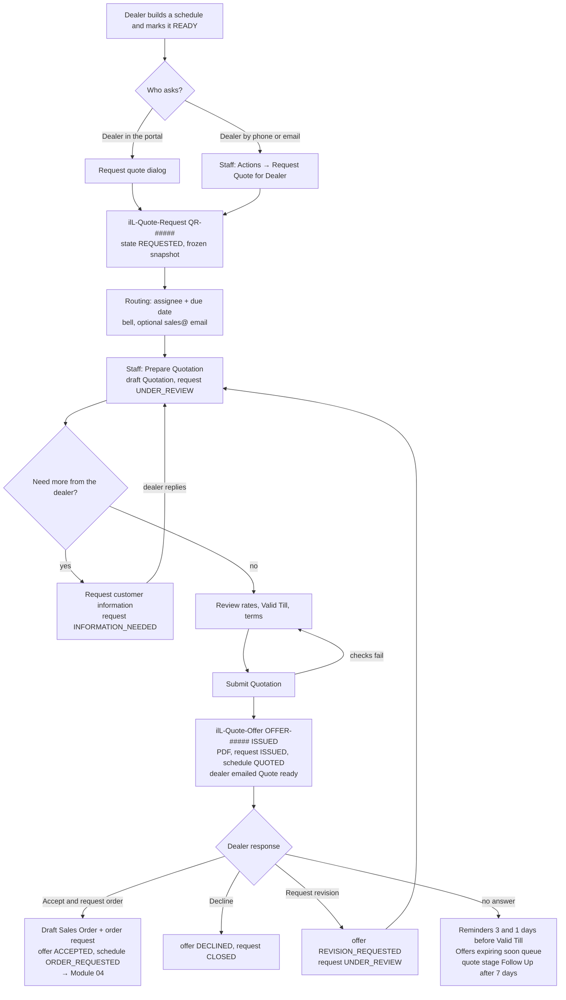
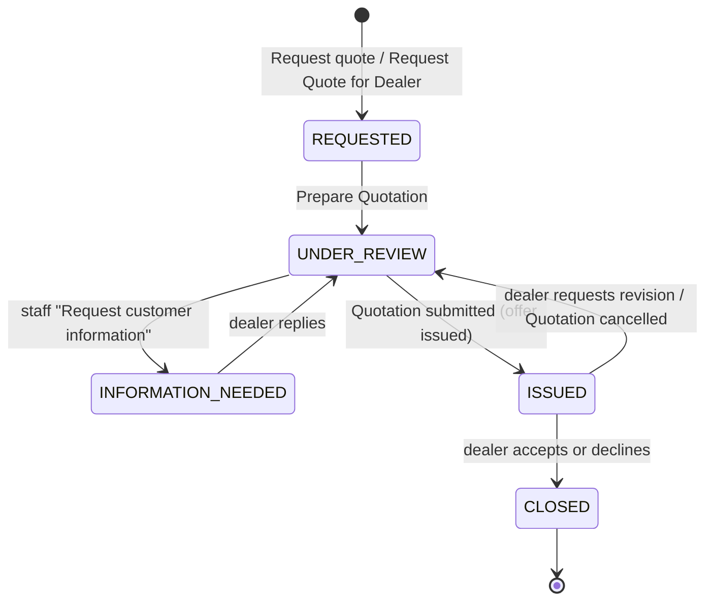

# Module 03: Quotes

**Audience:** sales, sales review, order approvers, owner; applications engineering and catalog publishers for the configurator lessons. **Length:** about 3 hours (2 hours of lessons, 1 hour of exercises on staging).
**Roles used:** ilL Sales Review (prepare, submit), ilL Order Approver, Dealer (portal side), Command Center Viewer / Editor / Finance, System Manager (settings only).

## Purpose

Trainees can create a quote every way the business does it, choose the right tool for the situation, issue it to the dealer, follow it up, and handle revisions, declines, expiry, cancellation and the hand-off to a sales order.

By the end of the module a trainee can:

1. Read the Quotes stage of the Command Center and say which quotes are waiting on us and which on the dealer.
2. Take a quote request from Received to Quote issued, including one raised for a dealer who phoned.
3. Build or extend a desk Quotation with Configure & Add Fixture and Get Items From → Fixture Schedule.
4. Explain where every price on a quote comes from and pick the right print format.
5. Keep a quote from going quiet: follow-up stage, expiry reminders, the sales@ inbox.
6. Handle every dealer response: accept, decline, revision, and what to do when a quote must be cancelled.

## Where to go

| What | Where |
|---|---|
| Quotes stage | `/command-center#quotes` |
| New quotation | `/app/quotation/new` (or Quotes stage quick link "+ New quotation") |
| Quotations list | `/app/quotation` |
| Quote requests (from dealers, or raised for them) | `/app/ill-quote-request` |
| Quote offers (what the dealer received; read-only) | `/app/ill-quote-offer` |
| Request a quote for a dealer | `/app/ill-project-fixture-schedule/<schedule>` → **Actions → Request Quote for Dealer** |
| Staff queues | `/app/ill-portal-operations` → Sales: Quote requests, Offers expiring soon, Product verification; Sales Inbox |
| Product verification requests | `/app/ill-product-verification-request` |
| Pricing tiers | `/app/pricing-rule` (one rule per Customer Group) |
| Follow-up days | `/app/ill-production-settings` → Order & Quote Stages → Quote Follow Up After (Days) |
| Routing and SLA | `/app/ill-portal-routing-settings` (System Manager) |
| Product Finder switches | `/app/ill-product-finder-settings` |
| Dealer side | `/portal/quotes`, `/portal/quotes/<offer>`, `/portal/quote-requests/<QR>`, `/portal/schedules/<schedule>` |
| Configurators (dealer and staff) | `/portal/configure` (`?category=LED Tape`, `LED Neon`, `LED Sheet`) |

## Which tool when

| Situation | Tool | Lesson |
|---|---|---|
| A dealer clicked **Request quote** on their schedule | Quote request → **Prepare Quotation** | 3.2 |
| A portal dealer asks by phone or email for a quote on their schedule | Schedule → **Actions → Request Quote for Dealer** → Prepare Quotation | 3.2 |
| You're building lines from scratch in the desk (then raise a quote request if the dealer uses the portal) | Desk Quotation + **Configure & Add Fixture** | 3.3 |
| A schedule already exists and you want its lines on a desk quote | Desk Quotation → **Get Items From → Fixture Schedule** | 3.4 |
| The dealer wants to explore products themselves first | Portal configurators / Product Finder | 3.5 |
| The dealer's client needs a retail-price copy | Print format **ilL Quotation - MSRP** | 3.6 |
| The customer doesn't use the portal | Desk Quotation, emailed with "ilL - Quotation - Quote sent" | 3.7 |
| The dealer wants changes to an issued quote | Revision: cancel and amend, or Prepare Quotation again | 3.8, 3.9 |

> **Important:** only a Quotation whose **Portal Quote Request** field is set (Prepare Quotation fills it) creates a portal offer and marks the schedule QUOTED when submitted. A desk Quotation made any other way does neither: the dealer gets no "Quote ready" email and cannot accept online. For a portal dealer who asks by phone or email, raise the quote request yourself (Lesson 3.2); email desk-only quotes to customers who don't use the portal (Lesson 3.7, decision 11).

---

## Process map

The main path, from a dealer's schedule to an order request. Dealer steps are on the portal; everything else is in the desk.

Numbered version (for slides):

1. Dealer marks the schedule READY (all lines configured).
2. Dealer clicks **Request quote**, or staff use **Actions → Request Quote for Dealer** on a DRAFT or READY schedule.
3. A quote request `QR-#####` is created (REQUESTED, "Received" to the dealer) with a frozen copy of the lines. Staff get a bell; sales@ may get an email; an assignee and due date are set.
4. The assignee opens the request and clicks **Prepare Quotation**: a draft Quotation is built and the request moves to UNDER_REVIEW.
5. If something is missing, the assignee sends **Request customer information** in the Portal conversation (INFORMATION_NEEDED). The dealer's reply moves it back to UNDER_REVIEW.
6. The assignee reviews rates, discounts, Valid Till and terms, then **submits**.
7. Submitting creates the offer `OFFER-#####` (ISSUED) with a private PDF; the request becomes ISSUED, the schedule QUOTED, and the schedule's owner is emailed "Quote ready".
8. The dealer accepts (draft Sales Order + order request, Module 04), declines, or asks for a revision (back to step 4 or a cancel-and-amend).
9. If nobody answers, reminders and the follow-up stage keep it visible until Valid Till.

---

## Status lifecycles

### Quote request (`ilL-Quote-Request`, field **State**)

| State | Dealer sees | What moves it here | Who | What it unlocks |
|---|---|---|---|---|
| DRAFT | Draft | Not used by the current flows (select option only) | — | — |
| REQUESTED | Received | Dealer's **Request quote**, or staff **Request Quote for Dealer** | Dealer (company buyer or editor), ilL Sales Review, ilL Order Approver | **Prepare Quotation**; Quote requests queue; "Requested" lane |
| UNDER_REVIEW | Under review | **Prepare Quotation**; a dealer reply after an info request; a revision request; cancelling the issued Quotation | Sales staff; the dealer's reply or response | Work on the draft Quotation; Portal conversation |
| INFORMATION_NEEDED | Needs your reply | Staff message with Action **Request customer information** | Sales staff with Quotation write | The dealer replies in the conversation ("Waiting on you") |
| ISSUED | Quote issued | Submitting the Quotation linked to this request | Sales staff with Quotation submit | The dealer can open and respond to the offer; Prepare Quotation is hidden |
| CLOSED | Closed | Dealer **Accept and request order** or **Decline** | Dealer (company buyer) | Nothing further; a new request is needed for more changes |

### Offer (`ilL-Quote-Offer`, field **State**, all read-only)

| State | Dealer label | What moves it here | Next |
|---|---|---|---|
| ISSUED | Awaiting your response (or **Expired** once Valid Until has passed) | Quotation submitted from a quote request | Dealer responds; reminders 3 and 1 days before Valid Until |
| ACCEPTED | Accepted | **Accept and request order** | Draft Sales Order + order request (`ilL-Order-Intake`); Module 04. Can't be replaced silently |
| DECLINED | Declined | **Decline** with a note | Request CLOSED |
| REVISION_REQUESTED | Revision requested | **Request revision** with a note | Request UNDER_REVIEW; Sales prepares a new or amended Quotation |
| SUPERSEDED | Replaced by a newer quote | A newer offer issued on the same request while this one was still ISSUED | None |
| CANCELLED | Cancelled | The Quotation was cancelled | Request reopens (UNDER_REVIEW) if this was its latest issued offer |

### Quotation stage (`ill_stage`, shown as **Stage**, recomputed every 15 minutes and on save/submit)

| Stage | Waiting on | Colour | How it is reached |
|---|---|---|---|
| Drafting | Us | gray | Any draft (docstatus 0) without an override |
| Waiting on Info | Customer | orange | Stage Override only |
| Waiting on Vendor | Vendor | orange | Stage Override only |
| Sent | Customer | blue | Submitted, less than *Quote Follow Up After (Days)* (7 on staging) since it was sent |
| Revising | Us | purple | Stage Override only |
| Follow Up | Us | red | Sent 7+ days ago with no reply ("Sent N days ago, no reply"), or ERPNext status Replied ("Customer replied") |
| Won | — | green | ERPNext status Ordered or Partially Ordered |
| Lost | — | darkgrey | **Set as Lost**, or Stage Override |
| Expired | — | gray | Valid Till has passed, or ERPNext status Expired, or Stage Override |
| Cancelled | — | red | Quotation cancelled |

- "Sent" counts from the latest email sent from the Quotation, else the submit date, else the quote date.
- **Stage Override** ("Leave blank to let the stage follow the order. Wins until cleared.") offers Drafting, Waiting on Info, Waiting on Vendor, Sent, Revising, Follow Up, Lost, Expired. Cancelled, Won and Lost from ERPNext always beat the override. **Submitting clears the override.**
- The Stage field's help text ("Worked out from work orders, stock, purchases and deliveries…") is shared with Sales Orders; for quotes, the rules above apply.

### What the quote does to the fixture schedule

| Event | Schedule status |
|---|---|
| Offer issued (submit with a quote request) | READY/DRAFT → **QUOTED** (timeline: "Issued offer OFFER-…") |
| Desk Quotation submitted without a quote request | Unchanged (decision 11) |
| Dealer accepts | QUOTED → **ORDER_REQUESTED** |
| Quotation cancelled and nothing else quotes the schedule | QUOTED → **READY** ("Reopened from QUOTED to READY…") |
| Anyone edits a QUOTED schedule | A new version is made; the old one is locked. An open offer warns first: "Quote OFFER-… is open for the customer until …. Changing this schedule will invalidate it." |

---

## Role and permission matrix

| Screen / action | ilL Sales Review | ilL Order Approver | System Manager | CC Viewer only | CC Editor | CC Finance | Dealer (company buyer) | Collaborator |
|---|---|---|---|---|---|---|---|---|
| Quotes stage in the Command Center | yes | yes | yes | yes, no dollar figures | yes | dollar figures | — | — |
| Card actions Reassign / + To-do (confirm on capture) | with Editor | with Editor | yes | no | yes | — | — | — |
| Request Quote for Dealer (schedule Actions) | yes | yes | yes | — | — | — | — | — |
| Request quote in the portal | — | — | — | — | — | — | yes (schedule editor) | yes if they can edit the schedule; never sees prices |
| Prepare Quotation | yes (needs Quotation create) | yes | yes | — | — | — | — | — |
| Reply / Request customer information | yes (needs Quotation write) | yes | yes | — | — | — | replies only | replies only |
| Submit Quotation (issue offer) | yes (needs Quotation submit) | yes | yes | — | — | — | — | — |
| Configure & Add Fixture | yes | yes | yes | — | — | — | — | — |
| Desk ilL-Quote-Offer records | read | read | read | — | — | — | — | — |
| Portal offer page and response | — | — | — | — | — | — | yes | no |
| Portal Operations → Sales queues | yes | yes | yes | — | — | — | — | — |
| Sales Inbox queue | yes | yes | yes | — | — | — | — | — |
| Product verification decisions | yes | yes | yes | — | — | — | — | — |
| Pricing Rules | Sales Manager / System Manager (standard ERPNext) | | yes | — | — | — | — | — |
| Routing settings, Product Finder Settings, follow-up days | — | — | yes | — | — | — | — | — |

Also: ilL Engineering and ilL Product Finder Manager can work product verification; ilL Support and ilL Catalog Publisher see the Sales Inbox. Kevin Schern is the systems admin (System Manager); Jay holds ilL Sales Review and ilL Order Approver (decision 8).

---

### Lesson 3.1: The Quotes stage in the Command Center

**Objective:** see every quote that needs you and every quote waiting on a dealer.

**Screen tour, top to bottom**

1. **Header and quick links.** "Quotes. Quote requests from the portal, the offers and quotations we've sent, and quotation tickets from sales@. Schedules arrive here from Design." Quick links: **+ New quotation**, **Quotations**, **Quote requests**, **Quote offers**, **Help desk**.
2. **Stage strip.** Overview · Design · Quotes · Sales orders · Purchasing · Manufacturing · Shipping · Service. The Quotes chip shows the count of open requests plus quotes out, and "N quotes out"; it turns amber when a request is over 2 business days old.
3. **Four stats.**
   - **Quote requests, our move**: REQUESTED + UNDER_REVIEW requests; "N older than 2 business days · N tickets open"; red when any is older than 2 business days.
   - **Waiting on dealer**: INFORMATION_NEEDED requests plus quotation tickets in Replied.
   - **Quotes out**: submitted Quotations with status Open, and "$… waiting on dealers" (net total, before tax; Finance role only).
   - **Expiring in 7 days**: open quotes whose Valid Till is within 7 days (red when any), plus "N unsent drafts (last 120 days)".
4. **Quote request lanes.** Requested ("New from the portal") · Under review ("We're pricing it") · Information needed ("Waiting on the dealer") · Issued ("Quote out, waiting on the dealer") · **Dealer responded** ("Accepted, declined or revision asked (30 days)"). Red age = waiting on us more than 2 business days.
5. **Request card.** State badge, age, `QR-##### · Customer`, schedule and project, a chip with the Quotation number and value (and "valid to" date), "Due …" (red when overdue), assignee avatar or "Unassigned", then **Reassign**, **Details**, **+ To-do**, **↗** (open in desk). Accepted offer cards carry a "Continues in Sales orders" chip.
6. **Quotation tickets.** Help desk tickets of type Quotation: Our move ("Open: needs a reply or a quote") · Waiting on customer ("Replied: follow up if quiet for 10+ days") · Done (last 30 days). A ticket with no quotation shows **Link quotation**.
7. **Quotes waiting on dealers** table: Quotation (with its quote request underneath), Dealer, Sent ("N business days ago"), Valid Till (amber within 7 days, red "Expired …"), Value, Ticket, Status (Waiting / Draft). **Include drafts** adds draft Quotations.

Test customers (names starting "ZZ ") and ilLumenate Lighting itself are left out of the counts.

> **SS-03-01** · Quotes stage, full page
> **URL:** `/command-center#quotes` · **Role:** Editor + Finance · **State:** at least one issued request
> **Highlight:** the four stats; the five lanes; Reassign on a card

*Captured.* What you see:
- Stage strip with **Quotes 6 · 6 quotes out** selected
- Quick links: + New quotation, Quotations, Quote requests, Quote offers, Help desk
- Stats: Quote requests, our move **0**; Waiting on dealer **0**; Quotes out **6** ($3,940 waiting on dealers); Expiring in 7 days **4** in red, "44 unsent drafts (last 120 days)"
- Lanes Requested, Under review, Information needed (all "Nothing here"), Issued **5**, Dealer responded **0**
- First Issued card: QR-00105 · Cascade Integration, 28d

> **SS-03-02** · "Quotes waiting on dealers" table and the quotation tickets board
> **URL:** `/command-center#quotes` · **Role:** Editor + Finance
> **Highlight:** the Include drafts switch; the Valid Till badges; Link quotation

*Captured (Include drafts is off in this shot).* What you see:
- Ticket lanes: Our move (1 card, "Re: Introduction and we have a fun project", 20d, **Link quotation**, HD Ticket 0135), Waiting on customer, Done (last 30 days)
- Table columns Quotation, Dealer, Sent, Valid Till, Value, Ticket, Status
- Rows such as Bain Custom Integrations-00002 with QR-00179 beneath, Valid Till **Nov 27** amber, $1,636, Waiting
- Rows with no Valid Till show "—"

> **SS-03-03** · Quotation list with status and stage colours
> **URL:** `/app/quotation` · **Highlight:** Follow Up and Expired

*Captured; retake with the Stage column added to the list view.* What you see:
- List columns Customer Name, Status, Date, Company; "20 of 180"
- Status pills Open (amber), Ordered (green), Cancelled (red), Draft (red), Expired (grey)
- Redact before publishing: customer names

> **SS-03-34** · A quote request card close up
> **URL:** `/command-center#quotes` · **Role:** Editor + Finance · **State:** an ISSUED request with a quotation and a due date (QR-00181 or QR-00179)
> **Highlight:** state badge and age; the quotation chip with value; Due date; Reassign, Details, + To-do, ↗

> **SS-03-35** · Quotes stage signed in as Command Center Viewer only (no Finance)
> **URL:** `/command-center#quotes` · **Role:** `training.viewer` · **State:** same data as SS-03-01
> **Highlight:** the Quotes out stat without a dollar figure; compare with SS-03-01

> **SS-03-36** · Quotes stage at phone width (phone)
> **URL:** `/command-center#quotes` · **Role:** Editor + Finance · **State:** 390×844
> **Highlight:** stats stacked; lanes scroll

> **SS-03-37** · (pair) Link a quotation to a quotation ticket: -a the **Link quotation** button on a ticket card; -b the "Link a quotation" sheet with the Quotation field typed
> **URL:** `/command-center#quotes` · **Role:** Editor · **State:** an Open Quotation ticket with no quotation. Close the sheet without saving.
> **Highlight:** the button; the sheet's Quotation field

> **DATA-03-01** · Quote pipeline snapshot: count and value by stage
> **API:** `GET /api/resource/Quotation?fields=["name","ill_stage","status","docstatus","grand_total"]&limit_page_length=1000` (staging's Frappe refuses `count()` in fields; total the rows yourself)
> **Use:** opening slide. On staging, 24 Nov 2026: 180 quotations: Drafting 80, Expired 44, Won 30, Cancelled 15, Follow Up 10, Lost 1.

---

### Lesson 3.2: The main path: dealer quote request → issued offer

**Objective:** take a quote request from "Received" to "Quote issued".

**Step 1, dealer requests (portal).** On a READY schedule the dealer's next-step button is **Request quote** (a DRAFT schedule shows **Mark ready** first, and stays disabled until every line is configured). The dialog "Request quote / engineering review" asks for:

| Field (portal label) | Required | Limit | Goes to |
|---|---|---|---|
| Contact instructions | no | 240 characters | Snapshot "Contact" |
| Requested timing (optional) | no | not in the past | Snapshot "Requested timing" |
| Scope, timing and questions | no | 4,000 characters | Request **Customer Notes** |
| Optional PDF/JPEG/PNG/HEIC attachments: up to 10 files, 20 MiB each | no | 10 files | Files on the request |

Then **Submit request**. The page goes to `/portal/quote-requests/<QR>`.

- Creates **ilL-Quote-Request** `QR-#####`, state REQUESTED ("Received" to the dealer), with a frozen snapshot of the lines (**Frozen Request**). The schedule's timeline gets "Quote request received: QR-…".
- Staff are told: a desk bell for the assignee, or for everyone holding ilL Sales Review / ilL Order Approver when nobody owns it, and one email to the shared inbox when **Also Email the Shared Inbox** is ticked (sales@illumenate.lighting on staging). Subject: "New quote request QR-… from <customer>".
- **Assignee:** the quotes queue's Default Assignee in **ilL-Portal-Routing-Settings**; else the enabled member of its Fallback Role (or of ilL Sales Review / ilL Order Approver) with the fewest open requests.
- **Due Date:** submission time plus the queue's SLA Hours, stored as a date. These are clock hours: the weekday-only SLA rule (decision 4) applies to drawing requests, not this queue. **On staging the Queues table has no rows**, so requests get an assignee but no due date.

**Step 2, prepare.** Open `/app/ill-quote-request/<QR>` → **Prepare Quotation**. With one selling company (staging has one, ilLumenate Lighting) there is no prompt; with more it asks for the **Selling Company**.
- Builds a **draft Quotation** linked to the schedule (**Fixture Schedule**) and the request (**Portal Quote Request**), with every sellable configured line: fixtures, groups, tape/neon as a single configured item, kits, sheets and accessories, each with its BOM. Other-manufacturer lines are left off and listed as exclusions on the offer.
- If the schedule has since been versioned, the draft uses its newest open version.
- The request moves to UNDER_REVIEW and is assigned to you. Running it again opens the same draft.

**Step 3, review.** Rates, discounts, taxes, exclusions, **Valid Till**, terms, payment schedule (field reference in Lesson 3.9).
- Need something from the dealer? In the request's **Portal conversation** set Visibility to **Message to the dealer** and Action to **Request customer information**, then **Send to dealer**. The request goes to INFORMATION_NEEDED ("Needs your reply" for the dealer); their reply moves it back to UNDER_REVIEW and rings your bell.
- Notes for colleagues: leave Visibility on **Internal note (staff only)** and click **Save internal note**. Internal notes can't change the request's state.

**Step 4, submit.** Submitting checks, in order:

1. The Quotation is addressed to a Customer.
2. Its customer and schedule match the request's owning company (the project's owner customer).
3. The request is not CLOSED; the schedule isn't locked and isn't ORDER_REQUESTED, ORDERED, CLOSED or ISSUE.
4. **Valid Till** is today or later.
5. Every row has a quantity above zero and none is marked **Is Alternative**.
6. You have Quotation submit permission.
7. Product verification is done (Product Finder Settings → Verification Gate; default "Before quote is issued and order is placed").

On submit:
- **ilL-Quote-Offer** `OFFER-#####` is created (ISSUED) with a frozen copy of the commercial lines and terms.
- The **ilL Quotation** PDF is rendered once and kept privately on the offer.
- An earlier offer on the same request that is still ISSUED becomes SUPERSEDED (an ACCEPTED one blocks the submit).
- Request → ISSUED; schedule → **QUOTED**.
- The schedule's owner gets the portal email **"Quote ready: <schedule name>"** ("Your quote is ready… Review the quote") if their quote-updates preference is on. It leaves through the portal outbox, which sends every 5 minutes.
- The Quotation's Stage becomes Sent and Stage Override is cleared.

**Dealer asked by phone or email?** Open their schedule (DRAFT or READY, unlocked) in the desk → **Actions → Request Quote for Dealer** → fill in the dialog → **Create Quote Request**. The request opens; continue from step 2. It runs the same checks as the dealer's own request, the dealer sees it in the portal, and its timeline notes "Raised by <you> on the dealer's behalf." Needs ilL Sales Review, ilL Order Approver or System Manager.

| Dialog field | Help text | Goes to |
|---|---|---|
| What the dealer asked for | "Up to 4,000 characters. The dealer can read this." | Customer Notes |
| Contact instructions | — | Snapshot "Contact" |
| Quote needed by | — | Snapshot "Requested timing" (not in the past) |

**Quote request form, field reference** (`/app/ill-quote-request/<QR>`)

| Field | Meaning | Filled by | Required | Flows to |
|---|---|---|---|---|
| Schedule | The fixture schedule quoted | System at request | yes | Prepare Quotation, offer |
| Drawing Import | Newest committed CAD import when the quote was requested | System | read-only | Draw-to-quote audit |
| Project | The schedule's project | System | no | Notifications, cards |
| Customer | The project's owning dealer company | System | no | Must match the Quotation's customer |
| Requested By | Who asked (dealer or the staff member who raised it) | System | yes | Reminder recipients, portal page |
| State | Lifecycle above | System and staff actions | yes | Lanes, queues |
| Assigned To | Owner of the request | Routing, Prepare Quotation, Assign / due date | no | Bell, inbox, My inbox |
| Due Date | Staff review due | Routing SLA, Assign / due date | no | Overdue view, daily digest; dealer sees "Staff review due" |
| Customer Notes | What the dealer asked for | Dealer or staff | no | Notifications, portal page |
| Frozen Request | JSON snapshot of lines, contact, timing, files | System | read-only | Audit; portal "Submitted scope" |
| Latest Offer / Latest Issued Offer | Quotation and offer of the latest issue | System | read-only | Supersede and revision logic |

Buttons on the form: **Prepare Quotation** (until ISSUED or CLOSED), **Assign / due date**, **Open in portal** (see what the dealer sees). The request's content is immutable after submission: "Submitted quote intake is immutable. Create a new request revision."

> **SS-03-32** · Schedule form Actions menu with "Request Quote for Dealer"
> **URL:** `/app/ill-project-fixture-schedule/ILL-SCHED-2026-00145` · **Role:** ilL Sales Review · **State:** DRAFT or READY, unlocked
> **Highlight:** Actions → Request Quote for Dealer

*Captured.* What you see:
- ILL-SCHED-2026-00145, **DRAFT**, "TRAINING DEMO Schedule", customer Jeremy Test Integrations, project ILL-PROJ-2026-00118
- Toolbar: **Actions** (open, showing Request Quote for Dealer), Support, Open in portal, CAD, Save
- Yellow note: "5 line(s) have pending fixture configuration: L1-3, L2-2, L3-1, L3-1, L3-2"
- Versioning: Version 2, Version Parent ILL-SCHED-2026-00144, Is Locked unticked

> **SS-03-33** · (pair) -a Request Quote for Dealer dialog filled in; -b the new quote request with the "Raised by … on the dealer's behalf" timeline note
> **URL:** as SS-03-32 · **Role:** ilL Sales Review · **State:** -b needs **Create Quote Request**, which notifies staff by email (lead decides)

*-a captured; -b not captured on purpose (sending notifies staff).* What you see in -a:
- Intro: "Creates a quote request for this schedule, as if the dealer had asked in the portal. Then use Prepare Quotation on the request."
- **What the dealer asked for** filled with "TRAINING DEMO: please quote the lobby and corridor fixtures; dealer asked by phone.", help "Up to 4,000 characters. The dealer can read this."
- **Contact instructions** (empty), **Quote needed by** 11-30-2026
- **Create Quote Request** button

> **SS-03-04** · Dealer: Request quote / engineering review dialog
> **URL:** `/portal/schedules/<schedule>` · **Role:** Dealer · **State:** READY schedule, all lines configured, no open request
> **Highlight:** the four fields; Submit request

*Not yet captured: Request quote only shows on a READY schedule; the test schedule has unconfigured lines.*

> **SS-03-05** · Desk quote request form
> **URL:** `/app/ill-quote-request/<QR>` · **Role:** ilL Sales Review · **State:** REQUESTED (for the Prepare Quotation button)
> **Highlight:** Prepare Quotation; State; Assigned To; Due Date

*Captured on an ISSUED request (QR-00181), so Prepare Quotation is hidden; retake on a REQUESTED one.* What you see:
- Title **QR-00181** with an **Issued** badge; buttons **Assign / due date**, **Open in portal**, Save
- Schedule ILL-SCHED-2026-00140, Project ILL-PROJ-2026-00115, Customer Bain Custom Integrations
- Requested By, State **ISSUED**, Assigned To, Due Date (empty: no SLA row on staging)
- Customer Notes (empty) and **Frozen Request** JSON (lines with configured_tape_neon ILL-CTN-00567, location "Linear Theater")

> **SS-03-06** · The draft Quotation it creates
> **URL:** `/app/quotation/<name>` · **Highlight:** Fixture Schedule and Portal Quote Request fields; configured item rows; Valid Till

*Captured (this Quotation has since been ordered).* What you see:
- ilL-SAL-QTN-Bain Custom Integrations-00003, status **Ordered**; toolbar Tools, Support, Cancel
- Tabs Details, Address & Contact, Terms, More Info, Connections
- Quotation To Customer, Date 10-27-2026, Order Type Sales, Valid Till 11-27-2026
- **Fixture Schedule** ILL-SCHED-2026-00140, **Portal Quote Request** QR-00181, Frappe CRM Deal (empty)
- Items: No., Item Code, **Section / Room** ("Linear Theater Lig…"), **Fixture Type** (L1-1-A); rows such as CH-RA03-SV Rainier Profile, LNS-RAXX lens, endcaps, mounting clips

> **SS-03-07** · (pair) -a Request customer information in the Portal conversation (staff); -b the dealer's "Needs your reply" view
> **Role:** -a ilL Sales Review, -b Dealer · **State:** an UNDER_REVIEW request; sending emails the dealer (lead decides)

*Not yet captured: needs a live quote cycle; staging sends real email.*

> **SS-03-08** · Submit blocked: example validation message (e.g. "An expired Quotation cannot be issued as a new portal offer")
> **State:** a draft prepared from a request, Valid Till yesterday; the refused submit sends nothing

*Not yet captured: needs a scripted state.*

> **SS-03-09** · Portal Operations → Sales queues and My inbox
> **URL:** `/app/ill-portal-operations` · **Highlight:** Quote requests and Offers expiring soon tiles; Everything / Assigned to me / Unassigned / Overdue

*Captured.* What you see:
- "Requests waiting on our team" with steps 1 Choose a queue, 2 Narrow it by view or search, 3 Click an ID
- **My inbox**: Everything, Assigned to me, Unassigned, Overdue; Search by ID…; "Nothing is waiting on you."
- **Sales · 0 waiting**: Product verification, Order changes and cancellations, Quote requests, Offers expiring soon, Order review
- The older "Accounts & Finance · 30 waiting" heading (now split into Dealer Accounts and Accounting), then Engineering

> **SS-03-10** · Routing settings: quotes queue (assignee, fallback role, SLA hours)
> **URL:** `/app/ill-portal-routing-settings` · **Role:** System Manager

*Captured.* What you see:
- Staff Notifications: "Dealer submissions always ring the Desk bell…", **Also Email the Shared Inbox** ticked, Shared Inbox Email sales@illumenate.lighting
- Assignment and SLA: "One row per queue. Queues without a row go to the team that handles them, with no due date."
- Queues table columns Queue, Default Assignee, Fallback Role, SLA Hours: **No rows**

> **SS-03-38** · Quote request list with the State column
> **URL:** `/app/ill-quote-request` · **Role:** ilL Sales Review · **State:** at least 3 requests
> **Highlight:** State, Customer, Assigned To columns; the filter chip

> **SS-03-39** · Quote request form, Portal conversation (staff view)
> **URL:** `/app/ill-quote-request/<QR>` · **Role:** ilL Sales Review · **State:** a REQUESTED or UNDER_REVIEW request (none open on staging; lead decides)
> **Highlight:** Visibility (Internal note / Message to the dealer); Action (Reply / Request customer information); "The dealer will see this message." banner; Send to dealer

> **SS-03-40** · Desk schedule with an open offer: the orange headline
> **URL:** `/app/ill-project-fixture-schedule/ILL-SCHED-2026-00139` · **Role:** ilL Sales Review · **State:** OFFER-00180 ISSUED, valid until 27 Nov 2026 (capture before then)
> **Highlight:** "Quote OFFER-… is open for the customer until …. Changing this schedule will invalidate it."

> **SS-03-41** · Dealer schedule page: progress steps and the Request quote button
> **URL:** `/portal/schedules/<schedule>` · **Role:** Dealer · **State:** READY schedule, no open request
> **Highlight:** steps Build, Ready, Quote requested, Quoted, Order requested, Ordered; Request quote; Order directly

> **SS-03-42** · Dealer quote request page
> **URL:** `/portal/quote-requests/<QR>` · **Role:** Dealer · **State:** a request of the training dealer's company
> **Highlight:** status badge; Requested timing; Staff review due; Submitted scope table; Your request; Conversation with ilLumenate

> **DATA-03-02** · The quote requests and offers on staging, for the worked example
> **API:** `GET /api/resource/ilL-Quote-Offer?fields=["name","state","customer","quotation","quote_request","schedule","valid_until","sales_order"]&order_by=modified desc&limit_page_length=20`
> **Use:** the worked example. Staging has no ACCEPTED offer yet (4 ISSUED, 1 CANCELLED). QR-00181 → OFFER-00182 (Bain Custom Integrations, schedule ILL-SCHED-2026-00140) is the best example; pair with DATA-02-01 when the job is picked.

---

### Lesson 3.3: Building a quote in the desk with Configure & Add Fixture

**Objective:** quote a configured product from scratch without a dealer request.

1. `/app/quotation/new` → set **Customer** first ("Set the Customer on this Quotation first, then configure fixtures." otherwise).
2. Click **Configure & Add Fixture** (toolbar, or the Items grid).
3. **Step 1, Project & Schedule.** "Customer: <name>". Pick a **Project** or tick **Create a new project** (then **New project name**). Pick a **Fixture Schedule** or tick **Create a new schedule** (**New schedule name**). Or tick **Skip schedule (add to this document only)**, which warns: "Lines added without a fixture schedule are NOT visible to the customer in the portal and cannot be traced back to a schedule line." **Continue**.
4. **Step 2, Line Details.**

| Field | Meaning | Required |
|---|---|---|
| Product Type | Linear Fixture, LED Tape, COB Tape, LED Neon, LED Sheet, Extrusion Kit, Power Supply, Controller | yes ("Please choose the type of product to configure.") |
| Schedule line | Pick an existing line to reconfigure it (its rows on this document are replaced), or **+ New schedule line** | — |
| Fixture Type | Optional, e.g. L1. Repeating one asks "Fixture Type L1 is already used on the schedule. Add another line with the same Fixture Type?" | no |
| Section / Room | Location on the schedule line and the row's print grouping | yes with a schedule ("Enter the Section / Room (location) for this schedule line.") |
| Qty | At least 1 | yes |
| Notes | Added to the row description | no |

5. **Step 3, Configure.** The same configurator the dealer uses, inside the dialog. Calculate, then save.
   - Writes the schedule line **and** a priced row: MSRP less the dealer's tier (Lesson 3.6). Power supplies and accessories come in as their own rows.
   - Result: "Added <part> (saved to schedule <name>)". **Add another** loops back to Line Details; **Done** closes. "Remember to save the Quotation to keep the N configured line(s)."
6. **Reconfigure Row:** tick one configured row, click Reconfigure Row. No row ticked: "Tick the checkbox of one configured row in Items, then click Reconfigure Row." A row not made by the dialog: "Row N was not added with Configure & Add Fixture, so there is no configuration to reopen. Edit it in the grid instead."
7. **Schedule not editable.** A QUOTED or locked schedule shows "Fixture Schedule … is locked. Create a new version to keep configuring." or "… is QUOTED; only DRAFT or READY schedules accept new lines." with **Create new version**. If nothing still quotes it, the schedule is reopened instead: "Reopened schedule … ; nothing still quotes it, so no new version was needed."
8. **Tools → Set Section / Room** tags the ticked rows (or every untagged row): "Tagged N row(s) as "Kitchen"." Print formats group by it.
9. **Two-way sync:** while the Quotation is a draft and the schedule is DRAFT/READY and unlocked, lines, qty, Fixture Type, Section/Room and notes stay in step both ways. Rates, discounts and taxes are never synced. Deleting a row warns in orange: "Row removed. When none of its rows remain, saving also removes line … from Fixture Schedule … (while the schedule is still editable)."
10. Internal roles only: System Manager, ilL Sales Review, ilL Order Approver ("The desk configurator is available to internal users only.").

If the dealer uses the portal, finish by raising the quote request from the schedule (Lesson 3.2) and use **Prepare Quotation**, so the dealer gets an offer they can accept.

> **SS-03-11** · Configure & Add Fixture: Project & Schedule step
> **URL:** `/app/quotation/new` · **Role:** ilL Sales Review

*Captured.* What you see:
- Steps **1 Project & Schedule** (active) › 2 Line Details › 3 Configure
- Customer: **Jeremy Test Integrations**; Project ILL-PROJ-2026-00118; Create a new project; Fixture Schedule (empty); Create a new schedule
- **Skip schedule (add to this document only)**; Cancel / Continue
- Behind the dialog: Stage Override, Stage Detail, Waiting On; Items columns Section / Room, Fixture Type, Load…, Quantity, Rate (USD)

> **SS-03-12** · Line Details step
> **State:** schedule ILL-SCHED-2026-00145 picked in step 1

*Not yet captured: the dialog needs a fixture schedule chosen first; script it with ILL-SCHED-2026-00145.*

> **SS-03-13** · Configure step (linear) with price preview

*Not yet captured: as SS-03-12.*

> **SS-03-14** · Quotation items after adding three configured lines, grouped by Section/Room
> **Highlight:** Reconfigure Row; Tools → Set Section / Room

*Not yet captured: needs a scripted step.*

> **SS-03-15** · Orange "Row removed…" alert after deleting a row

*Not yet captured: needs a scripted step.*

> **SS-03-46** · Skip schedule ticked: the warning
> **URL:** `/app/quotation/new` → Configure & Add Fixture · **Role:** ilL Sales Review · **State:** customer set; nothing saved
> **Highlight:** "Lines added without a fixture schedule are NOT visible to the customer in the portal…"

> **SS-03-47** · Linked schedule that is not editable: the "Linked" card and Create new version
> **URL:** `/app/quotation/<draft linked to a QUOTED schedule>` → Configure & Add Fixture · **Role:** ilL Sales Review · **State:** close without clicking Create new version
> **Highlight:** Linked badge; status badge; the warning; Create new version

> **SS-03-48** · Reconfigure Row with nothing ticked: "Select one row"
> **URL:** `/app/quotation/<draft with configured rows>` · **Role:** ilL Sales Review
> **Highlight:** the message

---

### Lesson 3.4: Get Items From → Fixture Schedule

**Objective:** pull an existing schedule onto a desk Quotation.

- **Get Items From → Fixture Schedule** (also **Opportunity**, standard ERPNext). A new or unsaved Quotation is saved first ("Please save the quotation before adding items from a fixture schedule.").
- Dialog "Get Items From Fixture Schedule": **Fixture Schedule** (filtered to the quotation's customer), then a preview table: Configured Fixtures, Multi-run Groups, LED Tape / Neon, Extrusion Kits, LED Sheets, Accessories / Power Supplies, Other Manufacturer (not imported), Unconfigured (skipped).
- Options: **Include Accessories / Power Supplies** (on); **LED Tape / Neon As**: *Single Configured Item* (one row per configured SKU) or *Raw Components (Item + Qty)* (tape, leader cable, jumpers and mounting rows). **Add Items**.
- Result: "Items Added" with "Added N item row(s) to this quotation." and counts by type, or "Nothing Added".
- One schedule per document: "Quotation … is already linked to Fixture Schedule …. Create a separate Quotation for another schedule." Other versions of the same schedule are allowed.
- Running it again only adds missing lines: "N schedule line(s) already on this Quotation were left as they are."
- Lines awaiting product verification are listed: "Lines awaiting product verification: L1, L3".
- The schedule's status is not changed.

> **SS-03-16** · Get Items From menu and the Quotation stage fields
> **URL:** `/app/quotation/<draft>` · **Role:** ilL Sales Review

*Captured (the menu, not yet the dialog; SS-03-49 covers the dialog).* What you see:
- Draft quotation for Progressive Custom Integration - Rockies, indicator **Drafting · Waiting on Us**, blue bar "Submit this document to confirm"
- Toolbar Tools, **Get Items From** (open: **Fixture Schedule**, **Opportunity**), **Configure & Add Fixture**, Support, Submit
- Fixture Schedule ILL-SCHED-2026-00130, Portal Quote Request empty (a desk-only quote)
- Stage Drafting, Waiting On Us, Stage Detail, **Stage Override** ("Leave blank to let the stage follow the order. Wins until cleared.")

> **SS-03-17** · Verification warning listing unverified lines

*Not yet captured: needs a schedule with a line awaiting verification.*

> **SS-03-49** · (pair) -a Get Items From Fixture Schedule dialog with the preview table and options; -b the "Items Added" message
> **URL:** `/app/quotation/<draft for Jeremy Test Integrations>` · **Role:** ilL Sales Review · **State:** -a pick ILL-SCHED-2026-00145, don't click Add Items; -b adds rows to a draft (lead decides)
> **Highlight:** preview counts; LED Tape / Neon As; Add Items; the counts in -b

---

### Lesson 3.5: Configurators, Product Finder, verification and spec submittals (dealer self-service)

**Objective:** know what dealers can do on their own before they ask for a quote, and the staff work it creates.

| Tool | URL |
|---|---|
| Configurator (category chooser; `?category=`, `?pn=`, `?preset=`, `mode=wizard`) | `/portal/configure` |
| Tape | `/portal/configure?category=LED Tape` (the old `/portal/configure-tape` link redirects there) |
| Neon (multi-segment) | `/portal/configure?category=LED Neon` (the old `/portal/configure-neon` link redirects there) |
| LED sheet | `/portal/configure?category=LED Sheet` (the old `/portal/configure-sheet` link redirects there) |
| Product Finder | `/portal/product-finder` (off on staging: Enable In Dealer Portal is unticked, so the link opens the Product Catalog at `/portal/products`) |

- Category chooser: "What would you like to configure?" Linear Fixture ("Most popular — not sure? Start here"), LED Tape, LED Neon, LED Sheet, Extrusion Kit, and more below.
- Each configurator has a **Schedule Target** (Project, Fixture Schedule, Fixture Type), the product steps and a **Results** panel. **Calculate & Validate** must run before saving ("Cannot save: please calculate first to validate the configuration").
- The price panel reads "Estimate — confirmed on your quote" with Estimated price and Lead time. The LED Sheet results show **Pricing (MSRP)**, Option adders and Sheet bundle MSRP.
- **Save as preset** stores a build for reuse; **Change product type** goes back to the chooser.
- **Product Finder "Verify with our team" lines** must be verified by staff before a quote is issued and an order placed. Product Finder Settings → **Verification Gate**: "Before quote is issued and order is placed" (default, staging), "Before order only", "Warning only". The dealer's schedule says "Some lines await product verification. You may request a quote; our team will confirm before it is issued."

**Product verification request** (`ilL-Product-Verification-Request`)

| State | Moved by | Buttons |
|---|---|---|
| REQUESTED | Dealer's "Verify with our team" | **Start review**, **Open schedule** |
| UNDER_REVIEW | Start review | **Mark verified**, **Not feasible** (each asks for a Resolution) |
| INFORMATION_NEEDED | Staff Request customer information | Mark verified, Not feasible |
| VERIFIED / NOT_FEASIBLE | Staff decision | Line verification updates; dealer emailed "Product verification updated" |
| CANCELLED | The line was removed from the schedule | — |

Due date: 2 weekdays after the request. Queue: Portal Operations → Product verification. Staff = sales, engineering or ilL Product Finder Manager.

**Spec submittals.** On the portal schedule page, the **Exports** card offers PDF (No Pricing), PDF (With Pricing, pricing roles only), CSV (No Pricing / With Pricing), **Spec Submittal** (cover + filled submittals) and **Spec Submittal (Full)** (adds each template's spec sheet). Packets build in the background; failed ones show **Retry** and land in Portal Operations → Engineering → Incomplete exports. Email a finished packet with the template **ilL - Quotation - Submittal package ready** (attach the PDF).

> **SS-03-18** · Configurator category chooser
> **URL:** `/portal/configure` · **Role:** Dealer

*Captured.* What you see:
- Portal nav: Overview, Projects, Quotes, Orders, Drawings, Products, Resources, Support, Account
- "What would you like to configure?"
- Cards: **Linear Fixture** with "Most popular — not sure? Start here", LED Tape, LED Neon, LED Sheet, Extrusion Kit

> **SS-03-19** · Neon multi-segment configurator
> **URL:** `/portal/configure?category=LED Neon`

*Captured.* What you see:
- Change product type; **Save as preset**; breadcrumb Projects › Configure LED Neon
- Schedule Target: Project, Fixture Schedule, Fixture Type selectors
- Product Category pills (LED Neon selected), Product Family search, "13 templates" (Bastile, Carbon, Cowlitz, Douglas…)
- Results panel "Not Calculated": "Configure segments and click 'Calculate & Validate' to see results"

> **SS-03-20** · Product Finder with a "Verify with our team" result
> **URL:** `/portal/product-finder`

*Captured, but it shows the Product Catalog: the finder is switched off on staging. Retake after Enable In Dealer Portal is ticked.* What you see:
- Product Catalog, 137 products, search, Refresh products
- Product Type chips (Accessory, COB Tape, Controller, Driver, Extrusion Kit, Linear Fixtures 71, LED Neon, LED Sheet, LED Tape) and Application filters
- Product cards with **View details**

> **SS-03-21** · Portal Operations → Product verification queue

*Captured.* What you see:
- Engineering tiles (Drawing responses 1, Drawing reapproval, Incomplete exports 28), Operations, Support, Sales Inbox tiles
- **Product verification** panel: "Dealers asking us to confirm a product can be built as configured."; Everything, Assigned to me, Unassigned, Overdue; "Nothing is waiting in this queue."
- Signed in as Training Lead

> **SS-03-50** · Configurator estimate panel
> **URL:** `/portal/configure?category=Linear Fixture` · **Role:** Dealer · **State:** a valid linear build after Calculate & Validate (don't save)
> **Highlight:** "Estimate — confirmed on your quote"; Estimated price; Lead time

> **SS-03-51** · LED Sheet configurator after Calculate & Validate
> **URL:** `/portal/configure?category=LED Sheet` · **Role:** Dealer · **State:** don't save
> **Highlight:** Pricing (MSRP); Option adders; Sheet bundle MSRP

> **SS-03-52** · LED Tape configurator
> **URL:** `/portal/configure?category=LED Tape` · **Role:** Dealer
> **Highlight:** Schedule Target; Calculate & Validate

> **SS-03-53** · Save as preset menu open
> **URL:** `/portal/configure?category=LED Neon` · **Role:** Dealer · **State:** a calculated build; close without saving
> **Highlight:** Save as preset

> **SS-03-54** · Product verification request in the desk
> **URL:** `/app/ill-product-verification-request/<name>` · **Role:** ilL Sales Review · **State:** UNDER_REVIEW (none on staging yet; lead decides)
> **Highlight:** Mark verified; Not feasible; Open schedule; Portal conversation

> **SS-03-55** · Product Finder Settings: portal switch and verification gate
> **URL:** `/app/ill-product-finder-settings` · **Role:** System Manager
> **Highlight:** Enable In Dealer Portal (off); Verification Gate; When A Product Has No Data

> **SS-03-56** · Portal schedule Exports card with the spec submittal buttons and history
> **URL:** `/portal/schedules/<schedule>` · **Role:** Dealer
> **Highlight:** Spec Submittal; Spec Submittal (Full); export history with Retry

---

### Lesson 3.6: Pricing, tiers and print formats

**Objective:** understand where a quote's prices come from and which print to send.

- **MSRP** = the item's rate on the **Standard Selling** price list.
- **Dealer tier** = the customer's **Customer Group**. The highest-priority enabled selling **Pricing Rule** for that group sets the discount, applied by brand.
- Tiers on staging (24 Nov 2026):

| Pricing Rule | Customer Group | Discount off MSRP |
|---|---|---|
| PRLE-0001 Bronze Dealer | Bronze | 40% |
| PRLE-0002 Silver Dealer | Silver | 45% |
| PRLE-0003 Gold Dealer | Gold | 50% |
| PRLE-0004 Diamond Dealer | Diamond | 55% |

  Other groups (Dealer, Antimatter, Agency, Specifier) have no rule, so they pay MSRP until one is added. Example: a $151.79 MSRP neon run for a Bronze dealer prices at $91.07.
- **Ignore Pricing Rule** on the Quotation turns tier pricing off for that document.
- Sales partners (reps) are tracked for commission but **never print** on customer documents.

**Print formats**

| | ilL Quotation | ilL Quotation - MSRP |
|---|---|---|
| For | The dealer | The dealer's client |
| Facts | Quote date, Valid until, Project, Fixture schedule, Prepared by, Payment terms, Shipping, Quote request | Quote date, Valid until, Project, Fixture schedule |
| Parties | Bill to / Ship to, Attention | "Your ilLumenate dealer" (dealer name and contact) |
| Line columns | Qty, List, Disc, Net, Amount | Qty, Unit MSRP, Amount |
| Totals | Subtotal, discount, shipping, tax, Total; "List value · you save" | Total (MSRP) only |
| After the lines | Payment schedule, ilL Sales Terms, **Acceptance** signature block | "About these prices", ilL Retail Terms ("Good to know") |
| Used for the portal PDF | yes (rendered on submit) | no |

- Rows group by **Section / Room** with subtotals and show the **Fixture Type** and spec line (CCT, Output, Length, Watts, Segments). A row's **Page Break** is honoured.
- A status tag prints when the quote isn't in its everyday state (Draft, Expired, Cancelled).
- Staging also lists older formats ("ilL Quotation - 04202026", "ilL-Quotation-Retail 04272026") and ERPNext's own (Quotation Classic, Modern…). Use only the two above.
- Print format edits in the desk are overwritten on deploy; ask the admin to change them in the repo.
- Terms text is a draft pending counsel review.

> **SS-03-22** · Customer form showing Customer Group (tier)
> **URL:** `/app/customer/<name>`

*Captured, but Customer Group is not in frame; retake on the tab that shows it.* What you see:
- Customer **Jeremy Test Integrations**, Enabled; toolbar View, Create, Actions, Save
- Tabs Details, Overview, Address & Contact, Accounting, Tax, Items, Settings, Sales Team, Portal U…
- Portal Purchasing Contact; Activity with an email thread
- Redact before publishing: the email signature carries phone numbers

> **SS-03-23** · Pricing Rule for a customer group
> **URL:** `/app/pricing-rule/PRLE-0002` · **Role:** Sales Manager / System Manager

*Captured.* What you see:
- Pricing Rule **Silver Dealer**, PRLE-0002
- Apply On **Brand**, Apply Rule On Brand **ilLumenate Lighting**, Price or Product Discount **Price**
- Party Information: **Selling** ticked, Applicable For **Customer Group**, Customer Group **Silver**
- Quantity and Amount limits all zero (no minimum)

> **SS-03-24** · (pair) Print preview: -a ilL Quotation; -b ilL Quotation - MSRP
> **URL:** `/app/quotation/<name>` → Print · **Highlight:** List / Disc / Net columns in -a; Unit MSRP and "About these prices" in -b

*Both captured.* What you see in -a (ilL Quotation):
- QUOTATION ilL-SAL-QTN-David Barrios Designs Inc-00002-1; Quote date, Valid until, Project, Fixture schedule, Prepared by, Shipping (FedEx Ground - $30)
- Bill to / Ship to and Attention blocks
- Columns #, Item, Qty, **List**, **Disc**, **Net**, Amount; sections **BAR** and **SHELVING** with subtotals; Fixture Type labels; spec lines
- Subtotal $415.59, Discount (40%) -$178.24, FedEx Ground $30.00, **Total $267.35**; Terms and conditions

What you see in -b (MSRP):
- Same number, "Suggested retail pricing", red **EXPIRED** tag
- Facts: Quote date, Valid until, Project, Fixture schedule only; "Your ilLumenate dealer" block
- Columns Qty, **Unit MSRP**, Amount; the same sections and subtotals
- **Total (MSRP) $415.59**; "About these prices"; "Good to know" retail terms
- Redact before publishing: dealer contact details

> **SS-03-57** · Pricing Rule list: the four dealer tiers
> **URL:** `/app/pricing-rule` · **Role:** System Manager
> **Highlight:** Title and Customer Group; Discount Percentage

> **SS-03-58** · Customer list with the Customer Group column
> **URL:** `/app/customer?customer_group=Bronze` · **Role:** ilL Sales Review
> **Highlight:** the Customer Group filter and column

> **SS-03-59** · ilL Quotation print, last page: savings, payment schedule, terms, acceptance
> **URL:** `/app/quotation/<submitted quote with a payment schedule>` → Print · **Role:** ilL Sales Review
> **Highlight:** "List value · you save"; Payment schedule; Acceptance signature lines

> **SS-03-60** · Print format picker on a Quotation
> **URL:** `/app/quotation/<name>` → Print → format dropdown · **Role:** ilL Sales Review
> **Highlight:** ilL Quotation and ilL Quotation - MSRP; the older formats to avoid

---

### Lesson 3.7: Sending, following up and expiry

**Objective:** make sure no quote goes quiet.

- **Portal-issued quotes:** the dealer is emailed automatically ("Quote ready"). Daily, buyers of an ISSUED offer get "Quote OFFER-… expires in 3 days" and "… expires tomorrow" (to the requester and the schedule owner, if they can read the offer and have quote updates on). Portal Operations → **Offers expiring soon** lists ISSUED offers whose Valid Until is within 3 days.
- **Desk-only quotes:** from the Quotation, **New Email** → **Use template** → **ilL - Quotation - Quote sent** (attaches the ilL Quotation PDF). Others for manual use: **Quote revised** (on the amended quote), **Quote lost check-in** (after Set as Lost), **Submittal package ready**.
- The three Notifications on Quotation, **ilL - Quote follow-up** (+3 days), **ilL - Quote expiring soon** (−7), **ilL - Quote expired** (+1), exist but are **disabled** (decision 2 keeps them off).
- **Follow Up stage:** 7 days (ilL-Production-Settings → **Quote Follow Up After (Days)**) after the last email sent from the Quotation, the stage turns Follow Up ("Sent N days ago, no reply"). A customer reply sets ERPNext status Replied → Follow Up ("Customer replied").
- **Overdue digest:** every morning, owners of overdue quote requests get one bell "Overdue portal work on <date>" (when the overdue digest is switched on).
- The shared **sales@** inbox: Portal Operations → **Sales inbox** lists received emails with no linked record. Open one, then **Reply**, **Relink** (Frappe's Communication button) to the Quotation, or **Assign To**.
- **Always set Valid Till.** Offers without it show "As stated in quotation terms", never expire, never trigger reminders and never reach Offers expiring soon (three of the five offers on staging have none).

| Email or bell | Trigger | To | Switch |
|---|---|---|---|
| New quote request QR-… from … | Request created | Assignee, or the sales team; sales@ | Routing settings: Also Email the Shared Inbox |
| New reply on quote request … | Dealer replies | Assignee (bell + email), else team + sales@ | — |
| New reply on your quote request … | Staff message to the dealer | Requester | Dealer's quote updates preference |
| Quote ready: <schedule> | Offer issued | Schedule owner | Dealer's quote updates preference |
| Quote … expires in 3 days / tomorrow | Daily job | Requester, schedule owner | Dealer's quote updates preference |
| <Customer> accepted / declined / asked to revise offer … | Dealer response | Request assignee, else the team; sales@ | Also Email the Shared Inbox |
| Overdue portal work on <date> | Daily digest | Owner, else team | Site flag |
| ilL - Quote follow-up / expiring / expired | Notification | Quotation contact | Disabled |

> **SS-03-25** · Email composer on a Quotation with the PDF attached
> **URL:** `/app/quotation/<name>` → New Email · **Highlight:** Use template; the attached ilL Quotation

*Captured (before a template was picked).* What you see:
- Quotation for David Barrios Designs Inc, status **Open**, indicator **Follow Up · Waiting on Us · Sent 31 days ago, no reply**; toolbar Tools, Support, Create, Update Items, **Set as Lost**, Cancel
- Stage Follow Up, Waiting On Us, Stage Detail "Sent 31 days ago, no reply"
- Composer: To (address suggestions from training users), CC, BCC, **Use template**
- Attachment card "iL Quotation • ilLumenate • English"; Send / Discard

> **SS-03-26** · Portal Operations → Offers expiring soon

*Captured (empty at the time).* What you see:
- Engineering, Operations, Support and Sales Inbox tiles
- **Offers expiring soon** panel: "Issued quote offers that expire soon. Follow up before they lapse."; Everything; "Nothing is waiting in this queue."

> **SS-03-27** · Sales inbox
> **URL:** `/app/ill-portal-operations` → Sales inbox

*Captured (empty; retake with a row and its Communication's Relink).* What you see:
- **Sales inbox** tile selected (0)
- Panel "Received emails at the sales address with no linked record."; Everything, Assigned to me; Search by subject…

> **SS-03-61** · Email composer with the template picker open
> **URL:** `/app/quotation/<name>` → New Email → Use template · **Role:** ilL Sales Review · **State:** close without sending
> **Highlight:** ilL - Quotation - Quote sent; Quote revised; Quote lost check-in; Submittal package ready

> **SS-03-62** · Quote notifications, all disabled
> **URL:** `/app/notification?document_type=Quotation` · **Role:** System Manager
> **Highlight:** Enabled column off for ilL - Quote follow-up, ilL - Quote expiring soon, ilL - Quote expired

> **SS-03-63** · Quote Follow Up After (Days)
> **URL:** `/app/ill-production-settings` · **Role:** System Manager
> **Highlight:** Order & Quote Stages section; the value 7

> **SS-03-64** · Offers expiring soon with rows
> **URL:** `/app/ill-portal-operations` → Offers expiring soon · **Role:** ilL Sales Review · **State:** OFFER-00180 and OFFER-00182 are valid until 27 Nov 2026, so they show 24–27 Nov
> **Highlight:** Valid Until column; the offer IDs

---

### Lesson 3.8: Dealer responses: accept, decline, revise

**Objective:** know what each dealer response does and what you do next.

**The dealer's offer page** (`/portal/quotes/<offer>`), top to bottom: offer number, Quotation number and status; **Download issued quotation**; Total, Valid until, Lines, Order request (once accepted); Next step ("Review the lines, exclusions and terms, then accept this quote or ask for a revision."); **Quoted lines** (Item, Quantity, Rate, Amount, with Fixture Type and notes); Terms; **Excluded from this offer** (other-manufacturer lines); **Conversation with ilLumenate**; Summary (taxes, Total); **Respond to this offer**.

The response panel: "Acceptance creates an order request for staff review. Manufacturing starts only after the required approvals." Fields **PO number (optional)**, **Requested delivery date**, **Note for Sales** ("Required when you request a revision or decline."), the box **"I have reviewed this quotation, its exclusions, and its terms."**, and three buttons:

- **Accept and request order** (box ticked and a delivery date on or after today): creates a **draft Sales Order** (PO number, delivery date, the offer link and every configured field copied) and an **order request** (`ilL-Order-Intake`, SUBMITTED). Offer ACCEPTED, request CLOSED, schedule ORDER_REQUESTED. The dealer lands on `/portal/orders/<SO>`. **Nothing is submitted or built yet** → Module 04.
- **Decline** (note required): offer DECLINED, request CLOSED. The note is posted on the request's conversation.
- **Request revision** (note required): offer REVISION_REQUESTED, request back to UNDER_REVIEW, note posted on the request.

Staff get a bell (and sales@ email): "<Customer> accepted offer OFFER-…" / "declined" / "asked to revise".

- Acceptance is refused if the offer expired, the schedule or customer changed, the Quotation was cancelled, lost or no longer matches the issued terms, verification is pending, or the schedule already has an order request.
- Only a company **Dealer** (buyer) can respond. Collaborators never see prices or offers.
- The same response twice returns the first receipt; a different second response is refused.
- An ACCEPTED offer can't be silently replaced; use the order change workflow (Module 04).

**Dealer's quotes list** (`/portal/quotes`): "My Quotes" with **+ Request a quote** (goes to Projects), search "Quote, quotation or schedule", Status (All quotes, Awaiting your response, Revision requested, Accepted, Declined, Expired), **Find quotes**. Below, **Quote and engineering requests** with Open, Needs your reply, Quoted or closed, All.

> **SS-03-28** · Dealer offer page with the acknowledgement box and three buttons
> **URL:** `/portal/quotes/<offer>` · **Role:** Dealer

*Not yet captured: needs a quote request taken to an issued offer for the training dealer; staging sends real email.*

> **SS-03-29** · Respond to this offer panel filled in (requested delivery date, PO number)

*Not yet captured: as SS-03-28.*

> **SS-03-30** · Quotes stage "Dealer responded" lane with an accepted card and its "Continues in Sales orders" chip
> **URL:** `/command-center#quotes`

*Captured, but the Dealer responded lane is empty; retake after an acceptance.* What you see:
- Lanes Requested 0, Under review 0, Information needed 0, **Issued 5**, Dealer responded 0
- Issued cards QR-00105 (28d, Cascade Integration-00006 · $0, Due Oct 22), QR-00122 (23d), QR-00146 (19d, Bain Custom Integrations-00001 · $1,384)
- Each card: avatar K, **Reassign**, **Details**, **+ To-do**, **↗**

> **SS-03-31** · Dealer quotes list
> **URL:** `/portal/quotes` · **Role:** Dealer · **Highlight:** Issued, Accepted and Expired badges

*Captured empty (the training dealer has no offers).* What you see:
- "DEALER PORTAL · My Quotes", **+ Request a quote**
- Issued quotes: search "Quote, quotation or schedule", Status **All quotes**, **Find quotes**
- Empty state "No issued quotations are available to this account." with **Go to projects**
- "Quote and engineering requests" heading

> **SS-03-65** · Dealer quotes Status filter open
> **URL:** `/portal/quotes` · **Role:** Dealer
> **Highlight:** All quotes, Awaiting your response, Revision requested, Accepted, Declined, Expired

> **SS-03-66** · Dealer "Quote and engineering requests" with a request row
> **URL:** `/portal/quotes?requests=all` · **Role:** Dealer · **State:** the training dealer has a request
> **Highlight:** Open / Needs your reply / Quoted or closed / All; the status badge

> **SS-03-67** · Offer record in the desk (read-only)
> **URL:** `/app/ill-quote-offer/OFFER-00182` · **Role:** ilL Sales Review
> **Highlight:** State; Valid Until; Issued By / Issued On; Pdf File; Sales Order (empty)

> **SS-03-68** · Dealer offer page at phone width (phone)
> **URL:** `/portal/quotes/<offer>` · **Role:** Dealer · **State:** as SS-03-28, 390×844
> **Highlight:** the response panel and its three buttons

> **SS-03-69** · Offer that can't be accepted: the reason banner
> **URL:** `/portal/quotes/<offer>` · **Role:** Dealer of that company · **State:** an ISSUED offer past its Valid Until (lead decides which dealer)
> **Highlight:** "This quote can't be accepted"; "This offer has expired; request an updated Quotation"

---

### Lesson 3.9: Revisions, lost quotes and cancellation

**Objective:** change a quote that's already out without breaking the portal.

**Revising an issued quote** (dealer asked for a revision, or you need to change it):

| Way | When | Steps | Result |
|---|---|---|---|
| Cancel and amend | Keep your rate and discount edits | Cancel the Quotation → **Amend** → change → Submit | Old offer CANCELLED; request reopens to UNDER_REVIEW (if it was ISSUED); new offer ISSUED from the amended quote (`…-1`) |
| Prepare Quotation again | The schedule changed a lot | Request (UNDER_REVIEW) → **Prepare Quotation** → review → Submit | A fresh draft from the current schedule version; manual price edits are not carried over |

Then email nothing by hand for portal dealers: the new offer emails "Quote ready". For desk-only customers use **ilL - Quotation - Quote revised**.

**Cancelling a Quotation** cancels its offer, reopens the request (UNDER_REVIEW, timeline: "Quotation … was cancelled; offer … withdrawn and the request reopened."), and returns the schedule to READY if nothing else quotes it. Otherwise the timeline says "schedule status left unchanged".

**Lost quotes:** **Set as Lost** asks for Lost Reasons (staging has one: "Quote Revision") and a Detailed Reason. Stage becomes Lost. Then, if wanted, email **ilL - Quotation - Quote lost check-in**.

**Stage Override:** use Waiting on Info, Waiting on Vendor or Revising while a draft is held up, so the Command Center shows who it's waiting on. Submitting clears it.

**Making the order in the desk instead.** **Create → Sales Order** on a Quotation (or **Actions → Convert to Sales Order** on a READY/QUOTED schedule) skips the dealer's acceptance: the offer stays ISSUED and still shows "Awaiting your response". Staging example: QR-00181's Quotation is Ordered and its schedule ORDERED, but OFFER-00182 is still ISSUED. Prefer the dealer's online acceptance; if you must order in the desk, tell your lead so the open offer is handled (confirm the clean-up step with Kevin).

> **SS-03-43** · Quotation Stage Override dropdown open
> **URL:** `/app/quotation/<draft>` · **Role:** ilL Sales Review · **State:** close without saving
> **Highlight:** the eight override options; Stage, Waiting On, Stage Detail

> **SS-03-44** · Quotation Terms tab
> **URL:** `/app/quotation/<name>` → Terms · **Role:** ilL Sales Review
> **Highlight:** Payment Terms Template; Terms (ilL Sales Terms); Term Details

> **SS-03-45** · A configured item row opened
> **URL:** `/app/quotation/<name>` → Items → edit a configured row · **Role:** ilL Sales Review
> **Highlight:** Configured Product Type; Configured Item; Configured BOM; Schedule Line ID; Spec & Power section

> **SS-03-70** · Set as Lost dialog
> **URL:** `/app/quotation/<submitted Open quote>` → Set as Lost · **Role:** ilL Sales Review · **State:** close the dialog without saving
> **Highlight:** Lost Reasons; Detailed Reason

**Quotation form, field reference** (Details tab unless noted)

| Field | Meaning | Who fills | Required | Flows to |
|---|---|---|---|---|
| Quotation To / Customer | Must be Customer for a portal offer | Sales; Prepare Quotation | yes | Offer customer; tier |
| Date | Quote date | Sales | yes | Print; Follow Up fallback |
| Valid Till | Expiry | Sales | no (set it!) | Offer Valid Until, reminders, Expired stage |
| Order Type | Sales | default | yes | — |
| Fixture Schedule | Linked schedule (read-only) | Prepare Quotation, configurator, Get Items From | no | Two-way sync, offer, print facts |
| Portal Quote Request | The request this quote answers | Prepare Quotation | no | **Makes submit issue an offer** |
| Frappe CRM Deal | CRM link | CRM sync | no | Email context |
| Stage / Waiting On / Stage Detail | Worked-out stage (read-only) | System | — | Command Center, list colours |
| Stage Override | Manual stage | Sales | no | Wins until cleared; cleared on submit |
| Price List (Currency and Price List) | Standard Selling | default | yes | MSRP |
| Ignore Pricing Rule | Turns tier pricing off | Sales | no | Rates |
| Items: Section / Room, Fixture Type | Grouping and type tag | Configurator, schedule, Tools | no | Print grouping, schedule |
| Items: Is Alternative | Optional line | Sales | no | Blocks a portal offer |
| Items: Page Break | Start a new printed page after this row | Sales | no | Print |
| Sales Taxes and Charges Template, Shipping Rule | Tax and freight | Sales | no | Totals (not on MSRP print) |
| Additional Discount Percentage | Document discount | Sales | no | Totals |
| Payment Terms Template (Terms tab) | Payment schedule | Sales | no | Print payment schedule |
| Terms / Term Details (Terms tab) | ilL Sales Terms by default on print | Sales | no | Print terms |
| Lost Reasons / Detailed Reason | Why it was lost | Set as Lost | — | Lost stage, reports |

---

## Behind the scenes

| Trigger | What happens automatically |
|---|---|
| Dealer **Request quote** / staff **Request Quote for Dealer** | ilL-Quote-Request created with a frozen snapshot; files attached; schedule timeline "Quote request received"; routing sets Assigned To and Due Date; bells; one sales@ email |
| **Prepare Quotation** | Draft Quotation with configured rows and BOMs; request UNDER_REVIEW, assigned to you |
| Quotation **validate** (save) | Configured rows follow their builds; a draft linked to an editable schedule pushes row changes to the schedule; Stage recomputed; spec and load stamped under tape/neon/sheet rows |
| Quotation **submit** with a quote request | Offer + private PDF; supersede; request ISSUED; schedule QUOTED; "Quote ready" email queued; Stage Sent, override cleared |
| Quotation **submit** without a request | Stage Sent; nothing on the portal |
| Quotation **cancel** | Offer CANCELLED; request reopened; schedule back to READY if nothing else quotes it; Stage Cancelled |
| Staff message "Request customer information" | Request INFORMATION_NEEDED; dealer emailed "New reply on your quote request …" |
| Dealer reply | Request UNDER_REVIEW; owner bell + email (team + sales@ when unowned) |
| Dealer **Accept** | Draft Sales Order + ilL-Order-Intake (SUBMITTED, routed to the orders queue); offer ACCEPTED; request CLOSED; schedule ORDER_REQUESTED; staff bell |
| Dealer **Decline / Request revision** | Offer state, request state, note posted on the request, staff bell |
| Every 5 minutes | Portal outbox sends queued portal emails |
| Every 15 minutes | Stage refresh on every open Quotation and Sales Order |
| Daily | Offer expiry reminders (3 and 1 days); overdue digest; Product Finder sessions expire |

---

## Worked example: Bain Custom Integrations, "Cove Linear Fixtures"

Real staging records (DATA-03-02). Use them to walk the path; redact names before publishing.

1. Schedule ILL-SCHED-2026-00140 ("Cove Linear Fixtures", project ILL-PROJ-2026-00115) holds tape/neon lines in "Linear Theater". It was created by a staff account (kevins@), not by the dealer.
2. On 27 Oct 2026 quote request **QR-00181** is raised, Requested By kevins@. Routing assigns it (Assigned To filled; no Due Date, because staging has no SLA row).
3. Sales clicks **Prepare Quotation**: draft **ilL-SAL-QTN-Bain Custom Integrations-00003** with 39 rows (profiles, lenses, endcaps, clips, tape), Fixture Schedule and Portal Quote Request filled, Section / Room "Linear Theater…", Fixture Type L1-1-A.
4. The customer is in **Bronze**, so each row is MSRP less 40%. Grand total $1,603.58.
5. Valid Till 27 Nov 2026 (one month). Submit → **OFFER-00182** ISSUED; request ISSUED; schedule QUOTED. "Quote ready" goes to the schedule's owner, which here is staff, so no dealer was emailed. Lesson: for a real dealer, the schedule should be the dealer's own, or the dealer must be told.
6. From 24 Nov the offer is in **Offers expiring soon**; the expiry reminders (24 and 26 Nov) go to the requester and the schedule owner, again staff here.
7. What actually happened on staging: the Sales Order was made from the Quotation in the desk. The quote is **Won**/Ordered and the schedule ORDERED, but OFFER-00182 is still ISSUED. In class, ask: what should have happened instead? (The dealer accepts online; the draft SO and order request then go to Module 04.)

---

## Troubleshooting

| Symptom (exact message) | Cause | Fix |
|---|---|---|
| "Use an editable DRAFT or READY schedule to request a quote." | Schedule is QUOTED, ordered or locked | Use the newest open version, or ask the dealer to create one |
| "Add at least one line before requesting a quote." | Empty schedule | Add lines first |
| "Requested timing cannot be in the past" | Needed-by date is past | Pick today or later |
| "Use up to 4,000 characters for notes and 240 for contact instructions" | Text too long | Shorten; attach a file instead |
| "The schedule changed. Reload and review before requesting a quote." | Someone edited the schedule while the dialog was open | Reload the page, check the lines, request again |
| "This action requires an authorized staff account" | No ilL Sales Review / ilL Order Approver | Ask the admin for the role |
| "Amend the existing offer or reopen the request before preparing another Quotation" | Request is ISSUED or CLOSED | Cancel and amend the issued Quotation (Lesson 3.9) |
| "This schedule revision cannot be quoted" | Newest version is locked or not DRAFT/READY/QUOTED | Check the schedule's status and versions |
| "Reconcile the quote request customer before preparation" / "The request's commercial customer must be reconciled before issuing this offer" | Project owner customer changed since the request | Ask the admin; the request may need replacing |
| "The request has no sellable configured lines" | Every line is unconfigured or another manufacturer | Configure the lines (or ask the dealer to) |
| "The existing draft Quotation uses a different selling company" | A draft already exists for another company | Open that draft or delete it |
| "Portal offers must be addressed to a Customer" | Quotation To is Lead or Prospect | Set Quotation To = Customer |
| "Quotation customer and schedule must match the quote request's owning company" | Customer or Fixture Schedule changed on the draft | Put back the request's customer and schedule |
| "Use an open request for an editable schedule revision" | Request CLOSED or schedule locked/ordered | A new quote request is needed |
| "An expired Quotation cannot be issued as a new portal offer" | Valid Till in the past | Move Valid Till to today or later |
| "Resolve alternative and unquantified rows before issuing a portal offer" | A row has qty 0 or Is Alternative | Fix or delete those rows |
| "Verify or remove the lines that need verification before issuing a quote: L1, L3" | Product verification pending (gate on) | Finish the verification requests |
| "An accepted offer requires the order-change workflow, not silent replacement" | Re-issuing after the dealer accepted | Use an order change (Module 04) |
| "Submitted quote intake is immutable. Create a new request revision." | Editing a request's notes, customer or snapshot | Don't edit; raise a new request |
| "Issued offer content is immutable; issue an amended Quotation" | Editing an offer | Cancel and amend the Quotation |
| "This request is closed. Start a new request for further changes." | Replying on a CLOSED/ISSUED request | New request, or use the offer/order conversation |
| "Internal notes cannot change customer status" | Request customer information with Visibility Internal | Switch to Message to the dealer |
| "Set the Customer on this Quotation first, then configure fixtures." | Configure & Add Fixture before a customer | Set Customer |
| "Fixture Schedule … is locked. Create a new version to keep configuring." | Schedule quoted or locked | **Create new version** in the dialog |
| "Quotation … is already linked to Fixture Schedule …. Create a separate Quotation for another schedule." | Second schedule on one quote | New Quotation |
| "Schedule items can only be added to a draft Quotation." | Get Items From on a submitted quote | Amend first |
| "Every item row already has a Section / Room. Select the rows you want to re-tag first." | Set Section / Room with nothing untagged | Tick the rows to re-tag |
| Dealer: "Review the terms, check the acknowledgment, and choose a requested delivery date." | Accept without the box or date | Tick the box, pick a date |
| Dealer: "This offer has expired; request an updated Quotation" | Valid Until passed | Prepare a new Quotation (cancel and amend with a new Valid Till) |
| Dealer: "The schedule revision changed; Sales must issue an updated offer" | Schedule edited after issue | Re-issue from the new version |
| Dealer: "The ERP Quotation no longer matches the issued terms" | Submitted Quotation changed after issue (e.g. Update Items) | Cancel and amend, re-issue |
| Dealer: "This schedule already has an order request; review that request with Sales" | An order exists already | Work it in Module 04 |
| Dealer got no "Quote ready" email | Desk quote without a quote request; or quote updates off in their portal Account; or the schedule owner is staff | Check Portal Quote Request; check the dealer's notification settings |
| Request has no Due Date | No row for "quotes" in routing settings | Admin adds a row with SLA Hours |

---

## Tips and shortcuts

- Read the Quotes stage first thing: red age means a request has waited on us more than 2 business days.
- **Open in portal** on a request shows exactly what the dealer sees.
- Use **Assign / due date** on a request to hand it over with a date, instead of a chat message.
- Put Section / Room on every row before printing; the print groups and subtotals by it.
- Set **Valid Till** on every quote. Without it nothing reminds anyone.
- For desk-only quotes, the email composer's **Use template** saves retyping and attaches the right PDF.
- Use Stage Override (Waiting on Vendor, Waiting on Info) so the board shows who is holding a draft.
- Search the dealer's portal quote list by schedule name, not only by OFFER number.

## Common mistakes

- Building a desk quote for a portal dealer and never raising the quote request: the dealer can't accept online and the schedule never shows QUOTED.
- Typing a value into **Portal Quote Request** by hand: let Prepare Quotation fill it.
- Converting to a Sales Order in the desk while the offer is still out (the offer stays "Awaiting your response").
- Leaving Valid Till blank.
- Using **Update Items** on a submitted, issued Quotation: the offer then refuses acceptance ("no longer matches the issued terms"). Cancel and amend instead.
- Sending the MSRP print to the dealer, or the dealer print to the end client.
- Writing a request-for-information as an Internal note: the dealer never sees it.
- Editing a QUOTED schedule without noticing the orange "Quote … is open" warning: it versions the schedule and invalidates the offer.

---

## Exercises (staging)

Use the training customer **Jeremy Test Integrations** and schedule **ILL-SCHED-2026-00145** ("TRAINING DEMO Schedule"). Don't submit anything and don't click **Create Quote Request** unless the lead says so: staging sends real email.

| # | Task | Expected result |
|---|---|---|
| 1 | Open `/command-center#quotes`. Name the oldest Issued request and its quotation value. | You can read the card's QR number, chip and age (SS-03-34) |
| 2 | On ILL-SCHED-2026-00145 open **Actions → Request Quote for Dealer**, fill the dialog, then close it with ×. | Same dialog as SS-03-33-a; nothing created |
| 3 | Open QR-00181. Which buttons show, and why is Prepare Quotation missing? | Assign / due date, Open in portal; the request is ISSUED |
| 4 | New Quotation for Jeremy Test Integrations → Configure & Add Fixture → tick Skip schedule. Read the warning, then cancel. | The "NOT visible to the customer" warning (SS-03-46) |
| 5 | Save a draft Quotation for the same customer → Get Items From → Fixture Schedule → pick ILL-SCHED-2026-00145. Read the preview; cancel, then delete the draft. | Preview counts, including "Unconfigured (skipped)" for its 5 pending lines |
| 6 | Work out the Silver-tier price of a $200 MSRP item. Check it against PRLE-0002. | $110.00 (45% off) |
| 7 | Print one submitted Quotation in both ilL formats. List three differences. | List/Disc/Net vs Unit MSRP; payment schedule and acceptance vs "About these prices"; dealer vs end-client contact |
| 8 | Find a quote in Follow Up. How many days since it was sent? | Stage Detail "Sent N days ago, no reply" |
| 9 | Open Portal Operations → Offers expiring soon (before 27 Nov). | OFFER-00180 and OFFER-00182 |
| 10 | As `training.dealer`, open `/portal/quotes` and the Status filter. | The six statuses (SS-03-65) |

---

## Slide deck beats

1. Eight ways a quote starts or changes, and which tool to use (table)
2. The main path: request → prepare → review → submit → offer (process map diagram)
3. Request and offer lifecycles (state diagram)
4. What submitting checks, and what it creates
5. Raising a request for a dealer who phoned (SS-03-32, SS-03-33-a)
6. The Quotes stage, region by region (SS-03-01, SS-03-02)
7. Building from scratch: Configure & Add Fixture
8. Pulling a schedule onto a quote
9. Dealer self-service: configurators, verification, spec submittals
10. Pricing: MSRP, tier, pricing rule (tier table)
11. Two print formats and who gets which (SS-03-24-a vs -b)
12. Follow-up and expiry: nothing goes quiet (email table)
13. Dealer responses and what each triggers
14. Revisions, lost, cancel; don't order around an open offer
15. Worked example: QR-00181 → OFFER-00182 (DATA-03-02)
16. Troubleshooting top five

## Check yourself

1. You built a quote in the desk with Configure & Add Fixture and submitted it. Why didn't the dealer get a "Quote ready" email?
2. Where does a dealer's discount come from? What does a Gold dealer pay for a $100 MSRP item on staging?
3. The dealer asked for a revision. What are your two options in ERPNext, and when do you use each?
4. Which print format do you send to the dealer's end client, and what does it leave out?
5. A dealer accepted a quote. Is anything being built yet? What happens next?
6. A dealer phones asking for a quote on their portal schedule. What do you click?
7. A quote request has no Due Date. Why?
8. What does the Follow Up stage mean, and what resets it?
9. The dealer says the Accept button gives "The ERP Quotation no longer matches the issued terms". What happened and how do you fix it?
10. Why must every quote have a Valid Till?
11. What does cancelling an issued Quotation do to the offer, the request and the schedule?
12. Who can see prices and respond to an offer: a company Dealer, a Collaborator, or both?
