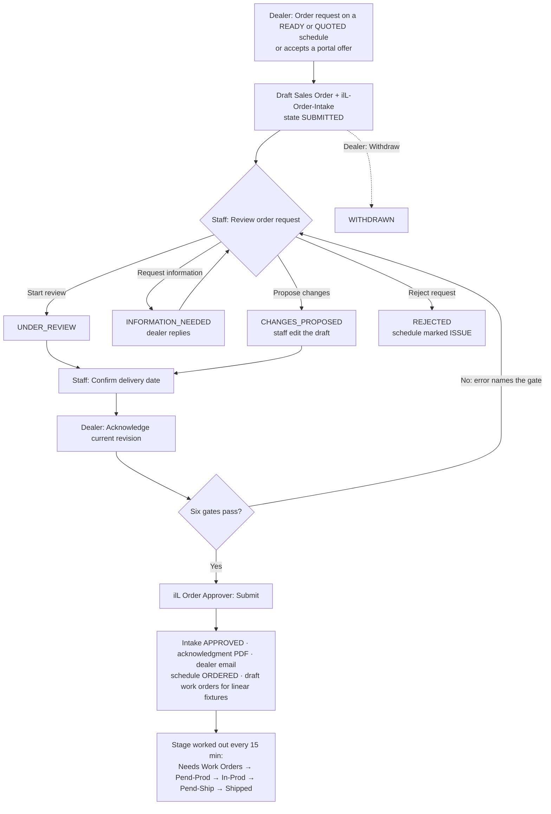

# Module 04: Sales orders

**Audience:** sales review, order approvers, operations, owner. **Length:** 2 sessions of 90 minutes (session 1: Lessons 4.1-4.4; session 2: Lessons 4.5-4.10 and the exercises).
**Roles used:** ilL Sales Review (review, confirm dates, decide change requests), ilL Order Approver (submit = approve), System Manager, Command Center Viewer / Editor / Finance, Sales User (email templates), Dealer (portal side).

## Purpose

Trainees can create a sales order every way it happens, review and approve a dealer's order request, read the order **Stage** and know what moves it, use the holds and ship-date fields the floor relies on, collect deposits and send the right customer emails, and process change, cancellation, reorder and replacement requests. They can also explain to a dealer exactly what the dealer sees on the portal at every step.

## Where to go

| What | Where |
|---|---|
| Sales orders stage | `/command-center#orders` |
| One order's page | `/command-center#so-<SO name>` |
| New sales order | `/app/sales-order/new` (or the stage's quick link "+ New sales order") |
| Sales orders list (Stage pill column) | `/app/sales-order` |
| Order requests (intakes) | `/app/ill-order-intake` (System Manager; others use the queue or the order's Portal request menu) |
| Order changes | `/app/ill-order-change` |
| Staff queues | `/app/ill-portal-operations` → Order review; Order changes and cancellations; Manufacturing drawing holds |
| Queue owners and SLA hours | `/app/ill-portal-routing-settings` |
| Automatic email switches | `/app/ill-email-settings` |
| Dealer side | `/portal/orders`, `/portal/orders/<SO>` |

## The process at a glance

1. **Request.** The dealer submits an order request from a READY or QUOTED schedule (or accepts a portal offer). A **draft** Sales Order and an **ilL-Order-Intake** (OI-#####) are created. The intake is assigned an owner from ilL-Portal-Routing-Settings, and the staff bell rings.
2. **Review.** Sales review opens the draft and picks a **Review order request** action. Every action except Start review needs a message, which is posted to the dealer's conversation and emailed.
3. **Promise.** Staff set the **Staff Confirmed Delivery Date** with **Confirm delivery date**. This also sets the order's delivery date and every line's delivery date.
4. **Acknowledge.** The dealer reviews prices, addresses and the confirmed date on the portal and clicks **Acknowledge current revision**. Any later staff edit to a price, line, address or date undoes it.
5. **Approve.** An ilL Order Approver submits the draft. Six gates are checked (Lesson 4.2). On success the intake goes APPROVED, the order acknowledgment PDF is issued, and the dealer is emailed.
6. **Build and ship.** Draft work orders appear for linear fixtures (Module 05). The order's Stage follows production, stock, purchasing and shipping (Lesson 4.4).
7. **Change.** After approval the dealer can ask for a change, cancellation or reorder from the order page (Lesson 4.8).

---

### Lesson 4.1: Four ways an order is created

**Objective:** pick the right way to start an order and know which ones follow the portal approval workflow.

| Path | How | Result | Portal approval workflow? |
|---|---|---|---|
| Dealer accepts a portal offer | Module 03, Lesson 3.8 | Draft SO + order request (intake) | Yes |
| Dealer orders straight from a schedule | Portal **Order request**: PO, billing / shipping address, purchasing contact, requested date, receiving / shipping instructions, files | Draft SO + intake (SUBMITTED) | Yes |
| From a desk Quotation | Quotation → **Create → Sales Order** | Draft SO | No: native ERPNext submit |
| Directly in the desk | `/app/sales-order/new` + **Configure & Add Fixture**, or a schedule's **Actions → Convert to Sales Order** | Draft SO | No: native ERPNext submit |

- **Only orders that carry an order request (intake) follow the buyer-acknowledgment workflow.** An amendment of such an order inherits it. Every other order, including Quotation → Sales Order for a schedule-linked Quotation, keeps native ERPNext behaviour: anyone with submit permission can submit it.
- Draft sales orders **create no demand**: no work orders, no shortages, no purchasing.
- **Configure & Add Fixture** shows for System Manager, ilL Sales Review and ilL Order Approver. It runs in three steps: **Project & Schedule** → **Line Details** → **Configure**. Step 1 lets you pick a project and fixture schedule, tick **Create a new project** / **Create a new schedule**, or tick **Skip schedule (add to this document only)**. Anyone else sees "The desk configurator is available to internal users only."
- The schedule form's **Actions → Convert to Sales Order** shows on READY or QUOTED schedules. It confirms "This will create Items and BOMs for configured fixtures (if needed) and generate a Sales Order. Continue?" and opens the new draft.
- **Tools → Set Section / Room** on a draft tags the selected rows (or every untagged row) with a section label. The print formats group lines by it.
- For a dealer order request, staff get a desk bell and an assignee from ilL-Portal-Routing-Settings (Lesson 4.10).
- The dealer's requested date must be **on or after today**, and the billing address, shipping address and purchasing contact must belong to the dealer's company ("Billing address, shipping address and purchasing contact are required").

> **SS-04-01** · Dealer: order request form from a schedule
> **URL:** `/portal/schedules/<schedule>` → Order · **Role:** Dealer (training.dealer) · **State:** a READY or QUOTED schedule
> **Highlight:** PO number, addresses, purchasing contact, requested date, instructions, files

> **SS-04-02** · Desk: new sales order with Configure & Add Fixture, step 1 (Project & Schedule)
> **URL:** `/app/sales-order/new` → Configure & Add Fixture · **Role:** ilL Sales Review (training.lead)
> **Highlight:** the three-step header; Create a new project; Skip schedule

**What you see:**
- The **Configure & Add Fixture** dialog over a new, unsaved Sales Order (the "Not Saved" badge shows behind it).
- Step chips **1 Project & Schedule** (active), **2 Line Details**, **3 Configure**.
- "Customer:" already filled from the order; the **Project** field holds a project id; **Fixture Schedule** is blank.
- Tick boxes **Create a new project**, **Create a new schedule**, **Skip schedule (add to this document only)**.
- **Cancel** and **Continue** at the bottom right. Behind the dialog: **Configure & Add Fixture**, **Tools**, **Get Items From** and **Save** in the toolbar, and the Shipping Instructions, Delivery Confirmed On / By and Accepted Portal Offer fields.

> **SS-04-03** · Quotation → Create → Sales Order menu
> **URL:** `/app/quotation/<submitted quotation>` · **Role:** ilL Sales Review (training.lead)
> **Highlight:** the Create menu; Sales Order

**What you see:**
- A submitted Quotation (status **Open**) with the stage pill **Follow Up · Waiting on Us · Sent 31 days ago, no reply** beside it.
- The **Create** menu open with one item, **Sales Order**.
- On the form: **Stage**, **Waiting On**, **Stage Detail** and **Stage Override** ("Leave blank to let the stage follow the order. Wins until cleared."), plus **Fixture Schedule** and **Amended From**.
- Toolbar: **Support**, **Create**, **Update Items**, **Set as Lost**, **Cancel**.

> **SS-04-31** · Fixture schedule Actions menu with Convert to Sales Order
> **URL:** `/app/ill-project-fixture-schedule/<READY or QUOTED schedule>` → Actions · **Role:** ilL Sales Review (training.lead) · **State:** a READY or QUOTED schedule; open the menu only, do not confirm
> **Highlight:** Actions → Convert to Sales Order; the schedule status

> **SS-04-32** · Configure & Add Fixture, step 2 (Line Details)
> **URL:** `/app/sales-order/new` → Configure & Add Fixture → Continue (tick Skip schedule) · **Role:** ilL Sales Review (training.lead) · **State:** unsaved new order; close without saving
> **Highlight:** the Line Details step and its fields

---

### Lesson 4.2: Reviewing and approving a dealer order request

**Objective:** take an order request from SUBMITTED to APPROVED and submit the SO.

#### Intake states

| State | Means | Who moves it here | Next |
|---|---|---|---|
| SUBMITTED | The dealer sent the request | Dealer (portal) | Staff review |
| UNDER_REVIEW | Staff are working on it | ilL Sales Review / Order Approver: **Start review** | Confirm date, propose changes, approve |
| INFORMATION_NEEDED | Waiting on the dealer to answer a question | Staff: **Request information** (message required) | Dealer replies in the conversation; staff pick another action. **Submit is blocked in this state** |
| CHANGES_PROPOSED | Staff changed the draft and want the dealer to accept | Staff: **Propose changes** (message required) | Dealer acknowledges the new revision |
| APPROVED | Submitted; order acknowledgment issued | ilL Order Approver: **Submit** | Production (Module 05) |
| REJECTED | Could not be approved; the schedule is marked ISSUE | Staff: **Reject request** (message required) | Dealer deletes the request or prepares a replacement draft |
| WITHDRAWN | The dealer pulled it | Dealer: **Withdraw pending request** (reason required, up to 4,000 characters) | Delete, or prepare a replacement draft |

#### The draft order's Portal request controls

On a draft SO linked to a fixture schedule (visible to System Manager, ilL Sales Review and ilL Order Approver):

- **Banner** at the top: "Portal request: <state>", then what is next. Examples: "Waiting on the buyer to complete the PO, addresses and contact." · "Confirm a delivery date next." · "Waiting on the buyer to acknowledge this revision." (orange, with "Changed since the buyer last acknowledged: …") · "The buyer acknowledged this revision on <date>. Ready to submit." (green). Open change requests show as "Buyer requests waiting on staff: Change (OC-00001)" links.
- **Portal request** menu: **Intake, files and conversation** (opens the intake), **Conversation with buyer**, **Confirm delivery date** (drafts only).
- **Review order request** button (drafts with an open request, or none yet). On a schedule-linked draft with no request, the first action **starts one** in UNDER_REVIEW, which puts that order under the portal approval workflow from then on. The dialog has an **Action** select with four choices and a **Message to buyer** box ("Posted in the buyer's portal conversation for this order."):

| Action | Sets the intake to | Message |
|---|---|---|
| Start review | UNDER_REVIEW | Optional |
| Request information | INFORMATION_NEEDED | Required |
| Propose changes | CHANGES_PROPOSED | Required |
| Reject request | REJECTED (and the schedule to ISSUE) | Required |

- **Approval is not in the dialog.** You approve by **submitting** the Sales Order.
- **Confirm delivery date** asks for "Confirmed delivery date" and saves. Then: "The delivery promise is saved. Ask the buyer to review and acknowledge the current order revision before approval." The date can't be in the past, and it also becomes the order's Delivery Date and every line's delivery date. **Delivery Confirmed On / By** are stamped automatically.

#### The six gates checked on Submit

Submit runs these checks, in this order, on portal orders only. Each failure stops the submit with the message shown.

| # | Gate | Error text when it fails |
|---|---|---|
| 0 | You hold ilL Order Approver or System Manager **and** Sales Order submit permission | "Staff review access required" / "ERP Sales Order permission required" |
| 1 | The buyer completed the intake (PO, addresses, receiving) | "Complete the buyer's PO, address and receiving intake before approval" |
| 2 | Staff confirmed a delivery date | "Authorized staff must confirm the delivery date before buyer acknowledgment and approval" |
| 3 | Billing address, shipping address and contact are set and belong to the customer | "Billing, shipping and purchasing-contact context is required" |
| — | The intake is SUBMITTED, UNDER_REVIEW or CHANGES_PROPOSED | "Resolve the order intake before approval" |
| 4 | The buyer acknowledged the **current** revision, and still has purchasing access | "The buyer must acknowledge the current order revision before approval. Changed since the buyer acknowledged: …" / "The acknowledging buyer no longer has purchasing access; obtain a current buyer acknowledgment" |
| 5 | A linked offer is still ACCEPTED, for this order and customer, and its Quotation is not cancelled | "The accepted offer link cannot be removed from this order request" / "This order request no longer has a valid accepted offer" / "The accepted Quotation was cancelled; Sales must resolve the order request" |
| 6 | Every configured row has an active, submitted BOM (each run of a group; each light engine of a ship-in-pieces fixture) | "Row 3: an active submitted BOM for the ordered Item is required" / "Row 3: every run in the group needs an active submitted BOM" |

- **What counts as a new revision:** customer, PO number and date, terms, totals, addresses, contact, the accepted offer, requested and confirmed dates, receiving and shipping instructions, and every line's item, qty, UOM, rate, amount, description, delivery date, fixture type, section, notes and configuration. A dealer's own PO-number edit keeps their acknowledgment.
- Drawings are **not** checked here. A drawing required for manufacturing blocks the **work order** instead (Lesson 4.6, Module 02 Lesson 2.5).
- **On approval:** intake APPROVED with Approved By / On, an **order acknowledgment PDF** is generated and attached to the intake, the note "Order approved. Your order acknowledgment is ready to download from this page." is posted in the conversation, the dealer gets the "Order approved" email, and the schedule moves to **ORDERED**.
- **On rejection:** the schedule is marked **ISSUE**. The rejected draft is kept as evidence. It can be deleted once the request is REJECTED or WITHDRAWN; the request and its conversation stay.
- Trying to delete a draft whose request is still open fails: "The buyer's order request OI-##### is still open. Reject it with Review order request (the buyer is told why), or ask the buyer to withdraw it, before deleting this order."
- Two people deciding at once: "The order changed. Reload and review the current revision before deciding."

> **SS-04-04** · Draft SO with the Portal request banner and button group
> **URL:** `/app/sales-order/<draft>` · **Role:** ilL Order Approver (training.lead) · **State:** intake UNDER_REVIEW
> **Highlight:** banner; Confirm delivery date; Review order request

> **SS-04-05** · Review order request: the Portal request menu and the dialog's four choices
> **URL:** `/app/sales-order/<SO>` → Portal request; on a draft, Review order request · **Role:** ilL Order Approver (training.lead)
> **Highlight:** the Portal request menu items; the Action select

**What you see:**
- This capture is the **approved** order ilL-SAL-ORD-Jeremy Test Integrations-00001 (status **To Deliver and Bill**), so the **Portal request** menu shows only **Intake, files and conversation** and **Conversation with buyer**. Confirm delivery date and Review order request show on drafts only; SS-04-25 captures the dialog itself.
- The green banner **Portal request: Approved**.
- Toolbar: **Update Items**, **Portal request**, **Actions**, **Support**, **Open in portal**, **Status**, **Create**, **Cancel**.
- The portal block of fields: **Buyer Requested Delivery Date** 11-05-2026, **Staff Confirmed Delivery Date** 11-30-2026, **Receiving Instructions**, **Shipping Instructions**, **Delivery Confirmed On** 11-05-2026 08:45:29, **Delivery Confirmed By**, **Accepted Portal Offer** (blank: this order came straight from a schedule).

> **SS-04-25** · Review order request dialog with its four actions
> **URL:** `/app/sales-order/<draft portal order>` → Review order request → open the Action select · **Role:** ilL Order Approver (training.lead) · **State:** a draft with an open intake (none on staging; the lead decides). Close with the X; do not save
> **Highlight:** Start review, Request information, Propose changes, Reject request; Message to buyer

> **SS-04-26** · Confirm delivery date prompt
> **URL:** `/app/sales-order/<draft portal order>` → Portal request → Confirm delivery date · **Role:** ilL Order Approver (training.lead) · **State:** same draft as SS-04-25; close without saving
> **Highlight:** the Confirmed delivery date field; Save

> **SS-04-27** · (pair) Banner before and after the buyer acknowledges
> **URL:** `/app/sales-order/<draft portal order>` · **Role:** ilL Order Approver (training.lead) · **State:** -a orange "Waiting on the buyer to acknowledge this revision" with a "Changed since…" line; -b green "Ready to submit" (needs a dealer acknowledgment; the lead decides)
> **Highlight:** the banner colour and wording

> **SS-04-06** · Submit blocked: "buyer must acknowledge current revision" message
> **URL:** `/app/sales-order/<draft portal order>` → Submit · **Role:** ilL Order Approver · **State:** edited after acknowledgment (needs a submit attempt; the lead decides)
> **Highlight:** the error text and the "Changed since" list

> **SS-04-07** · Dealer: Acknowledge current revision on the order page
> **URL:** `/portal/orders/<SO>` · **Role:** Dealer (training.dealer) · **State:** draft order with a confirmed date, not yet acknowledged
> **Highlight:** Next step banner; Acknowledge current revision

> **SS-04-08** · Order acknowledgement PDF
> **URL:** attachment on the intake / dealer "Download issued acknowledgment" · **Role:** Dealer or System Manager
> **Highlight:** the header, confirmed date, lines

> **SS-04-28** · ilL-Order-Intake record: state, decisions and acknowledgment
> **URL:** `/app/ill-order-intake/OI-00209` · **Role:** Administrator · **State:** the approved staging intake
> **Highlight:** State; Acknowledged By / On; Approved By / On; Decisions table; Acknowledgment File

> **SS-04-29** · Order requests list
> **URL:** `/app/ill-order-intake` · **Role:** Administrator
> **Highlight:** State column; Sales Order; Assigned To; Due Date

> **SS-04-30** · Conversation with buyer dialog
> **URL:** `/app/sales-order/ilL-SAL-ORD-Jeremy Test Integrations-00001` → Portal request → Conversation with buyer · **Role:** ilL Order Approver (training.lead) · **State:** read only; do not post
> **Highlight:** the "Order approved…" decision note; the reply box

> **SS-04-09** · Portal Operations → Order review queue
> **URL:** `/app/ill-portal-operations` · **Role:** ilL Sales Review (training.lead)
> **Highlight:** the Order review card and its filter chips

**What you see:**
- Portal Operations signed in as **Training Lead**, with **Refresh** at the top right.
- Count cards: **Drawing responses** 1, **Drawing reapproval** 0, **Incomplete exports** 28.
- **Operations · 3 waiting**: **Manufacturing drawing holds** 0 ("Drawings required for manufacturing that are not approved yet") and **Materials to order** 3.
- **Support · 0 waiting** (Support responses) and **Sales Inbox · 0 waiting** (Sales inbox).
- The **Order review** card: "Orders dealers submitted for review before they become sales orders.", filter chips **Everything**, **Assigned to me**, **Unassigned**, **Overdue**, a **Search by ID…** box, and the empty state "Nothing is waiting in this queue."

---

### Lesson 4.3: The Sales orders stage and the per-order page

**Objective:** use `#orders` and `#so-<name>` to spot orders that need attention.

#### `#orders`, region by region

| Region | What it shows | Actions |
|---|---|---|
| Header + quick links | "Order requests from the portal, then every open order with its progress, to-dos, tasks and anything that needs correcting." | **+ New sales order**, Sales orders, Order requests, Order changes, Order tickets, Delivery notes |
| Stats | **Open orders** (count + total $), **Past delivery date**, **Need materials** (orders with short items), **Need correcting** (flags below) | None |
| Order requests lanes | **Submitted** (New from the portal) · **Under review** · **Information needed** (Waiting on the dealer) · **Changes proposed** (Waiting on the dealer to accept) · **Approved** (Last 30 days). Cards: state badge, age, OI number and customer, schedule, the dealer's message, linked order and value, due date, owner | **Details**, **+ To-do**, **↗** (open the intake) |
| Drawing requests tied to sales orders | Manufacturing sign-off and other drawings for orders (shows only when there are any) | Open the request |
| Open sales orders | One row per order: number, customer, ERPNext status; mini steps (Ordered › Materials › Production › Shipped › Billed) and their words; value and due date (red when past); ticket, to-do and task pills; up to two flags (+n more) | Click a row → `#so-<name>` |
| Order tickets | Lanes **Our move** (Open), **Waiting on customer** (Replied: follow up if quiet for 10+ days), **Done (last 30 days)** | **Link sales order** on a ticket with none |
| Draft sales orders | "Not submitted, so they create no demand yet": Draft, Customer, Lines, Value, Created | Open the draft |
| Order change requests | Request, Order, Type, State, Owner, Due | Open the change |

#### `#so-<name>`, region by region

- **Header:** order name, customer · ERPNext status · due date · value. Buttons **+ Add to-do** and **Open in ERPNext**. Quick links: Sales orders, **+ New delivery note**, **+ New sales invoice**.
- **Step bar:** Ordered (Submitted) → Materials (In stock / n short) → Production (n need WO / n WO open / Done / none) → Shipped (Not yet / Ready / n% / Delivered) → Billed.
- **Needs correcting** flags: order value $0 or less; On hold; Past delivery date; n line(s) on retired part numbers; n duplicate/stale work order(s); "May have shipped without a Delivery Note"; open change requests ("Change request under review").
- **To-dos:** ERPNext ToDos on this order, with owners, due date and a ✓ to close.
- **Related:** Quotation, Tickets, Projects, Order requests (with state badge), Drawing requests, Tasks open.
- **Order lines:** Item, Qty, Delivered, Amount, and a "Retired code" badge.
- **Purchasing needed for this order:** short components (Item, Short, Supplier, Order by, Draft PO / MR) with a **Draft MR** button, then the purchase orders feeding the order with ETA badges ("overdue", "late for this order").
- **Manufacturing:** active work orders with status badges, "Duplicate/stale" badges and **Needs WO** rows for build lines without one.
- An order that is not open shows "Order not open" with **Open in ERPNext**.

> **SS-04-10** · Sales orders stage, full page
> **URL:** `/command-center#orders` · **Role:** Editor + Finance (training.lead)
> **Highlight:** order request lanes; mini steps on a row; Draft SOs table

**What you see:**
- The Command Center top bar (search, **Meeting mode**, **Refresh**, **+ Add task**) and the tab row (Sales pipeline, Executive, Inbox 57, Finance, Projects & tasks 700, Review, Agenda, Workbench, Catalog, Recommendations).
- Header **Sales orders** and the quick links **+ New sales order**, Sales orders, Order requests, Order changes, Order tickets, Delivery notes.
- The pipeline stepper with **Sales orders 22 · $36K open** highlighted.
- Stats: **Open orders 22** ($36,297 total), **Past delivery date 21** (red), **Need materials 0** (Orders with short items), **Need correcting 21** (Flags below).
- **Order requests** lanes: Submitted 0, Under review 0, Information needed 0, Changes proposed 0, **Approved 1** with card **OI-00209 · Jeremy Test Integrations**, Schedule Main Schedule, its order chip, age **11d**.

> **SS-04-11** · Per-order page with Needs correcting flags
> **URL:** `/command-center#so-<name>` · **Role:** Editor + Finance (training.lead) · **State:** an SO with at least one flag
> **Highlight:** step bar; flags; Draft MR button; + Add to-do

**What you see:**
- **← All sales orders**, the order **Jeremy Test Integrations-00001**, "To Deliver and Bill · due Nov 30 · $5,160".
- **+ Add to-do** (orange) and **Open in ERPNext**; quick links Sales orders, **+ New delivery note**, **+ New sales invoice**.
- Step bar: **Ordered** ✓ Submitted, **Materials** ✓ In stock, **Production** ! 5 need WO, **Shipped** Not yet, **Billed** Not yet.
- **Needs correcting:** "Nothing flagged" (this order has no flags; recapture on a flagged order for the Highlight). **To-dos:** "No to-dos". **Related:** Order requests **OI-00209 Approved**.
- **Order lines (27 lines)** with Item, Qty, Delivered, Amount.

> **SS-04-36** · Open sales orders rows with mini steps and flags
> **URL:** `/command-center#orders` → scroll to Open sales orders · **Role:** Editor + Finance (training.lead)
> **Highlight:** mini steps; red due date; flag badges and "+n"

> **SS-04-37** · Per-order page, lower half: Purchasing needed and Manufacturing
> **URL:** `/command-center#so-<name>` · **Role:** Editor + Finance (training.lead) · **State:** an order with short items or build lines that need a work order
> **Highlight:** Draft MR; PO ETA badges; Needs WO rows

> **SS-04-38** · + Add to-do side sheet on an order
> **URL:** `/command-center#so-<name>` → + Add to-do · **Role:** Editor (training.lead) · **State:** close without saving
> **Highlight:** To-do, Owners, Due, Priority, Notes

> **SS-04-39** · Order request card actions
> **URL:** `/command-center#orders` → Approved lane → OI-00209 card · **Role:** Editor (training.lead)
> **Highlight:** state badge; age; Details, + To-do and ↗ buttons

**DATA-04-01** · Our job's sales order (from DATA-02-01) with its stage history
**API:** `GET /api/resource/Sales Order/<name>` and `GET /api/resource/Version?filters=[["ref_doctype","=","Sales Order"],["docname","=","<name>"]]&fields=["creation","data"]&order_by=creation asc`
**Use:** "life of an order" timeline slide

**DATA-04-03** · Order requests by state, with owner and due date
**API:** `GET /api/resource/ilL-Order-Intake?fields=["name","state","sales_order","customer","assigned_to","due_date","creation"]&order_by=creation desc&limit_page_length=50`
**Use:** the order-request lanes slide; staging held OI-00005 (REJECTED) and OI-00209 (APPROVED) on 2026-11-24

---

### Lesson 4.4: Order stage: what it means and what moves it

**Objective:** read the stage pill and know what will move it next.

The **Stage** is worked out from data ERPNext already has. It shows as a coloured pill beside the status on the form (hover it for Waiting On and Stage Detail) and in the list's Stage column. **Stage Override** wins until it is cleared, except that a cancelled order is always **Cancelled** and a Completed or Closed order is always **Completed**.

#### Stage lifecycle

| Stage | Pill | Waiting On | What moves an order here |
|---|---|---|---|
| Pending Approval | gray | Us | Any draft (no override) |
| Hold for Release | purple | Customer | Hold Reason = Hold for Release; shows Likely Ship Date |
| Hold for Confirmation | purple | Customer | Hold Reason = Hold for Confirmation; shows Likely Ship Date |
| Needs Work Orders | red | Us | Submitted, has build points, and no work order yet |
| Pend-Prod | blue | Warehouse | Work orders exist, materials allocated, nothing started |
| Waiting for parts | orange | Vendor | Short after stock is handed out in ship-date order. Stage Detail: "Parts ETA <date>" or "No PO for short parts" |
| In-Prod | green | Warehouse | A work order is In Process or has material transferred |
| Paint | orange | Vendor | An open PO to the paint supplier group is linked to the order |
| Held | red | Us | ERPNext **On Hold** status, or a **Stopped** work order |
| Pend-Ship | green | Warehouse | Every work order complete, or nothing to build (stock lines only) |
| Hold for Ship | purple | Customer | Hold Reason = Hold for Ship |
| Will Call - Ready | green | Customer | Built, and Proforma / Will Call = Will Call |
| Proforma - Awaiting Payment | yellow | Customer | Built, Proforma, and not paid in full (advance or invoices) |
| Partially Shipped | light blue | Warehouse | Built and some delivered; Stage Detail "Partially Shipped (n%)" |
| Shipped / In Transit | cyan | — | 100% delivered |
| Delivered | dark gray | — | **Stage Override only** |
| Completed | gray | — | ERPNext status Completed (delivered and billed) or Closed |
| Cancelled | red | — | Cancelled |

- **First match wins**, in this order: Cancelled → Completed/Closed → Stage Override (Stage Detail "Override") → draft = Pending Approval → 100% delivered = Shipped / In Transit → a Hold Reason → the production board's status (Pend-Ship family, Needs Work Orders, Waiting for parts, In-Prod, Paint, Held, Pend-Prod).
- The older "Production Status Override" field was merged into **Stage Override**. Some staging screenshots still show the old label; retake them after the next migrate.
- **What refreshes the stage:** saving, submitting or cancelling a Sales Order; any Work Order change (drafts too); Stock Entry, Payment Entry, Sales Invoice, Delivery Note, Purchase Order and Purchase Receipt submits and cancels. Each queues **one** refresh of all open orders. A sweep every **15 minutes** catches Close, On Hold and anything ERPNext changes without hooks. Expect up to 15 minutes' lag.
- A Stage Override shows **at once** on save. Clearing it keeps the old stage until the next refresh.
- Shortages are shared across all open orders in ship-date order, so **one order's stage can change when another order changes**.
- The same Stage, Waiting On and Stage Override fields exist on Quotations (Module 03).

> **SS-04-12** · Sales order list coloured by stage
> **URL:** `/app/sales-order` · **Role:** Administrator · **Highlight:** stage pills

**What you see:**
- The **Sales Order** list, 20 of 235, with **List View**, refresh, **Add Sales Order**.
- Standard filters: ID, Company, Customer, Customer Name, Date, **Delivery Status**, **Billing Status**, **Advance Payment Status**, **Estimated Ship Date**, **Hold Reason**.
- Columns Customer Name, Project, **Status** (To Deliver and Bill, Overdue, Completed, Closed, Cancelled pills), **% Delivered** bars, Delivery Date.
- The **Stage** column is not in this list's column settings yet, so the pills shown are ERPNext statuses. SS-04-34 captures the Stage column. Redact customer names before publishing.

> **SS-04-13** · SO form header with stage pill, Waiting On and Stage Detail
> **URL:** `/app/sales-order/<name>` · **Role:** Administrator
> **Highlight:** the stage pill; Stage, Waiting On, Stage Detail fields

**What you see:**
- The approved order with status **To Deliver and Bill** and the green **Portal request: Approved** banner.
- Toolbar **Update Items**, **Portal request**, **Actions**, **Support**, **Open in portal**, **Status**, **Create**, **Cancel**.
- At this window width the stage pill is pushed out of the title bar (it shows in SS-04-17 as **Waiting**). SS-04-33 recaptures it wider, with the hover text.
- Fields shown: Buyer Requested / Staff Confirmed Delivery Date, Receiving / Shipping Instructions, Delivery Confirmed On / By, Accepted Portal Offer, Customer, Order Type, Date, Delivery Date 11-30-2026.

> **SS-04-33** · Stage pill with hover text on the form
> **URL:** `/app/sales-order/ilL-SAL-ORD-Jeremy Test Integrations-00001` · **Role:** Administrator · **State:** wide window (1600 px); hover the pill
> **Highlight:** "Waiting for parts · Waiting on Vendor · No PO for short parts"

> **SS-04-34** · Sales order list with the Stage column, filtered to one stage
> **URL:** `/app/sales-order?ill_stage=Needs%20Work%20Orders` · **Role:** Administrator · **State:** add Stage to the list columns (List Settings) for the capture only
> **Highlight:** the Stage pills; the filter chip

> **SS-04-35** · Stage Override options
> **URL:** `/app/sales-order/<submitted order>` → Stage Override select open · **Role:** Administrator · **State:** open the select only; do not save
> **Highlight:** the 18 options; the field description

**DATA-04-02** · Open orders by stage
**API:** `GET /api/resource/Sales Order?filters=[["docstatus","=",1],["status","not in",["Completed","Closed","Cancelled"]]]&fields=["ill_stage",{"COUNT":"*","as":"n"}]&group_by=ill_stage`
**Note:** this Frappe version refuses `count(name) as n` as a string; use the dict form above. On 2026-11-24 staging returned Held 3, Needs Work Orders 5, Partially Shipped 4, Pend-Ship 8, Shipped / In Transit 1, Waiting for parts 2.

---

### Lesson 4.5: Ship dates, holds, proforma and will call

**Objective:** set the fields that drive the production board and customer emails.

#### Field reference: Sales Order (ilLumenate fields)

| Label (as shown) | Where on the form | Meaning | Who fills it | Required | Editable after submit | Flows to |
|---|---|---|---|---|---|---|
| Buyer Requested Delivery Date | Details, top | The date the dealer asked for | Dealer (intake) | Yes, on portal requests | No (read only) | Portal "Requested delivery"; acknowledgment |
| Staff Confirmed Delivery Date | Details, top | Our promise to the dealer | Staff via Confirm delivery date | Yes, before approval | No: use an order change | Delivery Date and line dates; acknowledgment; portal "Confirmed delivery" |
| Receiving Instructions | Details | Dock, hours, contact on site | Dealer (intake) | No | No | Print formats; floor |
| Shipping Instructions | Details | Carrier, account, special handling | Dealer (intake) | No | No | Print formats; shipping |
| Delivery Confirmed On / By | Details | Who made the promise and when | Automatic | — | — | Audit |
| Accepted Portal Offer | Details | The offer the dealer accepted (blank when ordered from a schedule) | Automatic | — | — | Gate 5 |
| Stage / Waiting On / Stage Detail | Details, under Delivery Date | Worked-out stage | Automatic | — | Read only | List pill; Command Center |
| Stage Override | Details | Forces a stage until cleared | Ops lead | No | Yes | Stage; Flow tab step |
| Fixture Schedule | Details | Source schedule | Automatic | — | Read only | Portal governance; schedule status |
| Estimated Ship Date | Connections → Manufacturing | The day it leaves our warehouse; blank falls back to the delivery date | Ops lead / floor | No | Yes | Production board, Flow tab, on-time %, ship-date emails |
| Proforma / Will Call | Connections → Manufacturing | Proforma = pay before shipping; Will Call = customer pickup | Sales / accounts | No | Yes | Stage; Proforma & will call tab |
| Likely Ship Date | Connections → Manufacturing | When a held release is expected to ship | Sales | No | Yes | Monthly report release projections |
| Hold Reason | Connections → Manufacturing | Hold for Release / Hold for Confirmation / Hold for Ship | Sales / ops | No | Yes | Stage; Releases & holds tab; "On hold" email |
| Floor Notes | Connections → Manufacturing | Notes for the production floor | Anyone with edit | No | Yes | Board queue Notes column |
| Build Points, Build Hours, Worth Per Point, 2C-6C Runs, Wet-Rated Runs, FMC / Jumpers, Assemblies, Loose (Bulk Reels) | Connections → Manufacturing | Difficulty of the build (Module 05, Lesson 5.6) | Automatic | — | Read only | Production board |
| Build Count Adjustments / Why the Build Counts Were Adjusted | Connections → Manufacturing | Hand corrections from the board queue | Board **Edit** | — | Read only | Points |

- Labels confirmed against staging `getdoctype` on 2026-11-24.
- Edit the after-submit fields in the desk or in the Command Center side sheet (Editor). The sheet says "Submitted: only these fields can change after submit. Open it in ERPNext for anything else."
- Changing a submitted portal order's delivery promise is refused: "Use an approved order-change workflow to change a submitted delivery promise" (Lesson 4.8).

> **SS-04-14** · SO form: production and hold section
> **URL:** `/app/sales-order/<name>` → Connections tab, Manufacturing section · **Role:** Administrator · **Highlight:** Estimated Ship Date; Hold Reason; Likely Ship Date; Proforma / Will Call; Floor Notes

**What you see:**
- The Manufacturing section under the **Connections** tab: **3C Runs** 0, **4C Runs** 0, **5C Runs** 0, **6C Runs** 5 on the left.
- On the right: **Estimated Ship Date** (blank) with "The day the order leaves our warehouse. Used by the production board; blank falls back to the delivery date."
- A select still labelled **Production Status Override** ("Leave blank: the board works status out from Work Orders, stock and deliveries."). This is the old label for **Stage Override**; retake after migrate.
- **Floor Notes**, **Hold Reason**, **Proforma / Will Call**, **Build Count Adjustments** ("Set from the production board order queue…") and **Why the Build Counts Were Adjusted**.

> **SS-04-15** · Editing Estimated Ship Date from the Command Center side sheet
> **URL:** `/command-center#mfg` (Flow) → click an order → side sheet · **Role:** Editor (training.lead)

**What you see:**
- The side sheet over the Flow tab's Submitted sales orders table.
- Collapsed child tables with counts: Item Wise Tax Details 7, Packed Items 0, Pricing Rule Detail 7, **Payment Schedule 1**, Sales Team 0, and "Change these rows in ERPNext."
- The **EDIT** section with "Submitted: only these fields can change after submit. Open it in ERPNext for anything else."
- Fields **Stage Override**, **Estimated Ship Date** (focused, date picker), **Proforma / Will Call**, **Likely Ship Date**, **Hold Reason**, **Floor Notes**.

> **SS-04-40** · (pair) Setting Hold Reason moves the stage
> **URL:** `/app/sales-order/<submitted order>` · **Role:** Administrator · **State:** -a before, -b after setting Hold Reason = Hold for Release and waiting for the refresh (changes a staging order; the lead decides)
> **Highlight:** the stage pill; Likely Ship Date

---

### Lesson 4.6: Drawing holds and the readiness view

**Objective:** know where a drawing hold shows and why it does not block approval.

- Approving an order never checks drawings. A drawing request with **Required for manufacturing** ticked blocks **submitting a work order** for that order until its current revision is approved by the technical reviewer (Kevin or Jay, decision 8).
- Error on work order submit: "Manufacturing is on hold: drawing request DR-… requires approval of its current revision". If the order changed after the drawing was approved for the schedule: "Manufacturing is on hold: DR-… covers the schedule. Link a drawing review to this changed order and obtain approval." A request for another order revision: "Drawing request DR-… belongs to another order revision; Engineering must review this order".
- **Where to see holds:** Portal Operations → **Manufacturing drawing holds** (ilL Operations role); `#orders` → **Drawing requests tied to sales orders**; `#so-<name>` → Related → Drawing requests.
- **Readiness at a glance:** the per-order step bar (Materials, Production, Shipped), the **Need materials** and **Need correcting** stats, and the Shipping stage's "Ready per ERPNext" count (no draft work orders or shortages). The Product readiness dashboard (`/app/product-readiness`) is a catalog tool covered in Module 11, not an order view.
- The manual email template **ilL - Sales Order - Drawings ready for approval** tells a non-portal customer drawings are attached for approval.

> **SS-04-41** · Drawing requests tied to sales orders on `#orders`
> **URL:** `/command-center#orders` → Drawing requests tied to sales orders · **Role:** Editor (training.lead) · **State:** at least one drawing request linked to an order
> **Highlight:** status badges; required-for-manufacturing requests

> **SS-04-42** · Work order submit blocked by a drawing hold
> **URL:** `/app/work-order/<draft for an order with an unapproved required drawing>` → Submit · **Role:** Manufacturing Manager · **State:** needs a submit attempt; the lead decides
> **Highlight:** "Manufacturing is on hold: drawing request … requires approval of its current revision"

---

### Lesson 4.7: Deposits, terms and customer emails

**Objective:** collect deposits and keep the dealer informed.

- Terms: prepay unless approved for Net 30. Credit control is native ERPNext (customer credit limit and payment terms).
- **Deposits** come from the SO payment schedule (Terms tab): with several rows, the first unpaid row is the **Deposit**; a single row due within 3 days of the order date is **Payment in advance**. Paid rows are skipped.
- To collect before production, invoice from the SO in full with a payment schedule (Module 09; decision 1). Deposits must be invoiced, not recorded as loose advances, or QuickBooks payments fail to match.
- **Print formats:** **ilL Sales Order** (order acknowledgment layout: order date, your PO, requested delivery, confirmed ship date, project, schedule, bill to, ship to, attention, lines grouped by section with list, discount, net, amount; an On Hold note with the hold reason; shipped / billed %, advance paid, balance) and **ilL Sales Order - MSRP** (retail prices for the dealer's client).
- **Automatic emails** (ilL-Email-Settings → Automatic Emails; both **off** on staging on 2026-11-24; decision 2 recommends on):
  - **Email Order Confirmation on Sales Order Submit**: the "Order confirmation" template with the ilL Sales Order PDF, sent in the background to the order's contact.
  - **Also Email Dealer Portal Users**: off means a contact who is a portal user gets only the portal email.
  - **Send From Email Account**, **BCC Every Automatic Email To**, **Attach the PDF**, **Lines Listed in an Email** (15 on staging).
- **Portal emails** (always on, to the dealer's portal users): information requested, revision ready for review, request needs a correction, withdrawn, **order approved**, order change outcome, shipped.
- **Manual templates** (Email → Use template), all named "ilL - Sales Order - …": Order confirmation; Deposit request; On hold, action needed; Ship date update; Ship date changed; Ready for pickup; Proforma, pay before shipping; Partial shipment; Order change confirmed; Status update; Drawings ready for approval.
- The **ilL - Ship date update** Notification (Value Change on Estimated Ship Date) exists but is **disabled**. Decision 2: keep it off and send "Ship date changed" by hand.
- **Will Call Pickup** (Pickup Address, Pickup Hours) in ilL-Email-Settings prints in the Ready for Pickup email.

> **SS-04-16** · SO payment schedule with a deposit row
> **URL:** `/app/sales-order/<name>` → Terms tab · **Role:** Administrator · **Highlight:** payment schedule table

**What you see:**
- The **Terms** tab with **Payment Schedule**: columns No., Payment Term, Description, Due Date, Invoice Portion, Payment Amount. One row: due 11-05-2026, **100%**, **$4,897.79**. A single row due on the order date counts as **Payment in advance**; a two-row schedule (SS-04-43) shows a true deposit.
- **Terms & Conditions** (Terms, Terms and Conditions Details) empty.
- **Comments** and **Activity**: the mail-in address, "Kevin Schern submitted this document", "changed the value of Status from Draft to To Deliver and Bill", Pricing Rule Detail rows. **+ New Email** at the right.

> **SS-04-43** · Payment schedule with a deposit and a balance row
> **URL:** `/app/sales-order/<order with a 2-row schedule>` → Terms · **Role:** Administrator · **State:** an order whose payment terms template has a deposit (for example 50 / 50)
> **Highlight:** row 1 Deposit; row 2 Balance; due dates

> **SS-04-17** · Email composer with the SO template list open
> **URL:** `/app/sales-order/<name>` → + New Email · **Role:** Administrator · **Highlight:** the "ilL - Sales Order - …" templates

**What you see:**
- The composer titled **Sales Order: ilL-SAL-ORD-Jeremy Test Integrations-00001** over the form; the header shows the status **To Deliver and Bill** and a **Waiting** stage pill.
- **To** holds the order contact; the recipient suggestion list (training users) is open, covering the **Use template** link. Recapture with the template list open (SS-04-44).
- The attached print **ilL Sales Order • ilLumenate** with preview, edit and remove icons.
- **CC**, **BCC**, **Discard** and **Send**. Do not press Send on staging.

> **SS-04-44** · Use template: the Sales Order template list
> **URL:** `/app/sales-order/<name>` → + New Email → Use template · **Role:** Administrator · **State:** close with Discard
> **Highlight:** the 11 "ilL - Sales Order - …" templates

> **SS-04-18** · ilL-Email-Settings: automatic email switches
> **URL:** `/app/ill-email-settings` · **Role:** System Manager (Administrator)

**What you see:**
- **Point of Contact Fallback** ("Customer and supplier emails sign off with the document's own contact…"): Sales Contact Name **ilLumenate Lighting Sales**, Sales Contact Email, Phone; Purchasing Contact Name, Email, Phone.
- **Will Call Pickup** ("Printed in the Ready for Pickup email."): Pickup Address and Pickup Hours, both empty.
- **Automatic Emails** ("Sent in the background after the document is submitted, with the ilL email template and its PDF attached, and recorded in the document's timeline…"): **Email Order Confirmation on Sales Order Submit** and **Email Shipment Notice on Delivery Note Submit**, both unticked; **Send From Email Account**.

> **SS-04-45** · ilL-Email-Settings: the rest of Automatic Emails and Content
> **URL:** `/app/ill-email-settings` → scroll · **Role:** Administrator
> **Highlight:** Also Email Dealer Portal Users; BCC; Attach the PDF; Lines Listed in an Email

> **SS-04-46** · Disabled "ilL - Ship date update" notification
> **URL:** `/app/notification?document_type=Sales%20Order` · **Role:** Administrator
> **Highlight:** Enabled unticked; Value Change event

> **SS-04-19** · Print preview: ilL Sales Order
> **URL:** `/app/sales-order/<name>` → Print → ilL Sales Order · **Role:** Administrator

**What you see:**
- **SALES ORDER**, the order number and "Order acknowledgement" under it; company address and contact line.
- Facts: **Order Date** 11-05-2026, **Your PO** 1234, **Requested Delivery** 11-05-2026, **Confirmed Ship Date** 11-30-2026, **Project**, **Fixture Schedule** Main Schedule, **Prepared By**.
- **Bill To**, **Ship To**, **Attention** (redact contact details before publishing).
- Lines grouped under **KITCHEN** and **OFFICE** with Fixture Type (L1-1, L1-2, L1-3, L2-1), item names and codes, power-supply notes ("Power supply for L1-1"), a multi-run group with each run's length and leader, and **QTY, LIST, DISC, NET, AMOUNT**. "Kitchen subtotal $2,008.92".
- **Print** and **Get PDF** at the top right.

> **SS-04-47** · Print preview: ilL Sales Order - MSRP
> **URL:** `/app/sales-order/<name>` → Print → ilL Sales Order - MSRP · **Role:** Administrator
> **Highlight:** retail prices; no dealer discount

---

### Lesson 4.8: Changes, cancellations, reorders and replacements

**Objective:** process a dealer's order change request correctly.

| Type | Dealer can ask when | What happens on submit | Staff action to finish |
|---|---|---|---|
| Change | Order approved (submitted) | ilL-Order-Change (OC-#####) SUBMITTED | Cancel the SO, amend it, get a fresh intake, buyer acknowledgment and approval, then **Complete** with the amended order as the result |
| Cancellation | Order approved | OC SUBMITTED | Cancel the SO in the desk, then **Complete** |
| Reorder | Order approved | A new DRAFT schedule "Reorder: <name>" is created; the request completes at once | None: the dealer reconfigures and requests a new quote / order |
| Replacement | After a rejection, withdrawal or cancellation | A new DRAFT schedule "Replacement: <name>" is created; completes at once | None |

- The dealer must explain the request (up to 4,000 characters) and can attach up to 10 files.
- New schedules copy the customer's lines and say "Reconfigure each configured line with current specifications; prices are recalculated before a new request." Current engineering and price review are required.
- **Staff decisions** in `/app/ill-order-change/<name>` (or from the queue): **REVIEW** (→ UNDER_REVIEW), **REJECT** (→ REJECTED) or **COMPLETE** (→ COMPLETED). A note of up to 4,000 characters is **required** for every decision. Review and Reject need ilL Sales Review or ilL Order Approver; **Complete needs ilL Order Approver** (or System Manager).
- **The staff note is not internal.** It is posted in the order's conversation and sent in the "Order change … is under review / was declined / is complete" email to the dealer. Write it for the dealer.
- Complete refuses until the work is done:
  - Cancellation: "Cancel the Sales Order using the native ERP workflow before completing this request"
  - Change, no result order: "Provide the approved amended Sales Order that implements this change"
  - Change, wrong result: "The result must be an approved amendment of this cancelled Sales Order"
  - Amendment not yet approved by the buyer: "The amended order must complete buyer acknowledgment and staff approval"
  - Amendment edited after approval: "The amended order differs from its approved acknowledgment; reconcile it before completing the change"
- When you amend, the new draft drops the old offer link and confirmed date: it needs its own Confirm delivery date and buyer acknowledgment.
- Queue: Portal Operations → **Order changes and cancellations** (SUBMITTED, UNDER_REVIEW, INFORMATION_NEEDED). The CC per-order page flags open change requests; the draft SO banner lists them.
- Already decided: "This request has already been decided". Stale screen: "The request or order changed. Reload the comparison before deciding."

> **SS-04-20** · Dealer: change / cancellation request on the order page
> **URL:** `/portal/orders/<SO>` → Request change · **Role:** Dealer (training.dealer) · **State:** approved order; open the dialog only, do not submit
> **Highlight:** request type; note; files

> **SS-04-21** · Desk order change record with decision buttons
> **URL:** `/app/ill-order-change/<name>` · **Role:** ilL Sales Review (training.lead) · **State:** needs a submitted change request (none on staging)

> **SS-04-22** · Order change requests table on `#orders`
> **URL:** `/command-center#orders` → scroll · **Role:** Editor (training.lead)

**What you see:**
- **Order tickets** ("Order-status tickets from sales@ and any ticket linked to a sales order (0 linked so far)") with lanes **Our move**, **Waiting on customer**, **Done (last 30 days)**, all "Nothing here".
- **Draft sales orders** ("Not submitted, so they create no demand yet"): Draft, Customer, Lines, Value, Created, with two drafts of 268 and 269 lines ($59,596 and $67,596).
- **Order change requests** ("Changes, cancellations, reorders and replacements dealers asked for in the portal"): Request, Order, Type, State, Owner, Due, and "Nothing here right now".

> **SS-04-48** · Portal Operations → Order changes and cancellations queue
> **URL:** `/app/ill-portal-operations` → Order changes and cancellations · **Role:** ilL Sales Review (training.lead)
> **Highlight:** the queue card; filter chips; empty state

> **SS-04-49** · Order changes list in the desk
> **URL:** `/app/ill-order-change` · **Role:** ilL Sales Review (training.lead)
> **Highlight:** Request Type and State columns; empty state

---

### Lesson 4.9: What the dealer sees (desktop and phone)

- `/portal/orders` (**My Orders**, "Track order requests, production and shipments, and see where ilLumenate needs something from you."): **+ Start New Order**; search "Order, PO or customer"; **Status** select: All orders, **Needs your action**, Order requests, Approved / in progress, Partially shipped, Fulfilled, Cancelled; **Find orders** and **Clear**. Each card shows number, placed date and PO, Confirmed delivery, Items, Total, a status badge and a four-step bar (Approved › In Production › Shipped › Completed).
- **Portal status** (worked out, not typed): Order Request (draft) → Approved → In Production (any work order started or units made) → Production Complete → Partially Shipped → Shipped → Completed (delivered and billed). Also **On Hold** (ERPNext On Hold), **Cancelled**, and "Request rejected / withdrawn" (Issue).
- **"Needs your action"** = draft requests where the next step is the dealer's: complete the intake, answer a question, acknowledge a revision, or read a rejection.
- `/portal/orders/<SO>`: header (Order date, Confirmed delivery with "Requested:", PO Number, Total, status badge); **Next step** banner; **Order review** (requested vs staff-confirmed delivery, **Download issued acknowledgment**, **Complete intake**, **Edit PO number** while awaiting approval, **Acknowledge current revision**); **Order Progress** (Ordered, Approved, In Production, Shipped, Completed, % delivered); **Conversation with ilLumenate**; **Order Items** (type, item, section, "Built n · Net delivered n / n · Remaining n"); shipments with tracking; invoices with balance; **Order Summary** (Subtotal, Tax, Total, Delivery Status); **Actions**.
- **Actions** list: Withdraw pending request, Prepare replacement draft, Delete order request (when allowed); **Request change**, **Request cancellation**, **Prepare reorder draft** (approved orders, company dealers only); **Order PDF** / Order Request PDF, Invoice and Packing Slip PDFs; **Fixture Schedule: <name>**; **Request Drawing**; **Get Support**.
- The dealer can change the PO number only while the request awaits approval: "The PO number can only be changed while the order request is awaiting approval".
- At phone width the header stacks, the tab row scrolls sideways, and Order Progress turns vertical.

> **SS-04-23** · Dealer orders list with Needs your action filter
> **URL:** `/portal/orders` · **Role:** Dealer (training.dealer)

**What you see:**
- The portal nav (Overview, Projects, Quotes, **Orders**, Drawings, Products, Resources, Support, Account) and the bell.
- **DEALER PORTAL · My Orders** banner with **+ Start New Order**.
- Search **Order, PO or customer**, the **Status** select showing **All orders** (Needs your action is one of its options), and **Find orders**.
- One card: **ilL-SAL-ORD-Jeremy Test Integrations-00001**, "Placed 11-05-2026 · PO 1234", **Confirmed delivery 11-30-2026**, **Items 46**, **Total $5,159.99**, badge **Approved**, and the step bar Approved › In Production › Shipped › Completed with Approved filled.

> **SS-04-24** · Dealer order detail page, full scroll (phone width 390×844 as well)
> **URL:** `/portal/orders/<SO>` · **Role:** Dealer (training.dealer)

**What you see (desktop):**
- Breadcrumb Portal › Orders › the order; header card with **Approved**, Order date, Confirmed delivery 11-30-2026 (Requested: 2026-11-05), PO Number 1234, Total $5,159.99.
- **Next step:** "Approved. ilLumenate has confirmed this order."
- **Order review** (Approved): Requested delivery, Staff-confirmed delivery, **Download issued acknowledgment**.
- **Order Progress** (0% delivered): Ordered ✓ 11-05-2026, Approved ✓ 11-05-2026, In Production, Shipped, Completed.
- **Conversation with ilLumenate** (badges Approved, Waiting on ilLumenate): the update "Order approved. Your order acknowledgment is ready to download from this page."
- **Order Items** (27 items): type chips (L1-1, L2-2…), item, code and section, "Built 0.0 · Net delivered 0.0 / 1.0 Ea · Remaining 1.0" or "Standard Item fulfillment".
- Right column: **Order Summary** (Subtotal, Tax, Total, Delivery Status 0% delivered) and **Actions**: Request change, Request cancellation, Prepare reorder draft, Order PDF, Fixture Schedule: Main Schedule, Request Drawing, Get Support.

**What you see (phone, 390×844):**
- The menu button replaces the top links; the portal tabs scroll sideways (Overview, Projects, Quotes, Orde…).
- The header card stacks: order number on three lines, **Approved**, Order date, Confirmed delivery with Requested, PO Number, Total.
- The **Next step** card, **Order review** with a full-width **Download issued acknowledgment** button, and **Order Progress** as a vertical list with dates.

> **SS-04-50** · Dealer: Status select open with its seven options
> **URL:** `/portal/orders` → Status · **Role:** Dealer (training.dealer)
> **Highlight:** Needs your action

> **SS-04-51** · Dealer: order Actions panel close-up
> **URL:** `/portal/orders/<approved SO>` · **Role:** Dealer (training.dealer)
> **Highlight:** Request change; Request cancellation; Prepare reorder draft; Order PDF

> **SS-04-52** · Dealer: Order Items on a phone
> **URL:** `/portal/orders/<SO>` → scroll to Order Items · **Role:** Dealer (training.dealer) · **State:** phone 390×844 (phone)
> **Highlight:** type chip; Built / Net delivered / Remaining line

> **SS-04-53** · Schedule after approval shows ORDERED
> **URL:** `/app/ill-project-fixture-schedule/<schedule of the approved order>` · **Role:** Administrator
> **Highlight:** status ORDERED; Sales Order link

---

### Lesson 4.10: Queues, owners and SLAs

- Every dealer submission rings the desk bell for its assignee, or for the whole team when nobody owns it. With **Also Email the Shared Inbox** ticked (staging: on, sales@illumenate.lighting) one email goes to the shared inbox too.
- **ilL-Portal-Routing-Settings → Queues** (one row per queue): default assignee, fallback role, SLA hours. Queues without a row go to the team (ilL Sales Review + ilL Order Approver for orders and order changes) with no due date. With no default assignee, the enabled staff user in the role with the **fewest open items** is picked.
- On staging the Queues table is empty (2026-11-24), so order requests get no due date yet. Decision: SLAs skip weekends and company holidays; confirm the due dates on capture once rows are added.
- A daily job (`overdue_digest`, when its site flag is on) rings each owner's bell once with "Overdue portal work on <date>"; unowned overdue items go to the whole team.

> **SS-04-54** · ilL-Portal-Routing-Settings form
> **URL:** `/app/ill-portal-routing-settings` · **Role:** Administrator
> **Highlight:** Also Email the Shared Inbox; Queues table columns

---

## Role and permission matrix

| What | ilL Sales Review | ilL Order Approver | System Manager | CC Viewer | CC Editor | CC Finance | Dealer |
|---|---|---|---|---|---|---|---|
| Configure & Add Fixture on a draft | Yes | Yes | Yes | — | — | — | — |
| See the Portal request banner and menu | Yes | Yes | Yes | — | — | — | — |
| Review order request (start, request info, propose, reject) | Yes | Yes | Yes | — | — | — | — |
| Confirm delivery date | Yes | Yes | Yes | — | — | — | — |
| Submit (approve) a portal order | No | Yes (+ SO submit permission) | Yes | — | — | — | — |
| Decide an order change: Review / Reject | Yes | Yes | Yes | — | — | — | — |
| Decide an order change: Complete | No | Yes | Yes | — | — | — | — |
| Open `/app/ill-order-intake` directly | No (use the order) | No (use the order) | Yes | — | — | — | — |
| See `#orders` and `#so-<name>` | — | — | Yes | Yes | Yes | Yes | — |
| Edit after-submit fields in the side sheet, + Add to-do, Draft MR | — | — | Yes | No | Yes | — | — |
| See dollar values on CC pages | — | — | Yes | Partly (older feed shows some) | — | Yes | — |
| Edit ilL-Email-Settings | Sales User / Manager can | — | Yes | — | — | — | — |
| Order request, acknowledge, withdraw, request change | — | — | — | — | — | — | Company dealers (purchasing access) |

## Behind the scenes

| Trigger | What happens |
|---|---|
| Dealer submits an order request | Draft SO + ilL-Order-Intake (SUBMITTED); schedule ORDER_REQUESTED; assignee + due date; desk bell; optional shared-inbox email. No email goes to the dealer at this point |
| Review action | Decision row on the intake; message posted to the conversation; portal email (information requested / revision ready / needs a correction); reject also marks the schedule ISSUE |
| Confirm delivery date | Delivery Confirmed On / By stamped; Delivery Date and line dates set |
| SO validate | Configured rows follow their Item's build; build points rolled up; Stage set (Pending Approval or override); tape / neon / sheet power stamped |
| SO submit | Gates; intake APPROVED; acknowledgment PDF; "Order approved" email; schedule ORDERED; draft work orders for linear fixtures (Module 05); order confirmation email if switched on; one stage refresh queued |
| SO cancel | Stage Cancelled; schedule ISSUE |
| SO delete (draft) | Allowed only when the request is REJECTED or WITHDRAWN; links cleared; note on the intake |
| Work order, stock entry, payment, invoice, delivery note, PO, receipt changes | One stage refresh of all open orders |
| Every 15 minutes | Stage sweep (`order_stage.refresh_all`) |
| Every 5 minutes | Portal outbox sends queued portal emails |
| Daily | Overdue digest bell to owners (when enabled); offer expiry reminders (Module 03) |

## Worked example: an order request from schedule to approval

Uses the staging order **ilL-SAL-ORD-Jeremy Test Integrations-00001** (intake OI-00209). The record shows the request at 08:39, the date confirmed at 08:45 and the submit at 08:46 on 5 Nov 2026; the steps between follow the normal path. Repeat them on a new training order only with the lead's say-so, because approval emails the dealer.

1. **08:39** The dealer submits an order request from schedule "Main Schedule": PO 1234, requested delivery 2026-11-05. OI-00209 is created SUBMITTED with a draft order.
2. Staff open the draft from `#orders` → Submitted lane → ↗, or from the bell.
3. **Review order request → Start review.** The intake moves to UNDER_REVIEW.
4. **08:45** **Portal request → Confirm delivery date** = 11-30-2026. The banner turns to "Waiting on the buyer to acknowledge this revision."
5. The dealer opens `/portal/orders/<SO>`, checks prices, addresses and the confirmed date, and clicks **Acknowledge current revision**. The banner turns green: "Ready to submit."
6. An ilL Order Approver clicks **Submit**. Intake APPROVED; the acknowledgment PDF appears on the dealer's page; the dealer is emailed "Order approved".
7. Draft work orders appear for the linear fixtures (6 on this order). Five build lines still need work orders, so `#so-<name>` shows **Production: 5 need WO**.
8. Stock is short and no PO covers it, so the stage reads **Waiting for parts · Waiting on Vendor · No PO for short parts** (2026-11-24).

## Troubleshooting

| Symptom | Cause | Fix |
|---|---|---|
| "Complete the buyer's PO, address and receiving intake before approval" | The dealer never finished the intake | Ask the dealer to click **Complete intake** on the order page |
| "Authorized staff must confirm the delivery date before buyer acknowledgment and approval" | No Staff Confirmed Delivery Date | Portal request → Confirm delivery date |
| "A new delivery promise cannot be in the past" | Confirmed date before today | Pick today or later |
| "Use an approved order-change workflow to change a submitted delivery promise" | Editing the confirmed date on a submitted portal order | Dealer files a Change request; cancel, amend, re-approve |
| "Billing, shipping and purchasing-contact context is required" | Address or contact missing, or not the customer's | Fill them on Address & Contact with the customer's own records |
| "Resolve the order intake before approval" | Intake is INFORMATION_NEEDED (or closed) | Wait for the dealer's answer, then Start review |
| "The buyer must acknowledge the current order revision before approval. Changed since the buyer acknowledged: …" | A staff edit after the acknowledgment | Ask the dealer to acknowledge again; read the list of what changed |
| "The acknowledging buyer no longer has purchasing access…" | The dealer user lost access | Have a current buyer acknowledge |
| "This order request no longer has a valid accepted offer" / "The accepted Quotation was cancelled…" | Offer or Quotation changed after acceptance | Sales resolves: reject, and the dealer orders again from a fresh offer |
| "Row n: an active submitted BOM for the ordered Item is required" | Configured row with no active BOM | Reconfigure the row or ask Engineering to submit the BOM |
| "Choose a review action and explain the requested change or outcome" | Message left empty on Request information / Propose changes / Reject | Write the message to the dealer |
| "The order changed. Reload and review the current revision before deciding." | Someone saved the order after you opened it | Reload the form and decide again |
| "The buyer's order request OI-… is still open…" on delete | Deleting a draft with an open request | Reject the request first, or ask the dealer to withdraw |
| "The desk configurator is available to internal users only." | Missing role | Ask Kevin (systems admin) for ilL Sales Review |
| "You have view-only access. Ask Kevin for the Command Center Editor role." | Saving from a Command Center side sheet as a Viewer | Ask Kevin for Command Center Editor |
| Stage looks wrong right after a change | Refresh runs after commit, plus a 15-minute sweep | Wait up to 15 minutes; check Stage Override is blank |
| Stage changed though nobody touched the order | Another order with an earlier ship date took the stock | Expected; check `#so-<name>` → Purchasing needed |
| Dealer says they got no email | Automatic emails are off, or the contact is a portal user (gets only the portal email) | Check ilL-Email-Settings and Also Email Dealer Portal Users |

## Tips and shortcuts

- Ctrl/⌘-click any document in the Command Center to open the desk instead of the side sheet.
- The intake is easiest to reach from the order: **Portal request → Intake, files and conversation**.
- Use **Propose changes** (not Reject) when you can fix the order yourself; the dealer only has to acknowledge.
- Put the date the order leaves our building in **Estimated Ship Date**, never in Delivery Date.
- Hover the stage pill for Waiting On and Stage Detail; filter the list by **Hold Reason** or **Estimated Ship Date** from the standard filters.

## Common mistakes

- Approving in the dialog: there is no Approve action. Submit the order.
- Editing a line after the dealer acknowledged, then wondering why Submit fails.
- Writing an internal comment in an order change's staff note: the dealer receives it.
- Using Stage Override to "fix" a stage the sweep would correct, then forgetting to clear it. It wins until cleared.
- Recording a deposit as a loose advance instead of invoicing it (QuickBooks can't match it).
- Treating a draft SO as committed: drafts create no work orders or purchasing demand.

## Exercises (staging, read only unless the lead says otherwise)

1. **Trace a request.** As training.lead, open `#orders`, find OI-00209 in the Approved lane and follow it to its order and the order page. *Expected:* Staff Confirmed Delivery Date 11-30-2026; Delivery Confirmed On 11-05-2026 08:45:29; Production step "5 need WO".
2. **Explain a stage.** Open ilL-SAL-ORD-Jeremy Test Integrations-00001 and read the stage pill. *Expected:* Waiting for parts · Waiting on Vendor · No PO for short parts; explain which ERPNext record would move it (a PO for the short parts, then a receipt).
3. **Count by stage.** In `/app/sales-order` filter Stage = Needs Work Orders, submitted, not completed. *Expected:* 5 orders on 2026-11-24.
4. **Dealer view.** As training.dealer, open `/portal/orders`, set Status = Needs your action, then All orders, and open the approved order. *Expected:* none need action; the order shows Approved with Download issued acknowledgment.
5. **Pick the template.** On the same order, open + New Email → Use template and list which template you would send for a will-call order that is built. *Expected:* "ilL - Sales Order - Ready for pickup". Press **Discard**.
6. **Gate quiz.** For each error in the troubleshooting table, name the gate number from Lesson 4.2.

## Slide deck beats

1. Four ways an order starts, and which follow the portal workflow
2. Drafts create no demand: why approval matters
3. Intake states and the Review order request dialog (four actions; approve = submit)
4. The approval checklist: six gates before submit, with their errors
5. What counts as a new revision (and why the dealer must acknowledge again)
6. The Sales orders stage and the per-order page
7. Order stages: 18 values, first match wins, 15-minute sweep
8. Ship dates and holds: the fields the floor relies on
9. Drawing holds block work orders, not approval
10. Deposits, proforma and will call
11. Customer emails: automatic, portal, manual
12. Change, cancel, reorder, replace; the staff note goes to the dealer
13. The dealer's order list and order page, desktop and phone
14. Worked example: our job's order timeline (DATA-04-01)

## Check yourself

1. A dealer accepted a quote yesterday. Why isn't the order on the production board?
2. You edited a line after the buyer acknowledged. What must happen before you can submit?
3. Where do you put the date the order will leave our warehouse?
4. An order shows "Waiting for parts" but nothing changed on it. How is that possible?
5. A dealer wants to change quantities on an approved order. Walk through the steps.
6. Which Review order request actions need a message, and where does the message go?
7. The intake is INFORMATION_NEEDED and the dealer says "just ship it". Can you submit now?
8. Who can Complete an order change, and what must exist first for a Change?
9. A required drawing is still waiting for approval. Can you approve the order? Can the floor start?
10. A desk order with no portal request: which of the six gates apply?
