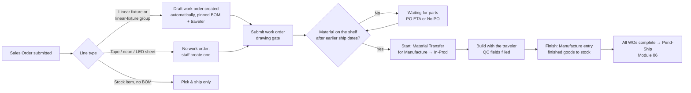

# Module 05: Manufacturing

**Audience:** production lead, floor staff, operations, owner; order approvers take Lesson 5.1. **Length:** 2 sessions of 90 minutes (session 1: Lessons 5.1-5.5 on the floor; session 2: Lessons 5.6-5.8, the exercises and planning).
**Roles used:** Manufacturing User / Manager, Stock User / Manager, Command Center Viewer / Editor / Finance, ilL Operations, Purchase User (waiting for parts).

## Purpose

Trainees can follow an approved order through work orders, picking materials, building, QC and completion to stock. They know which work orders are created for them and which they must create (tape, neon and LED sheet), use the Command Center **Flow** tab as their daily to-do list, clear waiting-for-parts and drawing holds, and use the production board reports for planning.

## Where to go

| What | Where |
|---|---|
| Manufacturing stage (opens on Flow) | `/command-center#mfg` |
| Work orders | `/app/work-order` (+ New work order) |
| Manufacture material requests | `/app/material-request?material_request_type=Manufacture` |
| BOMs | `/app/bom` |
| Production plans | `/app/production-plan` |
| Stock entries | `/app/stock-entry` |
| Production settings (weights, capacity, goals) | `/app/ill-production-settings` ("Weights & capacity" on the stage header) |
| Drawing holds queue | `/app/ill-portal-operations` → Manufacturing drawing holds |
| Generation errors | `/app/error-log` (title "Manufacturing Generation Errors for …") |

The chain this module teaches:

**Sales Order → Work Order → pick materials → build → Manufacture entry (finished goods in stock) → pick & ship → Delivery Note**

## The process at a glance

1. **Order submitted.** Draft work orders are created automatically for linear fixtures and linear-fixture groups, each with its pinned BOM and a build traveler in the remarks.
2. **Fill the gaps.** Tape, neon and LED sheet lines get no work order. The Flow tab lists them under "sales orders need work orders"; create them by hand (Lesson 5.2).
3. **Release.** Submit each draft work order. A required-for-manufacturing drawing that isn't approved blocks the submit.
4. **Wait or pick.** Stock is handed to work orders in ship-date order. A work order that is still short waits for parts; otherwise it is ready to pick.
5. **Start.** A **Material Transfer for Manufacture** stock entry moves material to Work In Progress. The order's stage becomes **In-Prod**.
6. **Build and check.** Build from the **ilL Work Order Traveler**, tick its QC checklist, and fill the work order's QC fields.
7. **Finish.** A **Manufacture** stock entry consumes the materials and puts the finished item in stock. When every work order on the order is complete, the order moves to **Pend-Ship** (Module 06).

---

### Lesson 5.1: From an approved order to work orders

**Objective:** know which work orders are created for you and which you create.

| Order line | Work order on submit? | Who creates it | How |
|---|---|---|---|
| Linear fixture (ilL-Configured-Fixture) | Yes, draft, one per line | Automatic | Pinned BOM, traveler in remarks, linked to the order line |
| Linear fixture shipped in pieces | Yes, one draft per light engine | Automatic | Each light engine's own BOM; kit notes in the traveler |
| Linear-fixture group (multi-run) | Yes, one draft per run | Automatic | Each run's BOM |
| Configured tape or neon | **No** | Production lead | Lesson 5.2 |
| Configured LED sheet | **No** | Production lead | Lesson 5.2 |
| Other configured groups, kits, accessories | **No** | Production lead, if built in house | Lesson 5.2 |
| Stock item with no BOM | Never | — | Picked and shipped from stock |

- Configured products already have their **Item** and a submitted **BOM** from the moment they were configured; the BOM is pinned to the order line (Sales Order Item → BOM).
- The gap is by design (B2B portal plan): tape / neon, sheets, kits and accessories use standard ERPNext planning, with no automatic work orders.
- **Drafts are safe.** A draft work order doesn't reserve material or reach the floor until it is submitted, but it already moves the order out of **Needs Work Orders**.
- On success the submitting user sees a green alert "Created n Work Order(s) for configured fixtures."
- **Errors don't block the order.** They go to the Error Log as **"Manufacturing Generation Errors for <SO>"** with the orange alert "Some manufacturing artifacts could not be generated. Check Error Log for details." Check it after every submit that shows the orange alert.
- **Actions → Generate Item/BOM/WO** on a submitted SO re-runs generation. It shows only when at least one row is a configured linear fixture. It asks "This will generate configured Items, BOMs, and Work Orders for all configured fixtures on this Sales Order. Continue?" and ends with "Manufacturing artifacts generated successfully." or an **Errors** box. Run by hand, it also covers tape, neon and sheet rows whose pinned build is current (confirm on capture). It never doubles a line: existing drafts count as covered.
- Refused on a draft order: "Approve the Sales Order before preparing production".
- Guards that protect the pinned build:
  - **Request for Raw Materials** (a Purchase material request raised from the order) is refused when a line's pinned BOM isn't the item's default: "Sales Order <SO> pins a different BOM than the Item default on row n (…). Request materials through a Production Plan, which uses the pinned BOM, or ask Engineering to reconcile the default."
  - A **Production Plan** always uses each line's pinned BOM and can't create a second work order for a line that already has one: "Sales Order <SO> already has Work Order <WO> for <item>. Configured builds get their Work Orders when the order is submitted; use Production Plan <PP> for materials only."

> **SS-05-01** · Submitted SO with its auto-created draft work orders in Connections
> **URL:** `/app/sales-order/<name>` → Connections · **Role:** Manufacturing Manager
> **Highlight:** Work Order count; BOM count

**What you see:**
- The approved order (status **To Deliver and Bill**, green **Portal request: Approved** banner) on its **Connections** tab.
- **Manufacturing** group: **Work Order 6** with a **6** count and a **+**, **BOM 9**, Blanket Order.
- Other groups: Fulfillment (Sales Invoice, Pick List, Delivery Note, Maintenance Visit), Proforma, Purchasing (Material Request, Purchase Order), Projects, Reference (Quotation, Auto Repeat, Stock Reservation Entry), Payment, Schedule, Subcontracting Inward, Support (HD Ticket).
- A collapsed **Manufacturing** section at the bottom (build points and ship-date fields).

> **SS-05-02** · Draft work order: pinned BOM, sales order item, traveler in remarks
> **URL:** `/app/work-order/<draft>` · **Role:** Manufacturing Manager
> **Highlight:** Draft badge; Submit; tabs

**What you see:**
- Work order **MFG-WO-2026-00219** for item ILL-SH01-FS-20-RGB+1840K-50-WH-MC-SV-120.0-E10-C with a red **Draft** badge and **Submit**.
- Blue notes "Submit this document to confirm" and "Submit this Work Order for further processing."
- Tabs: **Details**, **Production Item**, **Scheduling & Costing**, **Job Cards**, **Material Requests**, **Stock Entries**, **More Info**, Connections.
- **Configured Group** (blank: this one is a single fixture). The pinned BOM, sales order item and traveler remarks are on the Production Item and More Info tabs; SS-05-21 recaptures those.
- Activity: "Kevin Schern created this", "last edited this".

> **SS-05-03** · Error Log entry "Manufacturing Generation Errors for …"
> **URL:** `/app/error-log` · **Role:** System Manager
> **Highlight:** the "Manufacturing Generation Errors for <SO>" title

**What you see:**
- The **Error Log** list (20 of 1,000+), columns Title, Status, Reference DocType, Reference Name, ID.
- The visible rows are other jobs ("Could not tell n8n about gallery work…", "Scheduler ran. Campaigns found: 0"), all **Not Seen**. No manufacturing generation error was logged on staging, so filter by title (SS-05-38) to find one.

> **SS-05-04** · Actions → Generate Item/BOM/WO menu on a submitted SO
> **URL:** `/app/sales-order/<name>` → Actions · **Role:** Manufacturing Manager

**What you see:**
- The **Actions** menu open on the approved order with one item, **Generate Item/BOM/WO**.
- The portal block of fields underneath (Buyer Requested / Staff Confirmed Delivery Date, Delivery Confirmed On / By).

> **SS-05-38** · Error Log filtered to manufacturing generation errors
> **URL:** `/app/error-log?title=%25Manufacturing%20Generation%25` · **Role:** System Manager
> **Highlight:** the filter; an entry and its message

---

### Lesson 5.2: Work orders the system doesn't create (tape, neon, LED sheet)

**Objective:** close the work-order gap for tape, neon and sheet lines without breaking the pinned build.

1. Open `#mfg` (Flow). **Your list** shows "n sales orders need work orders: n build lines with no work order. In ERPNext: open the order → Create → Work Order." The **Submitted sales orders** table lists each missing line: "Needs a work order: <item> × <qty>".
2. Open the order and use **Create → Work Order** (ERPNext's own dialog), or **+ New work order** from the stage's quick links.
3. Check the **BOM** is the line's pinned BOM (the Sales Order Item's BOM). If the dialog offers the item's default BOM and it differs, use the pinned one.
4. Keep **Sales Order** and the **sales order item** filled so coverage, build points and the order's stage follow the work order. A work order with no order shows "No sales order (built for stock)" on the Flow tab.
5. On the work order's More Info tab, the ilLumenate fields **Configured Product Type** (Linear Fixture / LED Tape / COB Tape / LED Neon / LED Sheet), **Configured Tape/Neon**, **Configured LED Sheet**, **Configured Product** say which build it is. Fill them when you create by hand so the traveler can print the build.
6. Save (draft) and submit when the floor is ready.

- Configured builds need whole quantities in their stock unit: "Configured builds require whole quantities in their stock UOM".
- If a line already has a stopped or different work order: "Existing production differs or is stopped; Manufacturing must reconcile this order line". Too much planned: "Planned production exceeds this order line; Manufacturing must reconcile demand".
- A tape or neon line sold as a bulk reel may need no build at all. If its Item has no BOM, the Flow tab counts it as stock only.

> **SS-05-21** · Draft work order, Production Item and More Info tabs
> **URL:** `/app/work-order/MFG-WO-2026-00216` → Production Item, then More Info · **Role:** Manufacturing Manager
> **Highlight:** BOM No; Sales Order; Sales Order Item; Build Points 17.5; Configured Product Type

> **SS-05-22** · Sales order Create → Work Order dialog
> **URL:** `/app/sales-order/<order with a tape or sheet line>` → Create → Work Order · **Role:** Manufacturing Manager · **State:** open the dialog only; close without creating
> **Highlight:** the item rows and their BOM column

> **SS-05-23** · New work order form for a tape or neon line (unsaved)
> **URL:** `/app/work-order/new` · **Role:** Manufacturing Manager · **State:** fill Item, BOM and Sales Order; do not save
> **Highlight:** BOM No; Sales Order; Configured Product Type = LED Tape

> **SS-05-24** · Flow: Submitted sales orders filtered to Needs work orders
> **URL:** `/command-center#mfg` (Flow) → Submitted sales orders → Needs work orders · **Role:** Manufacturing User (training.floor)
> **Highlight:** "Needs a work order: <item> × <qty>" lines; the segment count

---

### Lesson 5.3: The Flow tab: your daily list

**Objective:** work from the Flow tab every morning.

The Manufacturing stage header reads "Flow: every open order and work order at the step it is waiting on, with what to do next in ERPNext. Reports: the schedule workbook's views (points, capacity, dollars)." Buttons: **Weights & capacity** (opens ilL-Production-Settings) and **Refresh**. Quick links: **+ New work order**, Work orders, Material requests (manufacture), BOMs, Production plans, Stock entries. The tab bar is **Flow**, then a "Reports" divider, then Schedule board, Material requests, Run rate & daily $, Monthly report, Releases & holds, Proforma & will call, Paint. The Command Center remembers the last tab per user.

#### Region by region

| Region | What it shows | Click |
|---|---|---|
| Flow strip | Six tiles, left to right: **Sales orders** (submitted & open, n past ship date) → **Work orders** (orders with every build covered, e.g. 1/9; n lines need one) → **Pick materials** (work orders ready, pieces to pull) → **Building** (in process, n waiting for parts) → **Pick & ship** (orders, pieces) → **Shipped** (delivery notes, 7 days). Each tile names its ERPNext document | Jumps to its section |
| Your list | One row per step that has work, most urgent first, with the ERPNext move that clears it (table below) | Filters the order table or jumps to a lane |
| Sales orders → work orders | A ring (n of m covered), counts for "Every build line has a work order", "Some lines still need one", "No work orders yet", "Stock only (nothing to build)", and a coloured bar "Where each order is" with a legend per step | Legend chips filter the order table |
| Submitted sales orders | Every open order at the one step it is waiting on, earliest ship date first: Sales order, Ship date (* = no ship date, delivery date shown; red = past), Step, Work orders (n/m build lines, WO chips coloured by lane, missing lines), Next (with pick quantities and flags "Parts short", "Short in stock", pick list and draft delivery note chips, hold reason) | Opens the side sheet; Ctrl/⌘-click opens ERPNext |
| Work orders | Lanes **Draft** · **Ready to pick** · **Waiting for parts** · **In production** · **Completed** · **Stopped** (only when there are any). Cards: WO number, ship date or "Past ship date", item, progress bar "n of m made", "For <SO> · customer", "Its order is closed or delivered", short items with "Parts ETA <date>" or "No open PO covers it", "To pick: …" | Opens the side sheet |
| Pick for production | Per work order: Item, To pick (required minus transferred), From warehouse, On shelf (excluding work-in-progress), "On the shelf" or "Short n" | — |
| Pick & ship | Orders ready to ship with pieces to pick and a badge (Short, Delivery note drafted, Picking, Ready); **Full pick list →** opens the Shipping stage | — |
| Clean-up | "Clean-up: n documents tied to closed or delivered orders": work orders, draft delivery notes and open pick lists. "They don't block anything, but they make the lists above harder to trust. Cancel or delete them in ERPNext." | Open each document |

#### Your list: steps and the move that clears them

| Row (as shown) | Meaning | Move in ERPNext |
|---|---|---|
| n sales orders need work orders | Build lines with no work order | Open the order → Create → Work Order |
| n draft work orders to submit | Drafts on open orders | Submit; a draft doesn't reserve material or reach the floor |
| n work orders ready to pick materials | Submitted, material on the shelf | Work order → Start (material transfer), or Create → Pick List |
| n work orders waiting for parts | Short once earlier ship dates take their stock | Purchasing has the ETAs (Lesson 5.5) |
| n work orders in production | Material moved | When built: work order → Finish |
| n orders to pick & ship | Built, or nothing to build | Sales order → Create → Pick List, then Delivery Note |
| n draft delivery notes to submit | Drafted, not submitted | Submit once the order has left the building |
| n orders on hold | Hold Reason, On Hold status or a Stopped work order | Nothing until it is released |
| Clean-up: drafts for closed orders | Leftover drafts | Cancel or delete |

#### Order step (first match wins)

| Step | Matches when |
|---|---|
| On hold | Stage Override is Held, Pending Approval or a Hold stage; or a Hold Reason; or ERPNext On Hold; or a Stopped work order |
| Needs work orders | A build line (item with a BOM) has no work order and isn't delivered |
| Work orders in draft | Any of its work orders is a draft |
| Waiting for parts | Stage Override = Waiting for parts |
| Building | Stage Override = Paint, or a work order is in production |
| Waiting for parts | A work order is short |
| Pick materials | A work order is ready to pick |
| Pick & ship | Everything built, or nothing to build |

#### Work order lanes

| Lane | A work order is here when | Next |
|---|---|---|
| Draft | Not submitted | Submit in ERPNext so the floor can start |
| Ready to pick | Submitted, not started, materials on the shelf | Start |
| Waiting for parts | Submitted, not started, short after earlier ship dates take stock | Wait; Purchasing has the ETA |
| In production | Status In Process, or some material transferred | Finish books the build |
| Completed | Completed or Closed, or produced ≥ qty. Shows 14 days, or until its order ships (first 6, then **Show n more**) | — |
| Stopped | Status Stopped; holds its order | Re-open or cancel |

- **Picking quantities:** required minus transferred. Stock goes to work orders by ship date first; "short" means short after that hand-out.
- The tab shows no money, so every viewer sees the same. It needs Command Center Viewer, Manufacturing User / Manager, Stock User / Manager or System Manager ("You need the Command Center Viewer role to see the warehouse flow.").
- If a refresh fails: "Couldn't refresh the warehouse flow (…). Showing what loaded at <time>."
- At the bottom of the stage, **Work order clean-up (n active · n duplicate or stale · n lines with no work order)** expands to Active work orders, Order lines that need a work order, and Duplicate and stale drafts (from the older data feed).

> **SS-05-05** · Flow tab, full page
> **URL:** `/command-center#mfg` (Flow) · **Role:** Manufacturing User (training.floor)
> **Highlight:** flow strip; Your list; coverage bar

**What you see:**
- Header **Manufacturing** with **Weights & capacity** and **Refresh**; quick links **+ New work order**, Work orders, Material requests (manufacture), BOMs, Production plans, Stock entries.
- The stage stepper with **Manufacturing 21 · open WOs** highlighted.
- Tabs **Flow** (selected), the **REPORTS** divider, Schedule board, Material requests, Run rate & daily $, Monthly report, Releases & holds, Proforma & will call, Paint.
- Flow strip: **Sales orders 22**, **Work orders 1/9**, **Pick materials 0**, **Building 0** (0 waiting for parts), **Pick & ship 12** (437 pcs + …), **Shipped 0**, each with its document label (SALES ORDER, WORK ORDER, MATERIAL TRANSFER, WORK ORDER · IN PROCESS, PICK LIST → DELIVERY NOTE, DELIVERY NOTE · 7 DAYS).
- **Your list:** "6 sales orders need work orders" (28 build lines), "17 draft work orders to submit", "12 orders to pick & ship".
- **Sales orders → work orders:** ring **1 of 9 covered**; Every build line has a work order 1, Some lines still need one 1, No work orders yet 7, Stock only 13; bar legend Needs work orders 6, Work orders in draft 1, Pick & ship 12, On hold 3.

> **SS-05-06** · Your list and the coverage card, close-up
> **URL:** `/command-center#mfg` (Flow), scrolled · **Role:** Manufacturing User (training.floor)
> **Highlight:** the rows of Your list; the coverage ring

**What you see:**
- **Your list** in full: 6 sales orders need work orders; **17 draft work orders to submit** (highlighted on hover); 12 orders to pick & ship ("9 short in ERPNext stock"); **3 draft delivery notes to submit**; **3 orders on hold**; **Clean-up: drafts for closed orders 18** (4 work orders, 12 draft delivery notes, 2 pick lists).
- The same coverage card beside it. The work order lanes are further down; SS-05-26 captures them.

> **SS-05-07** · Clean-up row and the Submitted sales orders table
> **URL:** `/command-center#mfg` (Flow), scrolled · **Role:** Manufacturing User (training.floor)
> **Highlight:** the Clean-up row; segment filter; red past ship dates

**What you see:**
- The **Clean-up: drafts for closed orders** row (18).
- **Submitted sales orders** with its description and the segment filter **All 22**, **Needs work orders 6**, **Work orders in draft 1**, **Pick & ship 12**, **On hold 3**.
- Columns SALES ORDER, SHIP DATE, STEP, WORK ORDERS, NEXT. Rows with red left bars (past ship date) and dates like **Jul 31\***; step **Pick & ship**; "Stock only"; next "Pick, pack and submit a delivery note", "Pick 16 pcs", **Short in stock**, **Draft delivery note**.
- The expanded Clean-up card itself is SS-05-49.

> **SS-05-25** · Flow strip close-up
> **URL:** `/command-center#mfg` (Flow) · **Role:** Manufacturing User (training.floor)
> **Highlight:** the six tiles and their document labels; warning dots

> **SS-05-26** · Work order lanes
> **URL:** `/command-center#mfg` (Flow) → Work orders · **Role:** Manufacturing User (training.floor) · **State:** at least one submitted work order (staging has drafts and completed only; the lead decides)
> **Highlight:** Draft, Ready to pick, Waiting for parts, In production, Completed; a short card with "Parts ETA"

> **SS-05-27** · Work order side sheet from the Flow tab
> **URL:** `/command-center#mfg` (Flow) → click a WO chip · **Role:** Editor (training.lead) · **State:** close without saving
> **Highlight:** after-submit fields (planned start, expected delivery); Open in ERPNext

> **SS-05-28** · Pick for production and Pick & ship cards
> **URL:** `/command-center#mfg` (Flow), scrolled · **Role:** Manufacturing User (training.floor) · **State:** a submitted work order ready to pick (lead decides)
> **Highlight:** To pick; On shelf; Short badge; Full pick list →

> **SS-05-29** · (pair) Flow tab at phone width: Your list, then the work order lanes
> **URL:** `/command-center#mfg` (Flow) · **Role:** Manufacturing User (training.floor) · **State:** phone 390×844 (phone)
> **Highlight:** the list rows; lanes stacked

> **SS-05-49** · Clean-up card expanded
> **URL:** `/command-center#mfg` (Flow) → Clean-up · **Role:** Manufacturing User (training.floor)
> **Highlight:** Document, Kind, Sales order, Date columns

> **SS-05-50** · Work order clean-up section at the bottom of the stage
> **URL:** `/command-center#mfg` → scroll to Work order clean-up → expand · **Role:** Manufacturing Manager (training.lead)
> **Highlight:** Active work orders; Order lines that need a work order; Duplicate and stale drafts

---

### Lesson 5.4: Submitting, picking, building, completing

**Objective:** run a work order through ERPNext correctly, from release to finished goods in stock.

1. **Submit the work order** (desk). It needs Work Order submit permission ("Manufacturing release permission required"). It is blocked while a required-for-manufacturing drawing isn't approved: "Manufacturing is on hold: drawing request DR-… requires approval of its current revision" (Module 04, Lesson 4.6; Module 02, Lesson 2.5). Check the target (finished goods) warehouse is set before you submit (confirm on capture: the auto-created drafts on staging had none).
2. **Pick materials:** print the **ilL Work Order Traveler** (Print → ilL Work Order Traveler). Then **Start**, which makes a **Material Transfer for Manufacture** stock entry into Work In Progress - ilL (or **Create → Pick List** first). The order moves to **In-Prod** at the next stage refresh.
3. **Build** from the traveler: build facts, cut list per segment with Done boxes, run plan, materials with Pulled boxes, six-point QC checklist, built-by and QC sign-off.
4. **QC fields** on the work order (More Info → ilLumenate QC): **Functional Test Result** (Pass / Fail), **Serial Number**, **Test Notes**.
5. **Finish:** a **Manufacture** stock entry consumes the transferred materials and adds the finished item to the target warehouse (Stores on the traveler). The work order turns **Completed**. When all of an order's work orders are complete, the order moves to **Pend-Ship** → Module 06.

- **Job cards are not used.** Configured BOMs are made without operations, so ERPNext creates no job cards and the **Job Cards** tab stays empty (staging: 0 job cards on 2026-11-24). Progress is tracked by stock entries, the traveler and the Flow tab.
- Planned start and expected delivery can be edited after submit (desk or side sheet).
- The Flow refreshes after any save from the Command Center; press **Refresh** after desk changes.
- **Stop** puts the work order in the Stopped lane and its order in **Held** until it is re-opened.

#### The traveler, section by section

| Section | Content |
|---|---|
| Header | WORK ORDER TRAVELER, the WO number, "Build n ea", status pill (Draft, Completed, Stopped…) |
| Facts | Sales order, Customer, Fixture type, Location (section / room), Project, Fixture schedule, Planned start, Ship by, Build points, BOM, Finished goods to |
| Build | Item name and code; build specs |
| Cut list | Seg, the build's columns, Notes, **Done** box (configured fixtures) |
| Run plan | Run, Run length, Watts, Leader, **Done** box (multi-run groups) |
| Materials | #, Item, From, Required, Issued, **Pulled** box |
| Quality check | Six checks with Pass / Fail / Initials: built length and cut lengths match the cut list; correct LED tape / CCT / output, colour consistent; lens seated, endcaps secure, no scratches; leader and jumper lengths, feed direction, polarity; powered at rated voltage, all segments light, dimming / colour channels work; label applied, packed with mounting hardware |
| Sign-off | Built by, Date, QC by, Date |

#### Field reference: Work Order (ilLumenate fields)

| Label | Tab | Meaning | Filled by | Flows to |
|---|---|---|---|---|
| Configured Group | Details | The multi-run group this run belongs to | Automatic | Traveler run plan |
| Functional Test Result | More Info → ilLumenate QC | Pass / Fail | Floor QC | Record of test |
| Serial Number | More Info | Unit serial | Floor QC | Record |
| Test Notes | More Info | What was tested or failed | Floor QC | Record |
| Configured Fixture / Tape/Neon / LED Sheet / Product DocType / Product | More Info | The configured build | Automatic, or by hand for Lesson 5.2 | Traveler |
| Configured Product Type | More Info | Linear Fixture, LED Tape, COB Tape, LED Neon, LED Sheet | Automatic or by hand | Reporting |
| Build Points | More Info | Difficulty of this quantity | Automatic on insert | Production board |
| Engineering Request | More Info | The configurator request behind the build | Automatic | Engineering |

Labels confirmed against staging `getdoctype` on 2026-11-24.

> **SS-05-08** · Work order traveler print preview
> **URL:** `/app/work-order/<name>` → Print → ilL Work Order Traveler · **Role:** Manufacturing User
> **Highlight:** cut list; QC checklist; sign-off boxes

**What you see:**
- **WORK ORDER TRAVELER**, **MFG-WO-2026-00202**, "Build 6 ea" and a **COMPLETED** pill.
- Facts: **Planned Start** 10-23-2026, **BOM** BOM-SMPL-SNF-TW-O-1840K-20W-001, **Finished Goods To** Stores. (This is a stock build with no sales order, so the order facts are blank.)
- **Build:** Snowfield Tunable White LED Sample Sheet, SMPL-SNF-TW-O-1840K-20W.
- **Materials:** three rows (LED sheet, leader cable 2ft, jumper cable 2in) with From Stores, Required 3 ea, Issued 3 ea and a **Pulled** box.
- **Quality Check** with six checks and **Pass / Fail / Initials**; **Built by, Date, QC by, Date** lines. No cut list on this sample sheet; SS-05-37 shows one for a linear fixture.

> **SS-05-37** · Traveler for a linear fixture: cut list and run plan
> **URL:** `/app/work-order/MFG-WO-2026-00216` → Print → ilL Work Order Traveler · **Role:** Manufacturing User (training.floor)
> **Highlight:** Sales order, Fixture type, Location; Cut list with Done boxes

> **SS-05-09** · Work order "Start" → Material Transfer for Manufacture stock entry
> **URL:** `/app/stock-entry/new?...` · **Role:** Manufacturing User · **State:** a submitted work order in Not Started status (lead decides)
> **Highlight:** Stock Entry Type; source and target warehouses; quantities

> **SS-05-10** · Work order QC fields
> **URL:** `/app/work-order/<name>` → More Info · **Role:** Manufacturing User
> **Highlight:** Functional Test Result; Serial Number; Test Notes

**What you see:**
- Completed work order **SMPL-SNF-TW-O-1840K-20W** (MFG-WO-2026-00202) on the **More Info** tab, with **Create** in the toolbar.
- **Functional Test Result** (focused, empty), **Serial Number**, **Test Notes**.
- **Configured Fixture**, **Build Points** 0, **Configured Product Type**, **Configured Tape/Neon**, **Configured LED Sheet**, **Configured Product DocType**, **Configured Product**, all empty on this stock build.
- **Additional Costs (as per BOM)** and **Secondary Items (as per BOM)**: "No rows". Recapture with the QC fields filled once a test build has them.

> **SS-05-11** · (pair) Work order "Finish" → Manufacture entry; WO status Completed
> **URL:** `/app/work-order/<in process>` → Finish · **Role:** Manufacturing User · **State:** needs a submit; the lead decides
> **Highlight:** -a the Manufacture entry; -b the Completed status and produced qty

> **SS-05-30** · Work order toolbar after submit
> **URL:** `/app/work-order/<submitted, Not Started>` · **Role:** Manufacturing Manager · **State:** needs a submitted work order (lead decides)
> **Highlight:** Start; Create Pick List; Stop (confirm the labels on capture)

> **SS-05-31** · Work order Required Items
> **URL:** `/app/work-order/MFG-WO-2026-00202` → Details → Required Items · **Role:** Manufacturing User (training.floor)
> **Highlight:** Source Warehouse; Required Qty; Transferred Qty; Consumed Qty

> **SS-05-32** · Completed work order, Details tab
> **URL:** `/app/work-order/MFG-WO-2026-00202` · **Role:** Manufacturing User (training.floor)
> **Highlight:** Completed status; Qty to Manufacture vs Manufactured Qty; Target Warehouse

> **SS-05-33** · Empty Job Cards tab
> **URL:** `/app/work-order/MFG-WO-2026-00202` → Job Cards · **Role:** Manufacturing User (training.floor)
> **Highlight:** no job cards: operations are not used

> **SS-05-34** · Manufacture stock entries list
> **URL:** `/app/stock-entry?stock_entry_type=Manufacture` · **Role:** Stock User
> **Highlight:** Stock Entry Type; Work Order column

> **SS-05-35** · A Manufacture stock entry
> **URL:** `/app/stock-entry/<Manufacture entry for MFG-WO-2026-00202>` · **Role:** Stock User
> **Highlight:** raw materials out of Work In Progress; finished item into Stores (Is Finished Item)

**DATA-05-01** · Work orders for our job's SO with status and dates
**API:** `GET /api/resource/Work Order?filters=[["sales_order","=","<SO>"]]&fields=["name","production_item","qty","status","planned_start_date","actual_end_date"]`

**DATA-05-02** · Work orders by status
**API:** `GET /api/resource/Work Order?fields=["status",{"COUNT":"*","as":"n"}]&group_by=status`
**Use:** the "where our work orders are" slide. Staging on 2026-11-24: Completed 193, Draft 21, Cancelled 2; none submitted and open.

---

### Lesson 5.5: Waiting for parts and material requests

**Objective:** know why an order is short, when its parts arrive, and how material requests follow work orders.

#### Waiting for parts

- Every open order's work orders need materials. Stock on hand (outside work-in-progress warehouses) is **handed to orders in ship-date order** (Estimated Ship Date, else delivery date). What an order still lacks after earlier orders take theirs is its shortage.
- Open purchase orders are then laid against the shortage. The **ETA** is the date open POs cover what is still short; items no PO covers are "No PO".
- Where you see it:
  - Sales order **Stage** = Waiting for parts, Stage Detail "Parts ETA <date>" or "No PO for short parts" (Module 04, Lesson 4.4).
  - Flow tab: Your list row, the **Waiting for parts** lane, cards with "Short: …" and "Parts ETA" or "No open PO covers it".
  - Schedule board → **Waiting for parts** table: Sales order, $, Ship date, ETA (or **No PO**), **Going to miss?**, This month?, Points, Short items (", no PO"), Notes.
  - `#so-<name>` → Purchasing needed for this order, with **Draft MR** (Module 07).
- Moving it: Purchasing raises the PO (Module 07). A **Purchase Receipt** queues a stage refresh, and the order moves on once the parts are in stock.
- Because shortages are shared, pulling one order's ship date earlier can push another order into Waiting for parts.

#### Manufacture material requests

- Manufacture-type material requests (Purchasing shows only Purchase ones) appear on the **Material requests** tab in lanes **Draft → Needs work order → Building → Done (30 days)**.
- Stats: **Open requests**, **Need a work order** (submitted, no work order yet), **Past needed date** (not finished by the required date). The tab label shows the open count, red when one is past its needed date.
- Buttons **+ New manufacture request** and **All in ERPNext**. Cards: MR number, needed date (red when late), items × qty, "For <SO>", WO chips with status and "n of m made", "Draft: submit in ERPNext" or "Open to create a work order".
- "Building" = it has a work order (drafts count). "Done" = every linked work order is Completed, or the request is Received / Issued / Transferred.
- ERPNext's own **Manufactured** status only means work orders **cover** the quantity, not that it's built.
- Staging had no Manufacture-type requests on 2026-11-24 (3 Purchase requests pending).

> **SS-05-12** · Material requests tab with lanes
> **URL:** `/command-center#mfg` → Material requests · **Role:** Manufacturing Manager (training.lead)

**What you see:**
- The **Material requests** tab selected.
- Stats **Open requests 0** (Manufacture-type material requests), **Need a work order 0** (Submitted, no work order yet), **Past needed date 0** (Not finished by the required date).
- **+ New manufacture request** and **All in ERPNext**.
- Lanes **Draft 0**, **Needs work order 0**, **Building 0**, **Done (30 days) 0**, each "Nothing here".

> **SS-05-36** · Schedule board: Waiting for parts table
> **URL:** `/command-center#mfg` → Schedule board → Waiting for parts · **Role:** Manufacturing Manager (training.lead)
> **Highlight:** ETA; No PO badge; Going to miss?

> **SS-05-39** · Purchase material request refused for a pinned-BOM mismatch
> **URL:** `/app/sales-order/<order>` → Create → Request for Raw Materials · **Role:** Manufacturing Manager · **State:** an order whose pinned BOM differs from the item default; needs a save attempt (lead decides)
> **Highlight:** "… pins a different BOM than the Item default …"

> **SS-05-40** · Production Plan from a sales order (unsaved)
> **URL:** `/app/production-plan/new` → Get Sales Orders · **Role:** Manufacturing Manager · **State:** do not submit
> **Highlight:** the BOM column holding each line's pinned BOM

---

### Lesson 5.6: Build points, capacity and the schedule board (production lead)

**Objective:** plan the floor using points.

- **Build points** measure difficulty per run: 2C/3C/4C/5C/6C runs, wet-rated (IP67+), FMC / jumpers, assemblies, loose bulk reels. Stamped on BOM submit and work order insert; roll up to SO lines and totals.
- **Build Hours** = points ÷ (points per person-day ÷ paid hours per day). **Worth Per Point** = (net total − commission) ÷ points.
- Floor staff can correct a count from the board queue (**Edit** → "Edit build counts"); the difference is saved on the SO, kept through recounts, and noted on its timeline. Errors: "Only manufacturing users can change build counts.", "<SO> is <state>; its build counts can no longer change.", "Nothing changed."
- **Schedule board tab**, top to bottom:
  - Pipeline cards **Pend-Prod / In-Prod / Pend-Ship / Waiting for parts / Paint / Held**: $ (or count), orders, points, average commission (commission over the flag, 22%, in red).
  - **Shipped today**, **Shipped this month**, **Available to ship** (open orders slated this month, not held), **Gap to goal** (or **Shipping days left** with "Set a monthly goal in Production Settings"), **On-time this month** (red under 95%).
  - **Past due**, **Due today**, **Due tomorrow** (or **Due Monday**), **Due this week**.
  - **Capacity:** Workload (in-house + waiting-for-parts orders due this month), Capacity per day (points × people, left today), Days to complete, Date clear.
  - **Burn-down:** points left at the end of each workday over 22 workdays (holidays skipped), with one day of capacity as a dashed line.
  - **Order queue:** filter All / Pend-Prod / In-Prod / Pend-Ship / Paint / Held; sort by Ship date, $ per point or Points; columns Sales order, $, Com %, Ship date, Status, 2C-6C, Loose, WR, FMC, Assy, Points ("adjusted" marker), Hrs, $ / pt, Notes, **Edit**. Red rows are past due; * = no ship date.
  - **Waiting for parts**, **Shipped this month** (On time / Late, not warehouse / Late, Why late) and **On-time by week**.
- **Status rules:** floor override first; Hold Reason, On Hold or a stopped WO = Held; no WOs = Pend-Prod if it has build points, else Pend-Ship; all WOs complete = Pend-Ship; open paint PO = Paint; any WO in process = In-Prod; material short = Waiting for parts; else Pend-Prod.
- Dollar columns need Command Center Finance, Manufacturing Manager, Accounts Manager or System Manager; everyone else sees counts and points and the note "Dollar figures need the Command Center Finance or Manufacturing Manager role."

#### Field reference: ilL-Production-Settings

| Section | Fields (staging default) | Used for |
|---|---|---|
| Difficulty Weights | 2C Run (Static White) 1 · 3C (Tunable White) 1.3 · 4C (RGB) 1.4 · 5C (RGBW) 1.5 · 6C (RGBTW) 1.75 · Wet-Rated Run Adder 1.75 · FMC / Jumper Adder 2 · Assembly Adder 2.5 · Loose Adder 0.75 · Pixel Tape Conductor Bucket 4 | Build points. Saving re-scores BOMs, open Sales Orders and open Work Orders |
| Release Estimate Weights | 1 / 1.3 / 1.4 / 1.5 / 1.75; wet 2; FMC 2.5; assembly 4; loose 0.5 | Release workload for Hold for Release / Confirmation orders |
| Capacity | Points Per Person Per Day 57.5 · Production Head Count 5.5 · Paid Hours Per Day 8.5 · Shift Working Hours 8 · Shift End 16:30 · Holiday List (blank = company default) | Capacity, hours, burn-down |
| Overtime | Daily Overtime Head Count / Hours / Days · Weekend Overtime Head Count / Hours (credited Monday) | Burn-down |
| Commission & Goal | Flag Commission Above (%) 22 · Monthly Shipping Goal | Red commission; gap to goal |
| Monthly Goals & Paint | Monthly Shipping Goals (one row per month) · Paint / Finishing Supplier Group | Monthly report; Paint stage |
| Linear Fixture Fulfillment | Split assembled and ship-in-pieces fixtures (off) | Ship-in-pieces work orders (Lesson 5.1) |
| Order & Quote Stages | Quote Follow Up After (Days) 7 | Quote stage (Module 03) |

- On staging the Monthly Shipping Goal is 0 and the Paint / Finishing Supplier Group is blank, so the board shows "Shipping days left" and the Paint tab shows only orders marked Paint by hand.
- Staging also shows **Labels (Dymo 1.5 x 2.5 + Rollo 4 x 6)** (Labels Enabled, Queue on Work Order Creation, Label Logo) and **Reels (tape and neon)** (Reels Enabled, Reel Warehouse). Both are off and are not in this branch yet: confirm before teaching.

> **SS-05-13** · Schedule board tab, top half
> **URL:** `/command-center#mfg` → Schedule board · **Role:** Manufacturing Manager (training.lead)
> **Highlight:** pipeline cards; gap to goal; capacity and burn-down

**What you see:**
- Pipeline cards with dollars: **Pend-Prod $7,041** (5 orders · 40.6 pts), **In-Prod $0**, **Pend-Ship $11,650** (12 orders · avg com 2.8%), **Waiting for parts $7,811** (2 orders · 108.5 pts), **Paint $0**, **Held $1,943** (3 orders · 19.8 pts · avg com 10.0%).
- **Shipped today $0**, **Shipped this month $0**, **Available to ship $18,691**, **Shipping days left 6** ("Set a monthly goal in Production Settings"), **On-time this month —**.
- **Past due 18** (red, $21,342), **Due today 0**, **Due Monday 0**, **Due this week 0**.

> **SS-05-14** · Order queue with filter and sort
> **URL:** `/command-center#mfg` → Schedule board → Order queue · **Role:** Manufacturing Manager (training.lead)
> **Highlight:** points, hours, $ per point, floor notes

**What you see:**
- **Order queue** with filter **All / Pend-Prod / In-Prod / Pend-Ship / Paint / Held** and **Sort: Ship date**.
- Columns SALES ORDER, $, COM %, SHIP DATE, STATUS, 2C, 3C, 4C, 5C, 6C, LOOSE, WR, FMC, ASSY, POINTS, HRS, $ / PT, NOTES and an **Edit** button per row.
- Past-due rows with red left bars and red dates with * (no ship date). Example: Cascade Integration-00019, $566, **Pend-Prod**, 3 × 2C and 3 WR = **8.3** points, **1.2** hours, **$69** per point; Olympic Home & Theater-00003 **Held**, 6 points, $100 per point. Negative values (–$30) flag orders to correct.

> **SS-05-15** · (pair) Schedule board as Manufacturing User (points only) vs Manager (dollars)
> **URL:** `/command-center#mfg` → Schedule board · **Role:** -a Manufacturing User (training.floor), -b Manufacturing Manager (training.lead)

**What you see (-a, Manufacturing User):**
- The note "Dollar figures need the Command Center Finance or Manufacturing Manager role."
- Pipeline cards show counts and points only: **Pend-Prod 5** (40.6 pts), **In-Prod 0**, **Pend-Ship 12**, **Waiting for parts 2** (108.5 pts), **Paint 0**, **Held 3** (19.8 pts).
- **Available to ship —**; the due cards show counts with no dollars.

**What you see (-b, Manufacturing Manager):**
- The same cards in dollars ($7,041, $0, $11,650, $7,811, $0, $1,943) with average commission, Available to ship **$18,691**, and Past due **$21,342**.

> **SS-05-16** · ilL-Production-Settings form
> **URL:** `/app/ill-production-settings` · **Role:** System Manager (Administrator) · **Highlight:** weights; capacity; monthly goals

**What you see:**
- **Difficulty Weights** with its description ("…Saving new weights re-scores BOMs, open Sales Orders and open Work Orders.").
- 2C Run (Static White) **1.000**, 3C **1.300**, 4C **1.400**, 5C **1.500**, 6C **1.750**; Wet-Rated Run Adder **1.750**, FMC / Jumper Adder **2.000**, Assembly Adder **2.500**, Loose Adder **0.750**, Pixel Tape Conductor Bucket **4**, each with its help text.
- **Release Estimate Weights** collapsed; **Capacity:** Points Per Person Per Day **57.500**, Shift Working Hours **8.000**, Production Head Count below.

> **SS-05-17** · Correcting build counts from the queue
> **URL:** `/command-center#mfg` → Schedule board → Order queue → Edit · **Role:** Manufacturing User (training.floor) · **State:** close without saving

**What you see:**
- The **Edit build counts** sheet for Garrett Integrated Systems-00002.
- The explanation "Set the order's totals when the configured fixtures don't show all of the work… The difference from what the builds count is saved on the sales order, kept through recounts, and noted on its timeline."
- Nine number boxes, each with "counted n": **2C, 3C, 4C, 5C, 6C, Loose, WR, FMC, Assy**.
- **Why** ("e.g. Field splice adds a 3C run") and **Save counts**.

> **SS-05-41** · Schedule board: Capacity and Burn-down
> **URL:** `/command-center#mfg` → Schedule board, scrolled · **Role:** Manufacturing Manager (training.lead)
> **Highlight:** Workload; Capacity per day; Date clear; the dashed one-day line

> **SS-05-42** · Schedule board: Shipped this month and On-time by week
> **URL:** `/command-center#mfg` → Schedule board, bottom · **Role:** Manufacturing Manager (training.lead)
> **Highlight:** On time / Late, not warehouse / Late badges; weekly bars

> **SS-05-43** · ilL-Production-Settings: Capacity, Overtime, Commission & Goal, Monthly Goals & Paint
> **URL:** `/app/ill-production-settings`, scrolled · **Role:** Administrator
> **Highlight:** Paid Hours Per Day; Holiday List; Monthly Shipping Goals table; Paint / Finishing Supplier Group

> **SS-05-44** · ilL-Production-Settings: Labels and Reels sections (staging only)
> **URL:** `/app/ill-production-settings`, bottom · **Role:** Administrator
> **Highlight:** Labels Enabled; Queue on Work Order Creation; Reels Enabled; Reel Warehouse

> **SS-05-45** · Build counts adjusted: the "adjusted" marker and the timeline note
> **URL:** `/command-center#mfg` → Order queue, then `/app/sales-order/<name>` timeline · **Role:** Manufacturing User · **State:** needs a saved adjustment (lead decides)
> **Highlight:** "adjusted" under Points; the timeline comment

---

### Lesson 5.7: The report tabs

| Tab | What it shows |
|---|---|
| Run rate & daily $ | Received today, average per day this month, average per day over the last 30 workdays, received this month, shipped per day this month (with "Need $n/day to reach the goal"); "Orders received per workday" chart; Inbound by day (Received, Orders, $, Com %, $0 orders, Same day, Next day, Rush) |
| Monthly report | This month and next two: Goal, Shipped, Scheduled / available to ship, Estimated run rate (30-day average × workdays left), At risk (waiting for parts and going to miss, plus held), expected releases, projection, % of goal, average commission |
| Releases & holds | Release $ by month for four months and **Release workload** (points and days at today's capacity, release weights); **Expected releases** (Hold for Release / Confirmation with Likely Ship, Hold, Release pts, Days, Notes); Hold for Ship, Through next month, Within a week |
| Proforma & will call | Open proforma and will-call orders (Sales order, Type, $, Com %, Ship date, Status, Notes) and completed this month. "Set Proforma / Will Call on the sales order." |
| Paint | At paint, Due back this month; **Out for paint** (Sales order, $, Ship date, PO, Sent, Due back, Items, Notes). Without a Paint / Finishing Supplier Group, only orders marked Paint by hand show |

> **SS-05-18** · Monthly report tab
> **URL:** `/command-center#mfg` → Monthly report · **Role:** Manufacturing Manager (training.lead)

**What you see:**
- **Monthly report** ("This month and the next two against the shipping goal (goals are set in Weights & capacity).").
- Columns **November 2026**, **December 2026**, **January 2027**.
- Rows: **Goal** (not set), **Shipped** ($0), **Scheduled / available to ship** ($18,691 in November), **Estimated run rate** ($4,654 · 6 workdays; $17,842 · 23; $16,290 · 21), **At risk** ($9,754 in November).

> **SS-05-19** · Releases & holds tab
> **URL:** `/command-center#mfg` → Releases & holds · **Role:** Manufacturing Manager (training.lead)

**What you see:**
- Month cards **November 2026** to **February 2027**, each $0 · 0 releases · com 0.0%, and **Release workload 0 pts** ("0 days at today's capacity (release weights)").
- **Expected releases** ("Hold for release / confirmation. Set Hold Reason and Likely Ship Date on the sales order."): Sales order, $, Com %, Likely Ship, Hold, Release pts, Days, Notes; "Nothing here right now".
- The start of **Hold for Ship**, **Through next month** and **Within a week** cards.

> **SS-05-20** · Paint tab
> **URL:** `/command-center#mfg` → Paint · **Role:** Manufacturing Manager (training.lead)

**What you see:**
- **At paint $0** (0 orders) and **Due back this month $0**.
- The note "Set the Paint / Finishing Supplier Group in Weights & capacity to pick up paint purchase orders automatically. Until then only orders marked Paint by hand show here."
- **Out for paint** (Sales order, $, Ship date, PO, Sent, Due back, Items, Notes), empty.
- The **Work order clean-up (17 active · 4 duplicate or stale · 28 lines with no work order)** bar with **Show**.

> **SS-05-46** · Run rate & daily $ tab
> **URL:** `/command-center#mfg` → Run rate & daily $ · **Role:** Manufacturing Manager (training.lead)
> **Highlight:** the KPI row; Orders received per workday chart; Inbound by day

> **SS-05-47** · Proforma & will call tab
> **URL:** `/command-center#mfg` → Proforma & will call · **Role:** Manufacturing Manager (training.lead)
> **Highlight:** Open proforma and will-call orders; Type column

---

### Lesson 5.8: Drawing holds and roles on the floor

- A drawing request with **Required for manufacturing** blocks submitting any work order for its order until the current revision is approved (Kevin or Jay review drawings, decision 8). See the queue at Portal Operations → **Manufacturing drawing holds** (ilL Operations).
- The floor never edits the order's commercial fields. Floor Notes, Estimated Ship Date and holds are edited in the side sheet (Editor) or on the SO's Manufacturing section.

> **SS-05-48** · Portal Operations → Manufacturing drawing holds
> **URL:** `/app/ill-portal-operations` → Operations · **Role:** ilL Operations (training.lead)
> **Highlight:** the Manufacturing drawing holds card and its list

> **SS-05-51** · (pair) Manufacturing stage as Viewer only vs Manufacturing User
> **URL:** `/command-center#mfg` · **Role:** -a training.viewer (CC Viewer only), -b training.floor
> **Highlight:** the same Flow content; no Edit buttons for the Viewer

---

## Status lifecycles

### Work order (ERPNext status → Flow lane)

| ERPNext status | Flow lane | Moved by | Unlocks |
|---|---|---|---|
| Draft | Draft | Created on SO submit or by hand | Submit |
| Not Started | Ready to pick, or Waiting for parts | Submit (drawing gate) | Start / Pick List |
| In Process | In production | Material Transfer for Manufacture | Finish |
| Completed | Completed | Manufacture entry for the full qty | Order → Pend-Ship once all are complete |
| Stopped | Stopped | Stop | Re-open; holds the order |
| Closed / Cancelled | Completed / dropped | Close / Cancel | — |

### Production board status (order)

| Code | Status | When |
|---|---|---|
| 1 | Pend-Prod | Work orders exist, nothing started; or build points but no work orders |
| 9 | Waiting for parts | Short after allocation |
| 2 | In-Prod | Any work order In Process or with material transferred |
| 7 | Paint | Open PO to the paint supplier group |
| 5 | Held | Hold Reason, On Hold or a Stopped work order |
| 3 | Pend-Ship | All work orders complete, or nothing to build |

### Manufacture material request lanes

Draft (not submitted) → Needs work order (submitted, none yet) → Building (has a work order, drafts count; or ERPNext "Manufactured") → Done (every work order Completed, or Received / Issued / Transferred; shows 30 days).

## Role and permission matrix

| What | Mfg User | Mfg Manager | Stock User / Manager | CC Viewer | CC Editor | CC Finance | ilL Operations | System Manager |
|---|---|---|---|---|---|---|---|---|
| See the Flow tab | Yes | Yes | Yes | Yes | Yes (with Viewer) | Yes (with Viewer) | — | Yes |
| See Schedule board and reports | Yes | Yes | No | Yes | Yes | Yes | — | Yes |
| See dollars on the board | No | Yes | — | No | No | Yes | — | Yes |
| Edit build counts (queue **Edit**) | Yes | Yes | — | No | No | No | — | Yes |
| Edit ship dates, holds, floor notes in the side sheet | With Editor | With Editor | With Editor | No | Yes | — | — | Yes |
| Create / submit work orders | Yes (ERPNext permission) | Yes | — | — | — | — | — | Yes |
| Stock entries (Start / Finish) | Yes | Yes | Yes | — | — | — | — | Yes |
| Drawing holds queue | — | — | — | — | — | — | Yes | Yes |
| ilL-Production-Settings | Read | Edit | — | — | — | — | — | Yes |

## Behind the scenes

| Trigger | What happens |
|---|---|
| SO submit | Draft work orders for linear fixtures and linear-fixture groups (pinned BOM, traveler remarks, sales order item); errors to the Error Log; one stage refresh |
| BOM submit | Build points stamped on the BOM |
| Work order insert | Build points for the quantity; guard against a second work order from a Production Plan |
| Work order submit | Drawing gate (required-for-manufacturing requests) |
| Work order change (any, drafts too) | One stage refresh of all open orders |
| Stock entry submit / cancel | Stage refresh (In-Prod, Pend-Ship) |
| Purchase Order / Receipt | Stage refresh (paint, part ETAs, Waiting for parts ending) |
| Purchase material request insert | Pinned-BOM check for requests raised from an order |
| Production Plan validate | Each order line planned with its pinned BOM |
| Saving ilL-Production-Settings weights | BOMs, open Sales Orders and open Work Orders re-scored |
| Every 15 minutes | Stage sweep |

## Worked example: our staging order through the floor

Order **ilL-SAL-ORD-Jeremy Test Integrations-00001**, submitted 5 Nov 2026 at 08:46.

1. On submit, six draft work orders were created at 08:46:07: MFG-WO-2026-00214 to 00219, for the Rainier and St. Helens linear fixtures, each with Work In Progress - ilL as the WIP warehouse and expected delivery 2026-11-30.
2. Build points were stamped per work order: 2, 8, 17.5, 3.5, 1.75 and 1.75 (34.5 in all).
3. The order's tape, power-supply and accessory lines got none. `#so-<name>` shows **Production: 5 need WO**: the build lines (items with a BOM) still uncovered.
4. Staging shows the order as **Waiting for parts · No PO for short parts** on 2026-11-24: its drafts already cover the linear fixtures, but materials are short and no PO covers them.
5. Next moves on the floor: create work orders for the five uncovered lines (Lesson 5.2), ask Purchasing for the short parts (Module 07), submit the drafts when the drawings are clear, then Start, build, QC and Finish.

## Troubleshooting

| Symptom | Cause | Fix |
|---|---|---|
| Orange alert "Some manufacturing artifacts could not be generated. Check Error Log for details." | Generation failed for a line | Open the Error Log entry "Manufacturing Generation Errors for <SO>"; fix and run Actions → Generate Item/BOM/WO |
| "Approve the Sales Order before preparing production" | Generate run on a draft | Submit the order first |
| No Generate Item/BOM/WO under Actions | No configured linear fixture rows | Create the work orders by hand (Lesson 5.2) |
| Tape / sheet line has no work order | By design | Lesson 5.2 |
| "Configured builds require whole quantities in their stock UOM" | Fractional qty or a UOM conversion | Use whole units in the stock UOM |
| "Existing production differs or is stopped; Manufacturing must reconcile this order line" | A stopped or different work order on the line | Re-open or cancel it, then regenerate |
| "Planned production exceeds this order line; Manufacturing must reconcile demand" | More planned than ordered | Cancel the extra work order |
| "Sales Order … pins a different BOM than the Item default …" | Request for Raw Materials on a pinned build | Use a Production Plan, or ask Engineering to reconcile the default BOM |
| "Sales Order … already has Work Order … use Production Plan … for materials only." | A plan tried to make a second work order | Plan materials only |
| "Manufacturing is on hold: drawing request … requires approval of its current revision" | Drawing not approved | Engineering approves the current revision (Kevin or Jay) |
| "Manufacturing release permission required" | No Work Order submit permission | Ask Kevin for the right ERPNext role |
| "You need the Command Center Viewer role to see the warehouse flow." / "…the production board." | Missing view role | Ask Kevin for Command Center Viewer |
| "Only manufacturing users can change build counts." | Not a manufacturing role | Ask the production lead |
| "<SO> is <state>; its build counts can no longer change." | Order completed, closed or cancelled | Nothing to change |
| Order still Pend-Prod after Start | Refresh lag | Wait for the refresh (up to 15 minutes) or press Refresh |
| Work order in the Waiting for parts lane though stock exists | An earlier ship date took the stock | Check ship dates; ask Purchasing |

## Tips and shortcuts

- Start each morning on Flow → Your list and work top to bottom.
- Click a legend chip in "Where each order is" to filter the order table to that step.
- Ctrl/⌘-click any document to open the desk instead of the side sheet.
- Print the traveler before you Start, so the Pulled boxes match what you transfer.
- Set **Estimated Ship Date** on every order: it decides who gets stock first.

## Common mistakes

- Waiting for tape, neon or sheet work orders to appear on their own.
- Using Request for Raw Materials on a configured order instead of a Production Plan.
- Leaving draft work orders unsubmitted: they reserve nothing and the floor can't start them.
- Reading ERPNext's "Manufactured" on a material request as "built".
- Finishing a work order before QC is recorded on the traveler and the work order.
- Leaving drafts on closed orders: they fill the Clean-up card and confuse the counts.

## Exercises (staging, read only unless the lead says otherwise)

1. **Morning list.** As training.floor, open `#mfg` (Flow) and read Your list top to bottom. *Expected (2026-11-24):* 6 orders need work orders (28 build lines), 17 draft work orders, 12 orders to pick & ship, 3 draft delivery notes, 3 on hold, Clean-up 18.
2. **Find the gap.** Filter Submitted sales orders to **Needs work orders** and pick one order. Name the lines that need a work order and say whether each is a linear fixture or tape / neon / sheet.
3. **Read a traveler.** Open MFG-WO-2026-00216 → Print → ilL Work Order Traveler. *Expected:* Draft pill, Build points 17.5, the sales order and fixture type in the facts.
4. **Points by hand.** A 3C wet-rated run with one jumper: 1.3 + 1.75 + 2 = 5.05 points. Check one queue row's Points against its counts.
5. **Dollars vs points.** Compare the Schedule board as training.floor and as training.lead (SS-05-15). *Expected:* only the lead sees dollars.
6. **Job cards.** Open a completed work order's Job Cards tab. *Expected:* empty; explain why.

## Slide deck beats

1. The chain: SO → WO → pick → build → Manufacture entry → ship → DN
2. What's automatic (linear fixtures, groups, light engines) and what isn't (tape, neon, sheet)
3. Creating a work order by hand without losing the pinned build
4. The Flow tab as the daily list: strip, Your list, lanes
5. Submitting a WO: the drawing gate
6. Start and Finish: the two stock entries that move the stage
7. The traveler and QC; why there are no job cards
8. Waiting for parts: ship-date allocation and ETAs
9. Manufacture material requests and their lanes
10. Build points and capacity
11. The schedule board and gap to goal
12. Report tabs for the Monday plan
13. Worked example: six drafts and five gaps on one order

## Check yourself

1. An order has tape lines only. Will work orders appear by themselves?
2. What moves an order from Pend-Prod to In-Prod?
3. Where do you change the points-per-person-day figure?
4. A manufacture material request shows "Manufactured" in ERPNext. Is it built?
5. Why can't you use Request for Raw Materials on a particular line?
6. A work order is in the Waiting for parts lane but the item is on the shelf. Why?
7. Why is the Job Cards tab empty?
8. Which two stock entries does a work order need, and what does each do to the order's stage?
9. Who can see dollars on the Schedule board?
10. A drawing is still waiting for approval. What happens when you submit the work order?
