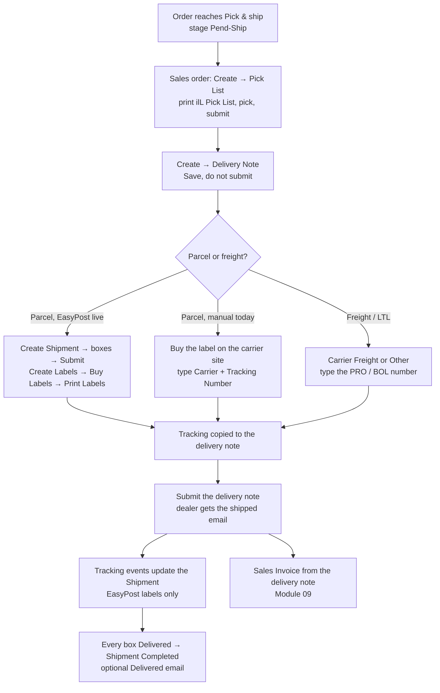
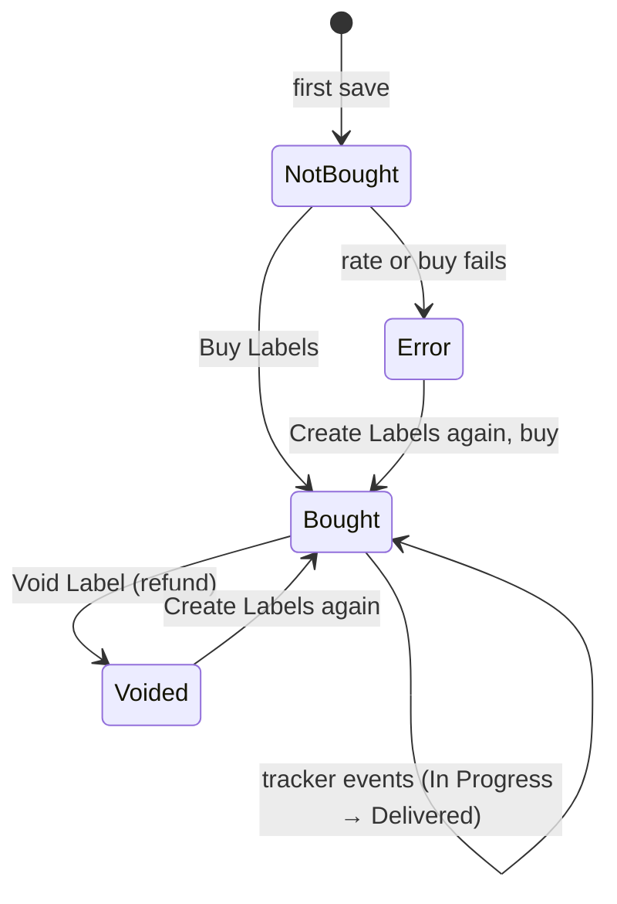

# Module 06: Shipping, delivery notes & tracking

**Audience:** shipping / warehouse, operations, sales and support (for tracking questions). **Length:** 2 sessions of 75 minutes (session 1: Lessons 6.1-6.5 and 6.10; session 2: Lessons 6.4 labels, 6.6-6.9 and 6.11).
**Roles used:** Stock Manager (create and submit Shipments, buy and void labels), Stock User (pick lists, delivery notes), Command Center Viewer / Editor, System Manager (settings), Dealer (portal side).

## Purpose

Trainees can pick and pack an order, create the delivery note and Shipment, buy and print labels, get tracking to the dealer, handle will call, freight, drop ship and partial shipments, record late shipments, follow an inbound shipment, and hand off to invoicing.

> **Status:** The EasyPost label and tracking integration is built but has **not run live yet** (Rolling out). Until the pilot, the live process is **manual**: buy the label outside ERPNext and type Carrier and Tracking Number on the delivery note (Lesson 6.5). Teach both; mark the EasyPost slides "Rolling out". See decision 5: staging test the week of 30 Nov, live parcel-only pilot 7-18 Dec, full go-live 4 Jan 2027 if the criteria are met.
>
> **Staging, as of 24 Nov 2026:** the ilL-Shipping-Settings form is deployed and matches the repo, but the record has **never been saved** (Enabled off, no webhook, no pickup address, no default box). There are **no Shipment Parcel Templates and no Shipments** yet, so every label screenshot waits for Phase 0 of decision 5. Staging's ilL-Inbound-Shipment Status list is also behind main: it has no **Cancelled** option yet.

## Where to go

| What | Where | Who uses it |
|---|---|---|
| Shipping stage | `/command-center#ship` | Everyone with Command Center Viewer |
| Manufacturing Flow tab (Pick & ship card) | `/command-center#mfg` | Floor, shipping |
| Orders to deliver | `/app/sales-order?status=["in",["To Deliver","To Deliver and Bill"]]` (the "Sales orders to deliver" link on the Shipping stage) | Shipping, sales |
| Pick lists | `/app/pick-list` | Shipping, floor |
| Delivery notes | `/app/delivery-note` | Shipping |
| New delivery note | `/app/delivery-note/new` (the "+ New delivery note" link) | Shipping |
| Shipments (labels) | `/app/shipment` | Shipping lead (Stock Manager) |
| Packing slips (cases) | `/app/packing-slip` | Shipping |
| Box sizes | `/app/shipment-parcel-template` | Shipping lead |
| Shipping settings | `/app/ill-shipping-settings` | System Manager, Stock Manager |
| Email settings (shipped email, will-call pickup text) | `/app/ill-email-settings` | System Manager |
| Inbound shipments (ILL-SHP) | `/app/ill-inbound-shipment`, or Command Center → Purchasing → Shipments | Buyer, receiving |
| On-time and shipped this month | `/command-center#mfg` → Reports (schedule board) | Production lead, owner |
| Dealer side | `/portal/orders/<SO>` (Shipments panel), `/portal/account` (Notification Preferences) | Dealer |

**Record names on our site:** Delivery Note `ilL-MAT-DN-<Customer>-#####` (an amended note adds `-1`), Pick List `STO-PICK-YYYY-#####`, Packing Slip `MAT-PAC-YYYY-#####`, Shipment `SHIPMENT-#####`, inbound shipment `ILL-SHP-YYYY-####`.

## Process map

One order, one ship event, parcel carrier. The manual path (today) and the EasyPost path (rolling out) share every step except 4 and 5.

1. Order reaches **Pick & ship** on the Command Center (sales order stage **Pend-Ship**).
2. **Pick List** from the SO; print **ilL Pick List**; pick; record picked quantities; submit.
3. **Delivery Note** from the SO or pick list. **Save, don't submit yet.**
4. **Create Shipment** from the delivery note → add boxes (inches, pounds) → **Submit** the Shipment. *(EasyPost path only.)*
5. **Create Labels** → confirm the rate → **Buy Labels** → **Print Labels**. Tracking copies to the delivery note. *(Manual path: buy the label on the carrier's site and type Carrier and Tracking Number.)*
6. **Submit the delivery note.** This sends the dealer their shipped email with tracking.
7. Tracking updates arrive automatically (EasyPost labels only); the Shipment completes when every box is delivered.
8. Create the **Sales Invoice** from the delivery note (Module 09, decision 1).

**The rule:** tracking goes on the delivery note **before** you submit it, or the shipped emails go out without tracking.

## Status lifecycles

### Delivery Note (standard ERPNext status)

| Status | What moves it there | Who | What it unlocks |
|---|---|---|---|
| Draft | Created from the SO or pick list, or new | Stock User / Manager, Sales User | Create Shipment; edit everything |
| To Bill | Submitted, nothing invoiced | Same | Shipped emails; order stage refresh; Create → Sales Invoice |
| Partially Billed | Some lines invoiced | Accounts | Invoice the rest |
| Completed | Fully billed | Accounts | Nothing; read-only except the four shipping fields |
| Return / Return Issued | A return delivery note (Is Return), or the original after a return | Stock Manager | Return Slip print; no Create Shipment |
| Cancelled | Cancel | Stock Manager | Amend (new name ends `-1`) |
| Closed | Close (rare) | Stock Manager | Nothing |

Staging today (24 Nov 2026): 15 Draft, 61 To Bill, 37 Partially Billed, 92 Completed, 6 Cancelled, 2 Return, 1 Return Issued.

### Shipment (EasyPost path, Rolling out)

| Field | Values | Set by |
|---|---|---|
| Status (standard) | Draft → Submitted → **Booked** (labels bought) → **Completed** (every box delivered); Cancelled | Submit; buying labels sets Booked; voiding sets Submitted again; the last Delivered event sets Completed |
| Label Status | **Not bought** → **Bought** → **Voided**; **Error** from any step | Not bought on first save; Bought after Buy Labels; Voided after Void Label; Error when the label service fails |
| Tracking Status | (blank) → **In Progress** → **Delivered** or **Returned** (Lost exists but nothing sets it) | Buying labels sets In Progress; tracker events set the rest |
| Box Tracking Status (each parcel row) | Pre-Transit, In Transit, Out for Delivery, Available for Pickup, Delivered, Returned, Exception, Cancelled, Unknown | Tracker events, one per box |

A failed rate or buy sets Error; fix the cause and Create Labels again. Only Void Label takes a Shipment back from Bought, and cancel is refused until it does.

| Carrier event (EasyPost) | Box status | Shipment Tracking Status | Extra |
|---|---|---|---|
| pre_transit, in_transit, out_for_delivery, available_for_pickup | same words | In Progress | |
| delivered | Delivered | **Delivered** once every box is delivered; Status becomes **Completed** | Delivered email if switched on |
| return_to_sender | Returned | **Returned** (wins over everything) | Exception email to the shipping lead |
| failure, error | Exception | unchanged | Exception email to the shipping lead |
| cancelled | Cancelled | unchanged | |

### Sales order stage (the shipping end)

| Stage | When | Waiting on |
|---|---|---|
| Pend-Ship | Built (or nothing to build), nothing delivered yet | Warehouse |
| Hold for Ship | Hold Reason = Hold for Ship: the customer asked us to hold it until the ship date | Customer |
| Will Call - Ready | Pend-Ship and Proforma / Will Call = **Will Call** | Customer |
| Proforma - Awaiting Payment | Pend-Ship and Proforma / Will Call = **Proforma**, not paid in full | Customer |
| Partially Shipped | Some lines delivered. Stage Detail reads "Partially Shipped (n%)". This wins over Will Call and Proforma | Warehouse |
| Shipped / In Transit | 100% delivered, not yet fully billed | (nobody) |
| Completed | Delivered and billed (order status Completed or Closed) | (nobody) |

A **Stage Override** on the sales order wins over all of these until it is cleared (Module 04).

### Inbound shipment (ILL-SHP), for comparison

Planned → Booked → In transit → At port / customs → Cleared → Out for delivery → Delivered → Costs final (also **Cancelled** on main; not yet on staging). Booked through Out for delivery move the linked POs' vendor status to **Shipped**; Delivered and Costs final move it to **Delivered**. Forward only (Lesson 6.11).

## Role and permission matrix

Roles as deployed on staging (24 Nov 2026). Ryan holds Stock Manager, so he can do every row (decision 8).

| Action | Stock User | Stock Manager | Sales User / ilL Support | CC Viewer only | CC Editor | System Manager | Dealer |
|---|---|---|---|---|---|---|---|
| See the Shipping stage and pick list | with CC Viewer | with CC Viewer | with CC Viewer | Yes | Yes | with CC Viewer | No |
| Edit carrier, tracking, late fields in the CC side sheet | | | | No (read-only) | Yes, if ERPNext also lets them write the delivery note | | No |
| Create / submit Pick List | Yes | Yes | No | No | No | Yes | No |
| Create / submit Delivery Note | Yes | Yes | Yes (Sales User) | No | No | Yes | No |
| See **Create Shipment** on a delivery note | **No** | Yes | No | No | No | Yes | No |
| Submit a Shipment; **Create Labels, Buy, Print, Void** | **No** | Yes | No | No | No | Yes | No |
| ilL-Shipping-Settings | No | Read and write | No | No | No | Full | No |
| Inbound shipments (ILL-SHP) | Create, write | Create, write | No | Read | Create, write | Full | No |
| Shipments panel, tracking links, packing slip PDF | | | | | | | Yes, own orders |
| Shipment Tracking email toggle | | | | | | | Yes |

> **Correction to earlier drafts:** on staging, Shipment create and submit belong to **Stock Manager** and **System Manager** only. A plain Stock User does not see the Create Shipment button and cannot buy labels. To let Stock Users buy labels, add Create and Submit on Shipment for Stock User in Role Permissions Manager (`/app/permission-manager/Shipment`).

---

### Lesson 6.1: The Shipping stage in the Command Center

**Objective:** know what's ready to go out today, what's short, and which orders are at risk.

**Screen tour, top to bottom**

1. **Header:** "Shipping", subtitle "What to pick and ship now, then which open sales orders can go out this week and which are at risk.", and a **Refresh** button (reloads the warehouse flow; toast "Warehouse flow refreshed").
2. **In ERPNext links:** **+ New delivery note**, **Delivery notes**, **Shipments**, **Sales orders to deliver**. Each opens the desk in a new tab.
3. **Pipeline stepper:** Overview, Design, Quotes, Sales orders, Purchasing, Manufacturing, **Shipping**, Service. The Shipping chip reads "ready/open" and "n past due"; it turns red when any order is past its delivery date.
4. **Summary tiles:** Orders to pick & ship ("Built, or nothing to build"), Lines to pick (pieces plus lengths by unit), Short in stock ("Orders with a line ERPNext shows short", amber when above 0), Draft delivery notes ("On open orders: submit once shipped"), Shipped, last 7 days ("Submitted delivery notes").
5. **Pick list: ready to ship:** one block per order at Pick & ship, earliest ship date first. The block header shows the order, dealer, ship date (red when past; `*` = no ship date set, delivery date shown), and links to its open pick lists and draft delivery notes. Each line: item, quantity to pick, warehouse, and **On the shelf** (green) or **Short n** (red). Kits are expanded ("part of X"). When nothing is left to pick: "Everything is picked; submit the delivery note."
6. **Open pick lists** (Pick list, Status, Sales order, Lines, Qty) and **Draft delivery notes** ("Submit once the order has shipped") side by side.
7. **Shipped in the last 7 days** (Delivery note, Customer, Date).
8. **Order tiles:** Open sales orders (count and value), Past delivery date (with the oldest date), Ready per ERPNext ("No draft work orders or shortages").
9. **Delivery timeline:** each open order at its delivery date; red past due, orange upcoming and at risk, green ready; a dashed "Today" line.
10. **Can it go out?:** Sales order (with its ERPNext status), Dealer, Delivery, Value, Delivered %, Ship? (**Ready** / **At risk**), Why. Reasons include "Past delivery date", "n item(s) short", "Order value $x: check". A Ready order past its date adds "may have shipped without a Delivery Note".
11. **Draft sales orders** (only when any exist): "Not submitted, so they create no demand".

**How "short" is worked out:** stock outside work-in-progress warehouses is handed to orders in ship-date order, after work orders take theirs. "Short" means short after earlier orders take their share, not short on the shelf today.

**Side sheet:** click any delivery note, pick list or sales order link on this page to open its side sheet instead of a new tab (Ctrl/⌘/Shift-click still opens ERPNext). On a **submitted** delivery note only four fields can change here: **Carrier**, **Tracking Number**, **Late, Not Warehouse Fault** and **Why Was This Late**. Creating and submitting happen in the desk. Shipments have no side sheet; they open in ERPNext.

**Empty and error states:** "Loading the pick list…"; "No order is ready to ship"; "Couldn't load the pick list: …"; and, after a failed refresh, "Couldn't refresh the warehouse flow (…). Showing what loaded at …".

> **SS-06-01** · Shipping stage, full page
> **URL:** `/command-center#ship` · **Role:** Stock User + CC Viewer · **State:** at least one order at Pick & ship with a short line
> **Highlight:** tiles; a ready-to-ship block with a Short badge; Draft delivery notes table

> **SS-06-02** · "Can it go out?" table with an At risk row and its reason
> **URL:** `/command-center#ship` (scroll down) · **Role:** CC Viewer · **State:** an At risk order
> **Highlight:** the Ship? dot; the Why column

> **SS-06-03** · Side sheet on a submitted delivery note, editing tracking fields
> **URL:** `/command-center#ship` → click a delivery note in "Shipped in the last 7 days" · **Role:** CC Editor (training.lead) · **State:** a delivery note submitted in the last 7 days
> **Highlight:** Carrier and Tracking Number in the sheet; the Save button

> **SS-06-33** · Shipping stage header: the In ERPNext links and the pipeline stepper with Shipping selected
> **URL:** `/command-center#ship` · **Role:** training.viewer · **State:** any
> **Highlight:** + New delivery note; Shipments; the Shipping chip's "ready · past due" text

> **SS-06-34** · A ready-to-ship block where everything is picked
> **URL:** `/command-center#ship` · **Role:** training.lead · **State:** an order at Pick & ship whose pick list covers every line (e.g. the order behind STO-PICK-2026-00003)
> **Highlight:** "Everything is picked; submit the delivery note."; the pick list and draft delivery note links in the block header

> **SS-06-35** · Open pick lists and Draft delivery notes tables side by side
> **URL:** `/command-center#ship` (scroll) · **Role:** training.lead · **State:** STO-PICK-2026-00002 open; 3 draft delivery notes on open orders
> **Highlight:** Status column; "Submit once the order has shipped"

> **SS-06-36** · Delivery timeline with the Today line
> **URL:** `/command-center#ship` (scroll) · **Role:** training.viewer · **State:** a mix of past-due and ready orders
> **Highlight:** the legend (Past due, Upcoming at risk, Ready); the dashed Today line

> **SS-06-37** · (pair) Delivery note side sheet as Viewer-only (-a, read-only) and as Editor (-b, editable)
> **URL:** `/command-center#ship` → a delivery note link · **Role:** training.viewer, then training.lead · **State:** a submitted delivery note
> **Highlight:** the four editable fields in -b; no Save in -a

> **SS-06-38** · Manufacturing Flow tab: the Pick & ship card with "Full pick list →"
> **URL:** `/command-center#mfg` · **Role:** training.floor · **State:** any order at Pick & ship
> **Highlight:** "Full pick list →"; "n delivery notes submitted in the last 7 days"

---

### Lesson 6.2: Pick lists and packing

**Objective:** pull the right parts for an order, check them, and pack them with a contents list.

- From the SO: **Create → Pick List**. The same Create menu offers Delivery Note, Work Order, Production Plan, Sales Invoice, Material Request, Request for Raw Materials, Purchase Order, Payment Request and Payment.
- Print **ilL Pick List**: customer, sales order, project, created date, purpose ("Delivery"), status pill; per line the item, item code, "For <SO>", warehouse / batch, To Pick and **Picked**. On a draft the Picked column is a blank write-in box; on a submitted pick list it prints the picked quantity. Signature lines: **Picked by, Date, Checked by, Date**. No prices.
- Product bundles (kits) are expanded to parts. Non-stock lines without parts (samples, services) and drop-ship lines are skipped.
- Pick list statuses on staging: Open, Partly Delivered, Completed.
- Optional **Packing Slip** per case (print **ilL Packing List**): delivery note, ship date, case number (or "Cases 1 to 3"), carrier, tracking number, ship-to, net and gross weight, and lines grouped by section with a **Checked** tick box. Configured lines show fixture type, CCT, output, length, watts, finish and segments.

**Packing tips**
- Pack by section or room: the packing slip and the ilL Delivery Note both group lines that way, so the installer unpacks room by room.
- Weigh each box as you close it and write the weight and dimensions on the pick list. You need them in Lesson 6.4 (or on the carrier site today).
- Put the ilL Delivery Note (the in-box packing slip) in box 1.

> **SS-06-04** · SO → Create → Pick List menu
> **URL:** `/app/sales-order/<SO at To Deliver>` · **Role:** training.lead · **State:** submitted SO, To Deliver and Bill
> **Highlight:** Pick List and Delivery Note in the Create menu

> **SS-06-05** · ilL Pick List print preview
> **URL:** `/app/print/Pick List/STO-PICK-2026-00004?format=ilL Pick List` · **Role:** training.floor
> **Highlight:** picked column; signatures

> **SS-06-06** · ilL Packing List print preview
> **URL:** `/app/print/Packing Slip/MAT-PAC-2026-00002?format=ilL Packing List` · **Role:** training.lead
> **Highlight:** case number; carrier and tracking; the Checked column

> **SS-06-39** · Pick List desk form, submitted, with the item locations table
> **URL:** `/app/pick-list/STO-PICK-2026-00004` · **Role:** training.floor · **State:** Partly Delivered
> **Highlight:** Status; Warehouse and Picked Qty columns; Create → Delivery Note

> **SS-06-40** · Pick list list view
> **URL:** `/app/pick-list` · **Role:** training.floor · **State:** the three staging pick lists
> **Highlight:** Status column (Open, Partly Delivered, Completed)

> **SS-06-41** · ilL Pick List on a draft pick list, blank write-in Picked column
> **URL:** `/app/print/Pick List/<draft>?format=ilL Pick List` · **Role:** training.floor · **State:** a draft pick list (creating one writes a draft record; no email)
> **Highlight:** the empty Picked boxes; "Draft" pill

> **SS-06-42** · Packing Slip desk form
> **URL:** `/app/packing-slip/MAT-PAC-2026-00002` · **Role:** training.lead
> **Highlight:** From Case No / To Case No; Net Weight; Gross Weight; the Delivery Note link

**DATA-06-02** · Pick lists on staging with status and order
**API:** `GET /api/resource/Pick List?fields=["name","status","docstatus","purpose","customer"]&limit_page_length=10`

---

### Lesson 6.3: The delivery note

**Objective:** create one delivery note per ship event and fill the shipping fields correctly.

- Create from the SO or pick list: **Create → Delivery Note**. One delivery note per ship event or carrier; a split order gets one per shipment.
- **Save, don't submit yet.** The draft shows the blue bar "Submit this document to confirm".
- Lines carry **Section / Room** and **Fixture Type** (and the configured product links) from the SO, read-only.
- Print **ilL Delivery Note** is the packing slip that goes in the box. Dealers see it as **Packing slip** on the portal. A return prints as **Return Slip**.

**Field reference: the shipping fields** (confirmed on staging)

| Field (label as shown) | Where | Meaning | Who fills it | Required | Editable after submit | Flows to |
|---|---|---|---|---|---|---|
| Carrier | More Info tab | UPS / FedEx / USPS / Freight / Other | Shipping; EasyPost fills it when labels are bought | No | Yes | Dealer shipped email, portal Shipments panel, ilL Delivery Note and ilL Packing List prints |
| Tracking Number | More Info tab, help "Shown to the dealer with a tracking link for UPS, FedEx and USPS." | The main tracking, PRO or BOL number | Shipping; EasyPost writes the master number | No | Yes | Same, as a link for UPS / FedEx / USPS |
| Late, Not Warehouse Fault | On-Time Review section, help "Counts as on time on the production board." | Tick when the delay was not ours (customer hold, vendor, carrier) | Shipping lead | No | Yes | On-time % on the schedule board |
| Why Was This Late | On-Time Review section | Short reason | Shipping lead | No | Yes | "Why late" column on Shipped this month |
| Transporter Name, Vehicle No, LR No (standard) | More Info tab | Older notes used these | Nobody now | No | No | Portal falls back to them for notes made before Carrier existed |
| Section / Room, Fixture Type (lines) | Items grid | From the SO line | Automatic | No | No | Print grouping |

On staging the On-Time Review section renders at the bottom of the **Connections** tab on a submitted note (confirm on capture for drafts).

**ilL Delivery Note print (in the box):** ship date, sales order, dealer PO, carrier, every tracking number, ship-to and contact, lines grouped by section with a **Packed** tick box, kit contents under their line, a **Received** block (Received by, Date, Condition / notes) and the closing line: "Please inspect on arrival. Note visible damage on the carrier's delivery receipt and report damage or shortages within five business days to <company email>." No prices.

> **SS-06-07** · Delivery note form (draft) with Carrier, Tracking Number and On-Time Review
> **URL:** `/app/delivery-note/<draft>` → More Info tab · **Role:** training.lead · **State:** draft delivery note
> **Highlight:** Create Shipment button; Carrier; Tracking Number

> **SS-06-08** · ilL Delivery Note print preview (the in-box packing slip)
> **URL:** `/app/print/Delivery Note/<submitted DN>?format=ilL Delivery Note` · **Role:** training.lead
> **Highlight:** carrier and tracking; section headings; Packed column

> **SS-06-43** · Delivery note list, submitted, with Status column
> **URL:** `/app/delivery-note?docstatus=1` · **Role:** training.lead · **State:** any
> **Highlight:** To Bill, Partially Billed and Completed badges; the name pattern `ilL-MAT-DN-<Customer>-#####`

> **SS-06-44** · Carrier dropdown open
> **URL:** `/app/delivery-note/<draft>` → More Info · **Role:** training.lead · **State:** draft; do not save
> **Highlight:** the five options UPS, FedEx, USPS, Freight, Other

> **SS-06-45** · Delivery note Connections tab on a shipped and invoiced note
> **URL:** `/app/delivery-note/ilL-MAT-DN-Mari Design-00007-1` → Connections · **Role:** training.lead
> **Highlight:** Sales Order, Sales Invoice and Packing Slip links

> **SS-06-46** · ilL Delivery Note bottom: Received block and the damage / shortage line
> **URL:** `/app/print/Delivery Note/<submitted DN>?format=ilL Delivery Note` (scroll to the end) · **Role:** training.lead
> **Highlight:** Received by, Date, Condition / notes; "report damage or shortages within five business days"

> **SS-06-47** · Return delivery note printed as Return Slip
> **URL:** `/app/print/Delivery Note/MAT-DN-2026-00048?format=ilL Delivery Note` · **Role:** training.lead · **State:** a return note
> **Highlight:** "Return Slip" title

**DATA-06-01** · Delivery notes for our job (DATA-02-01) with carrier and tracking
**API:** `GET /api/resource/Delivery Note?filters=[["docstatus","=",1],["ill_tracking_number","is","set"]]&fields=["name","customer","ill_carrier","ill_tracking_number","posting_date"]&order_by=posting_date desc&limit_page_length=5`
**Note:** on staging, 10 notes carry FedEx and none UPS, USPS, Freight or Other; one note has a tracking number with Carrier blank, so its number shows with no link (Lesson 6.7).

---

### Lesson 6.4: Shipments and EasyPost labels (Rolling out)

**Objective:** buy, print and void labels from ERPNext.

**Create the Shipment**
- On a **saved** delivery note (draft or submitted, not a return, not cancelled), click **Create Shipment**. If the form has unsaved changes: "Save the Delivery Note first." If a Shipment already lists the note, it opens that one ("Opening SHIPMENT-#####, which already lists this note.").
- The new Shipment opens **unsaved**, pre-filled:

| Section | Pre-filled with | Note |
|---|---|---|
| Pickup from | Company; ilL-Shipping-Settings Pickup Address, else the delivery note's company address | On staging this falls back to the company billing address |
| Pickup Contact Person | You (name, email, phone) | |
| Delivery to | Customer; the delivery note's shipping address, else its customer address; its contact, else the customer's default contact | **Check this:** with no shipping address it uses billing |
| Shipment Delivery Note | The note and its grand total | One Shipment per delivery note |
| Value of Goods | The delivery note's grand total | Required |
| Pickup Date / Pickup from / Pickup to | Today, 09:00-17:00 (settings) | Editable after submit |
| Description of Content | "LED lighting fixtures and components" | Required |
| Shipment Type / Pickup Type | Goods / Pickup | |
| Shipment Parcel | One suggested box: total weight of the lines (rounded up to 0.1 lb) and the Default Parcel Template's size | No row when the items have no weight |

- The blue intro reads: "Dimensions are in inches and weight in pounds. A row with Count above 1 becomes one row per box when you save, so each box gets its own label. Submit, then Create Labels."

**Add boxes**
- **Add Template** picks a standard box (Shipment Parcel Template), or type dimensions. Units are **inches and pounds**.
- A row with Count 3 becomes three rows on save, so each box gets its own tracking number.
- Every save re-checks each box against the surcharge thresholds and ticks **Special Handling** on boxes that will carry a surcharge.
- **Submit.** Errors stop it (title "Check the parcels"); surcharge flags show an orange "Surcharges likely" alert but let you submit.

**Surcharge rules** (FedEx published values, set in ilL-Shipping-Settings; length + girth = longest side + 2 × (the other two))

| Check | Default | Result |
|---|---|---|
| Longest side over 48 in | Additional handling | Flag |
| Second longest side over 30 in | Additional handling | Flag |
| Weight over 50 lb | Additional handling | Flag |
| Length + girth over 105 in | Additional handling | Flag |
| Longest side over 96 in, or length + girth over 130 in | Oversize (replaces the length/girth AH flags) | Flag |
| Longest side over 108 in, weight over 150 lb, or length + girth over 165 in | Maximum | **Refused** |
| Any side or weight 0 or blank | | **Refused** |

**Buy labels**
- **Create Labels** (blue, only on a submitted Shipment with Label Status not Bought, and only for users with Submit on Shipment). It shows "Getting the rate from EasyPost..." while it verifies the address and gets one rate: FedEx Ground (business) or Ground Home Delivery (residential), on our FedEx account. It is one automatic choice, not a comparison across carriers. Nothing is bought yet.
- The confirm dialog, "Buy FedEx labels for SHIPMENT-#####?", lists **Service**, **Rate**, **Boxes**, **Transit** ("n business days"), **Address** (Verified, "· residential", or red "Not verified"), any "Surcharges likely" box and EasyPost's address notes. Click **Buy Labels ($xx.xx)**.
- "Buying labels..." then a green alert "Labels bought. Tracking <number>", and the merged label PDF opens in a new tab.
- After buying: Status **Booked**; Label Status **Bought**; Service Provider EasyPost; Carrier; Carrier Service; AWB Number (the master tracking number); Shipment Amount; Tracking Status In Progress; each box's Tracking Number and Label; one merged **Label PDF** attached (private file `SHIPMENT-#####-labels.pdf`); a timeline comment "Labels bought: FedEx <service>, n box(es), $x. Master tracking <number>."; carrier and master tracking number copied to the delivery note.
- **Print Labels** opens the merged PDF. Print it at 4×6 (decision 7).

**Void**
- **Void Label** asks "Void the labels on SHIPMENT-##### and ask EasyPost for a refund? The tracking numbers will be removed from the Delivery Note." It refunds every box, clears the numbers from the Shipment and the delivery note, sets Status back to Submitted and Label Status **Voided**, and comments "Labels voided. Refund requested for …". You can buy again.
- A Shipment with bought labels **can't be cancelled** until voided: "Void the label before cancelling this Shipment."

**Errors:** Label Status becomes **Error** and a red banner "Label error: …" shows on the form. EasyPost error codes: `address_invalid`, `no_rate`, `already_refunded`, `easypost_error`, `bad_request`. A failed void leaves the labels Bought. After a **timeout on buy, check EasyPost before retrying**: a retry reuses the same EasyPost order, so it can't buy twice, but check anyway. Full message list in Troubleshooting.

**Not supported:** insurance; LTL / freight labels (use Lesson 6.5); customer-billed or collect freight; return labels (return delivery notes have no Create Shipment button); carriers other than FedEx through EasyPost.

**Field reference: Shipment** (confirmed on staging)

| Field | Section | Meaning | Filled by | Required |
|---|---|---|---|---|
| Pickup from / Company / Address / Pickup Contact Person | Pickup from | Our warehouse and the person shipping | Create Shipment | Address yes |
| Delivery to / Customer / Address / Contact | Delivery to | The dealer's ship-to and contact | Create Shipment | Address yes |
| Shipment Parcel (Length (in), Width (in), Height (in), Weight, Count) | Parcels | One row per box after save | Shipping | At least one box to submit |
| Parcel Template + Add Template | Parcels | Standard box sizes | Shipping | No |
| Total Weight (lb) | Parcels | Sum of the boxes | Automatic | |
| Shipment Delivery Note | Parcels | The note(s) this Shipment carries | Create Shipment | Yes |
| Pallets, Value of Goods, Pickup Date, Pickup from, Pickup to, Shipment Type, Pickup Type, Incoterm, Description of Content | Shipment details | Pickup window and customs-style details | Create Shipment | Value, dates, times, description yes |
| Service Provider, Shipment ID, Shipment Amount, Status, Carrier, Carrier Service, AWB Number, Tracking Status, Tracking Status Info | Shipment Information | What EasyPost returned | Buy Labels and tracker events | |
| Label Status, Label Message, Label PDF, EasyPost ID | Shipment Information | Our label state, last error, merged PDF link, EasyPost order id | Automatic, read-only | |
| Special Handling, Tracking Number, Tracking Status, Label (per box) | Parcel rows | Surcharge flag, box number, box status, box label | Automatic, read-only | |

> **SS-06-09** · Create Shipment button on a saved delivery note
> **URL:** `/app/delivery-note/<draft>` · **Role:** training.lead (Stock Manager) · **State:** saved draft delivery note
> **Highlight:** Create Shipment in the top bar

> **SS-06-10** · New Shipment, pre-filled, with the blue units intro
> **URL:** `/app/shipment/new` (from Create Shipment) · **Role:** training.lead · **State:** unsaved; do not save
> **Highlight:** pickup / delivery addresses; value of goods; parcel row

> **SS-06-11** · Add Template dialog with standard boxes
> **URL:** `/app/shipment/<draft>` · **Role:** Stock Manager · **State:** parcel templates exist
> **Highlight:** template list

> **SS-06-12** · (pair) Parcel row with Count 3 → three rows after save
> **URL:** `/app/shipment/<draft>` · **Role:** Stock Manager · **State:** draft Shipment
> **Highlight:** Count column before; three rows after

> **SS-06-13** · "Surcharges likely" alert on submit
> **URL:** `/app/shipment/<draft>` · **Role:** Stock Manager · **State:** a 50 × 12 × 10 in box; submit
> **Highlight:** the orange alert; "Box 1: additional handling: longest side 50 in."

> **SS-06-14** · Submitted Shipment with Create Labels button
> **URL:** `/app/shipment/<submitted>` · **Role:** Stock Manager · **State:** submitted, Label Status Not bought
> **Highlight:** Create Labels; Label Status

> **SS-06-15** · Buy Labels confirm dialog (EasyPost test key)
> **URL:** `/app/shipment/<submitted>` · **Role:** Stock Manager · **State:** EasyPost test key in n8n
> **Highlight:** rate; transit days; address verified; Buy Labels button

> **SS-06-16** · Shipment after buying: Booked, Bought, per-box tracking, attached PDF
> **URL:** `/app/shipment/<booked>` · **Role:** Stock Manager · **State:** test labels bought
> **Highlight:** Status Booked; Label Status Bought; AWB Number; per-box Tracking Number; Label PDF

> **SS-06-17** · Merged label PDF
> **URL:** the Label PDF link · **Role:** Stock Manager · **State:** test labels bought
> **Highlight:** one 4×6 label per page

> **SS-06-18** · Void Label confirm and the resulting timeline comment
> **URL:** `/app/shipment/<booked>` · **Role:** Stock Manager · **State:** test labels bought
> **Highlight:** confirm text; "Labels voided. Refund requested for …"

> **SS-06-19** · Label error banner (e.g. invalid address)
> **URL:** `/app/shipment/<submitted>` · **Role:** Stock Manager · **State:** a delivery address EasyPost can't verify
> **Highlight:** red "Label error: …" banner; Label Status Error

> **SS-06-20** · Cancel blocked: "Void the label before cancelling this Shipment."
> **URL:** `/app/shipment/<booked>` · **Role:** Stock Manager · **State:** test labels bought; try Cancel
> **Highlight:** the message

> **SS-06-48** · Delivery note as a plain Stock User: no Create Shipment button
> **URL:** `/app/delivery-note/<draft>` · **Role:** training.floor (Stock User) · **State:** saved draft
> **Highlight:** the top bar without Create Shipment (compare SS-06-09)

> **SS-06-49** · "Save the Delivery Note first." message
> **URL:** `/app/delivery-note/<draft>` · **Role:** training.lead · **State:** change any field, then click Create Shipment; discard the change after
> **Highlight:** the message

> **SS-06-50** · New Shipment, lower half: Shipment details section
> **URL:** `/app/shipment/new` (from Create Shipment, scroll) · **Role:** training.lead · **State:** unsaved; do not save
> **Highlight:** Value of Goods; Pickup Date; Pickup from / to; Description of Content; Pickup Type

> **SS-06-51** · Saved draft Shipment: Shipment Information section with Label Status "Not bought"
> **URL:** `/app/shipment/<draft>` · **Role:** training.lead · **State:** a saved draft Shipment (saving writes a draft record; no email; lead decides)
> **Highlight:** Label Status; Status Draft; Special Handling column on the parcel rows

> **SS-06-52** · "Check the parcels" refusal on submit
> **URL:** `/app/shipment/<draft>` · **Role:** training.lead · **State:** a box with no weight; click Submit (refused, nothing submits)
> **Highlight:** "Box 1 needs a weight above 0 (pounds)."

> **SS-06-53** · "Label buying is switched off in ilL-Shipping-Settings."
> **URL:** `/app/shipment/<submitted>` · **Role:** Stock Manager · **State:** submitted Shipment while Enabled is off (needs a submit; lead decides)
> **Highlight:** the message after Create Labels

> **SS-06-54** · Shipment list view
> **URL:** `/app/shipment` · **Role:** training.lead · **State:** at least one Shipment
> **Highlight:** Status column; add Label Status and AWB Number as list columns

---

### Lesson 6.5: Manual labels, freight, will call, proforma and drop ship

**Manual label (the live process today, and the fallback if EasyPost is down)**
1. Buy the label on the carrier's site (FedEx today).
2. On the delivery note, More Info tab, set **Carrier** and type the **Tracking Number**. Several boxes: type the master number; mention the others in the delivery note's comments.
3. Save, then submit. The dealer's email and portal show the number as a link for UPS, FedEx and USPS.
- Labels bought outside ERPNext get **no automatic tracking updates**: there's no Shipment for EasyPost to update.

**Freight / LTL**
- No label integration. Set Carrier **Freight** or **Other** and type the PRO / BOL number. It shows as plain text (no link). All freight is billed to our account; collect freight isn't supported.

**Will call (customer pickup)**
1. Set **Proforma / Will Call = Will Call** on the SO (editable after submit; also in the Command Center order sheet).
2. When the order is built, its stage becomes **Will Call - Ready** (Waiting on: Customer).
3. Send the manual template **"ilL - Sales Order - Ready for pickup"** from the SO (Email, pick the template). Subject "Ready for pickup: order <SO> (PO …)". It prints the pickup address and pickup hours from ilL-Email-Settings → Will Call Pickup, asks for "the day you'll come and the name of the person picking up", shows any payment due, and lists the lines without prices.
4. When it's collected, submit a delivery note with Carrier **Other** and "Will call" plus who collected it in Tracking Number, or leave both blank (confirm the house rule). No Shipment.
- **Staging gap:** Pickup Address and Pickup Hours in ilL-Email-Settings are blank, so the email prints neither until they are filled.
- A partly shipped order shows **Partially Shipped**, not Will Call - Ready.

**Proforma**
- Proforma orders stay **Proforma - Awaiting Payment** until paid in full (by advance or invoices with nothing outstanding). Don't ship until the stage moves. Manual template: "ilL - Sales Order - Proforma, pay before shipping".

**Hold for Ship**
- The customer asked us to hold a built order: set **Hold Reason = Hold for Ship** and the ship date. It shows on the schedule board's "Hold for ship" table and leaves the ready-to-ship list's urgency alone.

**Drop ship**
- SO lines delivered by the supplier ("Supplier delivers to customer") are skipped on the pick list. The PO email tells the vendor "This is a drop shipment to our customer X. Please ship it without pricing or invoices in the cartons."

> **SS-06-21** · Delivery note with Carrier = Freight and a PRO number typed in
> **URL:** `/app/delivery-note/<draft>` → More Info · **Role:** training.lead · **State:** draft; do not save
> **Highlight:** Carrier Freight; Tracking Number "PRO …"

> **SS-06-22** · SO with Will Call set and stage "Will Call - Ready"
> **URL:** `/app/sales-order/<SO>` · **Role:** training.lead · **State:** a built order with Proforma / Will Call = Will Call (needs an after-submit edit; lead decides)
> **Highlight:** Proforma / Will Call; Stage

> **SS-06-23** · Ready for pickup email template preview
> **URL:** `/app/email-template/ilL - Sales Order - Ready for pickup` · **Role:** System Manager
> **Highlight:** Subject; pickup address and hours lines

> **SS-06-55** · ilL-Email-Settings: Will Call Pickup and Automatic Emails sections
> **URL:** `/app/ill-email-settings` · **Role:** System Manager · **State:** as is
> **Highlight:** Pickup Address; Pickup Hours; Email Shipment Notice on Delivery Note Submit; Also Email Dealer Portal Users

> **SS-06-56** · Sales order list filtered to stage Pend-Ship and Will Call - Ready
> **URL:** `/app/sales-order?ill_stage=["in",["Pend-Ship","Will Call - Ready","Proforma - Awaiting Payment"]]` · **Role:** training.lead
> **Highlight:** Stage column; Waiting On

> **SS-06-57** · Purchase order email preview for a drop shipment
> **URL:** `/app/purchase-order/<drop-ship PO>` → Email → template "ilL - Purchase Order - Send to supplier" · **Role:** training.buyer · **State:** a PO with the Customer (drop ship) field set; do not send
> **Highlight:** "This is a drop shipment to our customer …"

---

### Lesson 6.6: Tracking updates and who gets told (Rolling out)

- **Where tracking lives:** the Shipment (master number, per-box numbers and statuses). The delivery note mirrors the master number. The portal and emails list the master number and then every box number, oldest Shipment first; voided labels are left out.
- **Automatic updates:** EasyPost sends tracking events to n8n, which forwards each one, signed, to ERPNext. ERPNext applies it as the **Shipping Integration** user (`shipping-integration@illumenate.lighting`). See the lifecycle tables at the top of this module.
- An event for a number no open Shipment holds is refused (`not_found`), for example a label bought outside ERPNext or one that was voided.
- **Tracking Status Info** shows the latest box status and carrier message, e.g. "Delivered · Left at front door".

**Emails and notifications**

| Email | Trigger | Who | Switch | Status |
|---|---|---|---|---|
| "Your order has shipped: <SO>" (heading "Your order is on the way" or "Part of your order is on the way"; button "Track shipment") | Delivery note submit | Dealer portal buyers on the order | Their **Shipment Tracking** toggle in Notification Preferences | Live, always on |
| "Return received for order <SO>" | Return delivery note submit | Same | Same | Live |
| "ilL - Delivery Note - Shipped" with the ilL Delivery Note PDF | Delivery note submit (queued after the commit) | The note's contact email, else the customer's purchasing contact; portal users skipped unless "Also Email Dealer Portal Users" | ilL-Email-Settings → Email Shipment Notice on Delivery Note Submit | Off on staging; decision 2: on now |
| "Delivered: <SO>" ("Your shipment was delivered") | Last box delivered on a Shipment | Dealer portal buyers | ilL-Shipping-Settings → Send Delivered Email | Off; decision 2: on at EasyPost go-live |
| "Shipping exception: SHIPMENT-##### (<box status>)" | A box returns or errors | Exception Alert Email in ilL-Shipping-Settings | Blank address = no email | Rolling out |
| "ilL - Delivery check-in" ("How did your order arrive?") | 5 days after the delivery note date, not returns | Contact email | Notification, disabled | Decision 2: hold |
| "ilL - Sales Order - Partial shipment" | Manual, from the SO | Contact email | | Manual |
| "ilL - Sales Order - Ready for pickup" | Manual, from the SO | Contact email | | Manual |

> **SS-06-24** · Shipment with mixed box statuses (one Delivered, one In Transit)
> **URL:** `/app/shipment/<booked>` · **Role:** Stock Manager · **State:** test labels with EasyPost test tracker events
> **Highlight:** per-box Tracking Status; Tracking Status In Progress

> **SS-06-25** · Dealer "Your order has shipped" email (from the email queue)
> **URL:** `/app/email-queue/<name>` · **Role:** System Manager · **State:** a delivery note submitted on staging for the training dealer (lead decides)
> **Highlight:** subject; Track shipment button; tracking link

> **SS-06-26** · Dealer notification settings with the Shipment Tracking toggle
> **URL:** `/portal/account` (Notification Preferences) · **Role:** Dealer
> **Highlight:** Shipment Tracking toggle; Save Preferences

> **SS-06-58** · Email template "ilL - Delivery Note - Shipped"
> **URL:** `/app/email-template/ilL - Delivery Note - Shipped` · **Role:** System Manager
> **Highlight:** subject with the return / shipped switch; tracking lines

> **SS-06-59** · Notification "ilL - Delivery check-in", disabled
> **URL:** `/app/notification/ilL - Delivery check-in` · **Role:** System Manager
> **Highlight:** Enabled unticked; Days After 5; Reference Date posting_date

> **SS-06-60** · Shipping Integration service user
> **URL:** `/app/user/shipping-integration@illumenate.lighting` · **Role:** System Manager
> **Highlight:** Enabled; role ilL Integration

> **SS-06-61** · Error Log filtered to shipping titles
> **URL:** `/app/error-log?title=["like","Shipping%"]` (or the method/title filter; confirm on capture) · **Role:** System Manager · **State:** any rows (may be empty before go-live)
> **Highlight:** titles such as "Shipping: label service error (…)"

---

### Lesson 6.7: Answering "where's my order?"

**Dealer view:** `/portal/orders/<SO>`
- **Order Progress:** "n% delivered".
- **Shipments** panel (count badge): one row per delivery note with name ("· Return" on returns), its lines (item, quantity, unit, line label), date, carrier and line count; every tracking number with a barcode icon ("box 1 of 3" on hover), linked for UPS / FedEx / USPS; "No tracking yet" when none; and a **Packing slip** link (the ilL Delivery Note PDF).
- Timeline and a Delivery Status meter at the side.

**Staff script**
1. Open the SO (or the Command Center order page). Read **Stage** and **Stage Detail** (e.g. "Partially Shipped (81%)").
2. Connections → Delivery Note → its Tracking Number (and Shipment, if labels were bought in ERPNext).
3. Click the number, or open the Shipment for each box's status.
4. Nothing shipped yet? Give the Estimated Ship Date and Waiting On. Don't promise a date the floor hasn't set (Module 05).

**Order stage:** Pend-Ship → Partially Shipped (n%) → Shipped / In Transit → Completed (billed).

Helpdesk tickets link to the SO, not the delivery note or Shipment.

> **SS-06-27** · Dealer order page Shipments panel with tracking links
> **URL:** `/portal/orders/<SO>` · **Role:** Dealer · **State:** an order of the training dealer with a submitted delivery note
> **Highlight:** tracking links; Packing slip link

> **SS-06-28** · Same panel at phone width (390×844)
> **URL:** `/portal/orders/<SO>` (phone) · **Role:** Dealer · **State:** as SS-06-27

> **SS-06-62** · Dealer Shipments row with "No tracking yet"
> **URL:** `/portal/orders/<SO>` · **Role:** Dealer · **State:** a delivery note with Carrier and Tracking Number blank
> **Highlight:** "No tracking yet"

> **SS-06-63** · Sales order with Stage "Partially Shipped" and Stage Detail "Partially Shipped (81%)"
> **URL:** `/app/sales-order/<partially shipped SO>` · **Role:** training.support · **State:** e.g. the 81% order in DATA-06-03
> **Highlight:** Stage; Stage Detail; Connections → Delivery Note count

**DATA-06-03** · Partially shipped orders on staging
**API:** `GET /api/resource/Sales Order?filters=[["ill_stage","=","Partially Shipped"]]&fields=["name","ill_stage","ill_stage_note","per_delivered"]&limit_page_length=10`

---

### Lesson 6.8: Late shipments and on-time %

- **On time** = delivery note date ≤ the SO's Estimated Ship Date (or delivery date when none is set), or **Late, Not Warehouse Fault** ticked.
- Manufacturing → schedule board: **On-time this month** tile ("Shipped by the estimated ship date, or not warehouse fault"; red below 95%), **Shipped today** and **Shipped this month** (dollars with Finance, counts without), **Shipped this month** table (Delivery note, Sales order, $, Com %, Ship date, Shipped, On time?, Why late) with badges **On time**, **Late, not warehouse** and **Late**, and **on-time by week** bars (weeks Monday-Sunday; orange below 95%).
- **After every late shipment:** fill **Why Was This Late**; tick **Not Warehouse Fault** only when it wasn't ours (customer hold, vendor, carrier). Both can be set after submit, from the desk or the Command Center side sheet.
- On staging no delivery note has a late reason or Not Warehouse Fault yet.

> **SS-06-29** · Shipped this month table with Late badges and reasons
> **URL:** `/command-center#mfg` → schedule board · **Role:** training.lead (Finance shows dollars)
> **Highlight:** On time? column; Why late

> **SS-06-30** · Delivery note On-Time Review section filled in
> **URL:** `/app/delivery-note/<late DN>` · **Role:** training.lead · **State:** a late note with a reason (an after-submit edit; lead decides)
> **Highlight:** Late, Not Warehouse Fault; Why Was This Late

> **SS-06-64** · Schedule board, scrolled to "Shipped this month" and on-time by week
> **URL:** `/command-center#mfg` (scroll past Capacity and Burn-down) · **Role:** training.lead · **State:** at least one delivery note this month
> **Highlight:** the badges; the weekly bars and the 95% colour change

---

### Lesson 6.9: Settings, permissions and the label printer (shipping lead and admin)

**ilL-Shipping-Settings** (`/app/ill-shipping-settings`; System Manager full, Stock Manager read and write)

| Field | Default | Meaning |
|---|---|---|
| **EasyPost Labels** | | |
| Enabled | off | "Create Labels and Void Label refuse while this is off. Create Shipment and tracking updates work either way." |
| Label Webhook URL | | n8n webhook for rate, buy and void |
| Webhook Shared Secret (HMAC) | | Signs requests both ways; the same value goes in the n8n variable SHIPPING_WEBHOOK_SECRET; `shipping_webhook_secret` in site_config.json wins |
| EasyPost Carrier Account ID | | Our FedEx account in EasyPost (ca_…), so labels use our rates |
| Carrier | FedEx | |
| Service | FEDEX_GROUND | Business addresses |
| Residential Service | GROUND_HOME_DELIVERY | When the verified address is residential |
| **Shipment Defaults** | | |
| Pickup Address | | Warehouse Address (with phone and email); blank falls back to the delivery note's company address |
| Pickup From / Pickup To | 09:00 / 17:00 | |
| Description of Content | LED lighting fixtures and components | |
| Default Parcel Template | | Box size for the suggested parcel |
| **Notifications** | | |
| Exception Alert Email | | Shipping lead; gets returns and exceptions |
| Send Delivered Email | off | Emails the dealer's order contacts when every box is delivered |
| **Surcharge Thresholds (inches, pounds)** | 48 / 30 / 50 lb / 105; oversize 96 / 130; maximum 108 / 150 lb / 165 | FedEx published values; check against our agreement |

- **Shipment Parcel Templates** (`/app/shipment-parcel-template`) hold our standard boxes; none exist on staging yet.
- Buying, voiding and printing labels need **Submit** permission on Shipment: Stock Manager and System Manager as deployed. Add Stock User in Role Permissions Manager if wanted.
- The EasyPost API key lives only in n8n (Module 13).
- **Label printer (decision 7):** a 4×6 direct thermal printer with USB (Zebra ZD421d class, or a Rollo), with the office laser on letter paper as the fallback. ERPNext opens one merged PDF per Shipment, so any printer that prints PDFs from the browser works; set the paper to 4×6. Ask for the label size to be set to 4×6 in the n8n workflow so labels print 1:1.

**Go-live checklist (decision 5, Phase 0)**
- [ ] Warehouse Address with phone and email; set as Pickup Address
- [ ] Shipment Parcel Templates for our boxes; set the Default Parcel Template
- [ ] EasyPost: FedEx connected, carrier account id, tracker webhook and its secret
- [ ] n8n: both workflows imported, test key on staging, variables set, active
- [ ] Settings: webhook URL, shared secret, carrier account, Exception Alert Email, then **Enabled**
- [ ] Surcharge thresholds checked against our FedEx agreement
- [ ] Label printer bought, paper set to 4×6
- [ ] Shipping Integration user enabled

> **SS-06-31** · ilL-Shipping-Settings form
> **URL:** `/app/ill-shipping-settings` · **Role:** System Manager
> **Highlight:** Enabled; Label Webhook URL; Pickup Address

> **SS-06-32** · Shipment Parcel Template list
> **URL:** `/app/shipment-parcel-template` · **Role:** Stock Manager · **State:** templates exist

> **SS-06-65** · ilL-Shipping-Settings lower half: Notifications and Surcharge Thresholds
> **URL:** `/app/ill-shipping-settings` (scroll) · **Role:** System Manager
> **Highlight:** Exception Alert Email; Send Delivered Email; the three threshold columns

> **SS-06-66** · New Shipment Parcel Template form
> **URL:** `/app/shipment-parcel-template/new` · **Role:** Stock Manager · **State:** unsaved; do not save
> **Highlight:** Length, Width, Height, Weight

> **SS-06-67** · Role Permissions Manager for Shipment
> **URL:** `/app/permission-manager/Shipment` · **Role:** System Manager
> **Highlight:** Stock Manager row with Submit; no Stock User row

---

### Lesson 6.10: Partial shipments

**Objective:** ship what's ready, keep the rest open, and tell the dealer.

1. On the SO, **Create → Delivery Note**. Remove the lines (or reduce the quantities) that aren't going today. Save.
2. Labels and tracking as usual (Lessons 6.4 / 6.5).
3. Submit. The dealer's portal email says **"Part of your order is on the way"** with "We'll email you when the rest goes out."
4. The SO's stage becomes **Partially Shipped** with Stage Detail "Partially Shipped (n%)". It stays on the Shipping stage's pick list with only the remaining quantities.
5. Optional: send the manual template **"ilL - Sales Order - Partial shipment"** to non-portal contacts.
6. Invoice the delivery note (one invoice per delivery note, decision 1).
7. Next ship event: a new delivery note for the rest. When it reaches 100%, the stage moves to **Shipped / In Transit** and the email says "Your order is on the way".

- One delivery note = one ship event. Don't add lines to a submitted note; make a new one.
- The delivery check-in email (when switched on) goes after every delivery note, partials included, which is why decision 2 holds it.

> **SS-06-68** · (pair) Delivery note before (-a, all lines) and after (-b, unshipped lines removed)
> **URL:** `/app/delivery-note/new` from a partially shipped SO · **Role:** training.lead · **State:** unsaved; do not save
> **Highlight:** the quantity column; Total Quantity

> **SS-06-69** · Email template "ilL - Sales Order - Partial shipment"
> **URL:** `/app/email-template/ilL - Sales Order - Partial shipment` · **Role:** System Manager
> **Highlight:** subject "Partial shipment: order …"

---

### Lesson 6.11: Inbound shipments (ILL-SHP)

**Objective:** follow goods from a vendor to our dock, and know what the record changes. Buyers own the full lesson (Module 07, Lesson 7.6); shipping needs to read it.

- Record **ilL-Inbound-Shipment**, named `ILL-SHP-YYYY-####`. Not submitted: the **Status** field drives it. Create it from the PO sheet (**Create shipment**) in the Command Center, from Purchasing → **+ New → Inbound shipment**, or the desk.
- **Freight Mode:** Ocean FCL, Ocean LCL, Air, Courier, LTL, FTL, Vendor delivers, Will call.
- **Tracking section:** Tracking / BOL / AWB / PRO, Tracking URL, Container No, Port of Loading, Port of Entry.
- **Dates:** ETD, ATD, ETA, ATA, Cleared Customs On, Delivered On (filled with today when Status becomes Delivered and it's blank).
- **Customs:** CBP Entry No (7501), Entered Value.
- **Purchase Orders & Receipts**, **Cost Lines** (Freight, Duty, Tariff (additional), MPF / HMF, Brokerage, Insurance, Drayage / delivery, Storage; estimated vs actual, billed by, bill), totals (Goods Value, Estimated Costs, Actual Costs, Variance, Landed Cost %), **Landed Cost Vouchers**, Notes.
- **What saving does:** fills each PO's value and supplier, the main supplier from the first PO, cost defaults on new cost lines, and actuals from submitted bills. A status or ETA change moves the linked POs' vendor status **forward only** (Shipped or Delivered) and copies the ETA to POs not fully received, with a PO timeline comment "… from inbound shipment ILL-SHP-…".
- Command Center → Purchasing → **Shipments** tab lanes: Planned · Moving · At customs · Arriving · Delivered, costs open · Costs final. The side sheet edits Status, Freight mode, Tracking # (BOL / AWB / PRO), Tracking link and cost lines; **Save shipment**.
- Permissions: CC Viewer reads; CC Editor, Stock User, Purchase User / Manager and Accounts create and write.
- Staging example: **ILL-SHP-2026-0001**, In transit, Ocean LCL, ETA 4 Dec 2026, tracking TRAINING-DEMO-001, for PUR-ORD-2026-00054.

> **SS-06-70** · Purchasing → Shipments tab with the training inbound shipment card
> **URL:** `/command-center#purch` → Shipments · **Role:** training.buyer · **State:** ILL-SHP-2026-0001
> **Highlight:** the Moving lane; mode icon; ETA

> **SS-06-71** · Inbound shipment side sheet in the Command Center
> **URL:** `/command-center#purch` → Shipments → ILL-SHP-2026-0001 · **Role:** training.lead · **State:** as is; do not save
> **Highlight:** Status; Freight mode; Tracking # (BOL / AWB / PRO); Save shipment

> **SS-06-72** · Inbound shipment desk form: Tracking and Dates sections
> **URL:** `/app/ill-inbound-shipment/ILL-SHP-2026-0001` · **Role:** training.buyer
> **Highlight:** Tracking / BOL / AWB / PRO; ETA; Status options

**DATA-06-04** · Inbound shipments on staging
**API:** `GET /api/resource/ilL-Inbound-Shipment?fields=["name","status","freight_mode","supplier","eta","tracking_no"]&limit_page_length=10`

---

## Behind the scenes

| Trigger | What happens | Where |
|---|---|---|
| Delivery note saved | Copies each line's build evidence (Section / Room, Fixture Type, schedule line, configured product, BOM) from its source sales order line | `portal/commercial_lineage.validate` |
| Delivery note submitted | Portal shipped email recorded for each order's dealer buyers (respects Shipment Tracking); "ilL - Delivery Note - Shipped" queued after the commit if switched on, never twice (skips a note that already has that Communication); if no non-portal email exists, a timeline comment "… not emailed: no customer email outside the dealer portal." | `portal/notifications.py`, `email_templates/auto_send.py` |
| Delivery note submitted, cancelled or edited after submit | One queued refresh of every open order's Stage | `api/order_stage.queue_refresh` |
| 5 days after a delivery note date | "ilL - Delivery check-in" Notification (disabled) | Notification |
| Create Shipment | Unsaved Shipment with defaults; nothing written | `api/shipping.make_shipment` |
| Shipment saved | Count rows split into one row per box; Special Handling flags; Label Status "Not bought" on a new Shipment | `shipment_validate` |
| Shipment submitted | Parcel errors refuse; surcharge alert | `shipment_before_submit` |
| Shipment cancel | Refused while Label Status is Bought | `shipment_before_cancel` |
| Create Labels / Buy Labels / Void Label | Signed POST (X-ilL-Signature, HMAC-SHA256) to the n8n label webhook, 60-second timeout; n8n calls EasyPost and answers in the same request | `quote_labels`, `buy_labels`, `void_labels` |
| Labels bought | Box numbers and labels written; merged private PDF attached; Status Booked; carrier and master number copied to the delivery note (a carrier other than UPS / FedEx / USPS is stored as Other); timeline comment | `write_labels` |
| Labels voided | Numbers cleared from the Shipment, boxes and the delivery note (only if it still shows them); Status Submitted; timeline comment | `clear_labels` |
| EasyPost tracker event | n8n verifies EasyPost's signature and forwards it signed; ERPNext checks the signature, runs as Shipping Integration (rate limit 300 a minute), updates box and Shipment status, sends exception or delivered emails | `receive_tracking_event` |
| Inbound shipment saved | PO values, cost defaults, actuals, totals; Delivered On; PO vendor status and ETA forward, with a PO comment | `api/purchasing.validate_shipment`, `shipment_write_back` |
| Failures | Error Log titles: "Shipping: label service unreachable (…)", "Shipping: label service error (…)", "Shipping: label PDF merge failed (…)", "Shipping webhook: signature verification failed", "Shipping webhook: integration user unavailable", "Shipping: delivered email failed (…)" | Error Log |

## Worked examples

**Example A: a two-box parcel order, manual label (the process today)**
Sample Dealer A's order SO-A is at Pick & ship; the Shipping stage shows "On the shelf" on every line.
1. Open SO-A → **Create → Pick List**. Print **ilL Pick List**, pick, write the picked quantities, sign Picked by; a second person signs Checked by. Enter Picked Qty and submit.
2. From the pick list, **Create → Delivery Note**. Save. Don't submit.
3. Pack by room into two boxes: 30 × 12 × 8 in, 22 lb and 24 × 18 × 10 in, 31 lb. Neither trips a surcharge (longest 30 ≤ 48, second 18 ≤ 30, weights ≤ 50, length + girth 30 + 2 × 20 = 70 and 24 + 2 × 28 = 80 ≤ 105).
4. Buy both labels on FedEx. On the delivery note, More Info: Carrier **FedEx**, Tracking Number = the master number. Add the second box's number in a comment.
5. Print **ilL Delivery Note**, put it in box 1. Submit the delivery note.
6. Check the Command Center: the order leaves the pick list; "Shipped, last 7 days" goes up by one; the SO's stage becomes Shipped / In Transit.
7. Hand the delivery note to accounting for the invoice (Module 09).

**Example B: the same order with EasyPost (staging test key, from the week of 30 Nov)**
1-3. As above.
4. On the saved delivery note click **Create Shipment**. Check the Delivery to address is the ship-to, not billing. Replace the suggested box with the two real boxes. Save, then Submit.
5. **Create Labels**. Read the dialog: FedEx Ground, rate, 2 boxes, transit days, Address Verified. **Buy Labels ($xx.xx)**. The label PDF opens: print both labels at 4×6.
6. Back on the delivery note, Carrier and Tracking Number are already filled. Submit it.
7. Over the next days each box's Tracking Status moves; when both read Delivered, the Shipment is Completed.

**Example C: a box that's too long**
A 110 in run of extrusion in one box: submit is refused with "Box 1 is 110 in long; the most FedEx Ground takes is 108 in." Options: split the run (if engineering allows), or ship it freight (Lesson 6.5). A 100 in box submits but flags "Box 1: oversize (100 in long, … in length + girth)."

**Example D: a late shipment**
SO-B's Estimated Ship Date was 10 Nov; the dealer asked us to wait for their site; it shipped 14 Nov. On the delivery note (after submit is fine), tick **Late, Not Warehouse Fault** and write "Customer asked to hold until site ready (email 9 Nov)". The schedule board shows it as "Late, not warehouse" and counts it as on time.

## Troubleshooting

| Symptom (exact text) | Cause | Fix |
|---|---|---|
| No **Create Shipment** button on the delivery note | You lack Create on Shipment (Stock User only), the note is unsaved, cancelled or a return | Ask the shipping lead (Stock Manager) or admin; save the note first |
| "Save the Delivery Note first." | Unsaved changes on the note | Save, then click again |
| "Delivery Note … is cancelled." | Creating a Shipment from a cancelled note | Use the amended note |
| "Opening SHIPMENT-…, which already lists this note." | A Shipment already exists | Work in that one |
| "Check the parcels" with "Add at least one parcel." | No box rows | Add a box |
| "Box n needs a length, width and height above 0 (inches)." / "Box n needs a weight above 0 (pounds)." | Blank or zero size or weight | Measure and fill |
| "Box n is … in long; the most FedEx Ground takes is 108 in." (also weighs … lb / … in length + girth) | Over the maximum | Repack or ship freight |
| Orange "Surcharges likely" | Additional handling or oversize | Allowed; repack if cheaper |
| No **Create Labels** button | Shipment not submitted, labels already bought, or no Submit permission | Submit; check Label Status; ask the shipping lead |
| "Label buying is switched off in ilL-Shipping-Settings." | Enabled is off (staging today) | Use the manual process; admin turns it on at go-live |
| "Submit the Shipment before buying labels." | Draft Shipment | Submit |
| "Set the Label Webhook URL in ilL-Shipping-Settings." / "Set the Webhook Shared Secret in ilL-Shipping-Settings." | Settings incomplete | Admin fills settings (Module 13) |
| "Could not rate this shipment" + an address message; red "Label error: …" | EasyPost can't verify the address (`address_invalid`) or has no rate (`no_rate`) | Fix the delivery Address, then Create Labels again |
| "This rate is out of date. Click Create Labels again." | The rate you confirmed isn't the latest one on the Shipment | Create Labels again |
| "Labels are already bought for … . Void them first." | Second Create Labels on a bought Shipment | Print Labels, or Void first |
| "No answer from the label service in 60 seconds. Check EasyPost before trying again." | n8n or EasyPost slow | Look in EasyPost for the order before retrying |
| "The label service could not be reached." / "The label service returned HTTP …" | n8n down or erroring | Manual process; tell the admin (Error Log) |
| "The label service returned no rate." / "… returned no tracking number." | Bad n8n response | Tell the admin; don't retry blindly |
| "Labels were not bought" | Buy step failed | Read the message; Label Status shows Error |
| "Could not void" / "The label service could not void this label." | Void failed; labels stay Bought | Retry later; check EasyPost |
| "… has no bought labels to void." | Already voided or never bought | Nothing to do |
| "Void the label before cancelling this Shipment." | Cancelling with labels bought | Void Label, then Cancel |
| Dealer's email had no tracking | Delivery note submitted before tracking was typed or bought | Add the number now (editable after submit); the email won't resend: send "ilL - Sales Order - Status update" or reply to the dealer |
| Tracking shows but isn't a link | Carrier is Freight, Other or blank | Set Carrier (UPS / FedEx / USPS) on the delivery note |
| Shipment Tracking Status never moves | Label bought outside ERPNext, or labels voided, or the tracker webhook isn't set | Expected for manual labels; admin checks the n8n tracker workflow |
| "Can it go out?" says "may have shipped without a Delivery Note" | A Ready order past its delivery date with nothing delivered | If it left the building, submit its delivery note today |
| Order still at Pend-Ship after shipping | Delivery note still a draft | Submit it; the stage refreshes in the background |
| "Couldn't load the pick list: …" | The warehouse flow call failed | Refresh; if it persists, tell the admin |
| "You don't have Command Center access." | No Command Center Viewer role | Ask the admin |

## Tips and shortcuts

- From the Shipping stage, Ctrl/⌘-click a document to open ERPNext instead of the side sheet.
- Fix a typo in a tracking number from the Command Center side sheet without opening the desk (CC Editor).
- Add **Label Status** and **AWB Number** as columns on the Shipment list to see at a glance what still needs labels.
- Filter delivery notes with `ill_tracking_number` "is not set" and docstatus 1 to find shipped notes with no tracking.
- The "Sales orders to deliver" link on the Shipping stage is the quickest open-order list.
- Ryan's daily routine: Shipping stage top to bottom; clear Draft delivery notes before 5 pm; check "Can it go out?" for "may have shipped without a Delivery Note".

## Common mistakes

- Submitting the delivery note before the tracking number is on it (the shipped email goes out without tracking).
- Shipping to the billing address because the delivery note had no shipping address (check Delivery to on the Shipment).
- One delivery note for two ship days. Make one per ship event.
- Ticking Late, Not Warehouse Fault for our own delays. It hides real problems from the on-time %.
- Cancelling a Shipment to "start over" with labels bought. Void first; voiding refunds the labels.
- Typing a box count of 3 and expecting one label. Count 3 means three boxes and three labels.
- Shipping a Proforma order before its stage moves off "Proforma - Awaiting Payment".
- Leaving Carrier blank on a manual label. The dealer gets a number with no link.

## Exercises (staging, read-only unless the lead says otherwise)

| # | Task | Expected result |
|---|---|---|
| 1 | On `/command-center#ship`, find the order with the most "Short" lines. | You can name the order and its first short item, and the warehouse it picks from |
| 2 | Open STO-PICK-2026-00004 and print **ilL Pick List**. | Status pill "Partly Delivered"; Picked column filled; Picked by / Checked by lines |
| 3 | Open a draft delivery note as training.lead and as training.floor. | Create Shipment shows for the lead only |
| 4 | As training.lead click **Create Shipment** on a draft note; inspect, then close without saving. | Pickup address falls back to the company address; Value of Goods = the note's grand total; parcel row empty or one suggested box |
| 5 | Work out the surcharge result for 50 × 12 × 10 in, 40 lb; 100 × 10 × 10 in, 30 lb; 110 × 6 × 6 in, 20 lb. | Additional handling (longest side 50 in); oversize; refused (over 108 in) |
| 6 | Run DATA-06-01 and open the newest note. Click its tracking number on the portal or in the desk. | FedEx tracking page opens |
| 7 | Find a delivery note with a tracking number and no Carrier. | The number shows with no link; you know to set Carrier |
| 8 | Find an order at "Partially Shipped". Read its Stage Detail and Connections. | e.g. "Partially Shipped (81%)" and its delivery notes |
| 9 | Open ILL-SHP-2026-0001 from Purchasing → Shipments. | In transit, Ocean LCL, ETA 4 Dec 2026, PUR-ORD-2026-00054 |
| 10 | As the training dealer, open Notification Preferences. | Shipment Tracking is on; you know turning it off stops the shipped and delivered emails |

## Slide deck beats

1. The 8-step ship workflow (diagram), and the one rule
2. Shipping stage: what's ready today, what's short, what's at risk
3. Pick list and packing slip
4. Delivery note fields that matter (and that they can change after submit)
5. Shipment and boxes (inches, pounds, one row per box, surcharges)
6. Buying, printing, voiding labels (Rolling out; Stock Manager only)
7. Manual label, freight, will call, proforma, drop ship
8. Partial shipments
9. Tracking updates and emails (who gets what, which switches)
10. "Where's my order?" script for sales and support
11. Late shipments and on-time %
12. Inbound shipments in one slide
13. Go-live plan and the label printer (decisions 5 and 7)

## Check yourself

1. Why must tracking be on the delivery note before it is submitted?
2. A shipment has three boxes. How many tracking numbers, and where do they show?
3. EasyPost is down and the truck is here. What do you do?
4. A dealer will pick up their order. What do you set, and what do you send?
5. An order shipped two days late because the customer moved the date. What do you record?
6. Why can't you cancel a Shipment?
7. A Stock User says there's no Create Shipment button. Why, and who can help?
8. A box is 52 × 14 × 10 in and 35 lb. What happens on submit?
9. Half an order ships today. What does the dealer's email say, and what is the order's stage?
10. Which tracking updates arrive by themselves, and which never will?
11. Where do you set the pickup address and hours printed in the Ready for pickup email?
12. What does changing an inbound shipment to Delivered do to its purchase orders?
