# Module 07: Purchasing & receiving

**Audience:** buyer, receiving, operations. **Length:** 2 sessions of 75 minutes (session 1: finding what to order, RFQs, quotes and POs; session 2: the purchasing mailbox, inbound shipments, receiving and setup).
**Roles used:** Purchase User / Manager, Stock User, Command Center Viewer / Editor (+ Command Center Finance or Purchase Manager to show dollars).
**Training users on staging:** `training.buyer` (Command Center Viewer, Purchase User, Stock User: buttons, no dollars), `training.lead` (every role: buttons and dollars), `training.viewer` (Command Center Viewer only: read-only).

## Purpose

Trainees can find what needs ordering, run the full buying cycle (material request → RFQ → supplier quotation → purchase order), send and chase the PO, track the vendor and the inbound shipment, and receive goods correctly, with quality checks and discrepancies handled.

> **Status:** the Command Center purchasing buttons (draft MR, RFQ, PO, shipment, receipt, LCV) are built (Rolling out) but have **not been run through a full cycle on the live site**. Before rollout, do one full staging cycle with Charlotte: MR → RFQ → SQ → PO → email → shipment → PR → vendor bill + broker bill → LCV. Capture screenshots from that cycle. The RFQ fix (PR #488) is deployed on staging; the draft-bill due-date fix (commit 3dcf97a) is on `main` (Module 08).

## Where to go

| What | Where | Notes |
|---|---|---|
| Purchasing desk | `/command-center#purch` | The Purchasing step of the pipeline stepper |
| Material requests | `/app/material-request` (+ New) | Only **Purchase**-type requests show on the board |
| RFQs | `/app/request-for-quotation` | Emails go out from purchasing@, no supplier portal |
| Supplier quotations | `/app/supplier-quotation` | Valid Till drives the Expiring lane |
| Purchase orders | `/app/purchase-order` (+ New) | Vendor Tracking section holds the board's fields |
| Inbound shipments | `/app/ill-inbound-shipment` | Named `ILL-SHP-YYYY-####` |
| Purchase receipts | `/app/purchase-receipt` | Print **ilL Receiving Report** |
| Suppliers | `/app/supplier` | Purchasing Defaults section |
| Items | `/app/item` | Lead Time in days, Country of Origin, Customs Tariff Number, Item Supplier rows, reorder levels |
| Customs tariff numbers (HTS) | `/app/customs-tariff-number` | Duty and additional tariff % |
| Stock balance | `/app/query-report/Stock Balance` | |
| Purchasing settings | `/app/ill-purchasing-settings` ("Settings" on the page) | Write: Purchase Manager, Accounts Manager, System Manager |
| Email templates | `/app/email-template?name=%25Purchase%25` | "ilL - Purchase Order - …", "ilL - Request for Quotation - …" |
| Purchasing mailbox settings | `/app/ill-email-settings` → Purchasing Mailbox | Admin |
| Notifications (PO chase) | `/app/notification?document_type=Purchase%20Order` | Both seeded **disabled** |

**The page header.** "Purchasing" with the line *What to order, vendor quotes, purchase orders, inbound shipments, receipts, bills and landed cost. Buttons create drafts; submit in ERPNext.* Top right: **+ New** (Material request, Request for quotation, Purchase order, Inbound shipment), **Settings** (opens ilL-Purchasing-Settings) and **Refresh**. Under it, the "In ERPNext:" quick links: + New material request, + New purchase order, Material requests, RFQs, Supplier quotations, Purchase orders, Inbound shipments, Purchase receipts, Purchase invoices, Landed cost vouchers, Suppliers, Customs tariff numbers, Stock balance, Items.

## The process at a glance

```mermaid
flowchart LR
  A[To order<br/>shortage or reorder] -->|Draft MR| B[Material Request<br/>submit in desk]
  B -->|Request quotes| C[RFQ<br/>emailed from purchasing@]
  B -->|Order directly| E
  C -->|Enter quote| D[Supplier Quotation<br/>submit in desk]
  D -->|Accept → draft PO| E[Purchase Order<br/>submit in desk]
  E -->|Email PO| F[Vendor status Sent]
  F --> G[Confirmed / In production]
  G -->|Create shipment| H[Inbound shipment<br/>In transit → Delivered]
  H -->|Draft receipt| I[Purchase Receipt<br/>count, inspect, submit]
  I -->|Draft bill| J[Module 08: bills and landed cost]
```

1. **Find it.** To order tab: a firm shortage, a reorder-level breach, or a data gap to fix first.
2. **Request it.** Draft one Material Request for the selected items. Submit it in the desk.
3. **Quote it (optional).** Request quotes (draft RFQ) → send from the desk → Enter quote (draft Supplier Quotation) → submit → compare.
4. **Order it.** Accept → draft PO (from a quote) or Order directly (from the MR). Check lead time, ETA, supplier part numbers. Submit in the desk.
5. **Send it.** Email PO from the desk composer (from purchasing@). The PO turns **Sent**.
6. **Chase it.** Record the vendor's confirmation date and ack #. Keep the ETA honest.
7. **Ship it.** Create shipment for overseas or freight orders; costs are estimated at once.
8. **Receive it.** Draft receipt, count against the packing slip, print the Receiving Report, inspect, submit.
9. **Hand off to accounts.** Draft bill and landed cost (Module 08).

## The cycle strip

**To order → Requests → Vendor quotes → POs → In transit → Received → Bills → Landed cost**

This strip sits at the top of the Purchasing desk, under the pipeline stepper. Each tile is a button that opens its tab. It shows a count, a sub-line, and a red or amber dot when it holds a decision (hover the dot to list them).

| Tile | Count | Sub-line (with dollars / without) |
|---|---|---|
| To order | Firm shortages + reorder breaches | "N past order-by", else "N below reorder level" |
| Requests | Open material requests | "N draft", else "material requests" |
| Vendor quotes | RFQs and quotes in RFQ draft, Awaiting reply, Quoted, Expiring | "N expiring", else "RFQs and quotes out" |
| POs | Submitted, not done, not on hold | "$NK open" / "N not sent" |
| In transit | Shipments Moving + At customs + Arriving | "N at customs" |
| Received | Submitted receipts under 100% billed | "to bill" |
| Bills | Bills not paid | "$N unpaid" / "N overdue" |
| Landed cost | Shipments needing a voucher | "$N to land" / "need a voucher" |

This module covers the first six tiles; Module 08 covers Bills and Landed cost.

**Every button creates a draft and says so. You submit in the desk.** The Command Center never submits or cancels. A successful button shows the toast *Draft &lt;type&gt; &lt;name&gt; created, not submitted · Open in ERPNext*, and leaves an Info comment on the record: *Command Center: draft … created by &lt;you&gt;*.

## Who can do what

The board checks roles in the app (`purchasing_board.py`), then ERPNext checks your permission on the document itself.

| Role | Sees the board | Sees dollars | Buttons and edits | Notes |
|---|---|---|---|---|
| Command Center Viewer only (`training.viewer`) | Yes | No | No (no buttons render) | Read-only |
| Purchase User (`training.buyer`) | Yes | No | Yes | Line "Dollar figures need the Command Center Finance, Purchase Manager or Accounts Manager role." shows |
| Purchase Manager | Yes | **Yes** | Yes | Can edit ilL-Purchasing-Settings |
| Command Center Editor | With Viewer | With Finance | Yes | Charlotte needs Editor for Draft bill / Draft LCV (decision 8) |
| Command Center Finance | With Viewer | Yes | With Editor | |
| Stock User alone | **No** | No | No | Receiving staff also need Command Center Viewer to open the board; they can always receive in the desk |
| Stock Manager | Yes | No | No | |
| Accounts User | Yes | **No** | No | Module 08 |
| Accounts Manager | Yes | Yes | No (add Editor) | Can edit ilL-Purchasing-Settings |
| System Manager | Yes | Yes | Yes | |

- Shipment **cost lines** are editable on the board only with buttons **and** dollars (without dollars the amounts arrive blank, so the sheet says "Cost lines need the Finance role to edit here.").
- ilL-Inbound-Shipment: create and edit for Purchase User / Manager, Stock User, Accounts User / Manager, System Manager.
- ilL-Purchasing-Settings: read for Purchase User and Accounts User; write for Purchase Manager, Accounts Manager, System Manager.

---

### Lesson 7.1: The Overview tab and the decisions

**Objective:** start each day from the decisions list.

**Screen tour (Overview tab)**

1. **Flow strip** (above).
2. **Tab bar:** Overview · To order · Requests · Vendor quotes · Purchase orders · Shipments · Receipts · Bills · Landed cost · Suppliers. The board remembers your last tab in this browser.
3. **Decisions** card: *Late, stuck or expiring. Click one to open its list.* Each card shows a count and a label; a red left edge is "bad", amber is "warn". Clicking opens the tab and highlights the lane. The unlinked-mail decision opens a desk list instead.
4. **Arriving in the next 14 days:** POs and shipments by ETA (columns ETA, Kind, Document, Supplier, Value). A late row is red.
5. **Open PO value by supplier** (top 10, bars) and **Open PO value by month of ETA** (columns, first 8 months). Without dollars both say "Needs the Finance role".
6. **Empty state:** "Nothing late, stuck or expiring."
7. **Load failure:** "The purchasing board couldn't load (…). Showing the older shortage list."

| Decision (id) | Label on the card | Tone | Opens | Threshold |
|---|---|---|---|---|
| to_order_late | Shortages past their order-by date | red | To order | order-by = need date − lead time − safety days (3) |
| reorder_breach | Items below their reorder level | amber | To order | projected qty < reorder level |
| mr_unactioned | Material requests with no quote or order after 2 days | amber | Requests → To quote | > 2 days |
| quote_expiring | Supplier quotes about to expire | amber | Vendor quotes → Expiring | Valid Till ≤ 7 days away (setting) |
| rfq_no_reply | RFQs with no reply after 5 days | amber | Vendor quotes → Awaiting reply | > 5 days |
| po_draft_old | Draft purchase orders older than 2 days | amber | POs → Draft | > 2 days |
| po_not_sent | Submitted POs not sent to the vendor | red | POs → Not sent | any |
| po_unconfirmed | POs sent but not confirmed after 3 days | amber | POs → Awaiting confirmation | > 3 days after Sent On (setting) |
| po_overdue | POs past their ETA, not received | red | POs | ETA < today |
| po_will_miss | POs arriving after the sales order needs them | red | POs | ETA > sales order delivery date |
| shipment_eta_passed | Shipments past their ETA | amber | Shipments | ETA < today, not delivered |
| receipt_no_bill | Receipts with no bill after 14 days | amber | Receipts | > 14 days (setting) |
| bill_overdue | Overdue vendor bills | red | Bills → Overdue | due date passed |
| bill_not_in_qbo | Bills not in QuickBooks | red | Bills | submitted, no QuickBooks id, on/after the start date |
| needs_lcv | Shipments whose freight and duty are not in stock value yet | amber, red after 30 days | Landed cost | delivered > 30 days (setting) |
| cost_variance | Shipments costing 15%+ more than estimated | amber | Shipments | actual > 1.15 × estimate of billed lines |
| mail_unlinked | Purchasing emails not linked to a document | amber | desk Communication list | open received mail, no reference |

> **SS-07-01** · Purchasing desk Overview with the flow strip and decisions
> **URL:** `/command-center#purch` · **Role:** Purchase Manager + CC Finance (`training.lead`) · **State:** at least one red and one amber decision
> **Highlight:** flow strip dots; three decisions (one red); Arriving next 14 days

> **SS-07-02** · (pair) Overview as Purchase User without Finance (no dollars) vs with
> **URL:** `/command-center#purch` · **Role:** `-a` `training.buyer`; `-b` `training.lead`
> **Highlight:** the "Dollar figures need…" line in `-a`; the POs tile sub-line "3 not sent" vs "$65K open"

> **SS-07-03** · Flow strip at phone width (2-column grid) (phone)
> **URL:** `/command-center#purch` · **Role:** `training.lead` · 390×844
> **Highlight:** the two-column tiles; the wrapped tab bar

> **SS-07-28** · Arriving in the next 14 days, with one red (late) row
> **URL:** `/command-center#purch` → Overview · **Role:** `training.lead` · **State:** a submitted PO or shipment with an ETA in the past and one in the next 14 days
> **Highlight:** the red ETA badge; the Kind column (PO vs Shipment with mode icon)

> **SS-07-29** · (pair) Open PO value charts with dollars vs "Needs the Finance role"
> **URL:** `/command-center#purch` → Overview, scrolled to the charts · **Role:** `-a` `training.lead`; `-b` `training.buyer`
> **Highlight:** "Open PO value by supplier" bars; "Open PO value by month of ETA"; the empty-state text in `-b`

> **SS-07-30** · (pair) Click a decision card → the tab opens with its lane outlined
> **URL:** `/command-center#purch` · **Role:** `training.lead` · **State:** "Submitted POs not sent to the vendor" ≥ 1
> **Highlight:** `-a` the red card; `-b` the Purchase orders tab with the Not sent lane highlighted

> **SS-07-31** · Hover tooltip on a flow-strip dot listing the decisions behind it
> **URL:** `/command-center#purch` · **Role:** `training.lead` · **State:** the POs tile has a red dot
> **Highlight:** the tooltip text ("3 Submitted POs not sent to the vendor", …)

---

### Lesson 7.2: To order: shortages, reorder levels and data gaps

**Objective:** know what to buy, by when, and why the list can be wrong.

**Screen tour (To order tab)**

- **Four stat cards:** Lines short (*Against submitted orders*), Past order-by date (*Should already be ordered*, red when > 0), Below reorder level (*Projected stock under the level*), Data gaps (*Items missing purchasing data*).
- **What to order** table: checkbox · Item (with item group) · Short (with "on hand · on order" under it) · Supplier (with "N-day lead · source", or a "No supplier" badge) · Order by (with "Needed &lt;date&gt;"; a red "Late · &lt;date&gt;" badge when passed) · Draft PO / MR (links, or "None") · Driven by (the sales orders and work orders behind it) · **Draft MR** button per row. Header button **Draft one MR for selected (N)**, disabled until you tick a row.
- Rows that already have a draft PO or MR, and manufactured items (they have a default BOM), have no checkbox or Draft MR button.
- **Below reorder level** table: Item · Warehouse · Projected (red) · Level · Reorder qty · Suggest · Supplier (with lead chip) · Open MR / PO · a "suggest N" note with **Apply** · **Draft MR** (only when there is no open MR or PO).
- **Only short if the draft sales orders go ahead (N)**: a collapsed list of shortages from draft sales orders (heads-up only, no checkboxes).
- **Data gaps**: five collapsible lists with counts: No default supplier, No lead time, No reorder level, No HTS code, No country of origin. Lead time can be **Set** inline; the others link "Open item ↗". Purchased items only (no BOM, not disabled).

**The math**

- **Short (firm)** = demand on submitted sales orders and active work orders − stock on hand − quantity on open POs. Adding draft sales orders gives the "only if draft orders go ahead" list.
- **Order by** = earliest need date − lead time − safety days (3 in ilL-Purchasing-Settings). Late when order-by is before today and the firm shortage is above zero.
- **Projected** (reorder) = on hand + on order − reserved, per warehouse, against the item's reorder row.
- **Suggested reorder level** = daily usage (over the 90-day look-back) × (lead time + safety days), rounded up.
- **Draft one MR**: quantities are rounded up to whole units; each line's Required By is the need date (or today + lead time, or today + 14 when there is none); the warehouse is the settings' default (Stores - ilL). The MR never carries the sales order, so ERPNext's pinned-BOM check does not block it.

**Lead time comes from** (first one found, whole days above zero):

| # | Source | Chip text | Where it is set |
|---|---|---|---|
| 1 | PO line | `po line` | Purchase Order Item → Estimated Lead Time (days) |
| 2 | PO header | `po` | Purchase Order → Vendor Tracking → Estimated Lead Time (days) |
| 3 | Latest live supplier quotation | `quote` | Supplier Quotation line Lead Time in days (submitted, not expired) |
| 4 | Supplier default | `supplier` | Supplier → Purchasing Defaults → Default Lead Time (days) |
| 5 | Item | `item` | Item → Lead Time in days |
| 6 | Item-group default | `group default` | ilL-Purchasing-Settings → Default Lead Times (child groups inherit the parent's row) |
| – | none | "No lead time" badge | listed under Data gaps |

A lead time of **0** counts as none. A PO card that says "No lead time" usually has 0 typed in the header.

> **SS-07-04** · To order tab: shortage table with rows selected and "Draft one MR for selected"
> **URL:** `/command-center#purch` → To order · **Role:** `training.buyer` · **State:** at least two firm shortages (none on staging today: needs a submitted sales order short of stock)
> **Highlight:** the ticked checkboxes; the button label with its count

> **SS-07-05** · Below reorder level with Apply
> **URL:** `/command-center#purch` → To order · **Role:** `training.buyer` · **State:** an item whose projected qty is under its reorder level
> **Highlight:** the red Projected figure; "suggest N" and Apply

> **SS-07-06** · Data gaps list with inline lead time edit
> **URL:** `/command-center#purch` → To order, scrolled to Data gaps · **Role:** `training.buyer`
> **Highlight:** the five gap counts; the "days" box and Set on a No lead time row

> **SS-07-32** · "Only short if the draft sales orders go ahead" opened
> **URL:** `/command-center#purch` → To order · **Role:** `training.buyer` · **State:** expand the list (51 rows on staging)
> **Highlight:** the Driven by column showing draft sales orders; no checkboxes

> **SS-07-33** · (pair) Set a lead time inline: before, then the toast
> **URL:** `/command-center#purch` → To order → Data gaps → No lead time · **Role:** `training.buyer` · **State:** writes the Item's Lead Time in days on staging (use a TRAINING DEMO item)
> **Highlight:** `-a` the typed days; `-b` "Lead time N days saved on &lt;item&gt;"

> **SS-07-34** · Item form purchasing fields the gaps point at
> **URL:** `/app/item/<name>` · **Role:** `training.buyer` · **State:** a purchased item
> **Highlight:** Lead Time in days; Country of Origin; Customs Tariff Number; the Item Supplier table (supplier part no.); Reorder level based on Warehouse

**DATA-07-01** · Items missing HTS code or supplier (for the "why data gaps matter" slide)
**API:** `GET /api/resource/Item?filters=[["is_stock_item","=",1],["disabled","=",0],["customs_tariff_number","is","not set"]]&fields=["name","item_group"]&limit_page_length=50`

---

### Lesson 7.3: Requests and vendor quotes

**Objective:** turn a request into the right supplier and price, with a paper trail.

#### Material requests (Requests tab)

Lanes: **Draft · To quote · Quoted · Ordered · Receiving** (fully received ones are hidden). The note above: *A submitted request can go out for quotes (RFQ) or straight to a draft purchase order. Fully received requests are hidden.*

| Lane | What puts a request there | What you can do |
|---|---|---|
| Draft | Not submitted | Card says "Submit in ERPNext to request quotes or order" |
| To quote | Submitted, no RFQ, quote or PO yet | **Request quotes**, **Order directly** |
| Quoted | An RFQ or supplier quotation names it | **Request quotes**, **Order directly** |
| Ordered | ERPNext status Ordered or Partially Ordered | Follow the PO |
| Receiving | Partially Received | Follow the receipt |
| (hidden) | Received, Stopped, Cancelled, Transferred, Issued, Manufactured | – |

Card: "MR 00007" link, "Needed &lt;date&gt;" (red when past and not yet ordered), up to three item × qty lines, a "For &lt;sales order&gt;" chip, and RFQ / SQ / PO chips.

- **Request quotes** opens a small sheet: *Creates a draft Request for Quotation from &lt;MR&gt;. Separate several suppliers with commas.* Field **Suppliers**; button **Create draft**. The RFQ's Message for Supplier is pre-set to "Please quote the items below with your price and lead time."
- **Order directly** opens: *Creates a draft Purchase Order from &lt;MR&gt; without quotes.* Field **Supplier**; button **Create draft**. Use it when you already know the vendor and price.
- Leaving the supplier blank shows "Pick a supplier."

**Material Request (desk) fields that matter**

| Field (as shown) | Meaning | Who fills | Required | Flows to |
|---|---|---|---|---|
| Purpose (material_request_type) | Purchase for buying; other purposes stay off the board | Board sets Purchase | Yes | Board filter |
| Transaction Date | Raised on | Board: today | Yes | mr_unactioned (> 2 days) |
| Required By (schedule_date) | When the goods are needed | Board: need date | Yes | "Needed" chip; RFQ / PO Required By |
| Set Target Warehouse | Where stock lands | Board: Stores - ilL | No | PO and receipt warehouse |
| Items: Item Code, Quantity, Required By | What and how many | Board | Yes | RFQ / PO lines |

**Gotcha:** an MR raised from a Sales Order through ERPNext's "Request for Raw Materials" is refused when the order pins a different BOM than the Item default: *Sales Order &lt;SO&gt; pins a different BOM than the Item default on row N (…). Request materials through a Production Plan, which uses the pinned BOM, or ask Engineering to reconcile the default.* The board's Draft MR never hits this.

#### RFQs and supplier quotations (Vendor quotes tab)

Lanes: **RFQ draft · Awaiting reply · Quoted · Expiring soon · Ordered · Expired / lost**, then a **Compare quotes** table.

| Lane | RFQ | Supplier Quotation |
|---|---|---|
| RFQ draft | Not submitted | – |
| Awaiting reply | Submitted, a supplier still "Pending", no quotation yet | – |
| Quoted | Every supplier answered, or a quotation exists | Submitted, valid more than 7 days |
| Expiring soon | – | Valid Till within 7 days (setting) |
| Ordered | A PO came from one of its quotations | Status Ordered, or a PO links it |
| Expired / lost | Cancelled or stopped | Expired, past Valid Till, or cancelled |

Card: an "RFQ" or "Quote" badge, the document link, supplier chips ("&lt;supplier&gt; · pending" or "received"; hover says "Email sent" / "Not emailed yet"), item count and lead days, total (dollars only), "Valid till / Valid Nd more / Expired" badge, MR and PO chips.

- **Enter quote** (on a submitted RFQ): pick the supplier from a dropdown (*Creates a draft Supplier Quotation to type in the prices and lead times the vendor sent.*) → **Create draft**. Type the vendor's prices, Lead Time in days per line and Valid Till, then submit in the desk.
- **Accept → draft PO** (on a submitted quotation in Quoted or Expiring): drafts the PO from the quote. A draft quote is refused: *Submit &lt;SQ&gt; in the desk first; only a submitted quote converts.*
- **Compare quotes**: items with two or more live, submitted quotations; each row shows supplier · rate · lead days · valid till, with **cheapest** (green) and **fastest** (blue) badges.

**How RFQ emails work here (the ilL override)**

- Suppliers reply to the RFQ email; there is **no supplier portal**. The override class (`ILLRequestForQuotation`) removes the "Submit your Quotation" portal link and the "Set Password" link, does **not** create a Website User or send a welcome email, and does not need the RFQ listed in Portal Settings.
- Each supplier row still gets a Contact (an existing one with that email, else a new one without a user) so the reply thread has a name.
- A blank supplier **Email ID** on the RFQ fills from the Supplier's **Purchasing Email**.
- Set **Email Template** to "ilL - Request for Quotation - Request". The email shows a reply-by date: RFQ date + **Days Suppliers Have to Answer an RFQ** (ilL-Email-Settings, 7 by default).
- The RFQ's Suppliers table has columns Supplier, Contact, Email ID and **Send Email**. **Submitting an RFQ emails every supplier row with Send Email ticked**; **Send Supplier Emails** resends. Both go from purchasing@. Untick Send Email for a supplier you will phone instead.
- Chasing: "ilL - Request for Quotation - No response reminder" (manual). Questions on a quote: "ilL - Supplier Quotation - Questions and expiry" (manual).
- **Supplier Parts** button on an RFQ edits part numbers per supplier when it lists several suppliers.

> **SS-07-07** · Requests tab lanes with Request quotes / Order directly buttons
> **URL:** `/command-center#purch` → Requests · **Role:** `training.buyer` · **State:** MAT-MR-2026-00006 and -00007 submitted, To quote
> **Highlight:** the red "Needed Nov 4" chip; Request quotes; Order directly

> **SS-07-08** · Draft RFQ created from the board (desk form)
> **URL:** `/app/request-for-quotation/PUR-RFQ-2026-00001` · **Role:** `training.buyer` · **State:** made with Request quotes on MAT-MR-2026-00007; do not submit (submit emails suppliers with Send Email ticked)
> **Highlight:** Suppliers table (Supplier, Contact, Email ID, Send Email); Items table (Item Code, Required Date, Quantity, UOM, Warehouse); Submit

> **SS-07-09** · Vendor quotes tab with Enter quote and Accept → draft PO
> **URL:** `/command-center#purch` → Vendor quotes · **Role:** `training.buyer` · **State:** one submitted RFQ and one submitted supplier quotation
> **Highlight:** the six lanes; Enter quote; Accept → draft PO

> **SS-07-10** · Compare quotes view
> **URL:** `/command-center#purch` → Vendor quotes, scrolled down · **Role:** `training.lead` · **State:** two live quotations for one item
> **Highlight:** cheapest and fastest badges

> **SS-07-35** · "Request quotes" sheet with two suppliers typed
> **URL:** `/command-center#purch` → Requests → Request quotes on an MR · **Role:** `training.buyer` · **State:** do not press Create draft
> **Highlight:** the helper line "Separate several suppliers with commas"; the Suppliers field

> **SS-07-36** · "Order directly" sheet, and the "Pick a supplier." message when left blank
> **URL:** `/command-center#purch` → Requests → Order directly · **Role:** `training.buyer`
> **Highlight:** the sheet title; the red message under the field

> **SS-07-37** · Toast after a board button: "Draft … created, not submitted · Open in ERPNext"
> **URL:** `/command-center#purch` · **Role:** `training.buyer` · **State:** right after Request quotes (creates a draft RFQ on staging)
> **Highlight:** the toast text and its Open in ERPNext link

> **SS-07-38** · RFQ desk form: Suppliers table with Email ID filled from Purchasing Email, Email Template set
> **URL:** `/app/request-for-quotation/<name>` · **Role:** `training.buyer` · **State:** a draft RFQ; do not submit (submit emails suppliers)
> **Highlight:** Email ID column; Email Template "ilL - Request for Quotation - Request"; Send Document Print

> **SS-07-39** · RFQ card in Awaiting reply with "pending" and "received" supplier chips
> **URL:** `/command-center#purch` → Vendor quotes · **Role:** `training.buyer` · **State:** a submitted RFQ with two suppliers, one quotation entered (needs a submit that emails suppliers: lead decides)
> **Highlight:** the supplier chips; the Enter quote button

> **SS-07-40** · "Enter quote" sheet with the supplier dropdown
> **URL:** `/command-center#purch` → Vendor quotes → Enter quote · **Role:** `training.buyer` · **State:** a submitted RFQ
> **Highlight:** the Supplier select; Create draft

> **SS-07-41** · Supplier Quotation desk form with Valid Till and line Lead Time in days
> **URL:** `/app/supplier-quotation/<name>` · **Role:** `training.buyer` · **State:** a draft made with Enter quote
> **Highlight:** Valid Till; Lead Time in days on each line; Rate

> **SS-07-42** · Quote card in Expiring soon with "Valid Nd more"
> **URL:** `/command-center#purch` → Vendor quotes · **Role:** `training.lead` · **State:** a submitted quotation valid for 7 days or fewer
> **Highlight:** the amber badge; Accept → draft PO

**DATA-07-03** · Open purchase material requests and their lane inputs
**API:** `GET /api/resource/Material Request?filters=[["material_request_type","=","Purchase"],["docstatus","<",2]]&fields=["name","status","docstatus","schedule_date","transaction_date"]&limit_page_length=20`

---

### Lesson 7.4: Purchase orders: creating, sending, tracking

**Creating**

- From the board (Order directly, Accept → draft PO) or `/app/purchase-order/new`.
- A new PO is pre-filled on insert: **Estimated Lead Time (days)** (the longest line lead time from quote, supplier, item or group; never from the PO itself), **Estimated Arrival** (order date + lead time), **Freight Mode** (Supplier's Default Freight Mode) and **Vendor Status** "Not sent". A blank **Required By** is allowed.
- **Contact Email** left blank fills from the Supplier's Purchasing Email.
- **Supplier part numbers:** a blank Supplier Part Number or Supplier Description on a line is filled from the Item's Item Supplier row for this supplier; a different one you type is **saved back to the Item** (for users who can edit Items). Type it right. The **Supplier Parts** button edits every line at once ("Supplier Parts for &lt;supplier&gt;" → **Save to Items**).
- Submit in the desk. A PO with no Estimated Arrival gets one on submit (order date + lead time, else Required By).
- **Paint** POs (supplier in the paint supplier group, ilL-Production-Settings) carry a "Paint" badge and feed the sales order's Paint stage.

**PO Vendor Tracking fields** (section "Vendor Tracking"; all editable after submit, none copied to an amendment)

| Field (as shown) | Meaning | Who fills | Flows to |
|---|---|---|---|
| Vendor Status | Not sent · Sent · Confirmed · In production · Shipped · Delivered · Issue | Prefill "Not sent"; email → Sent; shipment → Shipped / Delivered; receipt → Delivered; buyer for the rest | PO lane |
| Sent to Vendor On | Date the PO went out | Email from the desk (auto), or buyer | Confirmation chase (3 days) |
| Vendor Confirmed On | Vendor confirmed | Buyer | Stops the chase |
| Vendor Order / Ack # | Vendor's order or acknowledgement number | Buyer | Card "Ack #"; stops the chase |
| Estimated Lead Time (days) | "Prefilled from the supplier quotation, supplier, item or item group default." | Prefill, buyer | Lead chip, ETA |
| Vendor Promised Ship Date | Vendor's ship date | Buyer | Late-shipment notification (+1 day) |
| Estimated Arrival | "The date the purchasing and production boards use. Prefilled as order date + lead time." | Prefill, buyer, shipment | Card ETA, Waiting for parts |
| Freight Mode | Ocean FCL · Ocean LCL · Air · Courier · LTL · FTL · Vendor delivers · Will call | Supplier default, buyer | New shipment's mode |
| Purchasing Notes | Free text | Buyer | Shown on the card |
| Line: Estimated Lead Time (days), Line ETA | Per-line overrides; blank uses the order's | Buyer | Line ETA on the board |

**PO lanes** (Purchase orders tab; first matching rule wins)

| Lane | Rule | Typical next step |
|---|---|---|
| Draft | Not submitted | Submit in the desk (po_draft_old after 2 days) |
| On hold | ERPNext status On Hold | Release in the desk |
| Done (behind "Show done") | Completed, Closed or Delivered; or received and billed in full | – |
| To bill | 100% received, under 100% billed | Draft bill (Module 08) |
| Partly received | Between 0 and 100% received (card shows a progress bar) | Receive the rest |
| In transit | Vendor Status Shipped or Delivered | Receive on arrival |
| Confirmed / in production | Vendor Status Confirmed or In production | Watch the ETA |
| Awaiting confirmation | Vendor Status Sent or Issue | Chase the vendor |
| Not sent | Submitted, Vendor Status Not sent or blank | Email the PO |

**Vendor Status moves forward only** when the system sets it: Not sent → Sent → Confirmed → In production → Shipped → Delivered. "Issue" is outside the sequence: automatic updates never overwrite it. You can set any value by hand.

**The ETA on a card** comes from: line ETA → header Estimated Arrival → Required By → order date + lead time. The source shows in brackets, e.g. "ETA Nov 4 (required by)". The card is **red** ("Overdue · date") when the ETA has passed and it is not received, and **amber** ("ETA date · late for order SO-…") when it lands after the linked sales order's delivery date. The production board's "Waiting for parts" uses the same ETA, so both boards agree.

**Screen tour: PO card and side sheet**

- Card: PO name and value (dollars only), supplier (+ Paint badge), lead chip (`28d · quote`, or "No lead time"), ETA, "Ack #", "Sent &lt;date&gt;" while awaiting confirmation, notes, up to three sales order chips, progress bar when partly received.
- Toolbar: **Lanes / Table** and **Show done**. The table "Purchase orders by ETA" (*Click a row to edit tracking.*) has PO, Supplier, Lane, Vendor status, Lead, ETA, Received, Value.
- Side sheet (click a card): header "Purchase order · &lt;supplier&gt;"; facts Status, Ordered, Value, Received / billed, ETA, Sales orders, Shipments, Receipts, Bills; section **Vendor tracking** (Vendor status, Sent to vendor on, Vendor confirmed on, Vendor order / ack #, Estimated lead time (days), Estimated arrival, Vendor promised ship date, Freight mode, Purchasing notes); section **Lines (blank = use the header)** with Item, Qty (N in), Lead (days), ETA ("now &lt;date&gt;").
- Footer: **Email PO ↗** (opens the desk PO), and on a submitted PO **Create shipment**, **Draft receipt**, **Draft bill**; **+ Add to agenda**; **Save tracking**. Saving shows "Saved &lt;PO&gt; · N changes" and leaves *Command Center: tracking edited by &lt;you&gt; (vendor_status: Not sent -> Sent; …)* on the PO.

**Sending**

- **Email PO** opens the desk PO; use the email composer (Menu → Email, or **+ New Email**). Pick template "ilL - Purchase Order - Send to supplier"; the attachment is the **ilL Purchase Order** print format (supplier part numbers and descriptions first, Required by, Purchase terms).
- Mail goes from **purchasing@** with your name, so replies land in the purchasing inbox.
- Emailing a **submitted** PO whose Vendor Status is Not sent marks it **Sent** with today's Sent to Vendor On, and comments *Command Center: marked Sent to vendor (email sent &lt;date&gt;)*. Emailing a draft does not.
- Revised or cancelled PO: send "ilL - Purchase Order - Change or cancellation" from the amended or cancelled PO.
- Drop ship POs tell the vendor it's a drop shipment to our customer.

**Chasing (Notifications, seeded disabled; decision 2 recommends the chase on once purchasing@ is set up)**

| Notification | Sends | When | Condition |
|---|---|---|---|
| ilL - PO confirmation chase | "Please confirm purchase order &lt;PO&gt;" | 3 days after Sent to Vendor On | Submitted, Vendor Status Sent, no Vendor Confirmed On, no Ack # |
| ilL - PO late shipment | "Ship date update for purchase order &lt;PO&gt;" | 1 day after Vendor Promised Ship Date | Submitted, under 100% received, not Shipped or Delivered |

Both go to the PO's Contact Email. "ilL - Purchase Order - Ship date and ETA check" can also be sent by hand.

> **SS-07-11** · Purchase orders lanes
> **URL:** `/command-center#purch` → Purchase orders · **Role:** `training.lead`
> **Highlight:** an amber ETA; lead time source chip

> **SS-07-12** · PO side sheet with tracking fields and buttons
> **URL:** `/command-center#purch` → Purchase orders → click a card · **Role:** `training.lead`
> **Highlight:** Vendor tracking section; footer buttons

> **SS-07-13** · Desk PO form with the ilL tracking section
> **URL:** `/app/purchase-order/<name>` · **Role:** `training.buyer`
> **Highlight:** Vendor Status; Estimated Arrival and its description

> **SS-07-14** · Email composer on a PO sending from purchasing@
> **URL:** `/app/purchase-order/<name>` → New Email · **Role:** `training.buyer` · **State:** do not press Send
> **Highlight:** the From line; the ilL Purchase Order attachment

> **SS-07-15** · PO table view sorted by ETA
> **URL:** `/command-center#purch` → Purchase orders → Table · **Role:** `training.lead`
> **Highlight:** the ETA column order; a red overdue row

> **SS-07-43** · PO card close-up: lead chip, ETA source, Paint badge, Ack #
> **URL:** `/command-center#purch` → Purchase orders · **Role:** `training.lead` · **State:** a paint-supplier PO with an ack # (Lighthouse Powder Coating is in the paint group if set)
> **Highlight:** `28d · quote`; "(required by)"; the Paint badge

> **SS-07-44** · PO side sheet lower half: Lines table and footer on a submitted PO
> **URL:** `/command-center#purch` → Purchase orders → a submitted PO (e.g. PUR-ORD-2026-00055) · **Role:** `training.buyer`
> **Highlight:** "Lines (blank = use the header)"; Create shipment · Draft receipt · Draft bill · Save tracking

> **SS-07-45** · (pair) Save tracking: the toast, then the desk timeline comment
> **URL:** `-a` `/command-center#purch`; `-b` `/app/purchase-order/<name>` · **Role:** `training.buyer` · **State:** change Vendor Order / Ack # on a TRAINING DEMO PO
> **Highlight:** "Saved … · 1 change"; "Command Center: tracking edited by …"

> **SS-07-46** · Supplier Parts dialog on a PO
> **URL:** `/app/purchase-order/<name>` → Supplier Parts · **Role:** `training.buyer` · **State:** a draft PO; close without saving
> **Highlight:** Supplier Part Number and Supplier Description per item; Save to Items

> **SS-07-47** · ilL Purchase Order print preview
> **URL:** `/app/purchase-order/<name>` → Print → ilL Purchase Order · **Role:** `training.buyer`
> **Highlight:** Supplier part no. column; Required by; Purchase terms

> **SS-07-48** · Notification list showing the two PO chase rules disabled
> **URL:** `/app/notification?document_type=Purchase%20Order` · **Role:** Administrator
> **Highlight:** "ilL - PO confirmation chase" and "ilL - PO late shipment"; the Enabled column

> **SS-07-49** · PO side sheet at phone width (phone)
> **URL:** `/command-center#purch` → Purchase orders → a card · **Role:** `training.buyer` · 390×844
> **Highlight:** the stacked fields; Save tracking reachable at the bottom

**DATA-07-02** · Open POs with ETA and vendor status (for a worked example)
**API:** `GET /api/resource/Purchase Order?filters=[["docstatus","=",1],["status","in",["To Receive and Bill","To Receive"]]]&fields=["name","supplier","ill_vendor_status","ill_eta","transaction_date"]&order_by=ill_eta asc&limit_page_length=10`

---

### Lesson 7.5: The purchasing@ mailbox

- Email from a PO, RFQ, supplier quotation, receipt, bill, supplier, inbound shipment, subcontracting order / receipt or a supplier payment is sent from purchasing@ and keeps your name ("Your Name &lt;purchasing@…&gt;"). Automatic mail carries "ilLumenate Lighting".
- Replies to mail ERPNext sent thread onto their document by themselves.
- **New** mail in the mailbox that names a document number (e.g. PUR-ORD-2026-00059) is linked to that document (subject first, then body; PO before RFQ, SQ, receipt, bill, shipment) and to the Supplier the sender works for (exact address first, then company domain; free-mail domains such as gmail.com match only exactly).
- Unlinked mail shows as the `mail_unlinked` decision, which opens the desk Communication list of open, received, unlinked mail. Link it by hand (Communication → Add link / set Reference).
- Setup (admin): the Email Account for purchasing@ (incoming and outgoing), each buyer's **User → User Emails**, **ilL-Email-Settings → Purchasing Mailbox** (Purchasing Email Account; Send All Purchasing Email From This Account; Link New Supplier Email to the Document It Mentions), **Buying Settings → Fixed Outgoing Email Account**. Until the Email Account exists, none of this does anything.

> **SS-07-16** · PO timeline showing a linked vendor reply
> **URL:** `/app/purchase-order/<name>` · **Role:** `training.buyer` · **State:** a vendor reply received in purchasing@ naming the PO
> **Highlight:** the received email in the timeline; the Supplier link

> **SS-07-50** · ilL-Email-Settings, Purchasing Mailbox section
> **URL:** `/app/ill-email-settings` · **Role:** Administrator
> **Highlight:** Purchasing Email Account; the two checkboxes; Days Suppliers Have to Answer an RFQ

> **SS-07-51** · Unlinked purchasing mail list opened from the decision
> **URL:** `/app/communication?sent_or_received=Received&communication_type=Communication&status=Open` filtered to the purchasing Email Account · **Role:** Administrator · **State:** at least one unlinked supplier email (needs the mailbox configured)
> **Highlight:** the blank Reference column; the filter chips

---

### Lesson 7.6: Inbound shipments

**Objective:** track goods from the vendor to our dock, including customs, and estimate what they will really cost.

- Record: **ilL-Inbound-Shipment** (`ILL-SHP-YYYY-####`). Create it from the PO sheet (**Create shipment**) or the desk (+ New → Inbound shipment). One shipment can carry several POs; the board's button starts it with the PO you are on.
- Create shipment needs a **submitted** PO ("Pick at least one submitted purchase order."). It sets Status Planned, the supplier, the freight mode (yours, else the PO's) and seeds cost lines.
- **Freight modes:** Ocean FCL / LCL, Air, Courier, LTL, FTL, Vendor delivers, Will call.
- **Cost lines are seeded on creation:** each cost type's estimate = goods value × its "Estimate (% of Goods Value)" + any flat amount, from ilL-Purchasing-Settings; **Duty** and **Tariff (additional)** use each PO line's HTS rates instead (line value × General (MFN) Duty Rate, × Additional Tariffs) when the items have HTS codes. Lines that come to zero are left out. Description reads "Estimate (&lt;mode&gt;)".
- **Totals** (read-only): Goods Value (sum of PO values), Estimated Costs, Actual Costs, Variance (Actual − Estimate, of billed lines only), Landed Cost % (actual where billed, else estimate, ÷ goods value).
- Setting Status to Delivered with no Delivered On fills it with today.

**Statuses**

| Status | Board lane | What moves it there | PO Vendor Status set to |
|---|---|---|---|
| Planned | Planned | Created | – |
| Booked | Moving | Buyer (forwarder booked) | Shipped |
| In transit | Moving | Buyer (ATD known) | Shipped |
| At port / customs | At customs | Buyer | Shipped |
| Cleared | At customs | Buyer (broker cleared) | Shipped |
| Out for delivery | Arriving | Buyer | Shipped |
| Delivered | Delivered · costs open | Buyer; Delivered On fills | Delivered |
| Costs final | Costs final | Buyer, once every bill is in and landed | Delivered |
| Cancelled | (off the board) | Buyer | unchanged |

**Write-back to the POs** (whenever the status or ETA changes): Vendor Status moves **forward only** (never backwards, never over "Issue"); the shipment's ETA is copied onto each linked PO that is not fully received, earlier or later, and a comment says *… from inbound shipment ILL-SHP-…*.

**Shipment fields**

| Section | Field (as shown) | Meaning |
|---|---|---|
| Header | Status (required) · Supplier ("Main goods vendor.") · Freight Mode · Freight Forwarder / Carrier · Customs Broker · Incoterm · Origin Country | Forwarder and broker are Suppliers |
| Tracking | Tracking / BOL / AWB / PRO · Tracking URL · Container No · Port of Loading · Port of Entry | The card links the tracking URL |
| Dates | ETD (Estimated Departure) · ATD (Actual Departure) · ETA (Estimated Arrival) · ATA (Actual Arrival) · Cleared Customs On · Delivered On | ETA feeds the POs |
| Customs | CBP Entry No (7501) · Entered Value | From the broker |
| Purchase Orders & Receipts | Purchase Orders (Purchase Order, Supplier, PO Value, Share of Costs) · Purchase Receipts (Purchase Receipt, Posting Date, Value) | Share of Costs blank on every row = by PO value |
| Costs | Cost Lines (Cost Type, Description, Estimated, Actual, Billed By, Purchase Invoice, In Landed Cost, Expense Account, Allocation) | "Estimate first; fill the actual and link the bill when it arrives." |
| Landed Cost Vouchers | Landed Cost Voucher, Voucher Docstatus | Module 08 |
| Notes | Notes | |

**Shipments tab** lanes: Planned · Moving · At customs · Arriving · Delivered · costs open · Costs final. Card: mode icon, name, status, supplier "via &lt;forwarder&gt;", tracking link and container, ETA ("ETA passed &lt;date&gt;" in red when late) or "Arrived &lt;date&gt;", PO chips, Goods and Landed +%, an Est vs Act cost bar coloured by cost type, and a "Needs landed cost" badge.

**Shipment side sheet:** facts (Goods value, Estimated / actual costs, Landed cost, Purchase orders, Receipts, Landed cost vouchers); **Shipment** fields (Status, Freight mode, Tracking # (BOL / AWB / PRO), Tracking link, Container #, Estimated / Actual departure, Estimated / Actual arrival, Customs entry # (7501)); **Costs** table (Type, Estimated, Actual, Billed by, Bill (PI), In LC) with **+ Cost line**; the checkbox *Allow estimates in the landed cost voucher (lines with no bill yet)*; footer **Open in ERPNext**, **Draft receipt** (only until the shipment has a receipt), **Draft landed cost voucher**, **Save shipment**.

> **Known issue (confirm on capture):** a cost line's Actual saved blank is stored as $0.00, and the board reads $0.00 as "billed at zero". On staging ILL-SHP-2026-0001 shows Actual Costs $0.00, Variance −$61.21 and Landed Cost 0% before any bill. Until fixed, read the Estimated column, and expect Module 08's "missing bill" chips not to appear.

> **SS-07-17** · Shipments tab lanes
> **URL:** `/command-center#purch` → Shipments · **Role:** `training.lead` · **State:** ILL-SHP-2026-0001 In transit
> **Highlight:** the Moving lane card; Est / Act bar

> **SS-07-18** · Inbound shipment desk form, header and routing
> **URL:** `/app/ill-inbound-shipment/ILL-SHP-2026-0001` · **Role:** `training.lead`
> **Highlight:** Status; Freight Mode; Tracking / BOL / AWB / PRO; ETA

> **SS-07-19** · Inbound shipment cost lines (estimate vs actual)
> **URL:** `/app/ill-inbound-shipment/ILL-SHP-2026-0001`, scrolled to Costs · **Role:** with Finance (amounts) · note: without Finance they arrive blank on the board
> **Highlight:** Freight $58.30 and MPF / HMF $2.91; Landed Cost %

> **SS-07-52** · Shipment side sheet on the board with the Costs table
> **URL:** `/command-center#purch` → Shipments → click ILL-SHP-2026-0001 · **Role:** `training.lead`
> **Highlight:** the Shipment fields; Costs table; "Allow estimates…" checkbox; Draft landed cost voucher

> **SS-07-53** · (pair) Shipment sheet as Purchase User: cost lines read-only
> **URL:** same · **Role:** `-a` `training.buyer`; `-b` `training.lead`
> **Highlight:** "Cost lines need the Finance role to edit here." in `-a`; + Cost line in `-b`

> **SS-07-54** · Purchase Orders & Receipts section of the shipment
> **URL:** `/app/ill-inbound-shipment/ILL-SHP-2026-0001`, scrolled · **Role:** `training.lead`
> **Highlight:** PO Value 728.70; Share of Costs; the linked receipt

> **SS-07-55** · PO timeline comment written by the shipment
> **URL:** `/app/purchase-order/PUR-ORD-2026-00054` · **Role:** `training.buyer`
> **Highlight:** "Command Center: vendor status Shipped, eta 2026-12-04 from inbound shipment ILL-SHP-2026-0001"; Vendor Status Shipped

> **SS-07-56** · Customs fields filled (CBP Entry No (7501), Entered Value, Cleared Customs On)
> **URL:** `/app/ill-inbound-shipment/<name>` → Customs · **Role:** `training.lead` · **State:** a TRAINING DEMO shipment At port / customs
> **Highlight:** the 7501 number; Customs Broker

**DATA-07-04** · Inbound shipments with their POs and costs
**API:** `GET /api/resource/ilL-Inbound-Shipment?fields=["name","status","supplier","freight_mode","eta","goods_value","estimated_cost_total","landed_cost_pct"]&limit_page_length=10` then `GET /api/resource/ilL-Inbound-Shipment/<name>`

---

### Lesson 7.7: Receiving

**Objective:** receive goods so stock, the PO and the shipment all update, and every problem is on paper.

1. From the PO sheet or the shipment sheet: **Draft receipt**. From the shipment sheet the receipt is also added to the shipment's Purchase Receipts at once.
2. Count against the vendor packing slip. Type its number in **Supplier Delivery Note**. Print **ilL Receiving Report**: Received date, Purchase order, Vendor packing slip, Received by; one row per item with Purchase order, Received, Accepted, Rejected, **Put away to**, and an **OK** box; vendor part numbers under each item; signature lines **Received by / Inspected by / Date / Discrepancies reported to vendor**. No prices.
3. **Quality check** (paper sign-off; no barcode scanning in our process). Tick OK per line, sign Inspected by. Anything short, damaged or wrong: enter it as **Rejected Quantity** on the line (Accepted Quantity drops to match) and set the **Rejected Warehouse**. ERPNext's Quality Inspection record is not part of the process (an Item with "Inspection Required before Purchase" ticked would need one before submit: leave it unticked).
4. **Submit** the receipt in the desk. Accepted Warehouse defaults to "Stores - ilL". Stock is valued at the PO rate (freight and duty come later through landed cost, Module 08).
5. On submit:
    - a PO now 100% received gets Vendor Status **Delivered** (forward only) and the comment *marked Delivered (received on MAT-PRE-…)*;
    - the receipt joins the PO's open inbound shipment, **only if exactly one** open shipment (not Delivered, Costs final or Cancelled) holds the PO; otherwise link it by hand on the shipment;
    - sales order stages refresh (orders may leave "Waiting for parts" or "Paint").
6. Discrepancy? From the receipt, send the manual template "ilL - Purchase Receipt - Receiving discrepancy" (subject "Receiving issue on &lt;packing slip or receipt&gt;"); describe it and attach photos. It goes from purchasing@.

**Purchase Receipt fields that matter**

| Field (as shown) | Meaning | Who fills | Required | Flows to |
|---|---|---|---|---|
| Supplier | From the PO | Draft | Yes | Bill |
| Date / Posting Time | When received | Receiver (Edit Posting Date and Time to back-date) | Yes | Stock ledger; supplier actual lead time |
| Supplier Delivery Note | Vendor packing slip no. | Receiver | No | Receiving Report; discrepancy email subject |
| Accepted Warehouse | Where good stock goes | Default Stores - ilL | Yes | Stock |
| Rejected Warehouse | Where rejected stock goes | Receiver | When rejecting | Stock |
| Items: Accepted Quantity, Rejected Quantity | Counted good / bad | Receiver | Yes | PO % received; bill qty |
| Rate | PO rate | Draft | Yes | Stock value |

**Receipts tab:** *Goods received into stock in the last 120 days, and any still to bill.* Columns Receipt (Draft badge if unsubmitted), Supplier, Date, POs, Value, Billed %, Shipment, Landed cost chip (**Landed** / **Needs LCV** / **No inbound costs**) with the LCV amount, and **Draft bill** on submitted receipts under 100% billed (Module 08).

> **SS-07-20** · Draft receipt created from the board
> **URL:** `/app/purchase-receipt/MAT-PRE-2026-00050` · **Role:** `training.buyer`
> **Highlight:** Draft badge; Accepted Warehouse Stores - ilL; Rejected Quantity column

> **SS-07-21** · ilL Receiving Report print preview
> **URL:** `/app/purchase-receipt/<name>` → Print → ilL Receiving Report · **Role:** `training.buyer`
> **Highlight:** put-away column; Inspected by

> **SS-07-22** · Receipt with a rejected quantity
> **URL:** `/app/purchase-receipt/MAT-PRE-2026-00050` · **Role:** `training.buyer` · **State:** unsaved edit; do not save or submit
> **Highlight:** Rejected Quantity 1 on line 1

> **SS-07-23** · Receipts tab with LCV chips
> **URL:** `/command-center#purch` → Receipts · **Role:** `training.lead`
> **Highlight:** the Landed cost chips; Draft bill

> **SS-07-57** · Receipt with Supplier Delivery Note and Rejected Warehouse filled
> **URL:** `/app/purchase-receipt/<name>` · **Role:** `training.buyer` · **State:** a draft TRAINING DEMO receipt; do not submit
> **Highlight:** Supplier Delivery Note; Rejected Warehouse

> **SS-07-58** · Composer with "ilL - Purchase Receipt - Receiving discrepancy" chosen
> **URL:** `/app/purchase-receipt/<name>` → New Email → Use template · **Role:** `training.buyer` · **State:** do not send
> **Highlight:** the subject "Receiving issue on …"; From purchasing@

> **SS-07-59** · Shipment sheet "Draft receipt" button
> **URL:** `/command-center#purch` → Shipments → a shipment with no receipt · **Role:** `training.buyer` · **State:** a TRAINING DEMO shipment without receipts
> **Highlight:** Draft receipt next to Draft landed cost voucher

> **SS-07-60** · Error toast: "Could not create: Submit purchase order … in the desk first."
> **URL:** `/command-center#purch` · **Role:** `training.buyer` · **State:** a shipment whose PO was cancelled and amended (any path that calls Draft receipt on an unsubmitted PO)
> **Highlight:** the toast wording

---

### Lesson 7.8: Suppliers and HTS codes (setup)

**Supplier form → Purchasing Defaults:**

| Field (as shown) | Meaning | Flows to |
|---|---|---|
| Supplier Role | Goods vendor · Freight forwarder · Customs broker · Carrier · Other | Filters forwarder / broker picks |
| Default Lead Time (days) | Supplier's normal lead time | Lead time source 4 |
| Default Freight Mode | Usual mode | New PO's Freight Mode |
| Purchasing Email | "Where purchase orders and RFQs are sent." Filled from the primary contact if blank | PO Contact Email; RFQ Email ID |

**Suppliers tab:** "Supplier scorecard" (*Quoted lead time from supplier quotations; actual = receipt date − PO date. On time = received by the ETA.*): Supplier, Open POs, Open $, Quoted lead, Actual lead, On time %, Last PO, **Default lead time** (editable box + **Set**; toast "Default lead time saved on &lt;supplier&gt;"). Suppliers with no submitted PO in the window do not appear.

**HTS / customs tariff numbers:** set on the Item (Customs Tariff Number). The tariff record holds **General (MFN) Duty Rate** ("Estimate only; the broker's entry summary (7501) is the actual."), **Additional Tariffs (Section 301 etc.)**, **Rates Checked On**, **Rate Notes**. No automatic rate lookup; recheck rates by hand (HTS Rates Stale After: 90 days in settings).

**ilL-Purchasing-Settings:**

| Section | Field | Default | Used for |
|---|---|---|---|
| Defaults | Company | ilLumenate Lighting | Drafts |
| | Default Warehouse | Stores - ilL | "Where Material Requests drafted from the Command Center deliver to." |
| | Safety Days | 3 | Order-by date |
| | Reorder Look-back (days) | 90 | Suggested reorder levels |
| | HTS Rates Stale After (days) | 90 | Rate rechecks |
| Lead Times by Item Group | Default Lead Times (Item Group, Lead Time (days)) | Configured COB Tape, Configured LED Sheets, LED Sheet, COB Tape, Configured LED Tape, Configured LED Neon, LED Neon 35; Extrusion Kits 10; Controls 28 | Lead time source 6 |
| Warnings | Quote Expiry Warning (days) | 7 | Expiring lane |
| | Vendor Confirmation Warning (days) | 3 | po_unconfirmed |
| | Received, Not Billed Warning (days) | 14 | receipt_no_bill |
| | Delivered, Costs Not Landed Warning (days) | 30 | needs_lcv turns red |
| Landed Cost Rules | Cost Type Defaults | see Module 08 | New shipment cost lines |

> **SS-07-24** · Supplier form Purchasing Defaults section
> **URL:** `/app/supplier/<name>` · **Role:** `training.buyer`
> **Highlight:** Supplier Role; Purchasing Email and its description

> **SS-07-25** · Suppliers scorecard tab
> **URL:** `/command-center#purch` → Suppliers · **Role:** `training.lead`
> **Highlight:** Default lead time box and Set

> **SS-07-26** · Customs tariff number with duty and additional tariff %
> **URL:** `/app/customs-tariff-number/7604.29.10` · **Role:** `training.buyer`
> **Highlight:** General (MFN) Duty Rate; Additional Tariffs

> **SS-07-27** · ilL-Purchasing-Settings form
> **URL:** `/app/ill-purchasing-settings` · **Role:** Purchase Manager
> **Highlight:** Safety Days; Default Lead Times

> **SS-07-61** · ilL-Purchasing-Settings Warnings section
> **URL:** `/app/ill-purchasing-settings`, scrolled · **Role:** Purchase Manager (`training.lead`)
> **Highlight:** the four warning windows

> **SS-07-62** · Supplier list filtered by Supplier Role = Customs broker
> **URL:** `/app/supplier?ill_supplier_role=Customs%20broker` · **Role:** `training.buyer` · **State:** at least one broker supplier
> **Highlight:** the Supplier Role filter

---

## Behind the scenes

| Trigger | What happens automatically | Code |
|---|---|---|
| Purchase Order inserted | Lead time, Estimated Arrival, Freight Mode, Vendor Status "Not sent" filled | `purchasing.prefill_po_tracking` |
| PO / RFQ validated | Blank Contact Email / Email ID from Purchasing Email; blank supplier part no. and description from the Item | `recipients`, `supplier_parts` |
| PO / RFQ saved | A changed supplier part no. or description saved to the Item | `supplier_parts.save_line_supplier_parts` |
| PO submitted | Estimated Arrival filled if blank | `purchasing.on_po_submit` |
| Email sent from a submitted PO | Vendor Status Sent, Sent to Vendor On = today, comment | `purchasing.on_communication` |
| Any email on a purchasing document | Sent from purchasing@ under your name | `purchasing_mail` |
| New email arrives in purchasing@ | Linked to the document it names and the sender's Supplier | `purchasing_mail.link_inbound` |
| RFQ sent | No portal link, no Website User, Contact made without a user | `email_templates/rfq.py` |
| Shipment status or ETA changed | POs' Vendor Status forward, ETA copied, comment | `purchasing.shipment_write_back` |
| Shipment saved | PO values, totals, cost-line defaults, actuals from linked submitted bills | `purchasing.validate_shipment` |
| Purchase Receipt submitted | Fully received POs → Delivered; receipt joins the one open shipment; sales order stage refresh | `purchasing.on_receipt_submit`, `order_stage.queue_refresh` |
| 3 days after Sent On (if enabled) | "Please confirm purchase order …" | Notification "ilL - PO confirmation chase" |
| 1 day after Promised Ship Date (if enabled) | "Ship date update for purchase order …" | Notification "ilL - PO late shipment" |
| Every board write | "Command Center: …" Info comment on the record | `purchasing.comment` |

## Worked example: the Blueview LCL order (staging)

A real staging chain, labelled TRAINING DEMO where the form allows.

1. **Request.** MAT-MR-2026-00007 (Purchase, Pending, needed 4 Nov) sits in **To quote** with a red "Needed Nov 4" chip, and counts in "Material requests with no quote or order after 2 days".
2. **Order.** PUR-ORD-2026-00054 to Blueview Elec-optic Tech Co., Ltd. was raised 22 Oct and submitted: $728.70 of FML-2C parts (1 × FML-2C-BK at $103.70, 500 × FML-2C-5 at $0.70, 500 × FML-2C-DC-F at $0.55). On submit it was "Not sent" and counted in "Submitted POs not sent to the vendor".
3. **Ship.** From the PO sheet, **Create shipment** made ILL-SHP-2026-0001: Ocean LCL, tracking TRAINING-DEMO-001. Cost lines were seeded from settings: Freight 8% × $728.70 = **$58.30**, MPF / HMF 0.4% = **$2.91**; no duty line because the items have no HTS rates. Estimated Costs $61.21.
4. **Move.** Status set to **In transit**, ETA 4 Dec 2026. The PO's Vendor Status jumped Not sent → **Shipped** and its Estimated Arrival became 2026-12-04; the PO moved to the **In transit** lane, and the shipment card shows in **Moving**.
5. **Receive.** On the shipment sheet, **Draft receipt** made MAT-PRE-2026-00050 (Draft, Stores - ilL) and added it to the shipment. Counting finds one FML-2C-BK damaged: Rejected Quantity 1 (SS-07-22). Print the Receiving Report, sign, then submit in the desk (not done on staging).
6. **What would happen on submit:** the PO is not 100% accepted, so it stays In transit / Partly received; send the Receiving discrepancy email for the damaged part; the receipt shows on the Receipts tab with **Draft bill** and, because the shipment has estimated costs, a **Needs LCV** chip once submitted (Module 08 continues).

## Troubleshooting

| Symptom | Cause | Fix |
|---|---|---|
| "You need the Command Center Viewer role to see the purchasing board." | No viewing role (e.g. Stock User only) | Ask Kevin for Command Center Viewer |
| "You have view-only access. Ask Kevin for the Command Center Editor or Purchase User role." | Pressed a button without an edit role | Get Purchase User or Command Center Editor |
| No buttons on any card | View-only role, or not signed in | As above |
| "Pick at least one item with a quantity." | Draft one MR with nothing ticked | Tick rows first |
| "Pick at least one supplier to ask." / "Pick a supplier." | Request quotes or Order directly with the field blank | Type a supplier |
| "Pick the supplier whose quote you are entering." | Enter quote without a supplier | Choose one from the list |
| "Submit &lt;SQ&gt; in the desk first; only a submitted quote converts." | Accept → draft PO on a draft quotation | Submit the quotation |
| "Submit purchase order &lt;PO&gt; in the desk first." | Draft receipt / Draft bill on a draft PO | Submit the PO |
| "Pick at least one submitted purchase order." | Create shipment on a draft PO | Submit the PO |
| "Every cost line needs a cost type." | Saved the shipment sheet with a blank type | Pick a type |
| "Lead time can't be negative." | Negative days typed | Type 0 or more (0 counts as none) |
| "Supplier lead times arrive with the next app deploy." | Site lacks the Supplier field | Deploy, then retry |
| "Reorder level must be more than zero." | Apply with a zero suggestion | Set it on the Item |
| "Not editable from the Command Center on a purchase order: …" | A field outside Vendor Tracking was sent | Edit it in the desk |
| "&lt;PO&gt; is cancelled." | Tracking edit on a cancelled PO | Use the amendment |
| "Sales Order … pins a different BOM than the Item default on row …" | MR from Request for Raw Materials | Use a Production Plan, or the board's Draft MR |
| Drafting an RFQ failed with ImportError | Override class misnamed (fixed in PR #488, now on staging) | Retry |
| PO stays "Not sent" after you emailed it | Sent from Outlook, or from a draft PO, or Vendor Status wasn't Not sent | Email from the submitted PO in ERPNext, or set Sent + date by hand |
| PO card says "No lead time" | 0 typed in Estimated Lead Time, and no other source | Type a real number, or fix the supplier / item |
| Receipt not on the shipment | Two open shipments hold the PO, or the shipment was already Delivered | Add it to the shipment's Purchase Receipts by hand |
| Shipment shows Actual $0.00 and Landed 0% | Blank actuals stored as 0 (known issue) | Read Estimated until fixed |
| Vendor reply not on the PO | Mailbox not set up, or the email names no document | Link it from the unlinked-mail list |
| Supplier gets a "set your password" email | RFQ sent before the override was deployed | Not expected now; report it |

## Tips and shortcuts

- Click a decision, not a tab: it opens the right lane, highlighted.
- Hover the dot on a flow-strip tile to see which decisions it holds.
- Use the PO **Table** view in a weekly chase meeting: it sorts by ETA.
- Put the vendor's ack # in as soon as you have it: it stops the confirmation chase.
- Set Status to **Delivered** only after the receipt is submitted, so the receipt can auto-join the shipment.
- Fix Data gaps from the top purchased items first; a missing lead time makes every order-by date a guess.
- **+ Add to agenda** on the PO sheet puts a problem PO on the weekly meeting.

## Common mistakes

- Typing a supplier part number with a typo on a PO: it is saved to the Item and goes on every future PO and RFQ.
- Emailing the PO from Outlook: the board still says Not sent and the chase never starts.
- Receiving the full PO quantity when part was damaged, then fixing it on the bill.
- Leaving Estimated Lead Time at 0: the card says "No lead time" and the ETA falls back to Required By.
- Two open shipments on one PO: receipts then need linking by hand.
- Expecting the Command Center to submit: it only drafts.

## Exercises (staging)

1. **Read the board.** As `training.buyer`, open `/command-center#purch`. Write down the count on each flow tile and the three decisions. *Expected:* the "Dollar figures need…" line shows; no $ on the POs tile.
2. **Find the lead time source.** On the Purchase orders tab, open PUR-ORD-2026-00056. *Expected:* "No lead time" (0 typed) and "ETA Nov 4 (required by)".
3. **Request quotes.** On Requests, press Request quotes on MAT-MR-2026-00007 with two suppliers. *Expected:* toast "Draft Request for Quotation … created, not submitted"; the MR moves to **Quoted**. Do not submit the RFQ.
4. **Track a PO.** On a TRAINING DEMO PO, set Vendor Order / Ack # and Vendor Confirmed On; Save tracking. *Expected:* the card moves to Confirmed only if Vendor Status is Confirmed; the timeline has a "tracking edited by" comment.
5. **Follow the shipment.** Open ILL-SHP-2026-0001 and PUR-ORD-2026-00054. *Expected:* PO Vendor Status Shipped, Estimated Arrival 2026-12-04, and a comment naming the shipment.
6. **Receive with a reject.** Open MAT-PRE-2026-00050, set Rejected Quantity 1 on line 1, print the ilL Receiving Report. *Expected:* Accepted 0, Rejected 1 on that line. Discard; do not submit.
7. **Check the settings.** Open ilL-Purchasing-Settings as `training.buyer`. *Expected:* read-only (Purchase User can't save).

## Slide deck beats

1. The cycle strip: To order → … → Landed cost
2. Who sees dollars, who gets buttons
3. Decisions: the buyer's morning list
4. Finding what to order (shortages, reorder, data gaps) and the lead-time ladder
5. Requests, RFQs without a portal, comparing quotes
6. POs: create, part numbers, the Vendor Tracking fields
7. Sending and chasing: Sent, ack #, the two notifications
8. purchasing@: one mailbox, auto-linked
9. Inbound shipments: statuses, write-back, cost estimates
10. Receiving: count, inspect, reject, submit; what updates
11. Suppliers, HTS and settings

## Check yourself

1. Where does a PO's lead time come from if the line has none?
2. You emailed the vendor the PO from Outlook instead of ERPNext. What's wrong on the board?
3. Two open inbound shipments hold the same PO. What do you do after receiving?
4. What makes a PO card amber? What makes it red?
5. Why does a typo in a supplier part number on a PO matter later?
6. A Purchase User and a Purchase Manager open the same board. What does only one of them see?
7. You set a shipment to In transit with a new ETA. What changes on its POs, and what never goes backwards?
8. What stops the "PO confirmation chase" email from going out?
9. Where do you record a damaged unit at receiving, and who do you tell?
10. An RFQ supplier says they got no portal link. Is that a fault?

**Answers:** 1. PO header, then a live quote, the supplier default, the item, the item-group default. 2. The PO stays Not sent (red decision) and the chase never starts. 3. Add the receipt to the right shipment by hand. 4. Amber: ETA after the sales order needs it; red: ETA passed, not received. 5. It is saved to the Item and reused on every PO and RFQ. 6. Dollars (Purchase Manager). 7. Vendor Status moves to Shipped (forward only); the ETA is copied to POs not fully received. 8. A Vendor Confirmed On date or an ack # (or Vendor Status past Sent). 9. Rejected Quantity and Rejected Warehouse on the receipt; the Receiving discrepancy email to the vendor. 10. No: suppliers reply by email by design.
