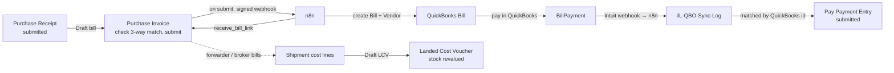

# Module 08: Vendor bills, payments & landed cost

**Audience:** accounting (Charlotte), buyer, owner. **Length:** 75-90 minutes (bills and the 3-way match; QuickBooks and payments; landed cost).
**Roles used:** Accounts User / Manager, Purchase Manager, Command Center Finance (dollars) and Command Center Editor (Draft bill, Draft LCV).
**Training users on staging:** `training.lead` (all roles: buttons and dollars), `training.buyer` (Purchase User: buttons, no dollars), Administrator (QuickBooks settings and logs).

## Purpose

Trainees can enter vendor, forwarder and broker bills, check the 3-way match, get bills into QuickBooks, record vendor payments the right way (in QuickBooks), read and fix the sync log, and land freight and duty into stock value.

> **Status:** the QuickBooks bill sync, payment sync and landed cost buttons are built. The n8n and Intuit pieces need setup, and the purchasing writes haven't run a full live cycle (Rolling out). Capture from the staging cycle described in Module 07. See decision 6 for the rollout plan. On staging today the bill sync is **off** (ilL-QBO-Settings has no Bill Webhook URL or start date), the service items (FREIGHT-IN, DUTY…) and an "Expenses Included In Valuation" account are not set up, and every bill payment that QuickBooks has sent has failed because its bill was keyed in QuickBooks directly. The draft-bill due-date fix (commit 3dcf97a) is deployed and verified.

## Where to go

| What | Where | Who |
|---|---|---|
| Bills and Landed cost tabs | `/command-center#purch` → Bills, Landed cost | Viewer roles; dollars need Finance, Purchase Manager or Accounts Manager |
| Receipts tab (Draft bill) | `/command-center#purch` → Receipts | Buttons need Editor or Purchase User / Manager |
| Purchase invoices (bills) | `/app/purchase-invoice` | Accounts User / Manager |
| Landed cost vouchers | `/app/landed-cost-voucher` | Accounts / Stock Manager |
| Payment entries | `/app/payment-entry` | Accounts User / Manager |
| QuickBooks sync log | `/app/ill-qbo-sync-log` | Read: Accounts User / Manager |
| QuickBooks settings | `/app/ill-qbo-settings` | Edit: Accounts Manager, System Manager |
| "Bills not in QuickBooks" queue | `/app/ill-portal-operations` → Accounting | Accounts Manager / User (needs Purchase Invoice read) |
| Error Log (failed bill pushes) | `/app/error-log` | System Manager |
| Purchasing settings (cost type rules) | `/app/ill-purchasing-settings` → Landed Cost Rules | Edit: Purchase Manager, Accounts Manager |

## The big picture

- **ERPNext** holds POs, receipts, bills and stock value.
- **QuickBooks Online** is the system of record for payables. **Pay bills in QuickBooks, not in ERPNext.**
- Bills flow ERPNext → QuickBooks. Payments flow QuickBooks → ERPNext.
- Landed cost vouchers stay in ERPNext; QuickBooks inventory is trued up periodically.

1. **Receive.** The receipt is submitted (Module 07). The Receipts tab shows **Draft bill**.
2. **Bill.** Draft the bill, type the supplier's invoice number and date, check the 3-way match chip, submit.
3. **Sync out.** On submit ERPNext posts the bill to n8n, which creates the QuickBooks Bill and writes its id back (**QBO ID**).
4. **Pay.** Pay the bill in QuickBooks.
5. **Sync in.** QuickBooks tells n8n, n8n tells ERPNext; a **Pay** Payment Entry is created and submitted against the bill. Every event is in the sync log.
6. **Land.** Forwarder and broker bills fill the shipment's cost lines; **Draft LCV** builds the Landed Cost Voucher; Accounts checks and submits it.

## Who can do what

| Role | Bills / Landed cost tabs | Dollars | Draft bill / Draft LCV | Submit bills, LCVs | QBO settings | Sync log |
|---|---|---|---|---|---|---|
| Accounts User | Yes | **No** | No (add Command Center Editor) | Yes (desk) | No | Read |
| Accounts Manager | Yes | Yes | No (add Command Center Editor) | Yes | Edit | Read |
| Purchase User | Yes | No | Yes | Bills: per ERPNext permission | No | No |
| Purchase Manager | Yes | Yes | Yes | Per ERPNext permission | No | No |
| Command Center Finance + Viewer | Yes | Yes | With Editor | – | – | – |
| System Manager | Yes | Yes | Yes | Yes | Edit | Edit |

Decision 8: Charlotte holds Accounts Manager, Command Center Viewer, Finance **and Editor**, so she sees dollars and can press Draft bill and Draft LCV. The "Bills not in QuickBooks" queue follows the Accounts Manager and Accounts User roles.

---

### Lesson 8.1: Entering the vendor bill

1. From the receipt or PO: **Draft bill** (Command Center: Receipts tab row, or the PO side sheet) or **Create → Purchase Invoice** (desk).
2. Enter the supplier's **Supplier Invoice No** and **Supplier Invoice Date**, check rates and quantities.
3. Check the **3-way match chip** on the Bills tab: PO vs receipt vs bill, per item. Flagged when the difference is over **2% or $50**: **Qty off** (red), **Price off** (amber) or **Matches** (green). Hover the chip for "Qty variance N · price variance $N". **Nothing blocks submit**; you must check it.
4. Payment terms (Supplier or bill) set the **Due Date**, which drives the Overdue lane.
5. Submit in the desk.

**What Draft bill does.** It needs a **submitted** receipt or PO ("Submit purchase receipt ‹PR› in the desk first."). It maps the receipt or PO into a draft Purchase Invoice and leaves *Command Center: draft purchase invoice from ‹PR› created by ‹you›* on it. The bill stays a draft so you can type the supplier's invoice number and date.

**Due-date validation (fixed and verified on staging).** With "Automatically Fetch Payment Terms from Order" on, ERPNext copies the PO's payment schedule into the bill. A schedule row from a PO with no payment terms template keeps the PO's own date, which is earlier than the bill, and ERPNext refused it: **"Due Date cannot be before Supplier Invoice Date"**. Draft bill now moves any lapsed row up to the bill's date (Supplier Invoice Date, else Posting Date), merges rows that land on the same day, and adds *(lapsed order payment terms now due ‹date›)* to the comment. If you later type a Supplier Invoice Date **after** a schedule row's due date, ERPNext raises the same message on save: open the **Terms** tab and move that row's Due Date to or after the Supplier Invoice Date.

**Purchase Invoice fields that matter**

| Field (as shown) | Meaning | Who fills | Required | Flows to |
|---|---|---|---|---|
| Supplier | Vendor, forwarder or broker | Draft | Yes | QuickBooks Vendor |
| QBO ID | QuickBooks Bill id (read-only) | n8n write-back | – | "In QBO" chip; payment matching |
| Synced From | Where it came from (read-only) | Integration | – | – |
| Posting Date | Accounting date | Draft: today | Yes | Start-date check for QuickBooks |
| Due Date | When it must be paid | Payment terms | – | Overdue lane; bill_overdue |
| Is Return (Debit Note) | A return | Accounts | – | Not sent to QuickBooks, not on the board |
| Supplier Invoice No (bill_no) | The vendor's invoice number | **Accounts** | Practically yes | Card "#…"; QuickBooks private note |
| Supplier Invoice Date (bill_date) | Date on the vendor's invoice | **Accounts** | Practically yes | Due date base |
| Items: Item, Accepted Qty, Rate, Amount, Expense Account | What is billed | Draft | Yes | 3-way match; shipment actuals by account |
| Payment Terms Template / payment schedule (Terms tab) | When it falls due | Supplier default | – | Due Date |

**Bills tab** (*Vendor, forwarder and broker bills. Every submitted bill goes to QuickBooks as a Bill · N not in QuickBooks yet (the hourly sync retries; see Portal Operations). 3-way match compares PO, receipt and bill quantities and prices (over 2% or $50 is flagged).*)

| Lane | Rule |
|---|---|
| Draft | Not submitted |
| Unpaid | Submitted, outstanding, not past due |
| Overdue | Past its Due Date (or ERPNext status Overdue) |
| Partly paid | ERPNext status Partly Paid |
| Paid (30 days) | Paid, posted in the last 30 days |

Card: bill name, outstanding (or total once paid), supplier · #supplier invoice no., "Due ‹date›" (red badge when overdue), a **goods** or **freight/duty** badge (freight/duty = linked on a shipment cost line or billed on a service item, with no PO or receipt), **In QBO** / **Not in QBO** chip (submitted bills), the match chip, PO and PR chips. Debit notes are left off.

> **SS-08-01** · Bills tab lanes with QuickBooks and 3-way match chips
> **URL:** `/command-center#purch` → Bills · **Role:** Accounts User + CC Finance (`training.lead`)
> **Highlight:** a `price_off` chip; a bill missing the QuickBooks chip

> **SS-08-02** · Draft bill created from a receipt (desk form)
> **URL:** `/app/purchase-invoice/ACC-PINV-2026-00002` · **Role:** `training.lead` · **State:** made with Draft bill on MAT-PRE-2026-00049
> **Highlight:** QBO ID (blank); Due Date; Supplier Invoice section; Accepted Qty

> **SS-08-03** · Receipts tab "Draft bill" button
> **URL:** `/command-center#purch` → Receipts · **Role:** `training.lead`
> **Highlight:** Draft bill; Billed 0%

> **SS-08-17** · Draft bill on the Bills tab with its match chip
> **URL:** `/command-center#purch` → Bills · **Role:** `training.lead` · **State:** ACC-PINV-2026-00002 (draft)
> **Highlight:** the Draft lane card; the Matches chip; PO and PR chips

> **SS-08-18** · Match chip tooltip "Qty variance · price variance"
> **URL:** `/command-center#purch` → Bills · **Role:** `training.lead` · **State:** a bill against a PO (hover the chip)
> **Highlight:** the tooltip text

> **SS-08-19** · (pair) Draft bill: the toast, then the bill's timeline comment
> **URL:** `-a` `/command-center#purch` → Receipts; `-b` `/app/purchase-invoice/<name>` · **Role:** `training.lead` · **State:** creates a draft bill on staging; do not submit
> **Highlight:** "Draft Purchase Invoice … created, not submitted"; "Command Center: draft purchase invoice from MAT-PRE-…"

> **SS-08-20** · Purchase Invoice Supplier Invoice section filled
> **URL:** `/app/purchase-invoice/ACC-PINV-2026-00002` · **Role:** `training.lead` · **State:** type a TRAINING DEMO invoice no. and date; do not save
> **Highlight:** Supplier Invoice No; Supplier Invoice Date

> **SS-08-21** · Terms tab: Payment Terms Template and the payment schedule
> **URL:** `/app/purchase-invoice/ACC-PINV-2026-00002` → Terms · **Role:** `training.lead`
> **Highlight:** the schedule's Due Date column

> **SS-08-22** · ilL Purchase Invoice print preview ("Vendor Bill")
> **URL:** `/app/purchase-invoice/ACC-PINV-2026-00001` → Print → ilL Purchase Invoice · **Role:** `training.lead`
> **Highlight:** Vendor invoice no.; Due date; Purchase order / Receipt; signature lines "Matched to PO and receipt", "Approved for payment"

> **SS-08-23** · (pair) Bills tab with dollars vs without
> **URL:** `/command-center#purch` → Bills · **Role:** `-a` `training.lead`; `-b` `training.buyer`
> **Highlight:** "$52" vs "—" on the Overdue card

---

### Lesson 8.2: Forwarder and broker bills

- Forwarder and customs broker bills are Purchase Invoices to those suppliers (Supplier Role "Freight forwarder" / "Customs broker") using the **service items** (FREIGHT-IN, DUTY, TARIFF, MPF-HMF, BROKERAGE, INSURANCE-IN, DRAYAGE), whose expense account is the "included in valuation" account. *(Not set up on staging yet: create the items and an "Expenses Included In Valuation" account first.)*
- **Link each bill on the inbound shipment's cost line** (Purchase Invoice column; Billed By = the forwarder or broker). When the bill is submitted, the cost line's Actual fills in and the shipment gets *Command Center: actual cost filled from bill ‹PI›*.
- One bill on **one** cost line: the line gets the bill's whole net amount. One bill on **several** lines (a broker bill with duty and brokerage): each line gets the bill items that post to **its** expense account; a line without an account stays blank.
- Linking a bill that is already submitted works too: saving the shipment fills the actual.
- The broker's entry summary (CBP 7501) is the actual duty; the HTS rates were only the estimate. Put the 7501 number on the shipment (CBP Entry No (7501)).
- `cost_variance` flags a shipment whose actuals are 15% or more over the estimate of the billed lines.

> **SS-08-04** · Broker bill using DUTY and BROKERAGE service items
> **URL:** `/app/purchase-invoice/<name>` · **Role:** `training.lead` · **State:** needs the service items on staging and a submit (lead decides)
> **Highlight:** the two service-item lines and their expense accounts

> **SS-08-05** · Inbound shipment cost line linked to that bill, actual filled
> **URL:** `/app/ill-inbound-shipment/<name>` · **Role:** `training.lead`
> **Highlight:** Purchase Invoice and Actual on the Duty and Brokerage lines

> **SS-08-24** · Cost Lines grid row opened in the desk: Billed By, Purchase Invoice, Expense Account, Allocation
> **URL:** `/app/ill-inbound-shipment/ILL-SHP-2026-0001` → Costs → edit the Freight row · **Role:** `training.lead` · **State:** do not save
> **Highlight:** Purchase Invoice link; Expense Account; Allocation "By qty"

> **SS-08-25** · Bill card with the "freight/duty" badge
> **URL:** `/command-center#purch` → Bills · **Role:** `training.lead` · **State:** a broker or forwarder bill linked on a cost line
> **Highlight:** the freight/duty badge

---

### Lesson 8.3: Getting bills into QuickBooks

- On bill submit, ERPNext sends it (signed) to the n8n **Bill Webhook URL**. n8n looks for a QuickBooks Bill whose DocNumber is the ERPNext bill name (a resend only writes ids back), finds the Vendor (by the Supplier's QBO ID, else display name) or creates it, and creates the **QuickBooks Bill**: one expense line per item at net amount, plus one line for taxes, charges and rounding, so the totals match. The supplier invoice number goes in the private note.
- n8n then calls back and the QuickBooks id is written to the bill (**QBO ID**) and the Vendor id to the Supplier (QBO ID). A different id already stored is refused (409), never overwritten.
- Cancelling the bill deletes the QuickBooks Bill, unless it has payments; then fix it in QuickBooks.
- **Not sent:** debit notes / returns, bills dated before **Send Bills Posted On or After**, anything while the Bill Webhook URL or that date is blank. Multi-currency bills are out of scope (one currency).
- **Retries:** hourly, for submitted bills still without a QBO ID 15 minutes after their last change (50 a run). Failures: Error Log "QBO bill push failed (‹PI›)"; a missing secret logs "QBO bill push: no webhook secret".
- **Watch:** the `bill_not_in_qbo` decision (bills on or after the start date) and Portal Operations → Accounting → **Bills not in QuickBooks**.
- Amended bills start without a QuickBooks id (the field doesn't copy).
- The **Not in QBO** chip and the "N not in QuickBooks yet" line show on every submitted bill without an id, even ones dated before the start date (which are never sent). Only the decision and the queue respect the start date.

**The "Bills not in QuickBooks" queue**

- Page: Portal Operations, section **Accounting** (*Customers to finish setting up and bills to sync to QuickBooks.*). Queue help: *Submitted purchase invoices that are not in QuickBooks yet.*
- Lists submitted, non-return Purchase Invoices with no QBO ID, posted on or after the start date. Columns: name, supplier, bill no., posting date, grand total, modified. One view ("Everything").
- Who: Accounts Manager, Accounts User, System Manager; the user also needs Purchase Invoice read.
- **Hidden** until ilL-QBO-Settings has both the Bill Webhook URL and Send Bills Posted On or After. On staging today the Accounting section shows only "New customers to set up".

**ilL-QBO-Settings fields**

| Section | Field (as shown) | Meaning |
|---|---|---|
| Inbound Payment Sync (QuickBooks Online → ERPNext) | Sync Enabled | "When unchecked, inbound QBO payment and bill payment events are logged as Skipped-NoOp and no Payment Entries are created or cancelled." |
| | Webhook Shared Secret (HMAC) | Signs every call both ways |
| Payment Entry Defaults | Paid To Account | Bank customer payments post to (Module 09) |
| | Paid From Account | "Bank account that bill payments made in QuickBooks are paid from. Bill payments fail until this is set." |
| | Mode of Payment | Default "QuickBooks Online" |
| Supplier Bills (ERPNext → QuickBooks Online) | Bill Webhook URL | "Leave blank to send no bills." |
| | Send Bills Posted On or After | Decision 6: 1 Jan 2027 |
| Endpoint | Endpoint Help | The three ERPNext endpoints n8n calls |

> **SS-08-06** · Submitted bill showing the QuickBooks id field filled
> **URL:** `/app/purchase-invoice/<name>` · **Role:** `training.lead` · **State:** a bill that reached QuickBooks (none on staging yet: the image shows the field blank)
> **Highlight:** QBO ID

> **SS-08-07** · Portal Operations → Bills not in QuickBooks
> **URL:** `/app/ill-portal-operations` → Accounting · **Role:** Accounts Manager · **State:** needs QBO bill sync configured (Bill Webhook URL and start date); turning it on sends bills to QuickBooks, so the lead decides
> **Highlight:** the queue and its rows

> **SS-08-08** · ilL-QBO-Settings (bill webhook URL, start date, accounts)
> **URL:** `/app/ill-qbo-settings` · **Role:** Accounts Manager
> **Highlight:** Paid From Account; Bill Webhook URL; Send Bills Posted On or After

> **SS-08-26** · Portal Operations Accounting section with the bills queue hidden (today)
> **URL:** `/app/ill-portal-operations` · **Role:** `training.lead`
> **Highlight:** "Accounting" heading and help line; only "New customers to set up" listed

> **SS-08-27** · Supplier form QBO ID and Synced From
> **URL:** `/app/supplier/<name>` · **Role:** `training.lead`
> **Highlight:** QBO ID (the QuickBooks Vendor id)

> **SS-08-28** · Error Log filtered to "QBO bill push"
> **URL:** `/app/error-log?method=%25QBO%20bill%20push%25` · **Role:** Administrator · **State:** any entries (none expected while the sync is off)
> **Highlight:** the title column

> **SS-08-29** · Bills tab note "1 not in QuickBooks yet (the hourly sync retries; see Portal Operations)"
> **URL:** `/command-center#purch` → Bills · **Role:** `training.lead`
> **Highlight:** the bold count in the note

---

### Lesson 8.4: Paying vendors

**Objective:** pay in QuickBooks and let ERPNext follow.

1. Pay the bill in **QuickBooks** (Pay bills / Bill Payment).
2. QuickBooks notifies n8n, which posts it to ERPNext as a **Pay** Payment Entry against the matching bill(s) (matched by QBO ID). One payment across several bills = one Payment Entry with several references. Any amount above the allocations stays unallocated (logged as a warning).
3. Edits in QuickBooks (Update / Merge with a changed amount, date or allocation) cancel and recreate the Payment Entry (status Superseded); voids and deletes cancel it. ERPNext never deletes it.
4. Check **ilL-QBO-Sync-Log** (`ILL-QBOSYNC-YYYY-#####`).

**The Payment Entry ERPNext creates:** Payment Type **Pay**, Party Type Supplier, Account Paid From = **Paid From Account** in ilL-QBO-Settings, Mode of Payment "QuickBooks Online", Cheque/Reference No `QBO-‹id›`, references to each bill with its allocated amount, **QBO ID**, **Synced From** "QuickBooks Online", QBO Event Type, QBO Last Synced, QBO Sync Note ("Created from QBO BillPayment"), QBO Payment Method, QBO Reference No. It is submitted at once.

**Sync log statuses**

| Status | Meaning | Action |
|---|---|---|
| Received | Logged, being processed (should not stay) | If it stays, check the Error Log |
| Matched | Bills found; Payment Entry being made | – |
| Created | Payment Entry created and submitted | None |
| Superseded | Old Payment Entry cancelled, new one created after a QuickBooks edit | None |
| Cancelled | QuickBooks void / delete: Payment Entry cancelled | None |
| Skipped-Duplicate | Same payment already in sync | None |
| Skipped-NoOp | Sync disabled, or a delete with nothing to cancel | Check Sync Enabled |
| Failed | See Error Message | Fix (table below), then replay from n8n |

**Sync log record fields:** QBO Entity (Payment / BillPayment), QBO Payment ID, QBO Event Type, Status, Received At, Source IP; QBO Amount, QBO Txn Date, QBO Invoice or Bill ID, QBO Customer or Vendor ID; Sales Invoice, Purchase Invoice, Payment Entry, Superseded Payment Entry, **Applied To** (every bill and its amount); Error Message, Warnings; Raw Payload.

**When it fails** (exact Error Message text)

| Error | Cause | Fix |
|---|---|---|
| "No Purchase Invoice with custom_qbo_id=‹id›" | The bill never reached QuickBooks from ERPNext, or its id wasn't written back, or it was keyed in QuickBooks directly | Fix the outbound side (or record the payment by hand for pre-cutover bills), then replay |
| "Purchase Invoice ‹PI› (custom_qbo_id=‹id›) is not submitted (docstatus=0)" | Bill still a draft | Submit it, replay |
| "QBO BillPayment ‹id› applies ‹x› but totals ‹y›" | Allocations exceed the payment | Correct in QuickBooks |
| "One QBO payment is applied to invoices of different parties or companies: …" | Mixed suppliers | Correct in QuickBooks |
| "… is applied to N invoices (…) without per-invoice amounts; send allocations or review manually" | One payment line covers several bills | **Manual:** record the Payment Entry by hand in ERPNext |
| "… has no linked Invoice (unapplied payment) — review manually" | Payment not applied to a bill, or a vendor credit | **Manual** |
| "A draft Payment Entry already carries custom_qbo_id=‹id›; submit or delete it first" | Someone started one by hand | Submit or delete the draft, replay |
| "Account '' does not exist; set paid_from_account in ilL-QBO-Settings" | Paid From Account blank | Set it (Accounts Manager), replay |
| "Sync disabled in ilL-QBO-Settings" (Skipped-NoOp) | Sync Enabled unticked | Tick it, replay |

- Payments that also apply a vendor credit are manual: record the Payment Entry by hand.
- Supplier payments emailed from ERPNext go from purchasing@ (template "ilL - Payment Entry - Remittance advice", manual).

> **SS-08-09** · Payment Entry created from QuickBooks (synced from = QuickBooks Online)
> **URL:** `/app/payment-entry/<name>` · **Role:** `training.lead` · **State:** a synced bill payment (none on staging)
> **Highlight:** Payment Type Pay; QBO ID; Synced From

> **SS-08-10** · QBO sync log list with a Failed row
> **URL:** `/app/ill-qbo-sync-log` · **Role:** Administrator
> **Highlight:** a Failed BillPayment row; the Status filter

> **SS-08-11** · One sync log record: payload, Applied To, error message
> **URL:** `/app/ill-qbo-sync-log/<name>` · **Role:** Administrator
> **Highlight:** QBO Invoice or Bill ID; Applied To; Error Message

> **SS-08-30** · Sync log record scrolled to Messages: "No Purchase Invoice with custom_qbo_id=1920"
> **URL:** `/app/ill-qbo-sync-log/ILL-QBOSYNC-2026-00018` · **Role:** Administrator
> **Highlight:** Error Message; Raw Payload

> **SS-08-31** · Sync log list filtered Status = Failed, QBO Entity = BillPayment
> **URL:** `/app/ill-qbo-sync-log?status=Failed&qbo_entity=BillPayment` · **Role:** Administrator
> **Highlight:** the two filter chips; the count

> **SS-08-32** · Payment Entry list filtered Synced From = QuickBooks Online
> **URL:** `/app/payment-entry?custom_synced_from=QuickBooks%20Online` · **Role:** `training.lead`
> **Highlight:** Payment Type column (Receive today; Pay once bill payments sync)

> **SS-08-33** · A synced Payment Entry's QBO fields (customer payment as the stand-in)
> **URL:** `/app/payment-entry/ACC-PAY-2026-00080` · **Role:** `training.lead`
> **Highlight:** QBO ID 1891; Synced From; QBO Event Type; QBO Sync Note; Cheque/Reference No "QBO-1891"

**DATA-08-01** · Sync log status counts for the last 30 days
**API:** `GET /api/resource/ilL-QBO-Sync-Log?filters=[["creation",">","<30 days ago>"]]&fields=["status","count(name) as n"]&group_by=status`

**DATA-08-03** · Failed bill payments with their error text (worked example)
**API:** `GET /api/resource/ilL-QBO-Sync-Log?filters=[["qbo_entity","=","BillPayment"],["status","=","Failed"]]&fields=["name","qbo_payment_id","qbo_invoice_id","qbo_amount","error_message"]&limit_page_length=20`

---

### Lesson 8.5: Landed cost, step by step

1. **Estimate.** Creating the inbound shipment seeds cost lines: freight as a % of goods value, duty and tariffs from HTS rates. Estimated landed % shows before arrival.
2. **Receive.** Submit the receipt; stock is valued at the PO rate.
3. **Bills.** Vendor bill against the PO or receipt. Forwarder and broker bills with service items, linked on the cost lines.
4. **Land it.** When every included cost has its bill (or tick "Allow estimates in the landed cost voucher"), **Draft LCV** builds the voucher: one charge row per included cost type, allocation basis from the cost lines, the linked bills in Vendor Invoices. Check the distribution, submit in the desk. ERPNext revalues the items (a short delay while it reposts).
5. **QuickBooks.** The LCV is not sent. True up QuickBooks inventory periodically with the **landed cost in stock** figure (decision 6: first true-up at the end of Q1 2027).

**What's included by default:** freight (by qty, est. 8%), MPF / HMF (by value, est. 0.4%), duty, additional tariff, brokerage, insurance (by value), drayage / delivery (by qty). **Not capitalised:** storage / demurrage, sales / use tax, other. Change per cost type in ilL-Purchasing-Settings → Cost Type Defaults (Cost Type, Include in Landed Cost, Expense Account, Allocation, Estimate (% of Goods Value), Estimate (Flat Amount per Shipment)).

**One basis per voucher.** The defaults mix "By qty" (freight, drayage) and "By value" (everything else), so a shipment with freight and duty is refused until you choose: set every included line's **Allocation** to one basis (or all to Manual) on the shipment's cost lines in the desk, or land them in two vouchers. The basis maps to the LCV's **Distribute Charges Based On**: By value → Amount, By qty → Qty, Manual → Distribute Manually.

**Draft LCV checks, in order** (exact refusal text)

| Check | Message |
|---|---|
| The shipment has receipts | "This shipment has no purchase receipts yet." |
| You can read them | "You can't read these receipts: ‹list›" |
| They are submitted | "Submit these purchase receipts first: ‹list›" |
| Some line is in landed cost | "No cost line on this shipment is marked In Landed Cost." |
| Every included line has an account | "Set an expense account on: ‹cost types›" |
| Every included line has an actual (unless Allow estimates) | "No actual amount yet for: ‹cost types›. Link the bills, or draft it from estimates." |
| One allocation basis | "These costs use different allocation bases (‹list›). A Landed Cost Voucher has one basis: split them into two vouchers or set them all to Manual." |
| One account per cost type | "‹cost type› lines post to different accounts; use one account per cost type." |
| Something to land | "The included costs add up to zero." |

On success: toast *Draft Landed Cost Voucher ‹name› created, not submitted*, the voucher is added to the shipment's Landed Cost Vouchers table, and the shipment gets *draft landed cost voucher ‹name› created by ‹you›*.

**Landed Cost Voucher fields (desk)**

| Field (as shown) | Filled by Draft LCV |
|---|---|
| Company, Posting Date | Receipt's company; today |
| Vouchers (Receipt Document Type, Receipt Document, Supplier, Posting Date, Grand Total) | Every receipt on the shipment |
| Receipt Items (Item Code, Qty, Rate, Amount, Applicable Charges) | Get Items, then distributed |
| Vendor Invoices (Vendor Invoice, Amount) | The bills linked on included cost lines |
| Landed Cost (Expense Account, Description, Amount) | One row per included cost type |
| Distribute Charges Based On | Qty / Amount / Distribute Manually |
| Total Landed Cost (Company Currency) | Sum |

**Landed cost tab**

- Stat cards: **Need landed cost** (*Delivered, costs not in a submitted voucher*), **Estimated costs still to land** (*Freight, duty and tariffs not yet in stock value*), **Landed cost in stock** (*For the periodic QuickBooks true-up (Decision D1)*).
- **Needs landed cost** table (*When every included cost has its bill (or you accept estimates), Draft LCV builds the Landed Cost Voucher. Charlotte checks the distribution and submits it in ERPNext.*): Shipment / receipt, Supplier, Estimated, Actual, Missing ("‹cost type› bill not in yet" chips, or **Ready**), **Draft LCV** (highlighted when ready).
- **Landed cost vouchers** (last 120 days): Voucher, Status (Draft / Submitted / Cancelled), Date, Receipts, Amount.
- **Landed cost by item**: Item, Last receipt, Purchase rate, Landed rate, Uplift, 12-mo avg; **Copy as text** (tab-separated, for a spreadsheet).
- **Landed cost in stock** = for each item, (landed rate − purchase rate on its last landed receipt) × stock on hand.
- A shipment "needs landed cost" when it has included costs, no submitted voucher, and either a receipt or status Delivered / Costs final. `needs_lcv` turns red 30 days after Delivered On.

> **Known issue (confirm on capture):** blank cost-line actuals are stored as $0.00 and read as billed, so "bill not in yet" chips may not appear and Draft LCV can build a voucher from zeros ("The included costs add up to zero.") instead of asking for bills. Check the Actual column by eye.

> **SS-08-12** · Landed cost tab: needs-voucher list with "Duty bill not in yet"
> **URL:** `/command-center#purch` → Landed cost · **Role:** `training.lead`
> **Highlight:** the missing-bill chip; Draft LCV

> **SS-08-13** · Draft LCV from the board (desk form): charge rows and distribution
> **URL:** `/app/landed-cost-voucher/<name>` · **Role:** `training.lead` · **State:** needs a submitted receipt on a shipment with billed costs (lead decides)
> **Highlight:** Landed Cost rows; Distribute Charges Based On; Applicable Charges

> **SS-08-14** · LCV refused: mixed allocation bases message
> **URL:** `/command-center#purch` → Shipments → a shipment sheet → Draft landed cost voucher · **Role:** `training.lead` · **State:** submitted receipts, expense accounts set, Freight By qty and Duty By value
> **Highlight:** the toast "These costs use different allocation bases…"

> **SS-08-15** · Landed cost by item table and the landed-cost-in-stock total
> **URL:** `/command-center#purch` → Landed cost · **Role:** `training.lead`
> **Highlight:** Uplift column; Copy as text

> **SS-08-16** · ilL-Purchasing-Settings cost type rules
> **URL:** `/app/ill-purchasing-settings` → Landed Cost Rules · **Role:** Purchase Manager
> **Highlight:** Include in Landed Cost; Allocation; Estimate %

> **SS-08-34** · Draft LCV refused today on staging: "Submit these purchase receipts first: MAT-PRE-2026-00050"
> **URL:** `/command-center#purch` → Shipments → ILL-SHP-2026-0001 → Draft landed cost voucher · **Role:** `training.lead` · **State:** the receipt is a draft, so nothing is created
> **Highlight:** the error toast

> **SS-08-35** · "Allow estimates in the landed cost voucher" checkbox on the shipment sheet
> **URL:** `/command-center#purch` → Shipments → ILL-SHP-2026-0001 · **Role:** `training.lead`
> **Highlight:** the checkbox next to Draft landed cost voucher

> **SS-08-36** · Landed Cost Voucher desk form: Vendor Invoices and Landed Cost tables
> **URL:** `/app/landed-cost-voucher/new` · **Role:** `training.lead` · **State:** a blank new form; do not save
> **Highlight:** Vouchers; Vendor Invoices; Landed Cost; Distribute Charges Based On options

> **SS-08-37** · Chart of Accounts: an "Expenses Included In Valuation" account
> **URL:** `/app/account?account_type=Expenses%20Included%20In%20Valuation` · **Role:** Accounts Manager · **State:** create one on staging first (none today)
> **Highlight:** Account Type

> **SS-08-38** · "Copied landed cost by item" toast after Copy as text
> **URL:** `/command-center#purch` → Landed cost · **Role:** `training.lead`
> **Highlight:** the toast

> **SS-08-39** · Shipment card with the "Needs landed cost" badge
> **URL:** `/command-center#purch` → Shipments · **Role:** `training.lead` · **State:** a delivered shipment with a submitted receipt and no submitted voucher
> **Highlight:** the badge; Landed +%

> **SS-08-40** · Landed cost tab at phone width (phone)
> **URL:** `/command-center#purch` → Landed cost · **Role:** `training.lead` · 390×844
> **Highlight:** the three stat cards stacked

**DATA-08-02** · A real delivered inbound shipment with estimates vs actuals (worked example)
**API:** `GET /api/resource/ilL-Inbound-Shipment?filters=[["status","in",["Delivered","Costs final"]]]&fields=["name","supplier","freight_mode","goods_value","landed_cost_pct"]&limit_page_length=5` then `GET /api/resource/ilL-Inbound-Shipment/<name>`

---

## Behind the scenes

| Trigger | What happens | Code |
|---|---|---|
| Draft bill pressed | Draft Purchase Invoice mapped from the receipt or PO; lapsed schedule dates moved to the bill date; comment | `purchasing_board.make_invoice`, `refresh_due_dates` |
| Purchase Invoice submitted | Queued to n8n (if the URL and start date are set and it is eligible) | `qbo_bills.on_submit` |
| Purchase Invoice submitted | Linked shipment cost lines get their Actual; comment | `purchasing.on_invoice_submit` |
| Purchase Invoice cancelled | Delete request to n8n | `qbo_bills.on_cancel` |
| n8n callback | QBO ID on the bill and the Supplier | `qbo_bills.receive_bill_link` |
| Hourly | Resend up to 50 submitted bills with no QBO ID, unchanged for 15 minutes | `qbo_bills.send_pending` |
| QuickBooks BillPayment webhook | Sync log row; Pay Payment Entry created, superseded or cancelled | `qbo_sync.receive_bill_payment_event` |
| Draft LCV pressed | Draft Landed Cost Voucher; added to the shipment; comment | `purchasing_board.make_landed_cost_voucher` |
| LCV submitted (ERPNext) | Receipts revalued; repost of stock ledger | ERPNext |
| Payment Entry change | Sales order stages refresh | `order_stage.queue_refresh` |

## Worked example (staging)

1. **The overdue bill.** ACC-PINV-2026-00001, Linea Lighting Co., Limited, supplier invoice C122-PI-260422, $52.08, due 22 Apr 2026. It is in the **Overdue** lane with a red "Due Apr 22" badge, a **goods** badge and **Not in QBO** (SS-08-01). The decision "1 Overdue vendor bills" shows on Overview. It never reached QuickBooks because bill sync is off on staging.
2. **The draft bill.** From the Receipts tab, **Draft bill** on MAT-PRE-2026-00049 (General Lighting Electronic, received 28 Oct) made ACC-PINV-2026-00002: 2 × COB-SD-FS-20 at $147.00 and more, $599.00, Posting Date and Due Date 23 Nov 2026 (SS-08-02). Before the fix this failed with "Due Date cannot be before Supplier Invoice Date". Next: type the supplier invoice number and date, check the match chip, submit.
3. **The failed payments.** QuickBooks sent BillPayments 1868 to 1921 (e.g. $5,091.63 on 28 Oct). Each failed: "No Purchase Invoice with custom_qbo_id=1920" (SS-08-10, SS-08-11). The bills were keyed in QuickBooks directly, so no ERPNext bill carries those ids. This is why decision 6 cuts over on a date: from 1 Jan 2027 bills are entered in ERPNext only. Customer payments (Payment, Created) sync fine: ACC-PAY-2026-00080 for $1,169.90.
4. **The shipment to land.** ILL-SHP-2026-0001 (Module 07) has Freight $58.30 (By qty) and MPF / HMF $2.91 (By value), no expense accounts, and a draft receipt. Draft LCV today says "Submit these purchase receipts first: MAT-PRE-2026-00050". After submitting it would say "Set an expense account on: Freight, MPF / HMF", then the mixed-basis message. Fix: set the valuation account on both cost types in ilL-Purchasing-Settings, set both lines to By value, link the forwarder's bill, then Draft LCV.

## Troubleshooting

| Symptom | Cause | Fix |
|---|---|---|
| "Due Date cannot be before Supplier Invoice Date" on Draft bill | Old code (before 3dcf97a) | Fixed on staging; update the site |
| Same message when saving the bill | Supplier Invoice Date later than a schedule row | Terms tab: move the row's Due Date |
| "Submit purchase receipt ‹PR› in the desk first." | Draft bill on a draft receipt | Submit the receipt |
| "Start from a purchase order or a receipt." | Called without a document | Use the row's button |
| No Draft bill button | View-only role, or receipt fully billed | Get Editor / Purchase User; check Billed % |
| Bill shows **Not in QBO** after an hour | Bill sync off, dated before the start date, a return, or the push failed | Check ilL-QBO-Settings, the Error Log ("QBO bill push failed"), the Accounting queue |
| "Bills not in QuickBooks" queue missing | Bill Webhook URL or start date blank, or no Accounts role | Configure (Accounts Manager); check roles |
| Bill payment Failed: "No Purchase Invoice with custom_qbo_id=…" | Bill not created from ERPNext | Fix outbound, or record by hand |
| Bill payment Failed: "Account '' does not exist; set paid_from_account…" | Paid From Account blank | Set it |
| Cost line Actual stays blank after the broker bill | Bill not linked on the line, not submitted, or a split bill whose lines have no expense account | Link it; set accounts; save the shipment |
| Draft LCV: "Set an expense account on: …" | Cost type has no account | Settings → Cost Type Defaults, and on the line |
| Draft LCV: "These costs use different allocation bases…" | Default bases mix | One basis per voucher |
| Draft LCV: "No actual amount yet for: …" | Bills missing | Link the bills, or tick Allow estimates |
| Landed rate unchanged after submitting the LCV | Repost still running | Wait, refresh |
| QuickBooks Bill not deleted after cancelling | It has payments | Fix it in QuickBooks |

## Tips and shortcuts

- Read the match chip before every submit; hover it for the numbers.
- Type the supplier invoice number exactly as printed: it goes to QuickBooks.
- Never pay a bill in ERPNext. If a payment must be recorded by hand (vendor credit, multi-bill line), say so in the Payment Entry remarks.
- Before the quarterly true-up, use **Copy as text** on Landed cost by item.
- Link forwarder and broker bills on the shipment **before** submitting them; the actual fills on submit.

## Common mistakes

- Paying in ERPNext as well as QuickBooks: a duplicate payment.
- Typing the bill in QuickBooks too after the cutover: the ERPNext bill then creates a second Bill.
- Submitting a bill with a **Qty off** chip and fixing it later.
- Leaving forwarder bills unlinked: freight never reaches stock value.
- Expecting the LCV to reach QuickBooks: it doesn't.

## Exercises (staging)

1. **Read the Bills tab.** As `training.lead`, open Bills. *Expected:* ACC-PINV-2026-00001 in Overdue, $52, red due badge, Not in QBO; ACC-PINV-2026-00002 in Draft.
2. **Compare roles.** Repeat as `training.buyer`. *Expected:* amounts show "—" and the Dollar figures line.
3. **Read a failure.** Open ILL-QBOSYNC-2026-00018. *Expected:* BillPayment, Failed, QBO Invoice or Bill ID 1920, Error Message "No Purchase Invoice with custom_qbo_id=1920". Explain why.
4. **Find the switch.** Open ilL-QBO-Settings. *Expected:* Bill Webhook URL and Send Bills Posted On or After blank, so no bill is sent and the Accounting queue is hidden. Do not change them.
5. **Try to land.** On the board, open ILL-SHP-2026-0001 and press Draft landed cost voucher. *Expected:* "Submit these purchase receipts first: MAT-PRE-2026-00050"; nothing is created.
6. **Plan the voucher.** From SS-08-16, list which cost types would be in the voucher and which basis each uses. *Expected:* seven included; Freight and Drayage By qty, the rest By value: two bases, so one must change.

## Slide deck beats

1. Who holds what: ERPNext vs QuickBooks
2. Entering a bill and the 3-way match chip
3. The due-date fix and the Terms tab
4. Forwarder and broker bills on cost lines
5. Bills into QuickBooks, and how to spot one that didn't make it
6. Pay in QuickBooks; ERPNext follows
7. Reading the sync log and fixing failures
8. Landed cost in five steps, and one basis per voucher
9. The quarterly QuickBooks inventory true-up

## Check yourself

1. Where do you record a vendor payment?
2. A bill has no QuickBooks chip after an hour. Where do you look?
3. The 3-way match chip says `price_off`. Can you still submit? Should you?
4. Why might Draft LCV refuse to build a voucher?
5. A QuickBooks payment applied a vendor credit. What do you do in ERPNext?
6. Why did every staging bill payment fail?
7. Who sees dollars on the Bills tab, and who can press Draft bill?
8. A broker bill covers duty and brokerage. How does each cost line get its actual?

**Answers:** 1. In QuickBooks; ERPNext follows. 2. ilL-QBO-Settings (URL, start date), the Error Log, Portal Operations → Accounting → Bills not in QuickBooks. 3. Yes, nothing blocks it; not before you understand the variance. 4. Draft receipts, no included lines, missing expense account, missing bills, mixed allocation bases, zero total. 5. Record the Payment Entry by hand. 6. The bills were keyed in QuickBooks, so no ERPNext bill has those QuickBooks ids. 7. Dollars: Finance, Purchase Manager, Accounts Manager, System Manager; Draft bill: Editor, Purchase User / Manager, System Manager. 8. By the expense account on each bill item matching the line's account.
