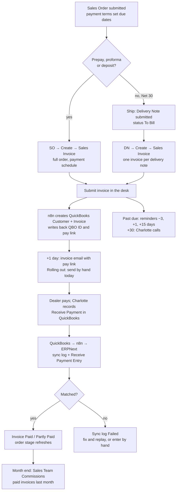

# Module 09: Invoicing, receivables & finance

**Audience:** accounting (Charlotte), owner. **Length:** 2 sessions of 60 minutes (invoicing and the dealer's invoice; payments, receivables and commissions).
**Roles used:** Accounts User / Manager, Command Center Finance (with Command Center Viewer), Dealer (portal side), System Manager (settings only).

## Purpose

Trainees can invoice an order (deposit, proforma or after shipping), get the invoice and its pay link to the dealer, follow receivables, record customer payments the right way (in QuickBooks), fix a payment that did not sync, issue a credit note, chase a late payer, and read the Finance tab and commission reports.

> **Status (Rolling out):** several pieces are not switched on yet. Checked on staging on 24 Nov 2026:
> - All six invoice and payment **Notifications** are disabled (`ilL - Invoice`, `… due soon`, `… past due 1 / 15 / 30 days`, `ilL - Payment received`).
> - The company field **Invoice Payment Instructions** is empty, so the "How to pay" box prints no remittance details.
> - **No invoice carries a QuickBooks pay link yet** (0 of 152 on staging). 125 of them do carry a QuickBooks id, so the invoice push itself works.
>
> Train the flow; mark the email and pay-link slides "Rolling out". See decisions 1, 2 and 6.

## Where to go

| What | Where | Who |
|---|---|---|
| Finance tab | `/command-center#finance` (Restricted, see the caveat in Lesson 9.4) | Command Center Finance |
| New sales invoice | `/app/sales-invoice/new`, or **Create → Sales Invoice** on a Delivery Note or Sales Order | Accounts User / Manager |
| Sales invoices | `/app/sales-invoice` | Accounts User / Manager |
| Delivery notes still to bill | `/app/delivery-note?status=To%20Bill` | Accounts User / Manager |
| Accounts Receivable report | `/app/query-report/Accounts Receivable` | Accounts User / Manager |
| Payment entries | `/app/payment-entry` | Accounts User / Manager |
| QuickBooks sync log | `/app/ill-qbo-sync-log` | Accounts User / Manager (read), System Manager |
| QuickBooks settings | `/app/ill-qbo-settings` | Accounts Manager, System Manager |
| Company payment instructions | `/app/company/ilLumenate Lighting` → Invoice Payment Instructions | Accounts Manager |
| Invoice emails (Notifications) | `/app/notification?document_type=Sales%20Invoice` | System Manager |
| Accounting queues | `/app/ill-portal-operations` → Accounting section | Accounts Manager / User (see the gap in Lesson 9.4) |
| Sales partners (reps) | `/app/sales-partner` | Sales Manager, Accounts Manager |
| Commission reports | `/app/query-report/Sales Team Commissions`, `/app/query-report/Sales Partner Invoice Report` | Accounts / Sales roles |
| Dealer's view of invoices | `/portal/orders/<sales order>` → Invoices | Dealer |

## Who holds which piece

| Piece of work | System of record | Who | Notes |
|---|---|---|---|
| Sales invoice, credit note | ERPNext | Charlotte (Accounts Manager) | Submitted in the desk |
| QuickBooks Customer and Invoice | QuickBooks Online | n8n, automatically | Created when the ERPNext invoice is submitted |
| Customer payment | **QuickBooks Online** | Charlotte | Never typed into ERPNext as well |
| Payment Entry in ERPNext | ERPNext | n8n, automatically | Follows the QuickBooks payment |
| Receivables follow-up | ERPNext (AR report, Finance tab) | Charlotte | Calls at 30 days past due (decision 2) |
| Commissions and SPIFs | ERPNext reports | Owner, Charlotte | Reps never print on customer documents |

## Process map

The whole order-to-cash flow, from the order to the commission report. The diagram version is in the Claude Doc.

1. **Order submitted** (Module 04). The customer's payment terms set the due date. Prepay, proforma and deposit orders carry a payment schedule.
2. **Before production**, for prepay, proforma and deposit orders: **Sales Order → Create → Sales Invoice** for the full order. Email it with the template "Order confirmation and invoice".
3. **Shipping** (Module 06): the Delivery Note is submitted and shows **To Bill**.
4. **Delivery Note → Create → Sales Invoice**. Check the lines, the customer's PO and the due date, then Save and Submit.
5. **On submit**, n8n creates the QuickBooks Customer (if new) and Invoice, then writes the QuickBooks id (and the pay link, once that is switched on) back to the invoice.
6. **One day after the invoice date**, the "ilL - Invoice" Notification emails the invoice with its pay link. It is disabled today, so send it by hand from the invoice.
7. **The dealer pays.** Charlotte records the payment in QuickBooks (Receive Payment).
8. **QuickBooks → n8n → ERPNext** writes a sync log row and a **Receive** Payment Entry against the invoice(s). The invoice turns Paid or Partly Paid.
9. **The order's stage refreshes.** A paid proforma order leaves "Proforma - Awaiting Payment". A fully delivered and fully billed order becomes Completed.
10. **If it isn't paid**, reminders go 3 days before the due date and 1 and 15 days after it. At 30 days Charlotte calls (decision 2). Watch the Finance tab aging table and the Executive "Overdue invoices" card.
11. **Month end:** the Sales Team Commissions report (paid invoices, last month) and the SPIF candidates list.

---

### Lesson 9.1: When to invoice

**Objective:** pick the right moment and the right source document, every time.

| Situation | Invoice from | Email template | Notes |
|---|---|---|---|
| Deposit / prepay before production | The Sales Order: **Create → Sales Invoice** | "Order confirmation and invoice" (manual) | Invoice the full order. The deposit is the first open row of the payment schedule |
| Proforma (pay before shipping) | The Sales Order | "Order confirmation and invoice" or "Invoice" | The order stays **Proforma - Awaiting Payment** until it is paid in full |
| Standard Net 30, after shipping | **Delivery Note → Create → Sales Invoice** | "Invoice" (Notification +1 day, Rolling out) | One invoice per delivery note (decision 1) |
| Return or credit | **Is Return (Credit Note)** invoice against the original (Lesson 9.6) | "Credit note" (manual) | Prints as "Credit Note" |

- **Billing completes the order.** The order's stage becomes **Completed** when ERPNext marks it Completed (fully delivered and fully billed) or Closed. A fully delivered order that isn't billed yet shows **Shipped / In Transit**.
- **Deposits must be invoiced.** QuickBooks payments only sync when they match an invoice, so a deposit with no invoice behind it fails (decision 1).
- **One delivery note, one invoice.** Partial shipments bill what shipped, and the invoice matches the packing slip in the box.
- **Configured lines keep their build.** When an invoice row comes from a delivery note or order row that carries a configured build, the build fields (Section / Room, Fixture Type, configured item, BOM and so on) are copied from that exact source row on save. Plain rows behave as ERPNext normally does.
- On staging only one payment terms template exists ("Net 30"). Deposit orders need a template with two rows (deposit now, balance before shipping); ask the systems admin to create it before teaching deposits.

**SS-09-01** · Delivery note → Create → Sales Invoice menu
**URL:** `/app/delivery-note/<name>` · **Role:** Accounts User · **State:** submitted DN, status To Bill
**Highlight:** the Create menu; the Sales Invoice item; the "To Bill" badge

What you see (captured):
- Delivery Note header with the yellow **To Bill** badge and the buttons **Create Shipment**, **Create**, **View**, **Status** and **Cancel**.
- The open **Create** menu: Shipment, Installation Note, Sales Return, Delivery Trip, **Sales Invoice**.
- Details tab: Customer, Date, Posting Time and the **Is Return** box.
- The Delivery Note Item table with the app's **Section / Room** and **Fixture Type** columns, Quantity and UOM, and a Shipping line.

**SS-09-02** · Sales invoice form created from a delivery note
**URL:** `/app/sales-invoice/<name>` · **Role:** Accounts User · **State:** submitted invoice
**Highlight:** QBO ID; Payment Due Date; the Section / Room and Fixture Type columns

What you see (captured):
- Header "Sales Invoice / <customer>" with a red **Overdue** badge and the buttons **Support**, **View**, **Create** and **Cancel**.
- Tabs: Details, Payments, Address & Contact, Terms, More Info, Connections.
- Left column: Company Tax ID, Customer, **QBO ID** (1932), **Synced From** (blank), **QuickBooks Payment Link** (blank: the pay link is not live yet), Tax Id.
- Middle column: Posting Date, Posting Time, **Payment Due Date**.
- Right column: Include Payment (POS), **Is Return (Credit Note)**, Is Rate Adjustment Entry (Debit Note) with its help text, Consider for Tax Withholding.
- Items table with Item, **Section / Room**, **Fixture Type**, Quantity and Rate (USD). **Update Stock** is unticked (the delivery note already moved the stock).

**SS-09-13** · Delivery notes waiting to be invoiced
**URL:** `/app/delivery-note?status=To%20Bill` · **Role:** Accounts User · **State:** at least 2 submitted DNs not yet billed
**Highlight:** the Status column; the filter chip; the oldest posting date

**SS-09-14** · Sales Order → Create menu for a proforma or deposit invoice
**URL:** `/app/sales-order/<name>` · **Role:** Accounts User · **State:** submitted SO, status To Deliver and Bill, not yet billed
**Highlight:** Create → Sales Invoice; the Stage field

**SS-09-15** · Sales invoice list filtered to Overdue, oldest due date first
**URL:** `/app/sales-invoice?status=Overdue` · **Role:** Accounts User · **State:** at least 3 overdue invoices (staging has 8)
**Highlight:** the status indicators; the Due Date column; the count "x of y"

**SS-09-16** · Sales invoice Payments tab: payment terms and the payment schedule
**URL:** `/app/sales-invoice/<name>` → Payments · **Role:** Accounts User · **State:** submitted invoice with a payment terms template
**Highlight:** Payment Terms Template; the Payment Schedule table (due date, portion, payment amount, outstanding)

**SS-09-17** · Sales invoice Connections tab
**URL:** `/app/sales-invoice/<name>` → Connections · **Role:** Accounts User · **State:** paid invoice made from a delivery note
**Highlight:** the Payment Entry, Delivery Note and Sales Order links; the Helpdesk ticket link when Helpdesk is installed

**SS-09-18** · Delivery note after billing: status Completed and the invoice under Connections
**URL:** `/app/delivery-note/<name>` → Connections · **Role:** Accounts User · **State:** a DN with status Completed (staging has several)
**Highlight:** the Completed badge; the Sales Invoice link

#### Screen tour: the Sales Invoice form

| Region | What's there | What to check |
|---|---|---|
| Header | Status badge, **Support** (Link Helpdesk Tickets), **View**, **Create** (Payment, Return / Credit Note and others), **Cancel** after submit | The badge: Draft, Unpaid, Overdue, Partly Paid, Paid, Return, Credit Note Issued, Cancelled |
| Details tab | Customer, QuickBooks fields, dates, return flags | QBO ID fills a minute or so after submit |
| Items | Item, Section / Room, Fixture Type, Quantity, Rate, Amount | Quantities match the delivery note |
| Taxes and totals | Sales Taxes and Charges, Additional Discount, Grand Total, Outstanding Amount | Freight lines and discount match the order |
| Payments tab | Payment Terms Template, Payment Schedule, Advances | Due date and deposit rows |
| Address & Contact | Customer Address, Contact Person, shipping address | The contact gets the invoice email |
| More Info | Sales Partner, commission, accounting details (confirm on capture) | The rep, for commission reports |
| Connections | Delivery Note, Sales Order, Payment Entry, linked Helpdesk tickets | Where the money came from |
| Sidebar | Assign, Attachments, Tags, Share, last edited and created by | |

#### Field reference: Sales Invoice

Labels as deployed on staging (getdoctype, 24 Nov 2026).

| Field (label) | Meaning | Filled by | Required | Flows to |
|---|---|---|---|---|
| Series | `ilL-ACC-SINV-<customer>-#####`; returns use `ilL-ACC-SINV-RET-<customer>-#####` | ERPNext | Yes | The invoice number the dealer sees and QuickBooks' DocNumber |
| Customer | The dealer company billed | Copied from DN or SO | Yes | QuickBooks Customer, AR report, Finance tab |
| Posting Date | Invoice date | You (defaults to today) | Yes | "Invoiced this month"; the +1 day invoice email |
| Payment Due Date | When it's due | Payment terms (or typed) | No | Overdue status, reminders, aging |
| QBO ID | The QuickBooks Invoice id | n8n, after submit (read-only) | No | How QuickBooks payments find this invoice |
| Synced From | Set when a record came from QuickBooks | Integration (read-only) | No | |
| QuickBooks Payment Link | The Intuit pay-now link (https on intuit.com only) | n8n (read-only) | No | "Pay online" on the print; "Pay this invoice online" button in emails |
| Customer's Purchase Order | The dealer's PO number | Copied from SO | No | Email subject "(PO …)" and the print's "Your PO" |
| Is Return (Credit Note) | Makes this a credit note | You, through Create → Return | No | Prints "Credit Note"; status Return |
| Return Against | The original invoice | ERPNext | With a return | "Against invoice …" on the print |
| Update Stock | Move stock from the invoice | Leave **off** when billing a delivery note | No | |
| Payment Terms Template | Net 30, or a deposit template | Customer default or SO | No | Payment Schedule, due date |
| Payment Schedule | Due date, portion and amount per row | ERPNext from the template | No | The "How to pay" box lists each row; the first open row is the deposit |
| Items (Section / Room, Fixture Type) | What was billed, with the project's room and fixture type | DN or SO rows | Yes | Print grouped by section |
| Sales Partner / Commission Rate (%) / Total Commission | The rep and their rate | SO | No | Sales Partner Invoice Report |
| Sales Contributions and Incentives | Sales people and allocation % | SO / Customer | No | Sales Team Commissions |
| Outstanding Amount | What is still owed | ERPNext (read-only) | | AR, Finance tab, past-due emails |

#### Status lifecycle: Sales Invoice

| Status | What moves it here | Who | What it unlocks |
|---|---|---|---|
| Draft | Saved, not submitted | Accounts User / Manager | Edit freely; nothing goes to QuickBooks |
| Unpaid | Submitted, due date not yet passed | Accounts User / Manager (Submit) | QuickBooks push; the +1 day invoice email; the −3 day reminder |
| Overdue | The due date passes with a balance (ERPNext updates it daily) | Automatic | Past-due emails at +1, +15, +30 days; "Past due N days" on the print; the Executive "Overdue invoices" card |
| Partly Paid | A Payment Entry covers part of it | n8n sync (or a manual Payment Entry) | Print shows "Partly paid" and the payments received |
| Paid | Outstanding reaches zero | n8n sync | Print shows "Paid"; it counts in the Sales Team Commissions default view |
| Return | A credit note (Is Return) is submitted | Accounts User / Manager | Prints as "Credit Note" |
| Credit Note Issued | A credit note was issued against this invoice and nothing is left to pay | Automatic | |
| Cancelled | Cancelled in the desk | **Accounts Manager** (Accounts User has no cancel right on staging) | The QuickBooks invoice must be handled in QuickBooks; amend to re-issue |

---

### Lesson 9.2: The invoice the dealer receives

**Objective:** know exactly what the dealer sees, and what's missing until the rollout finishes.

- Print **ilL Sales Invoice**, at dealer pricing:
  - **Header:** "Invoice" (or "Credit Note"), the number and a status badge: Draft, Cancelled, Credit, **Paid**, **Past due N days** (red), Partly paid or Unpaid.
  - **Facts:** Invoice date, Due date, Your PO, Payment terms, Sales order, Shipment, Project, Fixture schedule, tax IDs.
  - **Lines** grouped by section (BAR, SHELVING…) with fixture type, specs, list price, discount, net and amount, and a subtotal per section.
  - **Totals:** subtotal, discount, freight, Total, then **Paid** and **Balance due** on a submitted invoice. **Payments received** lists each payment with its date, method and QuickBooks reference.
  - **How to pay** box (red when past due), shown unless the invoice is paid in full, cancelled or a credit note. It lists the schedule rows or "$X due <date>", then "Please reference invoice <name> with your payment.", the **Pay online** link when there is one, and the company's **Invoice Payment Instructions** on the right.
  - Closing line: "Thank you for your business. Billing questions: <company email> or <phone>."
- **On submit**, n8n creates the QuickBooks Customer and Invoice and writes the QuickBooks id back (`custom_qbo_id`), plus the Customer's QuickBooks id when it had to find or create it. The pay link (`custom_qbo_payment_link`) is stored the same way and may be replaced later; ERPNext only accepts an https link on intuit.com.
- **Emails** (templates in `/app/email-template`, all named `ilL - Sales Invoice - …`):

| Template | Sent by | When | Attaches |
|---|---|---|---|
| Invoice | Notification `ilL - Invoice` (disabled) | 1 day after the invoice date, so the pay link has time to arrive | ilL Sales Invoice |
| Order confirmation and invoice | Manual | On the invoice made from the order, to collect before production | ilL Sales Invoice |
| Payment reminder | Notification `ilL - Invoice due soon` (disabled) | 3 days before the due date | — |
| Past due | Notifications `… past due 1 day`, `15 days`, `30 days` (disabled) | 1, 15 and 30 days after the due date | ilL Sales Invoice on the 30-day one |
| Paid in full receipt | Manual | After the last payment | ilL Sales Invoice |
| Credit note | Manual | On a return invoice | ilL Sales Invoice |
| Payment received (Payment Entry) | Notification `ilL - Payment received` (disabled) | On submit of a customer receipt | — |

- Every invoice Notification only fires when the invoice is submitted, is not a return and still has a balance (`doc.docstatus == 1 and not doc.is_return and doc.outstanding_amount > 0`).
- **The past-due ladder** uses one template whose tone follows the days overdue: **first** (1-14 days: "If you've already paid, thank you…"), **second** (15-29: "Please let us know when we can expect payment"), **final** (30+: "…we may need to pause shipments on open orders until the account is current"). Decision 2 keeps the 30-day email **off**; Charlotte calls instead.
- Every invoice email carries a **"Pay this invoice online"** button when a pay link exists, then "How to pay" or "Other ways to pay" from the payment instructions, and a PDF link.
- **Helpdesk saved reply** "ilL - Invoice copy and payment link" answers a dealer who asks for a copy (Module 02).
- **Dealers** see every submitted invoice on the order page (`/portal/orders/<SO>` → **Invoices**): number, date, status, "Outstanding $X" or "Settled" (or "Credit note"), due date, total and **Download PDF**.

**SS-09-03** · ilL Sales Invoice print preview with the How to pay box
**URL:** `/app/print/Sales Invoice/<name>?format=ilL Sales Invoice` · **Role:** Accounts User · **State:** submitted, unpaid invoice
**Highlight:** the status badge; Balance due; the How to pay box (scroll down)

What you see (captured):
- Print preview with **Print** and **Get PDF** at the top right.
- Logo, company address, phone, sales@ and the website; "INVOICE", the number and a red **PAST DUE 20 DAYS** badge.
- Facts row: Invoice date, Due date, Sales order, Project, Fixture schedule.
- "Bill to / Ship to" and "Attention" with the contact's name, email and phone.
- Lines grouped under **BAR** and **SHELVING** with fixture type, item code, specs (CCT, output, length, watts, segments), Qty, List, Disc, Net, Amount, and a subtotal per section.
- Totals: Subtotal, Discount (40%), FedEx Ground freight, **Total** and **Balance due**. The How to pay box is below the fold.

**SS-09-04** · Invoice showing QuickBooks id and pay link fields
**URL:** `/app/sales-invoice/<name>` · **Role:** Accounts User · **State:** submitted invoice pushed to QuickBooks
**Highlight:** QBO ID (filled); QuickBooks Payment Link (empty until the rollout)

What you see (captured):
- The same invoice scrolled so **QBO ID** (1932) is outlined, with **Synced From**, **QuickBooks Payment Link** and Tax Id below it, all read-only.
- **Payment Due Date** beside it.
- The Items table: four lines with Section / Room (BAR, SHELVING) and Fixture Type (KN1-1-A, SH1-3-A, SH1-3-B, KN1-1A).

**SS-09-05** · Notification list filtered to Sales Invoice (showing disabled)
**URL:** `/app/notification?document_type=Sales Invoice` · **Role:** System Manager
**Highlight:** the Disabled pills; Send Alert On

What you see (captured):
- Five rows, "5 of 5": ilL - Invoice past due (three rows), ilL - Invoice due soon, ilL - Invoice.
- Every row's Status is **Disabled**; the Condition starts `doc.docstatus == 1 and …`; Document Type Sales Invoice.
- Send Alert On: **Days After** (invoice and past due) or **Days Before** (due soon).
- The "Payment received" Notification is not in this list: it belongs to Payment Entry.

**SS-09-06** · Dealer order page Invoices section
**URL:** `/portal/orders/<SO>` · **Role:** Dealer · **State:** the training dealer's order with a submitted invoice (needs a submit; the lead decides)
**Highlight:** status; Outstanding / Settled; Download PDF

*Not yet captured: the test order has no invoices yet.*

**SS-09-19** · (pair) The print of a paid invoice vs a past-due invoice
**URL:** `/app/print/Sales Invoice/<name>?format=ilL Sales Invoice` · **Role:** Accounts User · **State:** -a a Paid invoice synced from QuickBooks; -b an Overdue invoice scrolled to the How to pay box
**Highlight:** -a the green Paid badge and "Payments received" with "QuickBooks #…"; -b the red How to pay box and "Please reference invoice …"

**SS-09-20** · Company form: Invoice Payment Instructions
**URL:** `/app/company/ilLumenate Lighting` · **Role:** Accounts Manager · **State:** as is (the field is empty on staging)
**Highlight:** the Invoice Payment Instructions field and its description "Remittance instructions displayed on sales invoices"

**SS-09-21** · Email templates for Sales Invoice
**URL:** `/app/email-template?name=%5B%22like%22%2C%22%25Sales%20Invoice%25%22%5D` · **Role:** System Manager · **State:** as is
**Highlight:** the six `ilL - Sales Invoice - …` templates

**SS-09-22** · One Notification: past due 30 days
**URL:** `/app/notification/ilL - Invoice past due 30 days` · **Role:** System Manager · **State:** as is; do not tick Enabled
**Highlight:** Enabled (unticked); Days After; Reference Date `due_date`; Days 30; the condition; Attach Print ilL Sales Invoice

**SS-09-23** · Email composer on an invoice with the "Invoice" template picked
**URL:** `/app/sales-invoice/<name>` → Email (the envelope or ⋯ → Email) · **Role:** Accounts User · **State:** a training invoice; pick the template, **do not press Send**, close the dialog
**Highlight:** the Email Template picker; the subject "Invoice … from ilLumenate Lighting"; the attached print

**SS-09-24** · (phone) Dealer order page, Invoices section at phone width
**URL:** `/portal/orders/<SO>` · **Role:** Dealer · **State:** same as SS-09-06 (needs a submitted invoice on the training dealer's order)
**Highlight:** Download PDF; the Outstanding amount

---

### Lesson 9.3: Customer payments

**Objective:** record payments in QuickBooks, confirm ERPNext followed, and fix the ones that didn't.

1. Record the payment in **QuickBooks** (Receive Payment), not in ERPNext.
2. QuickBooks → n8n → ERPNext creates a **Receive** Payment Entry against the invoice(s), matched by QuickBooks id. One payment across several invoices = one Payment Entry, several references.
3. Check the sync log. Most common failure: `invoice_not_matched` (the invoice never got its QuickBooks id).
4. Still manual: payments that apply a credit memo, payments with no invoice (on-account credit), and one payment line linked to several invoices.

**What ERPNext does with each QuickBooks event**

- The request must carry a valid signature (`X-QBO-Signature`, HMAC with the shared secret). An unsigned request is refused and only an Error Log "QBO webhook: signature verification failed" is written.
- Every signed event is logged first (**Received**), then matched (**Matched**), then acted on. The Payment Entry is created and submitted as the QuickBooks integration user.
- **Create** → a new Payment Entry (**Created**). **Update** with a new amount, date or allocation → the old Payment Entry is cancelled and a new one made (**Superseded**); the same values again → **Skipped-Duplicate**. **Delete / void** → the Payment Entry is cancelled (**Cancelled**), or **Skipped-NoOp** when there was none. **Merge** → the existing entry is re-keyed to the surviving QuickBooks id.
- Defaults come from **ilL-QBO-Settings**: Paid To Account (default `1010 - ilLumenate Lighting WA Trust - ilL`) and Mode of Payment (default "QuickBooks Online"). Sync Enabled unticked → every event is **Skipped-NoOp** "Sync disabled in ilL-QBO-Settings".
- Warnings (not failures) are written when the QuickBooks amount differs from the invoice's outstanding amount, or when part of the payment stays unallocated.

- Print **ilL Payment Receipt** shows the QuickBooks reference ("QuickBooks #<id>") and each invoice it was applied to.
- A paid proforma order moves on: the order stage refreshes whenever a Payment Entry or Sales Invoice changes, and a 15-minute sweep catches the rest.

**SS-09-07** · Receive Payment Entry synced from QuickBooks
**URL:** `/app/payment-entry/<name>` · **Role:** Accounts User · **State:** submitted Payment Entry with Synced From = QuickBooks Online
**Highlight:** Synced From; QBO ID; QBO Sync Note

What you see (captured):
- Header "Payment Entry / <customer>" with a blue **Submitted** badge and **Ledger**, **Actions** and **Cancel**.
- Payment Type **Receive**, Posting Date, Mode of Payment **QuickBooks Online**, Company Bank Account.
- QuickBooks block, all read-only: **QBO ID** (1909), **Synced From** (QuickBooks Online), **QBO Event Type** (Create), **QBO Last Synced** (with the America/Los_Angeles time zone), **QBO Sync Note** ("Created from QBO Payment").
- **QBO Payment Method** and **QBO Reference No**, each with help text saying it prints on the invoice. Both are empty on this one.

**SS-09-08** · ilL Payment Receipt print preview
**URL:** `/app/print/Payment Entry/<name>?format=ilL Payment Receipt` · **Role:** Accounts User · **State:** the Payment Entry from SS-09-07
**Highlight:** Reference "QuickBooks #…"; the Applied to table

What you see (captured):
- "PAYMENT RECEIPT" and the Payment Entry number.
- Payment date, Amount ($869.60), Method (QuickBooks Online), Reference (**QuickBooks #1909**).
- "Received from" with the dealer company, contact and email.
- **Applied to** table: the invoice number, "Sales Invoice", invoice / due date, invoice total and the amount applied.
- "Applied to invoices" and **Total received**, then "Thank you for your payment."

**SS-09-25** · Payment Entry list: customer receipts
**URL:** `/app/payment-entry?payment_type=Receive` · **Role:** Accounts User · **State:** as is
**Highlight:** synced and hand-entered receipts side by side (add the Synced From column if needed)

**SS-09-26** · Payment Entry: the Payment References table
**URL:** `/app/payment-entry/<name>` (scroll to Payment References) · **Role:** Accounts User · **State:** a synced receipt
**Highlight:** Type, Name, Grand Total, Outstanding, Allocated; the Cheque/Reference No `QBO-<id>`

**SS-09-27** · QuickBooks sync log, customer payments only
**URL:** `/app/ill-qbo-sync-log?qbo_entity=Payment` · **Role:** Accounts Manager · **State:** as is (staging has 6 Created and 1 Failed)
**Highlight:** the Status column; a Created row and the Failed row

**SS-09-28** · A Created sync log record
**URL:** `/app/ill-qbo-sync-log/<name>` · **Role:** Accounts Manager · **State:** status Created (e.g. ILL-QBOSYNC-2026-00012)
**Highlight:** Sales Invoice and Payment Entry links; **Applied To**; Raw Payload

**SS-09-29** · A Failed sync log record: unapplied payment
**URL:** `/app/ill-qbo-sync-log/ILL-QBOSYNC-2026-00014` · **Role:** Accounts Manager · **State:** as is
**Highlight:** Status Failed; Error Message "QBO Payment 1913 has no linked Invoice (unapplied payment) — review manually"; the empty ERPNext Documents section

**SS-09-30** · ilL-QBO-Settings: the inbound payment section
**URL:** `/app/ill-qbo-settings` · **Role:** Accounts Manager · **State:** as is; change nothing
**Highlight:** Sync Enabled; Paid To Account; Mode of Payment; the Endpoint help

#### Field reference: Payment Entry (customer receipt)

| Field (label) | Meaning | Filled by | Notes |
|---|---|---|---|
| Payment Type | Receive (customer), Pay (supplier), Internal Transfer | n8n: Receive | |
| Party Type / Party | Customer and the dealer company | From the first invoice | One payment can't span two customers |
| Posting Date | QuickBooks transaction date | n8n | Today if QuickBooks sent none |
| Mode of Payment | "QuickBooks Online" | Settings | |
| Account Paid From / To | Receivable account / the bank account in settings | n8n | Default bank `1010 - ilLumenate Lighting WA Trust - ilL` |
| Paid Amount / Received Amount | The QuickBooks payment total | n8n | |
| Cheque/Reference No | `QBO-<QuickBooks id>` | n8n | Prints as "QuickBooks #<id>" |
| Payment References | One row per invoice with the amount applied | n8n | The allocation from QuickBooks |
| QBO ID | QuickBooks Payment id | n8n (read-only) | Matches later edits and voids |
| Synced From | "QuickBooks Online" | n8n (read-only) | Blank = entered by hand |
| QBO Event Type | Create, Update, Delete or Merge | n8n (read-only) | |
| QBO Last Synced | Last time QuickBooks touched it | n8n (read-only) | |
| QBO Sync Note | "Created from QBO Payment", "Recreated after QBO Update; supersedes …", "Cancelled: …" | n8n (read-only) | Read this first on a cancelled entry |
| QBO Payment Method / QBO Reference No | Check, ACH, Visa…; the check or confirmation number | n8n (read-only) | Printed on the invoice's Payments received |

#### Status lifecycle: QuickBooks sync log

| Status | Meaning | Your move |
|---|---|---|
| Received | Signed event logged, not processed yet | None; it moves on within seconds |
| Matched | The invoice(s) were found | None |
| Created | A new Payment Entry was submitted | None; spot-check the amount |
| Superseded | QuickBooks changed the payment; the old entry was cancelled and replaced | Check the new entry |
| Cancelled | The payment was voided or deleted in QuickBooks; the entry was cancelled | None |
| Skipped-Duplicate | The same event again; nothing changed | None |
| Skipped-NoOp | A delete with no entry to cancel, or sync disabled | Check Sync Enabled if unexpected |
| Failed | A business rule refused it, or an error | Read Error Message; fix (table below) |

#### When a customer payment fails

| Error Message (exact) | Code | Cause | Fix |
|---|---|---|---|
| `No Sales Invoice with custom_qbo_id=<id>` | `invoice_not_matched` | The invoice never reached QuickBooks, or its id wasn't written back; or the deposit was taken without an invoice | Fix the outbound side (invoice in QuickBooks with its id on the ERPNext invoice), then have n8n replay the event |
| `Sales Invoice <name> (custom_qbo_id=<id>) is not submitted (docstatus=0)` | `invoice_not_submitted` | The invoice is still a draft | Submit it, then replay |
| `QBO Payment <id> has no linked Invoice (unapplied payment) — review manually` | `invoice_not_linked` | Payment taken on account, with no invoice | Apply it to an invoice in QuickBooks, or record it by hand in ERPNext |
| `QBO Payment <id> is applied to N invoices (…) without per-invoice amounts; send allocations or review manually` | `multiple_invoices_linked` | One payment line covers several invoices | **Manual:** record the Payment Entry by hand |
| `QBO Payment <id> applies <x> but totals <y>` | `allocation_exceeds_payment` | Allocations add up to more than the payment | Correct it in QuickBooks |
| `One QBO payment is applied to invoices of different parties or companies: …` | `mixed_parties` | One payment across two customers | Split it in QuickBooks |
| `A draft Payment Entry already carries custom_qbo_id=<id>; submit or delete it first` | `draft_payment_entry_exists` | Someone saved a draft with that id | Submit or delete the draft, then replay |
| `Account '<x>' does not exist; set paid_to_account in ilL-QBO-Settings` | `paid_to_account_missing` | Settings point at a missing account | Fix Paid To Account (Accounts Manager) |
| `Sync disabled in ilL-QBO-Settings` (Skipped-NoOp) | `sync_disabled` | Sync Enabled is unticked | Tick it when the rollout says so |
| Payment applies a credit memo | — | Not supported | **Manual:** record the Payment Entry by hand |

**DATA-09-02** · Customer-payment sync outcomes, for the "is it working?" slide
**API:** `GET /api/resource/ilL-QBO-Sync-Log?filters=[["qbo_entity","=","Payment"]]&fields=["status","error_message","received_at"]&limit_page_length=0` (count by status in the sheet; staging's Frappe v16 refuses `count(name)` written as a string)

#### Worked example: a payment that synced

1. Obsidian Group's invoice `ilL-ACC-SINV-Obsidian Group-00002` ($869.60, due 10-30-2026) was pushed to QuickBooks on submit.
2. Charlotte recorded the payment in QuickBooks on 10-28-2026.
3. The sync log `ILL-QBOSYNC-2026-00012` shows **Created**, Applied To "ilL-ACC-SINV-Obsidian Group-00002: 869.60".
4. Payment Entry `ACC-PAY-2026-00087` (SS-09-07): Receive, QBO ID 1909, Synced From QuickBooks Online, note "Created from QBO Payment".
5. The invoice is **Paid**; its print lists the payment; the receipt (SS-09-08) shows "QuickBooks #1909".

#### Worked example: a payment that didn't

1. On 10-28-2026 QuickBooks sent payment 1913 with no invoice applied.
2. Sync log `ILL-QBOSYNC-2026-00014`: **Failed**, "QBO Payment 1913 has no linked Invoice (unapplied payment) — review manually". No Payment Entry was made.
3. Fix: in QuickBooks, apply the payment to the right invoice. The Update event comes back through n8n and creates the entry. If it really is an on-account credit, record it by hand in ERPNext and note why.

---

### Lesson 9.4: Receivables and the Finance tab

**Objective:** know what is owed, by whom, and how late, every Monday.

#### Screen tour: the Finance tab (`#finance`)

| Region | What's there | How it's worked out |
|---|---|---|
| Header | "Finance", "Owner: Charlotte. Built from ERPNext Sales Invoices. Cash, payables and true margin need QuickBooks exports." | |
| Quick links ("In ERPNext:") | + New sales invoice, Sales invoices, Accounts receivable, Payment entries, + New purchase invoice, Purchase invoices (bills), QuickBooks sync log | Open the desk |
| Invoiced this month | $ this month, number of invoices, last month's total, a meter against the monthly target with a tick at today's pace | Submitted sales invoices this month |
| On-pace target to date | Target × share of the month gone | "Calculated" |
| Receivables outstanding | $ owed, number of invoices, "QuickBooks payments sync in" | Outstanding on submitted invoices |
| Cash · payables · margin | "—", "Needs a QuickBooks export" | Planned, not built |
| Invoiced by month | Bars per month with the dashed "Break-even target (calculated)" line | Break-even ≈ $17K current business + 8 new dealers × $3K |
| Customer concentration | Top 8 dealers' share of this year's invoicing, the largest in orange | |
| Receivables aging | Invoice, Dealer, Due, Outstanding, Days past due (red "Nd" badge when late) | Every open invoice |
| Tab dot | Green when this month is on pace, amber when behind | |

- **Known gap (decision 9):** the Finance tab and the finance figures on the Sales pipeline page read from the older "ilL Command Center API" data feed, which does not check the Finance role. Today every Command Center Viewer sees invoiced totals and receivables. The **Executive** tab's Finance tiles do check it: without Command Center Finance they show a lock and "Needs the Command Center Finance role". Don't screenshot the Finance tab for anyone outside the company.
- **Executive tab:** "Invoices outstanding" bar in Pipeline value by stage, and the **Overdue invoices** card in "Decisions this week" (red when any invoice is Overdue). Click it to open the Workbench list of overdue invoices.
- **Sales pipeline (Overview):** the funnel's last row "Invoiced this month" and the Break-even card's "Invoiced $X of $Y target".

**SS-09-09** · Finance tab, full page
**URL:** `/command-center#finance` · **Role:** CC Finance
**Highlight:** invoiced vs break-even; aging table

What you see (captured):
- Command Center header with the search box, Meeting mode, **Refresh** and **+ Add task**; the top tabs with **Finance** underlined in orange.
- "Finance" and the owner line; the "In ERPNext:" quick links (two "+ New" buttons and five links).
- Four tiles: **Invoiced this month** $0 ("0 invoices · last month $12,887", "0% of $41,000 target · the tick marks today's pace"), **On-pace target to date** $30,067, **Receivables outstanding** $7,804 ("8 invoices · QuickBooks payments sync in"), **Cash · payables · margin** "—" ("Needs a QuickBooks export").
- **Invoiced by month** bars Feb-Oct under a dashed "Break-even target (calculated)" line at about $40K.
- **Customer concentration**, "Share of 2026 invoicing, total $111,584": eight dealers, the largest at 36% in orange.
- The **Receivables aging** card begins at the bottom edge. Redact customer names before publishing.

**SS-09-10** · Accounts Receivable report with ageing buckets
**URL:** `/app/query-report/Accounts Receivable` · **Role:** Accounts User
**Highlight:** the ageing chart; the 30, 60, 90, 120 ranges

What you see (captured):
- Report header with **Accounts Receivable Summary**, **Actions**, refresh, print and ⋯.
- Filters: Company, report date, Finance Book, Cost Center, Project, Party Type, Party, Receivable Account, **Due Date** (ageing based on), **Report Date**, ranges **30, 60, 90, 120**, Customer Group, Payment Terms Template, Sales Partner, Sales Person, Territory.
- Ticks: Group By Customer, Based On Payment Terms, Show Future Payments, Show Linked Delivery Notes, Show Sales Person, Show Remarks, In Party Currency, Include Revaluation Journals, Group by Voucher.
- A stacked ageing bar with buckets <0, **0-30** (2086.19), **31-60** (4898.74), 61-90, 91-120.
- Rows: Posting Date, Party Type, Party, Receivable Account (1200 - Accounts Receivable), Customer Contact, Cost Center, Project, Voucher Type, Voucher No. Redact names and balances before publishing.

**DATA-09-01** · Invoiced per month, last 6 months (for the trend slide; keep totals only, no customer names)
**API:** `GET /api/resource/Sales Invoice?filters=[["docstatus","=",1],["posting_date",">","<6 months ago>"]]&fields=["posting_date","grand_total"]&limit_page_length=0`

**DATA-09-03** · Open overdue invoices for the collections exercise (staging had 8 on 24 Nov 2026)
**API:** `GET /api/resource/Sales Invoice?filters=[["status","=","Overdue"]]&fields=["name","customer","due_date","outstanding_amount","custom_qbo_id"]&order_by=due_date asc&limit_page_length=20`

**SS-09-31** · Finance tab: the Receivables aging table
**URL:** `/command-center#finance` (scroll to Receivables aging) · **Role:** CC Finance · **State:** at least one overdue invoice
**Highlight:** the red "Nd" badges in Days past due; the Outstanding column

**SS-09-32** · Finance tab as a Viewer-only user (the decision 9 gap)
**URL:** `/command-center#finance` · **Role:** training.viewer (Command Center Viewer only)
**Highlight:** the dollar figures still showing. Internal use only; redact before any other use

**SS-09-33** · (pair) Executive "Overdue invoices" card → Workbench list
**URL:** `/command-center#exec`, then click the card · **Role:** CC Finance · **State:** at least one Overdue invoice
**Highlight:** -a the red "Overdue invoices" card in Decisions this week; -b the Workbench Sales Invoice list filtered to Overdue

**SS-09-34** · Sales pipeline: Invoiced this month and the Break-even card
**URL:** `/command-center#pipeline` · **Role:** CC Finance
**Highlight:** the "Invoiced this month" funnel row; "Invoiced $X of $Y target" and its meter

**SS-09-35** · Accounts Receivable grouped by customer
**URL:** `/app/query-report/Accounts Receivable` with **Group By Customer** ticked · **Role:** Accounts User
**Highlight:** one subtotal per dealer; the ageing columns

**SS-09-36** · Accounts Receivable Summary
**URL:** `/app/query-report/Accounts Receivable Summary` · **Role:** Accounts User
**Highlight:** one row per customer with the ageing buckets

**SS-09-37** · Portal Operations → Accounting section
**URL:** `/app/ill-portal-operations` · **Role:** training.lead (has Accounts Manager plus ilL roles) · **State:** as is
**Highlight:** the "Accounting" heading; New customers to set up; Bills not in QuickBooks

**SS-09-38** · Customer form: QuickBooks id and default payment terms
**URL:** `/app/customer/<name>` · **Role:** Accounts User · **State:** a dealer already pushed to QuickBooks
**Highlight:** QBO ID; Synced From; the default Payment Terms Template (confirm the tab on capture)

**SS-09-39** · Payment Terms Template "Net 30"
**URL:** `/app/payment-terms-template/Net 30` · **Role:** Accounts Manager · **State:** as is
**Highlight:** the term row: invoice portion, credit days

#### Accounting queues in Portal Operations

- **New customers to set up:** Customers created from a Frappe CRM deal that still have no payment terms. Set the terms (and the Customer Group tier) before the first invoice. Search by customer name.
- **Bills not in QuickBooks:** submitted purchase invoices with no QuickBooks id (Module 08).
- Both belong to the **bookkeeping** capability: Accounts Manager or Accounts User (decided 22 Nov).
- **Gap to check:** the Portal Operations page itself only opens for System Manager, ilL Sales Review, ilL Order Approver, ilL Engineering, ilL Support, ilL Operations and ilL Integration (staging, 24 Nov). An Accounts-only user is refused at the page before the queues load. Until one of those roles (or the Accounts roles) is added to the page, open the queues as training.lead, or use the desk lists directly: `/app/customer?payment_terms=%5B%22is%22%2C%22not%20set%22%5D` and `/app/purchase-invoice?docstatus=1&custom_qbo_id=%5B%22is%22%2C%22not%20set%22%5D`.

On staging (24 Nov 2026) the page still shows the older single section "Accounts & Finance" (Account review, New customers to set up: 30) because the 22 Nov change isn't deployed there yet; see SS-10-01 in Module 10. After the next deploy it splits into "Dealer Accounts" and "Accounting". Bills not in QuickBooks only appears once the QuickBooks bill settings are filled in.

#### Collections and statements

- **Weekly (Monday):** Finance tab aging, then the AR report with **Group By Customer**. Sort by days past due.
- **1-14 days late:** the automatic first notice (once enabled). Until then, send the "Past due" template by hand.
- **15-29 days:** second notice; a personal email from Charlotte.
- **30+ days:** Charlotte calls (decision 2). Agree a plan; note it on the invoice timeline. Tell sales and operations before shipping more to that dealer.
- **Statements:** there is no statement print format in the app, and no "Process Statement Of Accounts" is set up on staging. For a dealer who asks, print the **Accounts Receivable** report filtered to that Party, or attach the open invoices' PDFs.

---

### Lesson 9.5: Commissions and reps

- Reps are native **Sales Partners**. The SO's total commission feeds the board's commission % (red above 22%) and worth per point.
- **Sales Partner Invoice Report**: invoices by partner and date. Filters From Date, To Date (default last month), Sales Partner, Status, Company. Columns Invoice ID, Sales Partner, Customer Name, Net Total, Grand Total, Posting Date, Payment Due Date, Status.
- **Sales Team Commissions**: by sales person; defaults to **Paid** invoices last month. Filters From Date, To Date, Payment Status (Paid, Due, All), Customer Sales Team Member, Customer, Company, Group by Sales Person. Summary: Invoices, Total Invoice Amount, Total Allocated, Total Commission / Incentive, Total Outstanding. "Paid" includes Credit Note Issued; "Due" is Unpaid, Overdue and Partly Paid.
- Overview stage shows **SPIF candidates** ($3K+ orders since Oct 1, with the rep): "Qualifies" or "Before SPIF". The Break-even card shows "SPIF qualifying orders" and "Rep payouts owed" (fixed at $0 today).
- Reps never print on customer documents.

**SS-09-11** · Sales Team Commissions report, last month
**URL:** `/app/query-report/Sales Team Commissions` · **Role:** Accounts User
**Highlight:** the Paid filter; the summary row

What you see (captured):
- Filters: 10-01-2026 to 10-31-2026 (last month), **Paid**, Customer Sales Team Member, Customer, ilLumenate Lighting; **Group by Sales Person** ticked.
- Summary: Invoices 0, Total Invoice Amount $0.00, Total Allocated $0.00, Total Commission / Incentive $0.00, Total Outstanding $0.00.
- "Nothing to show": no sales person is on the invoices' Sales Team yet (staging has one Sales Person and three Sales Partners).
- The ilLumenate Lighting workspace sidebar with the app's own reports.

**SS-09-12** · SPIF candidates panel on `#pipeline`
**URL:** `/command-center#pipeline` · **Role:** CC Finance
**Highlight:** the SPIF badge column

What you see (captured):
- The Pipeline right now funnel: Quotes out, Sales orders, Need materials, In production, Ready to ship, Service, **Invoiced this month** ($0, 0).
- The Break-even card's lower lines: **SPIF qualifying orders 1**, **Rep payouts owed $0**, Active dealers (90 days) 21, Dealers with no pricing tier 56.
- "Existing dealers, last 90 days vs the 90 before" (orange Down, blue Up bars) and "Invoiced by month" against the "Target $41K" line.
- The SPIF candidates table itself sits further down the page (confirm on capture).

**SS-09-40** · Sales Partner Invoice Report, last month
**URL:** `/app/query-report/Sales Partner Invoice Report` · **Role:** Accounts Manager
**Highlight:** the Sales Partner filter; the Status column

**SS-09-41** · Sales Partner list with commission rates
**URL:** `/app/sales-partner` · **Role:** Accounts Manager · **State:** as is (staging has 3)
**Highlight:** the commission rate column

**SS-09-42** · Sales Order: Sales Partner and commission fields
**URL:** `/app/sales-order/<name>` (the commission section; confirm the tab on capture) · **Role:** Accounts User
**Highlight:** Sales Partner; Commission Rate; Total Commission

---

### Lesson 9.6: Credit notes and returns

**Objective:** credit a dealer correctly so the invoice, the print and QuickBooks agree.

1. Open the original, submitted invoice. **Create → Return / Credit Note** (confirm the label on capture).
2. ERPNext makes a new invoice with **Is Return (Credit Note)** ticked, **Return Against** = the original, negative quantities and the `ilL-ACC-SINV-RET-<customer>-` series.
3. Keep only the lines being credited. Save and submit.
4. The original becomes **Credit Note Issued** when nothing is left owing; the new one is **Return**.
5. The print reads **Credit Note**, "Against invoice <original>", with no due date and no How to pay box.
6. Email it with the "Credit note" template.
7. A physical return also needs a return Delivery Note (Module 06; "Return received" template).

- A QuickBooks payment that applies a credit memo fails the sync. Record that Payment Entry by hand.

**SS-09-43** · Credit note form: Is Return and Return Against
**URL:** `/app/sales-invoice/<name>` · **Role:** Accounts User · **State:** a submitted return invoice (staging has 4 with status Return)
**Highlight:** Is Return (Credit Note); Return Against; the negative quantities; the RET series

**SS-09-44** · Credit note print
**URL:** `/app/print/Sales Invoice/<name>?format=ilL Sales Invoice` · **Role:** Accounts User · **State:** the same return invoice
**Highlight:** "CREDIT NOTE"; "Against invoice …"; no How to pay box

**SS-09-45** · Original invoice after a credit: status Credit Note Issued
**URL:** `/app/sales-invoice?status=Credit%20Note%20Issued` · **Role:** Accounts User · **State:** staging has 1
**Highlight:** the status indicator

---

### Lesson 9.7: Helpdesk and the invoice

- **Support → Link Helpdesk Tickets** on an invoice links open tickets to it (needs Helpdesk installed). With none ticked: "Select at least one ticket."
- Linked tickets appear under the invoice's **Connections**. The saved reply "Invoice copy and payment link" reads the ticket's invoice link.
- A ticket whose subject names an invoice (a dealer replying to the invoice email) links itself.

**SS-09-46** · Support → Link Helpdesk Tickets dialog on an invoice
**URL:** `/app/sales-invoice/<name>` → Support → Link Helpdesk Tickets · **Role:** Accounts User · **State:** dialog open, nothing ticked; close without linking
**Highlight:** the ticket picker

**SS-09-47** · Helpdesk saved reply "ilL - Invoice copy and payment link"
**URL:** `/app/hd-saved-reply/ilL - Invoice copy and payment link` (confirm on capture) · **Role:** System Manager
**Highlight:** the body's invoice placeholders

---

## Role and permission matrix

From staging permissions (24 Nov 2026) and the app's role checks.

| Action | Accounts User | Accounts Manager | CC Finance | CC Viewer only | Sales / ilL Sales Review | Dealer | System Manager |
|---|---|---|---|---|---|---|---|
| Create and submit a Sales Invoice | Yes | Yes | — | — | — | Not intended (see note) | Yes |
| Cancel a Sales Invoice | **No** | Yes | — | — | — | — | Yes |
| Create, submit, cancel a Payment Entry | Yes | Yes | — | — | — | — | Yes |
| Read the QuickBooks sync log | Yes (read) | Yes (read) | — | — | — | — | Yes |
| Change ilL-QBO-Settings | — | Yes | — | — | — | — | Yes |
| Finance tab figures | (with CC Viewer) | (with CC Viewer) | Yes | **Yes today (gap, decision 9)** | — | — | Yes |
| Executive Finance tiles | — | — | Yes | Locked | — | — | Yes |
| Accounting queues (data) | Yes | Yes | — | — | — | — | Yes |
| Portal Operations page | Needs an ilL role (gap) | Needs an ilL role (gap) | — | — | Yes | — | Yes |
| Sales Team Commissions | Yes | Yes | — | — | Sales User / Manager | — | Yes |
| Invoices on the portal order page | — | — | — | — | — | Own company's orders | — |

- **Note:** on staging the Dealer role holds read, write, create, cancel and amend on Sales Invoice. The app's dealer permission matrix (`dealer_permissions.py`) doesn't list Sales Invoice, and no row filter limits Sales Invoice to the dealer's company. Ask the systems admin to review it (Module 10, role audits).

## Behind the scenes

| Trigger | What happens | Where to see it |
|---|---|---|
| Sales Invoice validate | Build fields copied onto configured rows from their exact DN or SO row | The invoice lines |
| Sales Invoice submit | n8n creates the QuickBooks Customer and Invoice, then calls `receive_invoice_link` to store the QBO ID, Customer QBO ID and pay link | QBO ID on the invoice and Customer |
| Sales Invoice or Payment Entry change | One order-stage refresh is queued | Sales Order Stage |
| Every 15 minutes | Order-stage sweep | Sales Order Stage |
| Daily | ERPNext marks unpaid invoices past their due date Overdue; Notifications (when enabled) send the reminders | Status; Email Queue |
| QuickBooks Receive Payment | n8n posts a signed event to `receive_payment_event`; sync log, then Payment Entry | ilL-QBO-Sync-Log; Payment Entry |
| Unsigned or bad signature | Refused; Error Log "QBO webhook: signature verification failed" | Error Log |
| QuickBooks user missing | Refused with 503 so n8n retries; Error Log "QBO webhook: integration user unavailable" | Error Log |
| Unexpected error in a payment event | Sync log Failed; Error Log "QBO Payment sync failed (<id>)" | Error Log |
| Invoice print | The Payments received list is built from Payment Entries, advances and Journal Entries; a lookup failure logs "ilL Sales Invoice print: payment history lookup failed" and prints without it | Error Log |

## Troubleshooting

| Symptom | Cause | Fix |
|---|---|---|
| "Fulfillment source must be submitted for the same customer and company" on save | The invoice's customer or company differs from the DN/SO, or the source isn't submitted | Make the invoice from the submitted DN or SO; don't change the customer |
| "The source row does not match this fulfillment Item" | A configured row's item was changed | Put the original item back, or bill that item on a new row |
| "Source transaction access required" | You can't read the source DN or SO | Ask for the role, or have Charlotte create it |
| QBO ID still empty an hour after submit | n8n didn't create the QuickBooks invoice | Check n8n; payments for this invoice will fail `invoice_not_matched` until it's fixed |
| Invoice emailed with no pay link | Pay link not live yet | Expected during the rollout; payment instructions cover it once filled in |
| "How to pay" box has an empty right half | Company Invoice Payment Instructions is empty | Fill it in (Accounts Manager), decision 6 step 1 |
| Dealer paid but ERPNext still shows Overdue | Payment not recorded in QuickBooks, or the sync failed | Check QuickBooks, then the sync log (Lesson 9.3 table) |
| A Payment Entry is Cancelled with no one touching it | QuickBooks edited or voided the payment | Read QBO Sync Note; look for the replacement entry |
| The proforma order is still "Proforma - Awaiting Payment" | Not paid in full, or the stage sweep hasn't run | Check outstanding; wait 15 minutes |
| Portal Operations says "No portal operations role is assigned to this account…" or the page is refused | Accounts-only user; the page needs an ilL role | See the gap in Lesson 9.4 |
| A queue tile shows "—" and "You need read access to this document type." | Capability yes, DocType read no | Ask for read on that DocType |
| Commission report shows "Nothing to show" | No sales person on the invoices' Sales Team, or nothing paid last month | Set Payment Status to All; check the SO's Sales Team |
| "Select at least one ticket." | Link Helpdesk Tickets with nothing ticked | Tick a ticket |

## Tips and shortcuts

- From a delivery note, **Create → Sales Invoice** copies everything; you only check and submit.
- Filter the invoice list with **QBO ID is not set** on submitted invoices to find invoices that never reached QuickBooks.
- The invoice's Connections tab answers "has this been paid?" faster than the AR report.
- The Executive "Overdue invoices" card opens the Workbench list already filtered.
- Print → **Get PDF** gives the dealer exactly what the email would attach.

## Common mistakes

- Recording a customer payment in ERPNext **and** QuickBooks (double payment).
- Taking a deposit with no invoice behind it (the payment can't sync).
- Ticking **Update Stock** on an invoice made from a delivery note.
- Changing the customer on an invoice made from a delivery note.
- Sending the invoice email by hand on the invoice date, then again when the Notification is switched on.
- Sharing a Finance tab screenshot outside the company.

## Exercises (staging)

1. **Find what to bill.** Open `/app/delivery-note?status=To%20Bill`. Expected: a list of submitted DNs with no invoice (or an empty list, which is also a correct answer).
2. **Read an invoice.** Open the overdue invoice from SS-09-02. Write down its QBO ID, due date and outstanding. Expected: QBO ID 1932, due 11-02-2026, $247.97 outstanding.
3. **Read the print.** Open its ilL Sales Invoice print. Expected: a red "Past due N days" badge and a How to pay box with an empty right half.
4. **Trace a payment.** From `ACC-PAY-2026-00087`, find the sync log row and the invoice. Expected: `ILL-QBOSYNC-2026-00012`, `ilL-ACC-SINV-Obsidian Group-00002`, $869.60.
5. **Diagnose a failure.** Open `ILL-QBOSYNC-2026-00014`. Expected: Failed, unapplied payment; fix in QuickBooks.
6. **Aging.** Run Accounts Receivable with Group By Customer. Expected: the same total as the Finance tab's Receivables outstanding (within the day's changes).
7. **Commissions.** Run Sales Team Commissions with Payment Status = All for the last 3 months. Expected: rows only where a sales person is on the Sales Team.
8. **Do not:** submit, cancel or email anything on staging.

## Slide deck beats

1. Three moments to invoice
2. One delivery note, one invoice
3. The invoice the dealer receives (print, badges, How to pay)
4. The pay link and the emails (Rolling out)
5. The past-due ladder: −3, +1, +15, and the 30-day call
6. Payments: record in QuickBooks; ERPNext follows
7. The sync log statuses
8. When a payment fails, and the usual cause
9. Finance tab, AR report and the decision 9 caveat
10. Credit notes
11. Commissions and SPIFs

## Check yourself

1. The dealer paid in QuickBooks but the invoice is still unpaid in ERPNext. What do you check first?
2. Which document do you invoice from after shipping?
3. Why does the invoice email wait one day after the invoice date?
4. Where do you see which reps earned commission last month?
5. A sync log row says `No Sales Invoice with custom_qbo_id=…`. What happened, and what do you fix first?
6. Who can cancel a submitted Sales Invoice?
7. A Viewer-only colleague can see receivables on the Finance tab. Is that intended?
8. A dealer's payment applies a credit memo in QuickBooks. What do you do in ERPNext?
9. When does a past-due email change its tone, and which one is off by decision?
