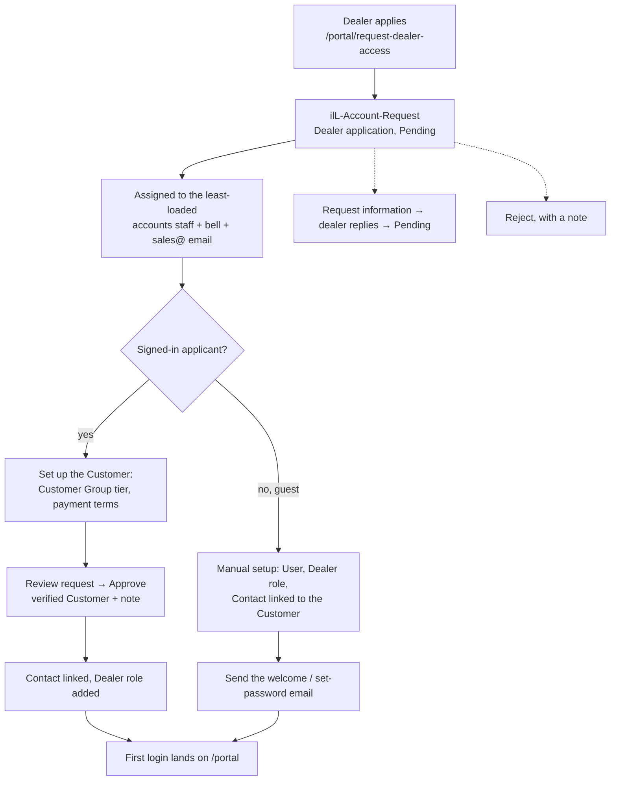

# Module 10: Service & dealer portal administration

**Audience:** support, sales, accounts, systems administrator. **Length:** 2 sessions of 60 minutes (queues, onboarding and account requests; support, visibility and role audits).
**Roles used:** ilL Support, ilL Sales Review, ilL Order Approver, Accounts Manager / User, System Manager, Dealer (portal side).

## Purpose

Trainees can work the Portal Operations queues, onboard a new dealer, process account requests, handle portal support issues and after-sale service, and understand what dealers and their collaborators can and can't see. Administrators can check who holds which capability and fix a dealer the portal can't place.

> **Status, checked on staging 24 Nov 2026:**
> - Portal Operations on staging shows the **Dealer Accounts** and **Accounting** sections (decision 8; checked by the lead on 24 Nov). SS-10-01 was captured before that and shows the old single "Accounts & Finance" section, so capture it again.
> - No portal support Issues exist on staging yet, so the Support responses queue is empty.
> - The Helpdesk knowledge base has one draft article ("Introduction"); decision 3 proposes the 10 starter articles.
> - No portal invitations exist yet. Five account requests exist, all Approved.
> - Portal routing settings: no queue routes (requests go to the least-loaded team member, with no due date); "Also Email the Shared Inbox" is on, to sales@illumenate.lighting.

## Where to go

| What | Where | Who |
|---|---|---|
| Service stage | `/command-center#service` | Command Center Viewer |
| Portal Operations (all staff queues and My inbox) | `/app/ill-portal-operations` | ilL roles, System Manager |
| Account requests | `/app/ill-account-request` | ilL Sales Review, Order Approver, Support |
| Portal invitations | `/app/ill-portal-invitation` | System Manager (read) |
| Portal support issues | `/app/issue` | ilL Support |
| Routing and SLA settings | `/app/ill-portal-routing-settings` | System Manager (edit); Sales Review, Support (read) |
| Helpdesk tickets / knowledge base | `/helpdesk/tickets`, `/helpdesk/kb` | Helpdesk agents |
| Customers and groups (tiers) | `/app/customer`, `/app/customer-group` | Sales, Accounts |
| Contacts and users | `/app/contact`, `/app/user` | Sales (contacts), System Manager (users) |
| Public dealer application | `/portal/request-dealer-access` | Anyone |
| Dealer side | `/portal`, `/portal/support`, `/portal/account`, `/portal/account/notifications`, `/portal/projects/<project>/collaborators` | Dealer |
| CRM leads and deals | `/crm/leads`, `/crm/deals` | Sales |

## Who works which queue (staff capabilities)

Capabilities are checked by the app (`portal/staff.py`). Any of the listed roles grants it; **System Manager** grants every capability.

| Capability | Roles | Portal Operations section | Queues |
|---|---|---|---|
| sales | ilL Sales Review, ilL Order Approver | Sales | Product verification, Order changes and cancellations, Quote requests, Offers expiring soon, Order review |
| accounts | ilL Support, ilL Sales Review, ilL Order Approver | Dealer Accounts | Account review |
| bookkeeping | Accounts Manager, Accounts User | Accounting | New customers to set up, Bills not in QuickBooks |
| engineering | ilL Engineering | Engineering | Drawing responses, Drawing reapproval, Incomplete exports |
| operations | ilL Operations | Operations | Manufacturing drawing holds, Materials to order |
| support | ilL Support | Support | Support responses |
| integration | ilL Integration | Integrations | Publication failures, Email failures |
| inbox | ilL Sales Review, ilL Order Approver, ilL Support, ilL Catalog Publisher | Sales Inbox | Sales inbox |
| finder | ilL Product Finder Manager | (Product verification uses its own staff check) | |
| catalog | ilL Catalog Publisher | (Catalog tools, Module 11) | |
| design_review | ilL Applications Engineer | (System design review, Module 02) | |

- Decided (decision 8): Charlotte's accounting queues follow the Accounts roles; dealer account requests stay with Sales and Support.
- Product verification shows only to staff the Product Finder verification check allows.

## Process map: from application to first order

1. **Application.** A visitor or a signed-in user without a company fills in the public dealer-access form. It becomes an **ilL-Account-Request**, type Dealer application, state Pending.
2. **Routing.** The app assigns it to the default assignee for the accounts queue, else the accounts staff member with the fewest open requests. It rings the Desk bell and emails the shared inbox (sales@) "New dealer application <ID> from <name> at <company>".
3. **Set up the Customer** if new: Customer Group (the pricing tier), default payment terms, addresses. Customers from won CRM deals with no payment terms show in **New customers to set up**.
4. **Decide** on the request: **Review request** → Approve (choose the verified Customer), Reject, or Request information. A note is always required.
   - Approving a signed-in applicant links their Contact to the Customer and adds the **Dealer** role.
   - A **guest** application has no user behind it. Its staff note says "The applicant has no portal account. To approve, set up the company and send them a company invitation."
5. **Manual setup** (guests, or when approval can't link): create the User, add the Dealer role, create a Contact with the user and the dealer's email, and link it to the Customer.
6. **Welcome** the dealer and check their first login lands on `/portal`.
7. Later changes (address, contact, profile, closure) arrive as more account requests (Lesson 10.4).

---

### Lesson 10.1: Portal Operations: the staff queue hub

**Objective:** know which queues are yours, work them daily, and read what an empty or locked tile means.

| Queue | Capability (roles) | What's in it | Owner field | Due field |
|---|---|---|---|---|
| Product verification | sales | Dealers asking to confirm a product can be built as configured | assigned_to | due_date |
| Order changes and cancellations | sales | Requests to change or cancel an order already placed | assigned_to | due_date |
| Quote requests | sales | Dealers asking for pricing on a project schedule | assigned_to | due_date |
| Offers expiring soon | sales | Issued quote offers that expire soon | — | — |
| Order review | sales | Orders dealers submitted for review before they become sales orders | assigned_to | due_date |
| Account review | accounts | Dealer sign-ups and account changes (Pending, Information needed) | assigned_to | — |
| New customers to set up | bookkeeping | Customers from CRM deals still missing payment terms | — | — |
| Bills not in QuickBooks | bookkeeping | Submitted purchase invoices with no QuickBooks id | — | — |
| Drawing responses | engineering | Drawing and document requests still open | assigned_to | sla_deadline |
| Drawing reapproval | engineering | Drawings a dealer asked to change, or that need approval again | assigned_to | sla_deadline |
| Incomplete exports | engineering | Schedule exports that failed or finished incomplete | — | — |
| Manufacturing drawing holds | operations | Drawings required for manufacturing, not approved yet | assigned_to | sla_deadline |
| Materials to order | operations | Purchase material requests not fully ordered | — | schedule_date |
| Support responses | support | Open portal support Issues | Portal Support Owner | Portal Response Due |
| Publication failures | integration | Website publish jobs that failed | — | — |
| Email failures | integration | Portal emails that failed to send | — | — |
| Sales inbox | inbox | Emails received at sales@ with no linked record | assignment | — |

#### Screen tour: Portal Operations

| Region | What's there |
|---|---|
| Header | "Portal Operations" and **Refresh** (reloads the tiles and My inbox) |
| Intro card | "Requests waiting on our team", and the three steps: 1. Choose a queue, 2. Narrow it by view or search, 3. Click an ID to open and work the record |
| **My inbox** | "Every dealer request with an owner, across quotes, orders, drawings, verification, accounts and support. Overdue items come first." Views: Everything, Assigned to me, Unassigned, Overdue; a search box. Row buttons: **Assign to me**, **Reply**, **Wait on dealer** ("What do you need from the dealer?") and **Send to dealer** |
| Team sections | One per team you can work, with "· N waiting" and a one-line description |
| Tiles | Queue name, count (grey 0 when empty), help line. A tile you can't read shows "—" and "You need read access to this document type." |
| Queue detail | Opens under the tiles: title, help line, view buttons (only the views that queue supports), "Search by ID…" (by customer name on New customers to set up, by subject on Sales inbox), table, "Showing x–y of z", Previous / Next |
| Empty states | "Nothing is waiting in this queue." / "No items match this view." / "Nothing is waiting on you." |
| Error states | "This queue could not be loaded. Check your role or try again." / "Could not load queue counts. Try Refresh." / "No portal operations role is assigned to this account. Ask an administrator to add the role for your team." |

- **Views:** Everything; **Assigned to me** and **Unassigned** when the queue has an owner; **Overdue** when it has a due date. Account review has no due date, so it has no Overdue view.
- **Overdue digest:** once a day the app sends each owner one Desk bell notification, "Overdue portal work on <date>", listing their overdue items (unowned items go to the whole team). It covers quotes, orders, order changes, verification, drawings and support. It is a bell, not an email; whether it also emails depends on each person's notification settings.
- **Who can open the page:** System Manager, ilL Sales Review, ilL Order Approver, ilL Engineering, ilL Support, ilL Operations, ilL Integration, ilL Catalog Publisher, Accounts Manager and Accounts User: every role that owns a queue (the last three added 24 Nov; on staging after the next deploy). A test keeps the page roles and the queue roles in step.
- **Routing settings** (`ilL-Portal-Routing-Settings`): per queue (quotes, orders, order_changes, accounts, support) a **Default Assignee**, a **Fallback Role** and **SLA Hours** (sets the due date; 0 = none). "Also Email the Shared Inbox" and "Shared Inbox Email". Staging has no routes yet.
- The workspace "Needs Attention" cards show the same signals.

**SS-10-01** · Portal Operations as ilL Sales Review
**URL:** `/app/ill-portal-operations` · **Highlight:** queue counts; Mine / Unassigned / Overdue

What you see (captured):
- Header "Portal Operations" with **Refresh**; the ilLumenate Lighting workspace sidebar.
- Intro card "Requests waiting on our team" with the three numbered steps.
- **My inbox**: Everything (selected), Assigned to me, Unassigned, Overdue; "Search by ID…"; "Nothing is waiting on you."
- **Sales · 0 waiting**: Product verification, Order changes and cancellations, Quote requests, Offers expiring soon, Order review, all 0.
- **Accounts & Finance · 30 waiting** (the pre-22 Nov build): Account review 0, **New customers to set up 30**.
- Engineering · 28 waiting begins at the bottom. Captured as Administrator, so every section shows.

**SS-10-02** · Same page as ilL Support (different queues; "Unavailable" on others)
**URL:** `/app/ill-portal-operations` · **Role:** training.support
**Highlight:** only the sections Support can work (Dealer Accounts, Support, Sales Inbox)

*Not yet captured: Needs a scripted step. Needs a submit or a notification that would send email from staging, or a state staging does not have.*

**SS-10-16** · My inbox with work in it
**URL:** `/app/ill-portal-operations` · **Role:** training.lead · **State:** at least one owned request open (the lead decides; creating one sends staff email)
**Highlight:** Assign to me; Reply; Wait on dealer; the due-state ordering

**SS-10-17** · A queue opened: New customers to set up
**URL:** `/app/ill-portal-operations` → click the tile · **Role:** training.lead · **State:** as is (30 on staging)
**Highlight:** the view buttons; "Search by customer name…"; the columns; "Showing 1–20 of 30"

**SS-10-18** · Portal Operations refused for a Viewer-only user
**URL:** `/app/ill-portal-operations` · **Role:** training.viewer
**Highlight:** the permission message

**SS-10-19** · Engineering and Operations sections
**URL:** `/app/ill-portal-operations` (scroll) · **Role:** training.lead
**Highlight:** Incomplete exports count; Materials to order

**SS-10-20** · Portal routing settings
**URL:** `/app/ill-portal-routing-settings` · **Role:** System Manager · **State:** as is; change nothing
**Highlight:** Also Email the Shared Inbox; Shared Inbox Email; the empty Queues table and its help text

**SS-10-21** · The overdue digest in the Desk bell
**URL:** any desk page → bell · **Role:** training.lead · **State:** the daily digest has run with an overdue item for this user (the lead decides)
**Highlight:** "Overdue portal work on …"

---

### Lesson 10.2: The Service stage

- `#service` is the last pipeline stage: "After shipping: customer requests from the portal (dealer applications, address and contact changes) and tech support tickets from sales@."
- Quick links ("In ERPNext:"): Help desk, Account requests, Knowledge base.
- **Customer requests** lanes from ilL-Account-Request: **Pending** ("Our move"), **Information needed** ("Waiting on the dealer"), **Done (last 30 days)** ("Approved, rejected or resolved"). Red age = pending more than 2 business days. Each card: request type chip, dealer, requester email, state badge, staff note, owner avatar, **Details**, **+ To-do** and ↗ (open in the desk).
- **Service tickets** (Helpdesk tickets typed Service, Issue, Unspecified or untyped): Our move, Waiting on customer, Resolved last 30 days, Linked to an order; Age of open tickets; Who has them; lanes **Our move** ("Open: needs a reply or a fix"), **Waiting on customer** ("Replied: close it if quiet for 10+ days"), **Done (last 30 days)**. A card without an order offers **Link sales order** (Command Center Editor).
- The stepper's Service tile counts open service tickets plus open account requests ("tickets our move" or "N account requests"); red when any is older than 2 business days.
- Portal support **Issues** are not on this stage; they're in Portal Operations → Support responses (decision 10).

**SS-10-03** · Service stage
**URL:** `/command-center#service`

What you see (captured):
- "Service" with its description and the quick links Help desk, Account requests, Knowledge base.
- The pipeline stepper with **Service 56** ("tickets our move") highlighted in navy.
- **Customer requests**: Pending 0 ("Nothing here"), Information needed 0, **Done (last 30 days) 4**.
- Done cards: **Address change** and **Contact change** for one dealer, each with the requester's email, a green **Approved** badge, the staff note, an owner avatar, and **Details**, **+ To-do** and ↗; age "18d".

**SS-10-22** · Service stage: the Service tickets section
**URL:** `/command-center#service` (scroll) · **Role:** CC Viewer
**Highlight:** Our move; Waiting on customer; the age chart; Who has them; the three lanes

**SS-10-23** · (pair) A customer request card → Details sheet
**URL:** `/command-center#service` · **Role:** CC Editor · **State:** any Done card
**Highlight:** -a the card's Details button; -b the side sheet with the request fields

**SS-10-24** · "Link sales order" on a service ticket card
**URL:** `/command-center#service` · **Role:** CC Editor · **State:** an open ticket with no order; open the sheet and close without saving
**Highlight:** the Link sales order sheet and its order picker

---

### Lesson 10.3: Onboarding a new dealer

**Objective:** take a dealer from application to first login.

1. **Application** arrives (public dealer-access page or a logged-in request) as an **ilL-Account-Request**, type Dealer application, state Pending. Form fields: **Company**, **Your name**, **Email** (required), Phone, Website, Territory, Message. Guests are limited to 5 applications an hour; a hidden "fax number" field catches bots.
2. **Set up the Customer** (if new): Customer Group (tier: Bronze, Silver, Gold, Diamond or Antimatter under Dealer; Agency and Specifier exist too), default Payment Terms Template, addresses. Portal Operations → "New customers to set up" lists won deals without payment terms.
3. **Decide:** open the request and click **Review request**. The dialog "Account request review" has **Decision** (Request information, Approve, Reject, Resolve profile request), **Verified Customer for linkage / dealer approval**, and **Outcome or requested information** (required). Click **Record decision**.
   - Approving links the user's Contact to the Customer and adds the **Dealer** role.
   - **Only sales staff can approve a dealer, a company link or a closure** (ilL Sales Review or Order Approver, plus permission to edit Users). Support can review, reject, ask for information, and approve address and contact changes.
   - **Guest applications** (no logged-in user): the request can't link anyone. Use the manual setup (step 4). The staff note suggests a company invitation, but the portal only offers invitations from a dealer of that company and project invitations; there is no staff invitation button (confirm with the systems admin). Invitations expire after 7 days.
4. **Manual setup when needed:** create the User (Website User), add the Dealer role, create a Contact with the user, link it to the Customer.
5. **Prices:** dealers see prices and priced exports by holding the Dealer role. The separate **Can View Pricing** role adds price changes in the System Designer and gives prices to non-dealer accounts; it doesn't exist on staging yet.
6. Welcome the dealer; check their first login lands on `/portal`.

**SS-10-04** · Public dealer application form (local instance)
**URL:** `/portal/request-dealer-access` · **Role:** guest (signed out)

What you see (captured):
- Site header with Projects, Sales Orders and Login.
- "Apply for dealer access" with a house icon and the line "The ilLumenate catalog, configurators and project tools are available to authorized dealers. Designers, specifiers and distributors interested in becoming a dealer can apply here."
- "Already a dealer? **Sign in**".
- Fields: **Company**, **Your name** and **Email** (each marked required), Phone, Website ("https://"), Territory ("Region or market you cover"), Message ("Tell us about your business and the projects you work on").

**SS-10-05** · Account request with the Review request button
**URL:** `/app/ill-account-request/<name>` · **Role:** ilL Sales Review · **State:** a Pending request shows **Review request**; this capture is an Approved one
**Highlight:** Review request (Pending only); Assign / due date; Open in portal

What you see (captured):
- "ilL-Account-Request / 6toi2c8asd" with **Assign / due date**, **Open in portal** and ⋯. No Review request button, because this request is already Approved.
- Read-only fields: Request Type (**Company linkage**), Requested By, Customer, **State (Approved)**, Reference Type, Reference Name, Expected Modified, **Proposed Json** (`{"note":"Company linkage test"}`), Request Hash, **Staff Note** ("Approved!"), Responses Json, Assigned To.
- Sidebar: last edited by staff, created by the requester.

**SS-10-06** · Review request dialog: decision, verified Customer and note
**URL:** `/app/ill-account-request/<name>` → Review request · **Role:** ilL Sales Review · **State:** a Pending request; open the dialog and close it without recording

*Not yet captured: Needs a scripted step. Needs a submit or a notification that would send email from staging, or a state staging does not have.*

**SS-10-07** · Customer form: Customer Group, payment terms, linked contacts
**URL:** `/app/customer/<name>` · **Role:** Sales User

What you see (captured):
- "Customer / <dealer>" with an **Enabled** badge and View, Create, Actions, ⋯ and **Save**.
- Tabs: Details, Overview, Details, Address & Contact, Accounting, Tax, Items, Settings, Sales Team, Portal U… (cut off).
- **Payment Terms Template** outlined and empty, beside Company Bank Account; Loyalty Points.
- Comments and Activity with "+ New Email" and "+ New Event", and a staff follow-up email asking for a signed dealer agreement or reseller permit.
- Sidebar: an attachment (the dealer's logo).

**SS-10-08** · Invitation flow for a guest application
**URL:** `/portal/accept-invitation#<token>` · **Role:** the invited user · **State:** a Pending invitation (sending one emails the invitee)

*Not yet captured: Needs a scripted step. Needs a submit or a notification that would send email from staging, or a state staging does not have.*

**SS-10-25** · Dealer-access page for a signed-in dealer
**URL:** `/portal/request-dealer-access` · **Role:** training.dealer
**Highlight:** the "approved" panel instead of the form

**SS-10-26** · (phone) Public dealer application form
**URL:** `/portal/request-dealer-access` · **Role:** guest · (phone)
**Highlight:** the required fields

**SS-10-27** · A Dealer application request record
**URL:** `/app/ill-account-request/dtks3ikn2b` · **Role:** ilL Sales Review · **State:** as is (Approved)
**Highlight:** Request Type Dealer application; Proposed Json with the form fields; Staff Note; Reviewed By / Reviewed On

**SS-10-28** · Customer Group tree (pricing tiers)
**URL:** `/app/customer-group/view/tree` · **Role:** Sales Manager
**Highlight:** Dealer → Antimatter, Bronze, Diamond, Gold, Silver; Agency; Specifier

**SS-10-29** · Contact linked to the dealer Customer
**URL:** `/app/contact/<name>` · **Role:** Sales User · **State:** the training dealer's contact
**Highlight:** User; the Links table (Customer)

**SS-10-30** · User form: the Dealer role
**URL:** `/app/user/training.dealer@example.com` → Roles · **Role:** System Manager · **State:** as is; change nothing
**Highlight:** User Type Website User; the Dealer role ticked

#### Field reference: ilL-Account-Request

All fields are read-only in the desk; decisions go through **Review request**. Editing the record directly is refused ("Use the account service to maintain this record"), and requests can't be deleted ("Account decisions and invitation receipts are retained").

| Field (label) | Meaning | Filled by |
|---|---|---|
| Request Type | Dealer application, Company linkage, Profile change, Account closure, Address change, Contact change | The portal |
| Requested By | The portal user (blank for a guest application) | The portal |
| Customer | The dealer's company (set on approval for linkage) | Portal / approval |
| State | Pending, Information needed, Approved, Rejected, Resolved | Review request |
| Reference Type / Reference Name | The Address or Contact being changed | The portal |
| Expected Modified | The record's version when the dealer asked; approval fails if it changed since | The portal |
| Proposed Json | What the dealer asked for (form fields, note, new values) | The portal |
| Request Key / Request Hash | Stops a double submit creating two requests | The portal |
| Staff Note | The decision note | Review request |
| Responses Json | The dealer's replies to "Request information" | The portal |
| Assigned To | The owner | Routing, or **Assign / due date** |
| Reviewed By / Reviewed On | Who decided and when | Review request |

#### Status lifecycle: account requests

| State | What moves it here | Who | What it unlocks |
|---|---|---|---|
| Pending | Submitted in the portal, or the dealer replied | Dealer / guest | Shows in Account review and the Service stage "Pending" lane |
| Information needed | Decision "Request information" | Sales or Support | The dealer can reply in the portal; the reply sets it back to Pending |
| Approved | Decision "Approve" | Sales (grants, linkage, closure); Sales or Support (address, contact) | The change is applied (see Lesson 10.4) |
| Rejected | Decision "Reject" | Sales or Support | Nothing changes; the note is the reason |
| Resolved | Decision "Resolve profile request" (Profile change only) | Sales or Support | Records that you applied it by hand |

---

### Lesson 10.4: Other account requests

| Type | Raised from | What happens on approval |
|---|---|---|
| Company linkage | Account page → **Request Company Access**, or a note | Links the user's Contact to the verified Customer |
| Address change / Contact change | Company records on the account page | Applied to the Address or Contact, after checking it hasn't changed since; an archive request disables the Address or archives the Contact |
| Profile change | Account page note | **Not applied automatically:** make the change in the native record, then **Resolve profile request** |
| Account closure | Account page → **Request Account Closure** ("Send an account-closure request to support?") | Disables the User. Commercial records and approval history are kept |

- States: Pending, Information needed, Approved, Rejected, Resolved. Every decision needs a note.
- A dealer can also disable a company member they invited, from the portal; staff aren't involved.

**SS-10-09** · Account request list filtered by type and state
**URL:** `/app/ill-account-request`

What you see (captured):
- "iLL-Account-Request" list, "5 of 5", sorted by Created On.
- Columns: ID, Request Type (chips: Company linkage, Dealer application, Contact change, Address change, Company linkage), Requested By, Customer, State.
- Every State is a green **Approved** badge; ages 2 w and 1 M.

**SS-10-31** · Account request list: Pending only (empty state)
**URL:** `/app/ill-account-request?state=Pending` · **Role:** ilL Support
**Highlight:** the filter chip; the empty list

**SS-10-32** · Dealer account page: Company Information and Request Company Access
**URL:** `/portal/account` · **Role:** training.dealer
**Highlight:** Company Information (Company Name, Customer Group, Territory); "To update company information, please contact your account manager or support."

**SS-10-33** · Dealer account page: Security and Account Closure
**URL:** `/portal/account` (scroll) · **Role:** training.dealer · **State:** don't click Request Account Closure
**Highlight:** Change Password; the Account Closure box

---

### Lesson 10.5: Portal support issues and after-sale service

- The portal's **Support** page (`/portal/support`) creates ERPNext **Issue** records (linked to the customer, contact, order and project), **not** Helpdesk tickets. Work them in Portal Operations → **Support responses** (decision 10: Jay checks it every morning alongside the Inbox).
- **The portal form:** Category (required: Order Status / Shipping, Technical Support, Returns / Warranty, Billing / Invoice, Other), Subject (required), Related Order, Related Project, Description (required), Attachments, **Submit Request**.
- **Priority is set from the category:** Returns / Warranty and Billing / Invoice → High; Order Status and Technical → Medium; Other → Low.
- On submit the Issue is assigned (support queue routing), the support team is belled, and sales@ gets "New support ticket <ID> from <dealer>".
- Dealers see their company's tickets (status badges) under "Your Company's Support Requests", and each ticket's page at `/portal/support/<ticket>`.
- Email tickets to sales@ land in **Helpdesk** (Module 02, Lessons 2.9-2.10).
- Mark a reply **Staff only** to keep it internal. Attachments: PDF, JPEG, PNG and HEIC/HEIF (converted to JPEG); 20 MiB each; 10 per message.
- **Service after shipping:** check the order's shipments and tracking (Module 06, Lesson 6.7), send "Delivery check-in" / "Return received" templates, raise a return delivery note for returns. Helpdesk saved replies cover "Warranty claim: what we need" and "Damaged in transit".
- Knowledge base content and Helpdesk ticket types are configured in Helpdesk itself, not in the app. Staging has the six ticket types (Unspecified, Issue, Quotation, Design, Sales Order, Service) and three teams (Billing, Engineering, Sales); decision 3 proposes the routing and the starter articles.

#### Field reference: Issue (portal fields)

| Field (label) | Meaning | Filled by |
|---|---|---|
| Subject / Description | From the portal form; the description starts with Category and Related Order | Dealer |
| Raised By (Email) | The dealer user | Portal |
| Customer / Contact | The dealer's company and contact | Portal |
| Priority | From the category | Portal |
| Status | Open, Replied, On Hold, Resolved, Closed | Staff |
| Next Action By | Staff, Customer or None (read-only; follows the conversation) | App |
| Portal Support Owner | Who works it (must be an enabled staff user with Issue access) | Routing or staff |
| Portal Response Due | The due time (from SLA Hours when set) | Routing |
| Related Portal Order | The sales order picked on the form | Portal |
| Portal Project | The project picked on the form | Portal |

**SS-10-10** · Dealer: portal support form
**URL:** `/portal/support` · **Role:** Dealer

What you see (captured):
- Portal header and tabs Overview, Projects, Quotes, Orders, Drawings, Products, Resources, **Support** (selected), Account, and the bell.
- Breadcrumb Portal › Support; banner "How can we help you?" with "Search for answers…".
- Three cards: **Email Support** (support@illumenate.lighting), **Phone Support** (Mon-Fri, 7am-4pm PST, 1-425-381-2447), **Submit Ticket** (**Create Ticket**).
- "Frequently Asked Questions" starting with "Ordering & Quotes", and the **Submit a Support Request** form starting with the required **Category** ("Select category…").

**SS-10-11** · Support responses queue in Portal Operations
**URL:** `/app/ill-portal-operations` → Support responses · **Role:** ilL Support · **State:** ideally with the Issue from SS-10-10 (staging has none, so the capture shows the empty queue)

What you see (captured):
- Lower part of Portal Operations as Training Lead: Drawing responses 1, Drawing reapproval 0, **Incomplete exports 28**.
- **Operations · 3 waiting**: Manufacturing drawing holds 0, Materials to order 3.
- **Support · 0 waiting**: the **Support responses** tile selected.
- **Sales Inbox · 0 waiting**.
- The Support responses detail: Everything, Assigned to me, Unassigned, Overdue; "Search by ID…"; "Nothing is waiting in this queue."

**SS-10-12** · Helpdesk knowledge base
**URL:** `/helpdesk/kb`

What you see (captured):
- Helpdesk agent app: Dashboard, Tickets, **Knowledge Base** (selected), Customers, Contacts; public views (My Feedback, Pending Tickets, SLA Alerts…).
- Knowledge Base list with Title, Category and Status filters and **+ Create**.
- One category **General** with one article **Introduction**, status **Draft**, visibility Customers, author Administrator.
- "Getting started 0/10 steps" and "Ticket fields update" panels.

**SS-10-34** · Portal support form with the Category list open
**URL:** `/portal/support` · **Role:** training.dealer · **State:** fill nothing; don't submit
**Highlight:** the five categories; Related Order; Related Project; Attachments

**SS-10-35** · Portal support: FAQ and the company's ticket list
**URL:** `/portal/support` (scroll) · **Role:** training.dealer
**Highlight:** the FAQ categories; "Your Company's Support Requests" (when any exist)

**SS-10-36** · Issue list for support
**URL:** `/app/issue?status=Open` · **Role:** training.support
**Highlight:** Portal Support Owner and Portal Response Due columns (add them if needed)

**SS-10-37** · An Issue raised from the portal
**URL:** `/app/issue/<name>` · **Role:** training.support · **State:** a portal Issue (needs a portal submit; the lead decides)
**Highlight:** Next Action By; Portal Support Owner; Portal Response Due; Related Portal Order; the Portal conversation section

**SS-10-38** · Portal conversation with a Staff only reply
**URL:** `/app/issue/<name>` → Portal conversation · **Role:** training.support · **State:** an Issue with one internal reply (the lead decides)
**Highlight:** the "Staff only" tag

**SS-10-39** · Dealer's ticket page
**URL:** `/portal/support/<ticket>` · **Role:** training.dealer · **State:** same Issue as SS-10-37
**Highlight:** status; Next action by; the conversation; files

**SS-10-40** · Helpdesk ticket types and teams
**URL:** `/app/hd-ticket-type` and `/app/hd-team` · **Role:** System Manager
**Highlight:** the six types; the three teams

**SS-10-41** · Helpdesk saved replies for service
**URL:** `/app/hd-saved-reply` · **Role:** System Manager
**Highlight:** "Warranty claim: what we need"; "Damaged in transit"

---

### Lesson 10.6: What dealers can and can't see

- **Dealer** role: no desk access (Desk Access off on staging), home page `/portal`. The app's permission matrix gives Sales Order (create, read, print) and read on Customer, Contact, Address, Item, Item Group, UOM, Currency, plus select on Account. Sales Orders, Customers, Contacts and Addresses are filtered to the dealer's own company.
- **Collaborators** (designers, GCs): Website User, **VIEW** ("Can view but not edit") or **EDIT** ("Can view and edit the project") per project. Never see prices or offers. Dealers manage them at `/portal/projects/<project>/collaborators`: **Add Collaborator** (a user from their company) or **Invite by email** ("For architects, designers and anyone outside your company. They get an email with a one-use link."), plus **Pending invitations** with Expires, resend and revoke.
- **Invitations** (`ilL-Portal-Invitation`): Pending → Accepted or Revoked; links expire after 7 days. The invitee must sign in with the invited email's website account; an invitee with no account gets one, with a set-password link in the same email.
- **Prices:** the Dealer role sees prices and priced exports. **Can View Pricing** (a separate role, not on staging) adds System Designer price changes and gives prices to non-dealer accounts.
- Dealers manage email preferences at `/portal/account/notifications`: Order Updates, Quote Ready, Drawing Requests, Shipment Tracking, Marketing & News, then **Save Preferences**.
- **Check on staging:** the Dealer role also holds read, write, create, cancel and amend on **Sales Invoice**, which the app's matrix doesn't grant and no company filter limits. Ask the systems admin to review it (Lesson 10.8).

**SS-10-13** · (pair) A project as the dealer buyer vs as a VIEW collaborator (no prices, no quotes)
**URL:** `/portal/projects/<project>` · **Role:** -a training.dealer; -b a VIEW collaborator
**Highlight:** prices and the Quotes area present in -a, absent in -b

*Not yet captured: Needs a scripted step. Needs a submit or a notification that would send email from staging, or a state staging does not have.*

**SS-10-14** · Dealer notification settings page
**URL:** `/portal/account/notifications` · **Role:** Dealer

What you see (captured):
- **Notification Preferences** card (outlined, the page jumped to it): Order Updates, Quote Ready, Drawing Requests and Shipment Tracking switched on; **Marketing & News** off; each with its one-line description.
- **Save Preferences**.
- **Security**: Password, "Last changed: Unknown", **Change Password**.
- **Account Closure** (red box): "Request support-assisted closure. Commercial records and approval history are retained."

**SS-10-42** · Collaborators page for a project
**URL:** `/portal/projects/<project>/collaborators` · **Role:** training.dealer · **State:** a project the training dealer owns; don't add anyone
**Highlight:** Add Collaborator; Invite by email; Access level VIEW / EDIT; Pending invitations

**SS-10-43** · Portal invitations list (empty)
**URL:** `/app/ill-portal-invitation` · **Role:** System Manager
**Highlight:** the State and Expires On columns

**SS-10-44** · Dealer portal: Orders list
**URL:** `/portal/orders` · **Role:** training.dealer
**Highlight:** only the dealer's company's orders

**SS-10-45** · Dealer role permissions in the Role Permissions Manager
**URL:** `/app/permission-manager` with Role = Dealer · **Role:** System Manager · **State:** view only
**Highlight:** Sales Order (create, read, print); the Sales Invoice row (the review item)

---

### Lesson 10.7: Shared sales inbox and CRM (brief)

- sales@ is a shared Email Account with an assignment rule; filed mail is relinked to its document from Portal Operations → Sales inbox (received, open emails with no linked record; search by subject).
- Staff notifications for new portal requests also go to sales@ when "Also Email the Shared Inbox" is on.
- Website forms create **Frappe CRM Leads** (per brand). A Deal marked **Won** creates the ERPNext Customer, which then shows in **New customers to set up** until it has payment terms.

**SS-10-15** · CRM lead from a Webflow form
**URL:** `/crm/leads`

What you see (captured):
- Frappe CRM sidebar: Dashboard, **Leads**, Deals, Contacts, Organizations, Notes, Tasks, Call Logs.
- "Leads / List" with **+ Create**; filters Email, Full Name, Job Title, Name, Status, Source; Filter, Sort, Columns.
- Columns: Full Name, Organization, Status (Nurture, Contacted, Converted, New), Email, Mobile No., Assigned To (staff avatars).
- "20 of 565" and **Load More**. Redact lead emails and phone numbers before publishing.

**SS-10-46** · CRM deals: a Won deal
**URL:** `/crm/deals` · **Role:** Sales User
**Highlight:** the Won status; the organization that became a Customer

**SS-10-47** · Sales inbox queue opened
**URL:** `/app/ill-portal-operations` → Sales inbox · **Role:** training.support
**Highlight:** "Search by subject…"; the Assigned to me view

---

### Lesson 10.8: Role audits (systems administrator)

- Three read-only checks run from the bench (System Manager only; they assign nothing):
  - `bench --site <site> execute illumenate_lighting.illumenate_lighting.portal.role_audit.report`: every enabled staff user, the capabilities each has or lacks, and **uncovered** capabilities that only a System Manager covers.
  - `…role_audit.dealers`: **unresolved** dealer users (no linked Customer, or several), whom the portal shows no company data; and **desk_access_at_risk** (System Users whose only desk role was Dealer).
  - `…role_audit.hr`: HR setup gaps (Module 12).
- Checklist after a staffing change:
  1. Every capability has at least one holder (the decision 8 mapping).
  2. No dealer is unresolved; fix Contact links on the Customer.
  3. Accounts-only staff can open Portal Operations (fixed 24 Nov; confirm after the deploy).
  4. The Dealer role has no rights beyond the app's matrix (today it has Sales Invoice rights on staging).
  5. Command Center Finance only for those who should see figures (decision 9).

**SS-10-48** · Role audit output (terminal)
**URL:** bench console on the local instance · **Role:** System Manager
**Highlight:** "uncovered"; "unresolved"

*Outside ERPNext: a terminal capture, not a desk page.*

**SS-10-49** · Role Profile or User Roles for a staff member
**URL:** `/app/user/training.support@example.com` → Roles · **Role:** System Manager · **State:** view only
**Highlight:** ilL Support; Command Center Viewer

---

## Role and permission matrix

| Action | ilL Support | ilL Sales Review / Order Approver | Accounts User / Manager | CC Viewer only | System Manager | Dealer |
|---|---|---|---|---|---|---|
| Open Portal Operations | Yes | Yes | **No** (page roles) | No | Yes | — |
| Account review queue | Yes | Yes | — | — | Yes | — |
| Review button on a request | Yes | Yes | — | — | Yes | — |
| Approve a dealer, company link or closure | **No** | Yes (needs User edit rights) | — | — | Yes | — |
| Approve an address or contact change | Yes | Yes | — | — | Yes | — |
| Support responses queue / Issues | Yes | — | — | — | Yes | Raises them |
| New customers to set up | — | — | Yes (data) | — | Yes | — |
| Routing settings | Read | Read | — | — | Edit | — |
| Service stage | With CC Viewer | With CC Viewer | With CC Viewer | Yes | Yes | — |
| Link sales order on a ticket | CC Editor | CC Editor | CC Editor | No | Yes | — |
| Invite collaborators | — | — | — | — | — | Own projects |
| Role audits | — | — | — | — | Bench only | — |

## Behind the scenes

| Trigger | What happens | Where to see it |
|---|---|---|
| Dealer application submitted | Account request (Pending); assigned (default assignee, else least loaded in the accounts team); bell; sales@ email "New dealer application …" | Account review; Service stage |
| Any portal account request | Same routing: "New account request (<type>) <ID> from <name>" | Account review |
| Portal support form | Issue created with customer, contact, priority; assigned; bell; sales@ email "New support ticket …" | Support responses |
| Dealer replies to Request information | State back to Pending | Account review |
| Review → Approve | Contact linked / Dealer role added / Address or Contact updated / User disabled | The native records |
| Daily | Overdue digest bell "Overdue portal work on <date>" | Desk bell |
| Every 5 minutes | Portal outbox sends queued portal emails; failures show in Email failures | Portal Operations → Integrations |
| Invitation sent | Invitation (Pending, 7 days); email with a one-use link (and a set-password link for a new account) | `/app/ill-portal-invitation` |
| Routing failure | Error Log "Portal staff routing failed for …" or "Dealer application routing failed for …"; the request is still saved | Error Log |

## Troubleshooting

| Symptom (exact text) | Cause | Fix |
|---|---|---|
| "The account request changed. Reload it before review." | Someone else decided it, or the dealer replied | Reload and review again |
| "Choose a decision and explain the outcome" | Note left empty | Write the note |
| "Account grants and linkage require the approval action" | "Resolve profile request" used on a non-profile request | Use Approve |
| "Account review requires authorized staff" | No sales or support role | Ask for the role |
| "Account linkage, dealer grants and closure require native User administration permission" | Support (or a user without User edit) approving a grant | Hand it to Sales Review / Order Approver |
| "Select and verify the approved Customer in ERP" | Verified Customer left empty | Pick the Customer |
| "Existing company linkage must be reconciled in native Contact records first" | The user is already linked to another company | Fix the Contact links first |
| "Portal intake cannot alter a staff account" | The requester is a System User | Handle by hand |
| "Apply and verify the requested company/profile changes in the native records, then record the outcome as a resolved request" | Approve used on a Profile change | Change it by hand, then Resolve profile request |
| "The source changed after this request. Obtain a new request." | The Address or Contact changed since the dealer asked | Reject with a note; ask the dealer to resubmit |
| "Disable or transfer the linked account before archiving its identity contact" | Archiving a contact that has a user | Disable the user first |
| "Change the User identity through the native account administration flow" | A contact change edits a user's email | Change the User by hand |
| "Email is associated with another User; staff reconciliation is required" / "A Contact is already linked to another company" | Duplicate identities | Merge or fix Contacts by hand |
| "Use the account service to maintain this record" | Editing an account request directly | Use Review request |
| "Invitation was used, revoked or expired" / "Invitation is invalid or unavailable" | Old or bad link | Resend the invitation |
| "Sign in with the invited email's website account" | Signed in as someone else | Sign out; use the invited email |
| "Your account already has dealer access." | A dealer filled in the application | Nothing to do |
| "Subject is required" / "Description is required" / "Order unavailable" / "Project unavailable" | Portal support form | Fill it in; pick an order the dealer can see |
| "Choose an enabled support System User with native Issue access" | Portal Support Owner set to someone without Issue access | Pick a Support user |
| "This staff queue is unavailable for your role" / tile "—" | Missing capability or DocType read | Ask for the role |
| "This item changed. Reload before assigning it." / "That action did not complete. Reload and try again." | Someone else changed it | Reload |
| A dealer sees no projects or orders | The user isn't linked to exactly one Customer | Run `role_audit.dealers`; fix the Contact links |

## Tips and shortcuts

- Start the day on **My inbox → Overdue**, then Assigned to me.
- **Open in portal** on a request shows exactly what the dealer sees.
- **Assign / due date** reassigns without touching the request's content.
- Use the Service stage's **+ To-do** to track a follow-up on a request.
- Reply with the Helpdesk saved replies for warranty and damage.

## Common mistakes

- Approving a guest application without a user behind it (nothing gets linked).
- Editing a dealer's address by hand and then approving their address change (it fails: the source changed).
- Treating a grey "—" tile as "nothing to do": it means no access.
- Answering portal Issues in Helpdesk (they're separate).
- Giving a collaborator the Dealer role to show them prices.

## Exercises (staging)

1. **Queues.** Open Portal Operations as training.lead. Expected: Sales, Accounts & Finance (or Dealer Accounts and Accounting after the deploy), Engineering, Operations, Support, Sales Inbox; New customers to set up = 30.
2. **Role difference.** Open it as training.support. Expected: Account review, Support responses and Sales inbox (the pre-22 Nov build on staging may also show New customers to set up).
3. **Locked out.** Open it as training.viewer. Expected: refused.
4. **Read a request.** Open `dtks3ikn2b`. Expected: Dealer application, Approved, the form fields in Proposed Json.
5. **Service stage.** Open `#service`. Expected: Done lane cards with Details, + To-do, ↗.
6. **Dealer view.** As training.dealer open `/portal/account/notifications`. Expected: the five switches and Save Preferences (don't save).
7. **Find the gap.** In Role Permissions Manager, Role = Dealer. Expected: a Sales Invoice row; note it for the admin.
8. **Do not:** submit applications, support tickets or invitations on staging; they email real inboxes.

## Slide deck beats

1. Portal Operations: one hub, many queues
2. Which queues are yours (capabilities)
3. My inbox, views and the overdue bell
4. The Service stage
5. Onboarding a dealer, step by step
6. The Review request dialog and who can approve what
7. Other account requests
8. Portal support issues vs Helpdesk tickets
9. What dealers and collaborators can see
10. From website lead to customer
11. Role audits and the open gaps

## Check yourself

1. A guest applied for dealer access. How do you give them a login?
2. A dealer changed their shipping address in the portal. What do you need to do?
3. Where do portal support requests appear?
4. A lighting designer on a project asks for prices. Can they see them?
5. Support tries to approve a dealer application and gets an error. Why?
6. A tile shows "—". What does it mean?
7. What does the overdue digest send, and to whom?
8. A dealer logs in and sees no projects. What do you run, and what do you fix?
