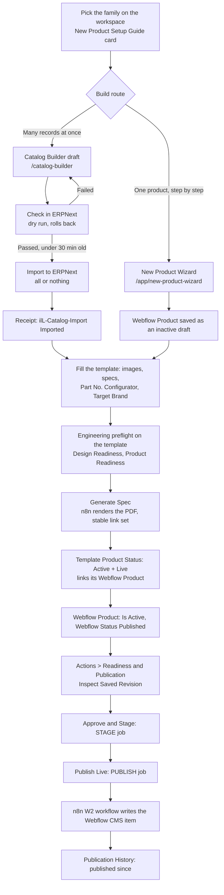

# Module 11: Catalog, products & publishing

**Audience:** catalog publisher, engineering, marketing & web. **Length:** 3 sessions of 75 minutes (1: product model, Catalog Builder and readiness; 2: spec sheets and publishing; 3: Product Finder, troubleshooting and exercises).
**Roles used:** ilL Catalog Publisher, ilL Engineering, ilL Applications Engineer, ilL Product Finder Manager, ilL Integration (service users only), System Manager.
**Training login on staging:** `training.lead` holds ilL Catalog Publisher, ilL Engineering and ilL Product Finder Manager, so every exercise here runs as that user unless it says otherwise.

## Purpose

Trainees can add a new product with the Catalog Builder or the New Product Wizard, maintain the six template types, generate spec sheets, publish to the two Webflow websites (ilLumenate Lighting and 206 Lighting), clear readiness issues and keep the Product Finder accurate. They can read a failed publish job or catalog import receipt and fix the cause.

> **Status:** Catalog Builder code is built and used on staging (133 check and import receipts on staging as of 2026-11-24); production acceptance is still pending (Rolling out). Run the smoke test in `docs/CATALOG_BUILDER_ROLLOUT.md` first. Webflow automatic pushes are off unless the site config `webflow_auto_push` is on. Gallery sync is waiting on a staging run. Publishing from the Webflow Product form is Live.

## Where to go

| What | Where | Who sees it |
|---|---|---|
| Catalog Builder (full screen, titled "YAML Builder") | `/catalog-builder` | ilL Catalog Publisher, System Manager |
| Catalog Builder (inside the Command Center) | `/command-center#catalog` (Restricted) | ilL Catalog Publisher, System Manager |
| Workspace: Product Catalog, New Product Setup Guide, Publishing & Website | `/app/illumenate-lighting` | All desk users (cards filter by permission) |
| Catalog import receipts ("Catalog Import Runs") | `/app/ill-catalog-import` | ilL Catalog Publisher (read), System Manager (read, delete) |
| Templates (six types) | `/app/ill-fixture-template`, `/app/ill-tape-neon-template`, `/app/ill-led-sheet-template`, `/app/ill-extrusion-kit-template`, `/app/ill-driver-template`, `/app/ill-controller-template` | Everyone reads fixture templates; Catalog Publisher and Engineering author |
| Webflow products | `/app/ill-webflow-product` | ilL Catalog Publisher (read, write, create), System Manager |
| Product publications (approved, staged, live hashes per brand) | `/app/ill-product-publication` | Catalog Publisher, System Manager |
| Publish jobs | `/app/ill-publish-job` | ilL Catalog Publisher, ilL Integration, System Manager (read only) |
| Webflow approvals | `/app/ill-webflow-approval` | Catalog Publisher (read; decides from the product form), System Manager |
| Webflow automatic pushes (waiting rows) | `/app/ill-webflow-auto-push` | System Manager |
| Brands | `/app/ill-webflow-brand` | System Manager |
| Webflow categories | `/app/ill-webflow-category` | Catalog Publisher, System Manager |
| Product Finder questions | `/app/ill-finder-question` | ilL Product Finder Manager (edit); Catalog Publisher, Sales Review, Engineering (read) |
| Product Finder settings | `/app/ill-product-finder-settings` | ilL Product Finder Manager, System Manager |
| Product Finder Coverage report | `/app/query-report/Product Finder Coverage` | Finder Manager, Catalog Publisher |
| Catalog Configurability report (Preview repair / Apply repair) | `/app/query-report/Catalog Configurability` | Catalog Publisher, System Manager |
| New Product Wizard | `/app/new-product-wizard` | ilL Catalog Publisher, System Manager |
| Product Readiness (CMS preflight per product) | `/app/product-readiness` | Catalog Publisher, Engineering, Integration, System Manager |
| Design Readiness (records the System Designer cannot use yet) | `/app/design-readiness` | Catalog Publisher, Engineering, Applications Engineer, System Manager |
| Spec Submittal Readiness | `/app/submittal-readiness` | Catalog Publisher, Engineering, System Manager |
| Stable spec sheet link | `https://<site>/spec-sheets/<brand>_<template>.pdf` | Public |
| Portal product page preview | `/portal/products/<slug>` | Dealers and staff |

---

## Process map: a new product from idea to website

In words:

1. Open the workspace `/app/illumenate-lighting` and find the family's card under **New Product Setup Guide** (for a linear fixture, 27 numbered steps from **1. Series** to **27. Webflow Product**).
2. Build the records: many at once in the **Catalog Builder**, or one product through the **New Product Wizard**.
3. In the Catalog Builder, **Check in ERPNext** (dry run), then **Import to ERPNext** within 30 minutes. Read the receipt.
4. Finish the template on the desk: hero image, dimensions image, specifications, Part No. Configurator, one enabled Target Brand.
5. Run **Engineering preflight** on the template; clear what **Design Readiness** and **Product Readiness** list.
6. **Generate Spec**. n8n renders the PDF; the stable link `/spec-sheets/...` points at it.
7. Set the template's **Product Status** to **Active + Live**. A popup makes you create or link its Webflow Product.
8. On the Webflow Product, tick **Is Active**, set **Webflow Status** to **Published**, save.
9. **Actions → Readiness and Publication**, pick the brand, **Inspect Saved Revision**, then **Approve and Stage** and **Publish Live**. (Or use the one-click **Sync to Webflow**.)
10. Check the publish jobs reached **COMPLETE** and the **Publication History** section shows the brand as published.

---

## Role and permission matrix

| Screen or action | Catalog Publisher | Engineering | Applications Engineer | Product Finder Manager | Sales Review | System Manager |
|---|---|---|---|---|---|---|
| Catalog Builder, Command Center Catalog tab | Yes | No | No | No | No | Yes |
| Check in ERPNext / Import to ERPNext | Yes (needs create permission on every DocType in the draft) | No | No | No | No | Yes |
| Read catalog import receipts | Yes | No | No | No | No | Yes (and delete) |
| Edit templates, specs, attributes | Yes | Yes | No | No | Read only (fixture templates are readable by all) | Yes |
| Engineering preflight (templates) | Yes | Yes | No | No | No | Yes |
| Generate Spec / Generate Spec & Sync to Webflow | Yes | Generate Spec only (sync needs Catalog Publisher) | No | No | No | Yes |
| Webflow Product: edit, Duplicate as new product | Yes | No | No | No | No | Yes |
| Actions → Channel preflight, Portal product preview | Yes | Yes | No | No | No | Yes |
| Actions → Readiness and Publication (inspect) | Yes | No | No | No | No | Yes (ilL Integration also inspects) |
| Approve and Stage, Publish Live, Retire from Webflow | Yes | No | No | No | No | Yes |
| Sync to Webflow | Yes | No | No | No | No | Yes |
| Approve / Reject a Webflow approval | Yes (anyone who can edit the product) | No | No | No | No | Yes |
| Retry Current Revision on a failed publish job | Yes | No | No | No | No | Yes (ilL Integration too) |
| Portal Operations → Publication failures | No (use the Failed Publish Jobs card) | No | No | No | No | Yes (ilL Integration too) |
| New Product Wizard | Yes | No | No | No | No | Yes |
| Product Readiness page | Yes | Yes | No | No | No | Yes |
| Design Readiness page | Yes | Yes | Yes | No | No | Yes |
| Finder questions and settings | Read | Read | No | Edit | Read | Edit |
| Portal Operations → Product verification queue | No | No | No | No | Yes (and Order Approver) | Yes |
| Brands (`ilL-Webflow-Brand`) | No | No | No | No | No | Yes |

The capability behind the Catalog Builder is `catalog` (ilL Catalog Publisher or System Manager; `portal/staff.py`). Everything else follows standard DocType permissions.

---

### Lesson 11.1: The product model in one picture

**Objective:** name the record that holds each kind of product fact, and say which status decides what dealers and the website see.

- **Templates** (six DocTypes: ilL-Fixture-Template, ilL-Tape-Neon-Template, ilL-LED-Sheet-Template, ilL-Extrusion-Kit-Template, ilL-Driver-Template, ilL-Controller-Template) hold the product family's rules: allowed options, pricing, the Part Number Builder, spec sheet data, photometrics.
- **Specs, attributes and maps** (ilL-Spec-*, ilL-Attribute-*, ilL-Rel-*) feed the configurators, spec sheets and submittals.
- **Items:** catalog items come from the Catalog Builder; configured items are created by the configurators automatically.
- **Webflow Product** (`ilL-Webflow-Product`): the website listing. One template links to exactly one Webflow Product; the product targets one or more brands.
- **Product Publication** (`ilL-Product-Publication`): per product and brand, the current, approved, staged and live revision hashes.
- **Publish Job** (`ilL-Publish-Job`): one STAGE, PUBLISH or RETIRE request, claimed by the n8n worker.
- The **New Product Setup Guide** cards on the workspace list the steps for each family in order: Linear Fixture Setup, LED Tape / Neon Setup, LED Sheet Setup, Extrusion Kit Setup, Controller Setup, Accessory Setup. "Each numbered step uses records created in the steps above it."
- Staging today: 174 fixture templates (130 Draft, 27 Active + Live, 17 Active), 31 tape / neon templates, 137 Webflow Products (34 Published, 103 Webflow Draft).

**SS-11-01** · Workspace Product Catalog and New Product Setup Guide cards
**URL:** `/app/illumenate-lighting`

**SS-11-17** · Needs Attention number cards: Products Not Ready and Failed Publish Jobs
**URL:** `/app/illumenate-lighting` · **Role:** ilL Catalog Publisher · **State:** at least one failed publish job on staging
**Highlight:** the Products Not Ready and Failed Publish Jobs cards

**SS-11-18** · New Product Setup Guide: the Linear Fixture Setup card expanded, steps 1 to 27
**URL:** `/app/illumenate-lighting` (scroll to New Product Setup Guide) · **Role:** ilL Catalog Publisher
**Highlight:** the numbered links from 1. Series to 27. Webflow Product

**SS-11-19** · Publishing & Website section: Product Publication, Publication Jobs, Item Literature, Catalog Imports shortcuts and the Catalog Publishing, Webflow Integration, Product Finder cards
**URL:** `/app/illumenate-lighting` (scroll to Publishing & Website) · **Role:** ilL Catalog Publisher
**Highlight:** the four shortcuts; the Webflow Integration card

#### Template status lifecycle (Product Status on every template)

| Product Status | What it means (form help text) | Dealers and staff | Website |
|---|---|---|---|
| Draft | Not offered | Hidden | A published page is hidden |
| Internal Only | "Offered to staff only, hidden from dealers and the website." New templates start here | Staff only | A page that was published stays up, marked discontinued |
| Active | "Offered to dealers and staff in ERPNext and the portal, not listed on the website" | Offered | A published page is hidden |
| Active + Live | "Offered the same way and listed on the website through its Webflow Product, which must be linked first" | Offered | Listed |
| Discontinued | Not offered | Hidden | A published page stays up, marked discontinued |
| Archived | Not offered | Hidden | The page is hidden; only the product's Webflow Status = Archived archives it in Webflow (through an approval) |

- Moving to **Active + Live** without a linked Webflow Product opens the popup **This template needs a Webflow Product** with **Create new** (name, slug, type and brand prefilled) or **Link existing**. Cancel puts the status back.
- **Is Active** is "Set from Product Status". Don't tick it by hand.
- Saving a template saves its linked Webflow Product, so a status change reaches the product without opening it.

#### Webflow Status lifecycle (on the Webflow Product)

| Webflow Status | What Webflow shows | How you get there | Needs approval? |
|---|---|---|---|
| Webflow Draft (default) | Page hidden. A sync stages only (or publishes hidden once it was ever published) | New products start here | No |
| Published | Page shown | Set by a Catalog Publisher | Only when coming back from Archived |
| Discontinued | Page stays up, marked discontinued | Set by hand, or **Is Discontinued** is set automatically from the template | Only when coming back from Archived |
| Archived | Page taken down (unpublished and archived, never deleted) | Set by hand | Yes, if the page was ever published |

**Is Discontinued** is "set automatically on save: on when the Webflow Status is Discontinued, or when the template is Discontinued or Internal Only and the product has been published. Never edited by hand."

**SS-11-02** · A linear fixture template form with its buttons
**Highlight:** Duplicate as new product; Generate Spec; Readiness and Publication

**SS-11-20** · Template Actions menu opened
**URL:** `/app/ill-fixture-template/ILL-SH01-SW` · **Role:** ilL Catalog Publisher · **State:** saved template with a linked Webflow Product
**Highlight:** Apply Calculations, Engineering preflight, Duplicate as new product, Unlink Webflow Product

**SS-11-21** · Template Product Data tab: Spec Data, Specifications & Certifications, Configurator sections
**URL:** `/app/ill-fixture-template/ILL-SH01-SW` (Product Data tab) · **Role:** ilL Catalog Publisher
**Highlight:** Hero Image, Dimensions Image, Spec Sheet Public URL; the Part No. Configurator table

**SS-11-22** · (pair) Setting Product Status to Active + Live on a template with no Webflow Product: the "This template needs a Webflow Product" popup (-a), then the status back after Cancel (-b)
**URL:** `/app/ill-fixture-template/<name>` · **Role:** ilL Catalog Publisher · **State:** a saved TRAINING DEMO Draft template with one enabled Target Brand and no Webflow Product. Cancel; don't save
**Highlight:** Create new / Link existing; Product Name, Slug fields

**SS-11-23** · Webflow Product form, lower sections: Marketing Content, Attribute Links, Compatibility, Brands & Sync, Publication History
**URL:** `/app/ill-webflow-product/ill-sh01-sw` (scroll down) · **Role:** ilL Catalog Publisher
**Highlight:** Target Brands table; Sync Targets table (Sync Status per brand); the Publication History section

#### Field reference: template Identity section (ilL-Fixture-Template)

| Field (as shown) | What it means | Who fills it | Required | Where it flows next |
|---|---|---|---|---|
| Template Code | Record name, e.g. ILL-SH01-SW | Catalog Builder or publisher | Yes | Spec sheet link, Webflow Product link |
| Template Name | e.g. "St. Helens [SF] Static White" | Publisher | Yes | Spec sheet title (if no Display Name) |
| Product Status | Draft, Active, Active + Live, Internal Only, Discontinued, Archived | Publisher | No (defaults) | Portal offering, Webflow effective status |
| Is Active | Set from Product Status | Automatic | No | Configurator lists |
| Product Category | Webflow taxonomy, e.g. linear-fixtures | Publisher | Needed for spec sheet | Webflow category |
| Series | e.g. St. Helens | Builder | No | Filtering |
| Sublabel | Product application, e.g. Surface; "shows on spec sheet under product name" | Publisher | Needed for spec sheet | Spec sheet, Webflow |
| Target Brand | "The one brand this template is listed under. At most one row can be enabled" | Publisher | One enabled row needed to link a Webflow Product or generate a spec sheet | Spec sheet link, publication |
| Base Price (MSRP), Price per Foot (MSRP), Pricing Length Basis | List pricing (L_tape_cut or L_mfg) | Publisher | No | Configurator pricing |
| Webflow Product | The linked listing | Set by the go-live popup; change only through Actions → Unlink Webflow Product | No | Publishing |
| Spec Sheet, Spec Submittal Template | Current PDF and submittal template | Generate Spec; engineering | No | Stable link, submittals |

#### Field reference: Webflow Product (ilL-Webflow-Product), confirmed on staging

| Field (as shown) | What it means | Who fills it | Required | Where it flows next |
|---|---|---|---|---|
| Product Name | Display name | Publisher | Yes | Webflow item name |
| Webflow Status | Webflow Draft, Published, Discontinued, Archived | Publisher | No (Webflow Draft) | Effective status sent to Webflow |
| Is Discontinued | Automatic | System | No | Webflow "discontinued" flag |
| Product Slug | Lowercase web address; also the record name | Publisher (auto from name) | Yes | `/products/<slug>` on the brand site |
| Product Type | Fixture Template, Driver, Controller, Extrusion Kit, LED Tape, COB Tape, LED Neon, Component, Accessory, LED Sheet | Publisher | Yes | Which Source Reference link shows |
| Product Category | Set from the template's category | Automatic | No | Webflow category |
| Is Active | Must be ticked to stage or publish | Publisher | No | Readiness ("the product is not active") |
| Source Reference (Fixture Template, Tape / Neon Template, ...) | The template or single spec this page describes | Go-live popup or wizard | One for its type | Projection of specs and images |
| Is Configurable, Kit Components | Configurator on the page | Calculated | No | Webflow configurator embed |
| Spec Data, Documents | Specification rows; literature (Spec Sheet row copied from the template) | Calculated / publisher | No | Webflow |
| Web Badge | New, On Sale, Quick Ship | Marketing | No | Webflow badge |
| SEO Description, Features, Featured Image, Dimensions Image (Light), Series Family Image, Gallery Images | Marketing content | Marketing | No (readiness flags missing alt text and images) | Webflow |
| Attribute Links, Certifications, Compatible Products | Filters and cross-links | Calculated / publisher | No | Webflow filters |
| Target Brands | Brand + Enabled per row | Publisher | At least one enabled to publish | One publish job per brand |
| Sync Targets | Per brand: Sync Status (Never Synced, Pending, Synced, Error), Webflow Item ID, Last Synced At, Sync Error Message | Automatic | No | Health check |

---

### Lesson 11.2: Adding a product with the Catalog Builder (Rolling out)

**Objective:** build a whole family's records in one draft, check them against ERPNext and import them in one all-or-nothing step.

#### Screen tour: `/catalog-builder`

| Region | What is there |
|---|---|
| Header | "ilLumenate · Product tools", title **YAML Builder**, buttons **Family expansion editor**, **Open YAML**, **Save draft**, **Download catalog**, **Check in ERPNext**, **Import to ERPNext** |
| Family bar | Linear fixtures, LED tape, LED neon, LED sheets, Extrusion kits, Drivers, Controllers |
| Toolbar | **Catalog name** box ("Your product family"), a "N records · N checks to resolve" counter, **New product**, **Save as starter**, **Load example**, **Clone existing family**, **Clear draft** |
| Media manifest (optional) | A collapsible panel for a manifest CSV (images and files to attach) |
| ERPNext records (left panel) | "Find a DocType..." search, **This product** list (e.g. "0 of 17 started": Fixture-Template, Item, Spec-Profile, ...), **Other DocTypes**; **« Hide** collapses it |
| Record area | DocType title and count, **Table / Cards** switch, **Undo**, **Redo**, **Generate rows**, **Clear all**, **Find & replace**, **Import readiness** (red badge = checks to resolve), **Design readiness** (amber badge) |
| Existing records strip | "2795 existing in ERPNext · Live from ERPNext · loaded hh:mm", expandable; each existing record has **Copy as new record**; **Refresh ERPNext records** reloads |
| Grid toolbar | Filter rows, Columns 17/17, Duplicate, Insert row, move up / down, Delete, Set field, Check, Fill down, Clear, Copy table, Paste rows, Shortcuts |
| Grid | One row per record, required columns marked `*` (Item Code, Item Group, Default Unit of Measure), **+ Add row**, **+ Add 10 rows** |
| Results (after a run) | Media results, ERPNext results with a filter, **Open audit log** (the receipt), "Recent checks and imports" history with **Retry history** |

Steps:

1. Open `/catalog-builder` (or the Command Center **Catalog** tab). Pick a family: Linear fixtures, LED tape, LED neon, LED sheets, Extrusion kits, Drivers, Controllers.
2. Name the catalog, then start the draft: **New product** (creates every record a new product needs, named from its product code, optionally from a saved starter), **Clone existing family** (copy an ERPNext family as-is, or with find and replace while copying), or **Copy as new record** on one existing record (drops prices, supplier rows and Webflow state).
3. Fill the grid. Use **Generate rows** for variant grids and **Find & replace** (Ctrl+H) to rename across the draft; links follow renamed records. **Import readiness** lists each check; select one to jump to its cell.
4. **Check in ERPNext**: a full dry run inside a transaction that rolls back. The receipt is `ilL-Catalog-Import` with Mode = Check and Status Passed or Failed.
5. **Import to ERPNext**: the same draft, by the same user, with a passing Check less than 30 minutes old. A confirm box lists the record counts by DocType and says "This cannot be undone from the builder." All or nothing. It never updates existing records. Maximum 500 records per import.
6. Inspect the created records and the receipt (Imported). Test the product in its configurator.
7. Upload attachments by hand if you didn't use a media manifest. Publish separately (Lesson 11.5).

- Drafts live in **this browser**. **Save draft** downloads the draft as a YAML file; **Open YAML** loads one. Use them to move work between computers or to the offline builder.
- **Save as starter** keeps the draft as a starting point for the next **New product** of that type (browser storage).
- Publishers can't undo an import; an admin deletes the records (in reverse batch order).
- If a response is lost (network drop during Import), check "Recent checks and imports" before retrying. A retried Import of a catalog that already went in fails on the existing names.
- In the Command Center, an amber dot on the Catalog tab means unsaved changes. The tab offers **Open full screen**, **Import history** and **Reload builder**.
- Offline: the same builder as a standalone app (`tools/yaml_builder_ui`) shows "To check and import, use the builder in ERPNext" with **Open ERPNext Catalog Builder**; a CLI writes import CSVs (`tools/fixture_builder`).

#### Catalog import receipt statuses (`ilL-Catalog-Import`)

| Status | Mode | What happened | What you do next |
|---|---|---|---|
| Passed | Check | Every record would insert; transaction rolled back | Import within 30 minutes, without changing the draft |
| Failed | Check | At least one record errored or was skipped (shown per row) | Fix the rows named in Results; Check again |
| Imported | Import | All records committed | Inspect, test, publish |
| Rolled Back | Import | A record failed during the real insert; nothing was kept | Fix and Check again |
| Refused | Check or Import | Stopped before inserting: bad shape, over 500 records, Check missing or expired, or another run holding the lock | Read Error Detail; usually Check again |
| Error | Check or Import | Unexpected server error | Check the Error Log; tell the admin |

Staging counts as of 2026-11-24: 55 Check Passed, 31 Check Failed, 47 Imported.

#### Field reference: catalog import receipt

| Field | Meaning |
|---|---|
| Mode | Check or Import |
| Status | See the table above |
| User | Who ran it; Import must be the same user as the passing Check |
| Product Type, Catalog Name | Family and the Catalog name box |
| Catalog Hash | Fingerprint of the draft; Import must match the Check's hash |
| Passing Check | (Import only) the Check receipt it relied on |
| Records, Created, Errors, Skipped, Warnings | Counts |
| Duration (ms) | Server time |
| Submitted Catalog, Results, Error Detail | The JSON sent, per-record results, error text |

**SS-11-03** · Catalog Builder grid with a draft linear fixture
**URL:** `/catalog-builder` · **Role:** ilL Catalog Publisher

**SS-11-04** · Check in ERPNext result (passed)

**SS-11-05** · Import result and the receipt record

**SS-11-06** · Catalog tab inside the Command Center with the amber dirty dot

**SS-11-07** · Save draft / Open YAML buttons in the header (the draft as a YAML file)

**SS-11-24** · Existing-records strip expanded, with Copy as new record on one record
**URL:** `/catalog-builder` · **Role:** ilL Catalog Publisher · **State:** Linear fixtures family, Fixture-Template selected
**Highlight:** "existing in ERPNext · Live from ERPNext"; the Copy as new record button; Refresh ERPNext records

**SS-11-25** · New product dialog: Starter, Names, Review
**URL:** `/catalog-builder` → New product · **Role:** ilL Catalog Publisher · **State:** Extrusion kits family; close without creating
**Highlight:** Product name; the Review list of records it will create

**SS-11-26** · Clone an existing family dialog with "Find and replace while copying"
**URL:** `/catalog-builder` → Clone existing family · **Role:** ilL Catalog Publisher · **State:** close without cloning
**Highlight:** Family to copy; How to copy; the Action / Record / New name review table

**SS-11-27** · Import readiness panel open with checks to resolve
**URL:** `/catalog-builder` · **Role:** ilL Catalog Publisher · **State:** Load example, then blank one required cell
**Highlight:** the red badge count; "Select one to go to the cell."

**SS-11-28** · A failed Check: ERPNext results filtered to errors
**URL:** `/catalog-builder` · **Role:** ilL Catalog Publisher · **State:** a draft with one invalid attribute value (Check only, rolls back)
**Highlight:** the error row message; the Open audit log link

**SS-11-29** · Catalog import receipt list with Mode and Status columns
**URL:** `/app/ill-catalog-import` · **Role:** ilL Catalog Publisher · **State:** existing receipts (CAT-IMP-2026-00192 to 00197 for "Chimney")
**Highlight:** Check / Failed rows followed by Check / Passed and Import / Imported

**SS-11-30** · A Failed Check receipt: Results JSON with an "error" row
**URL:** `/app/ill-catalog-import/CAT-IMP-2026-00195` · **Role:** ilL Catalog Publisher
**Highlight:** Errors = 3; the Results row "Attribute Value Feed Through is not valid for the selected attribute Endcap Type."

**SS-11-31** · Import confirm box: "Create these records in ERPNext?" with counts
**URL:** `/catalog-builder` · **Role:** ilL Catalog Publisher · **State:** a passing Check of a ZZTEST- draft. Cancel at the box; the lead decides whether a real import is captured
**Highlight:** the record counts; "This cannot be undone from the builder."

**SS-11-32** · Standalone builder (offline) notice with Open ERPNext Catalog Builder
**URL:** `tools/yaml_builder_ui` dev build (`npm run dev`) · **Role:** none · **State:** offline mode
**Highlight:** the notice; no Check or Import buttons

**DATA-11-02** · The latest catalog check and import runs, for the worked example
**API:** `GET /api/resource/ilL-Catalog-Import?fields=["name","mode","status","user","product_type","series_name","record_count","created_count","error_count","duration_ms","creation"]&order_by=creation desc&limit_page_length=10`
**Use:** Worked example A

---

### Lesson 11.3: New Product Wizard and the readiness pages

**Objective:** start one product without the builder, and use the readiness pages to find what blocks configuring, spec sheets and publishing.

#### New Product Wizard (`/app/new-product-wizard`)

The wizard only uses existing records and APIs. It creates a **Webflow Product** draft; it does not hand off to the Catalog Builder (build the template there first, or link an existing template).

| Step | What you do | Notes and messages |
|---|---|---|
| 1. Family | Product family: Fixture Template, LED Tape, COB Tape, LED Neon, LED Sheet, Extrusion Kit, Driver, Controller, Component, Accessory | "Choose a family." if blank |
| 2. Start | Start from: A blank product, or A copy of an existing product (slug); tick Reuse images and documents | "Choose the product to copy." |
| 3. Identity | Product name, Slug (auto from the name); for blank: Short description, Sublabel | "Enter a product name and slug." |
| 4. Source template | Existing template code with **Engineering preflight**, or **Create a new template**; for a copy, a new template code. **Create draft** saves the product | "Template {0} already belongs to {1}. Copy it instead, or leave this blank." Component and Accessory have no template |
| 5. Media | **Open the product gallery**, **Set the main image on the template** | The hero image is what dealers and Webflow show first |
| 6. Documents | **Add product documents**, **Attach the template spec sheet** | |
| 7. Readiness | CMS channel preflight of the draft | "No issues found." or a list of record / field: message |
| 8. Finish | Brand to publish to, **Inspect publication**, **Request staging** (only when ready), **Open product** | "{0} is saved as an inactive draft. Activate it on the product form when it is ready, then request staging." |

**SS-11-03a** · New Product Wizard, family chosen
**URL:** `/app/new-product-wizard` · **Role:** ilL Catalog Publisher

**SS-11-33** · Wizard step 2 Start: "A copy of an existing product" with the slug list
**URL:** `/app/new-product-wizard` · **Role:** ilL Catalog Publisher · **State:** family Extrusion Kit chosen
**Highlight:** Start from; Existing product to copy (slug); Reuse images and documents

**SS-11-34** · Wizard step 4 Source template with an Engineering preflight result
**URL:** `/app/new-product-wizard` · **Role:** ilL Catalog Publisher · **State:** blank Fixture Template, template code typed, Engineering preflight pressed. Don't press Create draft unless the lead approves a TRAINING DEMO draft
**Highlight:** the issue list; Create a new template link

**SS-11-35** · Wizard step 8 Finish with Inspect publication result
**URL:** `/app/new-product-wizard` · **Role:** ilL Catalog Publisher · **State:** needs a TRAINING DEMO draft product from step 4 (creates a record; lead decides). Don't press Request staging
**Highlight:** the inactive-draft sentence; Inspect publication; Request staging hidden until ready

#### Product Readiness (`/app/product-readiness`)

- Filters: **Family**, **Brand**, **Only incomplete**; **Refresh**; **Load more** pages.
- Columns: Product, Identity, Source, Specs, Images, Alt text, Docs, Spec sheet, Publication, Webflow sync, then a **Preflight** button. "Select a status to open the record and field that needs attention; Preflight runs the full CMS check."
- Each cell shows a status chip (**OK**, **Check**, **Fix**, **N/A**) and one line of detail, for example "Fix · Add the main product image", "Check · 1 gallery image(s) without alt text", "Check · Not requested" under Publication, "Check · Pending" under Webflow sync.
- Status line: "{0} products shown, {1} ready." (staging with Only incomplete on: "50 products shown, 0 ready.") The header has a **New product wizard** button.
- The workspace card **Products Not Ready** (31 on staging) counts the same products.

#### Design Readiness (`/app/design-readiness`)

- "Catalog records the System Designer cannot use yet. Open a record and fill the listed fields; Volume shows how many recent schedule lines use it, so start with the highest."
- Filters: **Product type**, **Only incomplete**; **Refresh**. Columns: Type, Record, Status, Fields to fill, Notes, Volume. Volume counts schedule lines from the last 180 days.
- Staging: "4 of 354 records are incomplete", led by driver PS-UNIV-24V-30W-IP66 (Volume 34, field `max_input_a_at_v`).

#### Catalog Configurability report

- Why each catalog product does or does not open its configurator on the portal. Filters: Product Type, "Only products that cannot be configured" (on by default), "Include inactive products".
- **Preview repair** shows what it would change; **Apply repair** links each product to the active template that points at it and marks it configurable. Saving regenerates configurator options and marks synced products as pending Webflow sync.

**SS-11-03b** · Product Readiness with "Only incomplete" on
**URL:** `/app/product-readiness`

**SS-11-03c** · Design Readiness showing fields to fill and volume
**URL:** `/app/design-readiness`

**SS-11-36** · Product Readiness: one status cell opened to its record and field
**URL:** `/app/product-readiness` · **Role:** ilL Catalog Publisher · **State:** a product with a red Fix chip under Images (e.g. Acc Test)
**Highlight:** the column statuses; the Preflight button

**SS-11-37** · Catalog Configurability report with Preview repair result
**URL:** `/app/query-report/Catalog Configurability` · **Role:** ilL Catalog Publisher · **State:** Preview repair only (dry run); never Apply repair for a capture
**Highlight:** "Repair preview" box: Would change / Needs a manual decision

**SS-11-38** · Template Engineering preflight dialog with affected products
**URL:** `/app/ill-fixture-template/ILL-SH01-SW` → Actions → Engineering preflight · **Role:** ilL Engineering
**Highlight:** "Saved master checks pass..." or the issue list; the product links; Scan next product page

---

### Lesson 11.4: Spec sheets and pricing

**Objective:** generate a spec sheet, find its stable link, and know what must be filled first.

- **Generate Spec** on any of the six templates. The button reads **Generate Spec & Sync to Webflow** (yellow) when the template has a linked Webflow Product, and **Generate Spec** (light blue) when it has none.
- The template must be saved first ("Save the template first."). The server checks the template, then a background job posts it to the n8n spec renderer. A blocking dialog stays open: "When completed, this page will unfreeze and the new spec will attach to the Spec Sheet field." The job keeps running if you close the page.
- On success: "Spec sheet generated." The PDF is attached to **Spec Sheet**, older spec files are unattached (they stay in File Manager), and the stable link points at the new file. With the sync variant, the linked Webflow Product then syncs; a sync failure shows "Spec sheet generated, Webflow not synced".
- **Must be filled before generating** ("Fill these in before generating the spec sheet:"): Target Brand (one enabled row); Display Name or Template Name; Sublabel; Hero Image; Dimensions Image; Specifications (at least one row with a value); Product Category (or Webflow Category); Part No. Configurator (at least one step, each step complete); for fixtures a Default Profile Spec with dimensions and Operating Temperature Min and Max; for kits Kit Components.
- **Stable link:** `https://<site>/spec-sheets/<brand>_<template>.pdf`, for example `/spec-sheets/illumenate-lighting_kit-ra01.pdf`. It is a redirect (302, not cached) to the file in the template's Spec Sheet field, so the link never changes. `/spec-sheets/kit-ra01.pdf` (no brand) works too. A wrong brand part gives 404.
- **Other template actions:** **Populate Part Number Builder** (fixture templates), Actions → **Apply Calculations** (recalculates specifications, configurator, component and badge images, and saves the Webflow Product). **Export Spec Sheet CSV** is on the Webflow Product's Actions menu (fixture templates and tape / neon).
- Photometry and colorimetry specs are copied onto the template for spec sheets and submittals.
- **Prices:** MSRP is the Standard Selling Item Price (Catalog Publisher can edit Item Price). The template also carries Base Price (MSRP) and Price per Foot (MSRP). Tiers are customer-group pricing rules (Module 03).

**SS-11-08** · Generate Spec in progress and the attached PDF

**SS-11-09** · Stable spec sheet URL opened in a browser

**SS-11-39** · (pair) The two button styles: Generate Spec on a template with no Webflow Product (-a) and Generate Spec & Sync to Webflow on one with a product (-b)
**URL:** `/app/ill-fixture-template/<draft template>` and `/app/ill-fixture-template/ILL-SH01-SW` · **Role:** ilL Catalog Publisher
**Highlight:** the button label and colour

**SS-11-40** · "Fill these in before generating the spec sheet:" message
**URL:** `/app/ill-fixture-template/<draft template with no hero image>` → Generate Spec · **Role:** ilL Catalog Publisher · **State:** a TRAINING DEMO or Draft template missing Hero Image; the check refuses before any job starts
**Highlight:** the list of missing fields

**SS-11-41** · Spec Documents section: Spec Sheet attachment, Spec Submittal Template, Other Documents
**URL:** `/app/ill-fixture-template/ILL-SH01-SW` (scroll to Spec Documents) · **Role:** ilL Catalog Publisher
**Highlight:** the Spec Sheet file; Spec Sheet Public URL on the Product Data tab

---

### Lesson 11.5: Publishing to Webflow

**Objective:** publish, update and retire products on both brand sites safely, and read the job trail.

- **Brands:** `illumenate` (ilLumenate Lighting, default, illumenate.lighting) and `lighting_206` (206 Lighting, 206.lighting). Both are active with sync enabled on staging. A template is listed under one brand; a Webflow Product's **Target Brands** table can enable more than one, and each enabled brand gets its own job. The brand badge shows at the top of the sidebar.
- **Standard path** (Webflow Product form, **Actions** menu):
  1. **Actions → Readiness and Publication**: pick the Brand, **Inspect Saved Revision**. The dialog shows the state and revision hash, each issue as record / field: message, "Not published: <reason>" lines, warnings, Staged revision and Live revision, and **Open publication jobs**.
  2. **Approve and Stage**: enabled only when readiness passes. Creates a STAGE publish job.
  3. **Publish Live**: enabled only when the staged revision equals the current one. A separate PUBLISH job.
  4. An inactive product shows **Retire from Webflow** instead.
- **Engineering preflight** on templates and **Channel preflight** on products (channels: portal, configure, pdf, cms) check before you publish. **Portal product preview** opens `/portal/products/<slug>`.
- **One-click:** **Sync to Webflow** on the product (dark blue button), or **Generate Spec & Sync to Webflow** on the template. A dialog shows "Sending to Webflow...", then "Waiting for Webflow..." for up to 3 minutes. Published and Discontinued products publish; a Webflow Draft product is staged only.
- **Open in Webflow** opens `https://illumenate.lighting/products/<slug>` or `https://206.lighting/products/<slug>` (a dropdown when two brands are enabled).
- **Banners on the form:** "Synced to Webflow - Last sync: ...", "Pending Sync - Changes need to be pushed to Webflow", "Sync Error - <message>". A grey line above the form explains what Webflow shows when the template status overrides the product (for example "Nothing goes to Webflow: the template is Active and this page was never published.") and when an automatic push is due, held or retrying.
- **Auto push** (when site config `webflow_auto_push` is on): saving an already-synced product queues a push 2 minutes after the last save; each save moves it. Runs as the `webflow_auto_push` service user. When off: "Automatic push to {brand} held: automatic pushes are off".
- **Retiring:** untick Is Active first; retiring unpublishes and archives, never deletes.
- **Approvals:** restoring an Archived product (to Webflow Draft, Published or Discontinued), or archiving one that was ever published, creates an `ilL-Webflow-Approval`. While it is Pending an orange banner shows "Waiting for approval: ... Nothing for this product goes to Webflow until this is approved or rejected." with **Approve** / **Reject**. Approve sends the change through the normal sync as the approver; Reject puts the status back.
- **Failures:** a temporary failure (rate limit, timeout, connection, 5xx) retries after 1, 5 and 15 minutes; a permanent one, or the third failed retry, notifies the users in site config `webflow_notify_users` (Desk bell, and email if their notification settings allow). Fix the cause, then **Retry Current Revision** on the failed job. Admins also see Portal Operations → Publication failures.
- **Publication History** (bottom of the product and template forms): per brand "published since", "on Webflow, never published" or "not on Webflow", and the latest pushes and status changes with When, Status, Result, By, Finished, Error.

#### Publish job states (`ilL-Publish-Job`)

| State | Meaning | What moves it | What you do |
|---|---|---|---|
| QUEUED | Waiting for the n8n worker | Approve and Stage, Publish Live, Retire, Sync to Webflow, auto push, Retry | Wait |
| RUNNING | Claimed by the worker (five-minute lease) | n8n W2 workflow | Wait |
| COMPLETE | Webflow confirmed | n8n callback | Check the site |
| FAILED | Webflow or n8n refused or did not answer | n8n callback or timeout | Read Last Error; fix; Retry Current Revision |
| SUPERSEDED | A newer revision replaced it before it ran | A later save or request | Nothing; the newer job carries the change |

Staging as of 2026-11-24: 95 jobs, all STAGE: 55 COMPLETE, 37 SUPERSEDED, 3 FAILED (each "Publication failed (500: n8n or Webflow had a server error) after 3 retries").

#### Webflow approval states (`ilL-Webflow-Approval`)

| State | Meaning | Who moves it |
|---|---|---|
| Pending | A Restore or Archive waits; nothing goes to Webflow for the product | Created on save of the product |
| Approved | The change was sent through the normal sync | System Manager or anyone who can edit the product |
| Rejected | Webflow left alone; status put back to From Status | Same |

**SS-11-10** · Readiness and Publication panel with preflight results (Webflow Product → **Actions** menu → Readiness and Publication, then Inspect Saved Revision)
**URL:** `/app/ill-webflow-product/ill-sh01-sw` · **Role:** ilL Catalog Publisher · **State:** pick brand illumenate; inspect only
**Highlight:** state and hash line; Staged revision / Live revision; Approve and Stage, Publish Live buttons

**SS-11-11** · Approve and Stage, then Publish Live (pair)

**SS-11-12** · Publish job list with statuses

**SS-11-13** · Pending Webflow approval on a product

**SS-11-14** · Webflow Product: target brands and sync status per brand

**SS-11-42** · Webflow Product Actions menu opened
**URL:** `/app/ill-webflow-product/ill-sh01-sw` · **Role:** ilL Catalog Publisher
**Highlight:** Readiness and Publication, Channel preflight, Portal product preview, Apply Calculations, Export Spec Sheet CSV, Duplicate as new product

**SS-11-43** · Channel preflight: the channel prompt (portal, configure, pdf, cms) and the result box
**URL:** `/app/ill-webflow-product/ill-sh01-sw` → Actions → Channel preflight · **Role:** ilL Engineering
**Highlight:** "Channel ready" or "Setup corrections required"

**SS-11-44** · A failed publish job form with Last Error and Retry Current Revision
**URL:** `/app/ill-publish-job/4dgju1osva` · **Role:** ilL Catalog Publisher · **State:** FAILED job for ps-univ; don't press Retry
**Highlight:** State FAILED; Attempts 4; Last Error; the Retry Current Revision button

**SS-11-45** · Publish job list filtered to State = FAILED
**URL:** `/app/ill-publish-job?state=FAILED` · **Role:** ilL Catalog Publisher
**Highlight:** the filter chip; Product and Brand columns

**SS-11-46** · Publication History section on a published product
**URL:** `/app/ill-webflow-product/ill-sh01-sw` (bottom) · **Role:** ilL Catalog Publisher
**Highlight:** the brand line "published since"; the push table; "All publication jobs"

**SS-11-47** · Status line above the form: "Nothing goes to Webflow: the template is Active and this page was never published." and an automatic push line
**URL:** `/app/ill-webflow-product/<product whose template is Active>` · **Role:** ilL Catalog Publisher
**Highlight:** the grey line; the Pending Sync banner

**SS-11-48** · (pair) Sync to Webflow: the "Syncing to Webflow" dialog (-a) and the result alert (-b)
**URL:** `/app/ill-webflow-product/<TRAINING DEMO product>` · **Role:** ilL Catalog Publisher · **State:** pushes to the staging Webflow site; lead decides
**Highlight:** "Waiting for Webflow..."; "Webflow sync finished."

**SS-11-49** · Webflow approval form with Summary and Decision sections
**URL:** `/app/ill-webflow-approval/WFA-00235` · **Role:** ilL Catalog Publisher
**Highlight:** Action Restore; State Pending; From Status / To Status; Requested By

**SS-11-50** · Webflow Brand form (illumenate): sync switches and collections
**URL:** `/app/ill-webflow-brand/illumenate` · **Role:** System Manager · **State:** credentials and IDs blurred
**Highlight:** Is Active, Is Default, Sync Enabled; Webflow Public Site URL; Collections table

**SS-11-51** · Webflow Product list filtered by Targeted to Brand
**URL:** `/app/ill-webflow-product` → Targeted to Brand… · **Role:** ilL Catalog Publisher
**Highlight:** the Filter by Target Brand dialog; the filtered list

**DATA-11-01** · Webflow products by Webflow Status
**API:** `GET /api/resource/ilL-Webflow-Product?fields=["webflow_status",{"COUNT":"*"}]&group_by=webflow_status` (the per-brand sync status lives in the Sync Targets child table; the old top-level `sync_status` is a hidden legacy field)

**DATA-11-03** · Failed publish jobs with their errors
**API:** `GET /api/resource/ilL-Publish-Job?filters=[["state","=","FAILED"]]&fields=["name","product","brand","operation","attempts","last_error","modified"]&order_by=modified desc`
**Use:** Troubleshooting exercise 4

---

### Lesson 11.6: Product Finder

**Objective:** keep the finder's questions mapped to real product data, and work the verification queue.

- Role: **ilL Product Finder Manager** (edits questions and settings).
- **Finder questions** (`/app/ill-finder-question`, 25 on staging: 21 Single, 2 Number, 1 Range, 1 Family chooser). Form buttons: **Preview** and **Preview matches**. Fields: Question, Short Label ("Shown in the step navigation"), Is Active, Sequence ("Order in the quiz; lower comes first"), Question Type (Single, Multi, Family chooser, Number, Range, Info), Required, Asked For Product Types (use "Any" for every path), Help Text (Tooltip, Learn More, Glossary Term), Options, When To Ask (conditions), Matching (Product Fact, Match Mode: None, Hard, Soft, Rank only; Comparison; When A Product Has No Data: Use default, Verify, Exclude, Include silently; Relax Priority; Verification Reason), ERP Mapping (Answer To ERP Values).
- **Product Finder Coverage** report: Issue, Question, Product Fact, ERP Value, Products, Detail. Two issue kinds: "Answer not mapped" (an answer with no ERP value, so choosing it matches nothing) and "ERP value not reachable" (active products use a value no answer leads to).
- **Product Finder Settings:** Enable In Dealer Portal, Enable Public (Webflow) Quiz, Public Brands, Content Version; Dashboard Banner; Needs Verification (When A Product Has No Data, **Verification Gate**: "Before quote is issued and order is placed", "Before order only" or "Warning only"; Verification Queue Role; Warning Title / Text); Maximum Results; Portal Session Expiry (Days).
- **Verification queue:** "Verify with our team" results create `ilL-Product-Verification-Request` rows due in 2 business days (weekdays). Portal Operations → **Product verification** (Sales Review, Order Approver). States: REQUESTED → UNDER_REVIEW → INFORMATION_NEEDED → VERIFIED or NOT_FEASIBLE; CANCELLED from any open state. None on staging yet.
- The public finder is enabled per brand (Public Brands). Finder sessions expire daily (scheduled job).

**SS-11-15** · Finder question with Preview matches

**SS-11-16** · Product Finder Coverage report

**SS-11-52** · Finder question Matching and ERP Mapping sections
**URL:** `/app/ill-finder-question/controller_mounting` (scroll down) · **Role:** ilL Product Finder Manager
**Highlight:** Product Fact, Match Mode, When A Product Has No Data; Answer To ERP Values table

**SS-11-53** · Preview matches result dialog
**URL:** `/app/ill-finder-question/<a mapped Single question>` → Preview matches · **Role:** ilL Product Finder Manager
**Highlight:** the matched product list

**SS-11-54** · Product Finder Settings: Availability and Needs Verification sections
**URL:** `/app/ill-product-finder-settings` · **Role:** ilL Product Finder Manager
**Highlight:** Enable In Dealer Portal; Enable Public (Webflow) Quiz; Verification Gate

**SS-11-55** · Product Finder Coverage filtered to "ERP value not reachable"
**URL:** `/app/query-report/Product Finder Coverage?issue=ERP value not reachable` · **Role:** ilL Product Finder Manager
**Highlight:** the Products column (e.g. Mounting Clip used by 28 products)

**SS-11-56** · Portal Operations → Product verification queue (empty state)
**URL:** `/app/ill-portal-operations` · **Role:** ilL Sales Review · **State:** no open verification requests on staging
**Highlight:** the Product verification section and its count

---

## Behind the scenes

| Trigger | What happens automatically | Where to see it |
|---|---|---|
| Check in ERPNext | Dry-run inserts in a transaction, rolled back; a site lock stops two runs at once | `ilL-Catalog-Import` (Mode Check) |
| Import to ERPNext | Real inserts, committed only if all succeed; receipt written after commit | `ilL-Catalog-Import` (Mode Import) |
| Template saved | Linked Webflow Product saved too (status, is_discontinued, mirrored data) | Product's modified time; Publication History status change |
| Template set to Active + Live without a product | Go-live popup creates or links an `ilL-Webflow-Product` | Template's Webflow Product field |
| Webflow Product saved (synced product) | `ilL-Webflow-Auto-Push` row due in 2 minutes per brand (held when `webflow_auto_push` is off) | Grey status line; `/app/ill-webflow-auto-push` |
| Every minute (scheduler) | `webflow_auto_push.tick` sends due pushes and claims due retries; `gallery_publication.tick` | Publish jobs |
| Product archived (ever published) or restored | `ilL-Webflow-Approval` Pending | Orange banner; approval list |
| Approve / Publish request | `ilL-Product-Publication` updated; `ilL-Publish-Job` QUEUED; n8n W2 webhook called | Job list |
| n8n callback | Job COMPLETE or FAILED; Sync Targets row updated; success = browser alert to the requester only | Job, product banner |
| Final failure | Notification Log (type Mention) to `webflow_notify_users`; emailed if their settings allow | Desk bell |
| Generate Spec | Background job posts to `n8n_spec_webhook_url`; n8n renders the PDF and uploads it; ERP registers the file and the stable link, unattaches older files, saves the product | Spec Sheet field; File Manager |
| Attribute, category, brand saved | `webflow_sync_events` hooks mark Webflow taxonomy for sync | Module 13 |
| Daily | Finder sessions expire | — |

---

## Worked examples

### A. A new extrusion kit family through the Catalog Builder (real staging run, 28 Oct 2026)

1. Kevin opened `/catalog-builder`, chose **Extrusion kits** and named the catalog **Chimney**.
2. He used **Clone existing family** with find and replace to start from an existing kit, giving 41 records.
3. **Check in ERPNext** failed four times (receipts CAT-IMP-2026-00192 to 00195: 1, 1, 7, then 3 errors). One error: "Attribute Value Feed Through is not valid for the selected attribute Endcap Type." on item EC-CH03-WH-HO.
4. He fixed the endcap attribute values in the grid (one record removed, 40 left).
5. Check passed (CAT-IMP-2026-00196, 40 records, 695 ms).
6. Three seconds later he imported (CAT-IMP-2026-00197: Imported, 40 created, 547 ms).
7. Next: fill the kit template's images and Kit Components, Generate Spec, then go live.

### B. Taking St. Helens [SF] Static White to the website

1. Open `/app/ill-fixture-template/ILL-SH01-SW`. Check Product Status (Active), Target Brand (illumenate, enabled) and the Spec Documents section.
2. Actions → **Engineering preflight**. Fix any issue listed.
3. Press **Generate Spec & Sync to Webflow** (the template already links Webflow Product `ill-sh01-sw`). Wait for "Spec sheet generated."
4. Set Product Status to **Active + Live** and save.
5. Open the Webflow Product. Confirm **Is Active** and **Webflow Status** = Published. Save.
6. Actions → **Readiness and Publication**, Brand = illumenate, **Inspect Saved Revision**. No issues: press **Approve and Stage**. Then inspect again and press **Publish Live**.
7. Watch `/app/ill-publish-job?product=ill-sh01-sw` until both jobs are COMPLETE. Open in Webflow.

### C. Retiring a product that was published

1. Untick **Is Active** on the Webflow Product and set **Webflow Status** to Archived. Save.
2. Because the page was published, an approval is created. The banner reads "Waiting for approval: Archive ...".
3. A second person with edit rights presses **Approve** ("Approve and send this change to Webflow now?").
4. The RETIRE path unpublishes and archives the CMS item. The ERP record stays.

---

## Troubleshooting

| Symptom | Cause | Fix |
|---|---|---|
| Import refused: "Run Check again: the catalog changed or the check expired" | Draft edited after Check, Check older than 30 minutes, or Check run by another user | Check again, then Import straight away |
| Refused: "Another catalog check or import is running; try again shortly" | Site lock held by another run | Wait a minute and retry |
| Refused: "Split the catalog: N records, limit 500" | Over 500 records | Split into two catalogs |
| Check Failed: "Declared existing record not found in ERPNext: <DocType> <name>" | The draft links to a record that isn't there | Create it in the draft, or **Use existing ERPNext record** with the right name |
| Check Failed: "You cannot create <DocType>" | Your roles lack create permission | Ask the admin for the role, or remove those rows |
| Check row error: "Depends on <record>, which failed" | An earlier record in the batch failed | Fix the first error; the rest follow |
| Catalog Builder page says access denied (403) | Not ilL Catalog Publisher or System Manager | Role needed (decision 8: Kevin, Regina) |
| "Fill these in before generating the spec sheet:" | Missing template fields | Fill the listed fields and save |
| "Spec sheet not generated" / "n8n did not return a file." | n8n renderer failed | Retry; then check n8n executions (Module 13) |
| "Save the template first." / "Save the product first." | Unsaved edits | Save, then press the button |
| "A template is listed under one brand. Enable only one Target Brand row." | Two brand rows enabled on a template | Untick one |
| "Link a Webflow Product before setting the Product Status to Active + Live." | Went live without a product | Use the popup's Create new or Link existing |
| "The brand cannot change: {product} has been published on {brand}." | Brand switch after publishing | Retire on the old brand first, or keep it |
| "Use Actions > Unlink Webflow Product to change the Webflow Product." | Edited the link field directly | Use the Actions menu |
| "Template {0} already belongs to {1}. Copy it instead, or leave this blank." (wizard) | One template, one product | Copy the template, or leave blank |
| "Resolve product readiness issues before publication" | Readiness failed | Inspect Saved Revision and fix each record / field |
| "Product or dependencies changed; inspect the current revision first" | Something changed after the inspect | Inspect again, then Approve and Stage |
| "Stage this approved revision before publishing" | Publish Live before a matching stage | Approve and Stage first |
| "Nothing to publish: the product is not active" | Is Active unticked | Tick Is Active, save |
| "Nothing was sent: the product is not ready for any brand." (Sync to Webflow) | No enabled target brand passes readiness | Run Readiness and Publication to see why |
| "Syncing to Webflow needs the ilL Catalog Publisher role." | Missing role | Ask the admin |
| "Waiting for approval: ... Nothing goes to Webflow for this product until it is approved." | Pending approval | Approve or Reject on the product form |
| "Webflow finished an older revision. Sync again for the latest changes." (orange) | You saved during the sync | Sync again |
| "Not confirmed yet. It may still be running; check the product later." | The 3-minute wait ran out | Check the publish job later |
| Job FAILED "Publication failed (500: n8n or Webflow had a server error) after 3 retries" | n8n or Webflow down | Check n8n executions; then Retry Current Revision |
| Job FAILED "(401: Webflow or n8n credentials were refused)" | Expired token | Admin fixes the credential in n8n |
| Job FAILED "(identity-conflict: more than one Webflow item matches this product; reconcile it)" | Duplicate CMS items | Admin reconciles in Webflow (Module 13) |
| "Only a failed job for the current approved revision can be retried" | Product changed since the failure | Inspect and Approve and Stage again |
| Edit not showing on Webflow | Auto push off (held), approval pending, template not Active + Live, product inactive, job failed or superseded | Read the grey status line and Publication History |
| Spec link gives 404 | Wrong brand part in the URL, or two templates with the same name | Use `/spec-sheets/<template>.pdf`; ask the admin |

## Tips and shortcuts

- Ctrl+H in the builder opens Find & replace; Undo / Redo cover every grid change.
- Use **Save as starter** after a clean family; the next **New product** of that type is half done.
- Run **Check** often. A failed Check costs nothing and leaves a receipt that shows exactly which row failed.
- The Publish Job list's Product filter is the fastest history view: `/app/ill-publish-job?product=<slug>`.
- **Open in Webflow** shows the live page; **Portal product preview** shows the dealer page.
- Sort Design Readiness by Volume: fix the most-quoted product first.

## Common mistakes

- Editing a draft after Check, then pressing Import. Check again.
- Ticking two Target Brand rows on a template.
- Expecting Generate Spec to update the website when the template has no Webflow Product.
- Setting Webflow Status to Published while the template is only Active: nothing shows on Webflow.
- Archiving a published product and expecting it gone at once: it waits for approval.
- Pressing Retry on a failed job without fixing the cause.
- Clearing browser data with an unsaved draft: drafts live in the browser. Save draft first.

## Exercises (staging, as `training.lead`)

1. **Find the model.** Open SS-11-01's workspace, open Linear Fixture Setup and list steps 12 to 16. *Expected:* Profile, Lens, LED Tape, Driver, Accessory (ilL-Spec-*).
2. **Read a receipt.** Open CAT-IMP-2026-00195. *Expected:* Mode Check, Status Failed, 3 errors, one about "Feed Through" and Endcap Type.
3. **Dry run.** In `/catalog-builder`, Extrusion kits, **Load example**, rename the catalog `ZZTEST-<your initials>`, press **Check in ERPNext**. *Expected:* a new Check receipt (Passed or Failed). Do not Import.
4. **Failed jobs.** Use DATA-11-03. Open job 4dgju1osva. *Expected:* FAILED, 4 attempts, server error after 3 retries; you can name the next step (check n8n, then Retry Current Revision).
5. **Inspect without publishing.** On `ill-sh01-sw`, Actions → Readiness and Publication, Brand illumenate, Inspect Saved Revision. Close without pressing Approve. *Expected:* state, hash and staged / live revisions shown.
6. **Approval trail.** Open `/app/ill-webflow-approval` and find WFA-00235. *Expected:* Restore of "acctest", Pending.
7. **Finder coverage.** Run Product Finder Coverage, Issue = ERP value not reachable. *Expected:* rows such as Mounting method / Mounting Clip with a product count.
8. **Spec check.** On a Draft template without a hero image, press Generate Spec. *Expected:* "Fill these in before generating the spec sheet:" with Hero Image listed. No job runs.

## Slide deck beats

1. Templates, items and website listings (one template, one Webflow Product)
2. Template Product Status vs Webflow Status
3. The New Product Setup Guide (27 steps for a linear fixture)
4. Catalog Builder: draft → Check → Import, and the receipt
5. New Product Wizard and the readiness pages
6. Spec sheets, the required fields, and stable links
7. Publishing: inspect, stage, live; one-click Sync to Webflow
8. Auto push, approvals and retiring
9. Failures: retries, notifications, Retry Current Revision
10. Product Finder: questions, coverage and verification

## Check yourself

1. Your import failed halfway. What state is ERPNext in? *(Nothing was kept: Import is all or nothing; the receipt says Rolled Back.)*
2. Does Generate Spec update the website? *(Only the "Generate Spec & Sync to Webflow" variant, shown when a Webflow Product is linked.)*
3. How do you take a product off the website without deleting it? *(Untick Is Active, set Webflow Status Archived, get the approval; retiring archives the CMS item.)*
4. Why isn't your edit showing on Webflow? Name two possible reasons. *(Auto push off or held; approval pending; template not Active + Live; product inactive; job failed or superseded.)*
5. How long is a passing Check valid for Import, and for whom? *(30 minutes, same user, same draft.)*
6. Which button does Publish Live need first? *(Approve and Stage of the same revision.)*
7. A job failed with a 500 error. How many automatic retries happened, and when? *(Three: after 1, 5 and 15 minutes.)*
8. Where do you see which recent schedule lines use an incomplete driver? *(Design Readiness, Volume column.)*
9. What does "Answer not mapped" mean on Product Finder Coverage? *(Choosing that answer matches no product: it has no ERP value.)*
