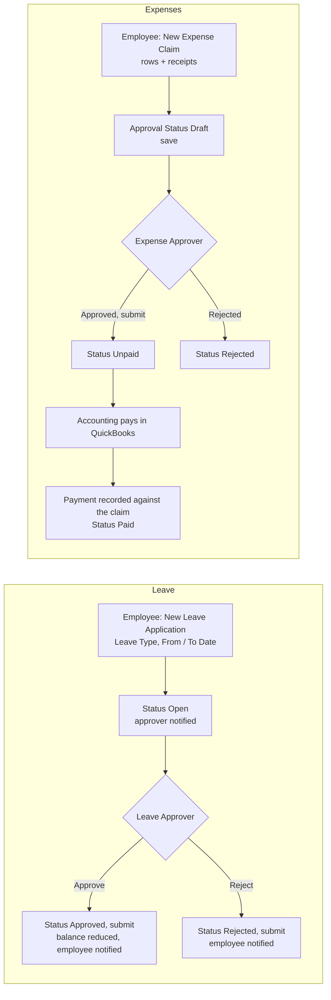

# Module 12: HR self-service

**Audience:** everyone (as employees), the HR lead, approvers, the systems administrator. **Length:** 30 minutes (employees) + 45 minutes (HR lead and approvers) + 15 minutes (systems administrator: audit and holiday list).
**Roles used:** Employee, Employee Self Service, Leave Approver, Expense Approver, HR Manager (HR lead only), System Manager (audit only).
**People (decision 8):** Charlotte is the HR lead (HR Manager, Leave Approver, Expense Approver). Kevin, the Owner and systems administrator, approves Charlotte's leave and expenses.

## Purpose

Employees can request leave and submit expense claims, from a phone or the desk. Approvers can approve or reject them. The HR lead can maintain employees, leave policies and the holiday list. The systems administrator can audit who sees what.

**Scope:** leave, attendance exceptions and expense claims, in Frappe HR (the `hrms` app). **Payroll is not in Frappe HR** (revisit after one full quarter). Expense reimbursements are paid from **QuickBooks**.

> **Status (staging, 2026-11-24):** Frappe HR is installed, but the setup in `docs/HR_SETUP.md` is not done there yet. Staging still has the HRMS defaults: leave types Casual Leave, Compensatory Off, Sick Leave, Privilege Leave and Leave Without Pay; expense claim types Calls, Food, Medical, Others, Travel; no Leave Policy and no Leave Policy Assignment; default departments and designations; 3 Employees (Kevin, Reigine, Ryan) with no approvers set; the Company's **Default Holiday List** empty. 0 leave applications, 0 expense claims, 0 attendance records. This module teaches the **planned** setup and marks staging gaps. Confirm the production setup before the session (run the audit in Lesson 12.6).

## Where to go

| What | Where | Who |
|---|---|---|
| HR app (self-service, phone friendly) | `/hrms` | Every employee with a linked Employee record |
| Leave applications | `/app/leave-application` | Own records (employees); all (HR Manager) |
| New leave application | `/app/leave-application/new` | Employees |
| Expense claims | `/app/expense-claim` | Own records; all (HR Manager) |
| Employees | `/app/employee` | Own record; all (HR Manager) |
| Leave Policy | `/app/leave-policy` | HR Manager |
| Leave Policy Assignment | `/app/leave-policy-assignment` | HR Manager |
| Leave Allocation, Leave Control Panel | `/app/leave-allocation`, `/app/leave-control-panel` | HR Manager |
| Leave Type, Leave Period | `/app/leave-type`, `/app/leave-period` | HR Manager |
| Expense Claim Type | `/app/expense-claim-type` | HR Manager |
| Holiday List | `/app/holiday-list` | HR Manager, System Manager |
| Company default holiday list | `/app/company/ilLumenate Lighting` (Default Holiday List field) | System Manager |
| Employee Attendance Tool (exceptions) | `/app/employee-attendance-tool` | HR Manager |
| HR Settings (notifications, approver rules) | `/app/hr-settings` | HR Manager, System Manager |
| Leaves workspace | `/app/leaves` | HR Manager |
| Role audit | `bench --site <site> execute illumenate_lighting.illumenate_lighting.portal.role_audit.hr` | System Manager |

---

## Process map

In words:

**Leave**
1. The employee opens `/hrms` (or the desk) and creates a Leave Application: Leave Type, From Date, To Date, Reason. The balance shows as "Leave Balance Before Application".
2. On save the status is **Open**. The Leave Approver (from the Employee record) gets the "Leave Approval Notification" email (HR Settings → Send Leave Notification is on).
3. The approver sets **Status** to Approved or Rejected and submits. The employee gets the "Leave Status Notification".
4. Approved leave reduces the balance and counts as the absence for those days. No separate attendance is needed.

**Expenses**
1. The employee creates an Expense Claim: one row per expense (Expense Date, Expense Claim Type, Description, Amount) and attaches receipts.
2. They save it with **Approval Status** Draft. The Expense Approver sees it in their list.
3. The approver sets Approval Status **Approved** (or Rejected) and submits. An approved claim shows **Unpaid**.
4. Accounting reimburses the employee in **QuickBooks**, then records the payment against the claim in ERPNext so it shows **Paid**. Nothing syncs automatically.

---

## Role and permission matrix

| Screen or action | Employee + Employee Self Service | Leave Approver | Expense Approver | HR Manager (HR lead) | System Manager |
|---|---|---|---|---|---|
| `/hrms` app | Own data | Own data plus approvals | Own data plus approvals | Everything | Everything |
| Create own Leave Application / Expense Claim | Yes | Yes | Yes | Yes | Yes |
| See a colleague's leave, expenses, Employee record | No (Create User Permission limits you to yourself) | Only applications where they are the approver | Only claims where they are the approver | Yes | Yes |
| Approve / reject leave | No | Yes, when named on the application | No | Yes | Yes |
| Approve / reject expense claims | No | No | Yes, when named on the claim | Yes | Yes |
| Employees, Leave Policy, Assignments, Holiday List | No | No | No | Yes | Yes |
| Employee Attendance Tool | No | No | No | Yes | Yes |
| Mark an expense claim paid | No | No | No | Accounting (Accounts Manager) records the payment | Yes |
| Run `role_audit.hr` | No | No | No | No | Yes |

Rules from `docs/HR_SETUP.md`: everyone gets **Employee** and **Employee Self Service**; only the HR lead gets **HR Manager**; **nobody gets HR User**; keep System Manager to the systems administrator, because System Managers can open every HR record.

---

### Lesson 12.1: Your Employee record and the HR app (everyone)

**Objective:** know what links you to Frappe HR and find your way around `/hrms`.

- You need one **Employee** record with **User ID** set to your login and **Create User Permission** ticked. Without it `/hrms` cannot show your data (this is why SS-12-01 could not be captured on staging).
- `/hrms` is the Frappe HR web app, built for phones (390 px wide). Use it from your phone's browser; add it to your home screen.
- What you see there (confirm on capture): your leave balances, quick actions to request leave and claim an expense, and lists of your requests with their status.
- On the desk, the same records live under Leave Application and Expense Claim. You only see your own.

**SS-12-01** · `/hrms` home on a phone (390×844)

**SS-12-09** · `/hrms` sign-in redirect for a user with no Employee record (the empty or error state)
**URL:** `/hrms` (phone) · **Role:** `training.viewer` (no Employee record) · **State:** none
**Highlight:** the message shown when no Employee is linked (confirm on capture)

**SS-12-10** · Employee list showing the three staging employees
**URL:** `/app/employee` · **Role:** Administrator · **State:** 3 Active employees (HR-EMP-00001 to 00003)
**Highlight:** Status column; Department and Designation blank (setup gap)

#### Field reference: Employee (the fields that matter for self-service)

| Field (as shown) | What it means | Who fills it | Required | Where it flows |
|---|---|---|---|---|
| First Name / Full Name | The person | HR lead | First Name yes | Every HR record |
| Status | Active, Inactive, Suspended, Left | HR lead | Yes | Only Active employees are audited |
| Date of Joining | Start date | HR lead | Yes | Leave allocations "based on Joining Date" |
| User ID | The person's login | HR lead | No, but needed for self-service | Links `/hrms` and permissions |
| Create User Permission | Restricts the user to their own Employee and HR records | HR lead (default on) | No, but must be on | Privacy |
| Company, Department, Designation | Org placement | HR lead | Company yes | Reports, approver fallback |
| Reports to | Manager | HR lead | No | Org chart |
| Holiday List (Employment tab) | Overrides the company list for this person | HR lead | No | Leave day counts |
| Expense Approver, Leave Approver (Approvers section) | Who approves this person | HR lead | Needed (HR Settings makes approvers mandatory) | Defaults onto each application / claim |

**SS-12-06** · Employee record (redacted) showing User ID, department, approvers

**SS-12-11** · Employee form, Employment tab: Holiday List and the Approvers section
**URL:** `/app/employee/HR-EMP-00003` (Employment tab) · **Role:** Administrator · **State:** redact personal fields
**Highlight:** Holiday List; Expense Approver; Leave Approver (both empty on staging)

---

### Lesson 12.2: Requesting leave (everyone)

**Objective:** request a day off, a half day, or several days, and read your balance.

- **Planned leave types:** **Paid Time Off**, **Sick Leave**, **Leave Without Pay** (Is Leave Without Pay ticked). Staging still shows the HRMS defaults (Casual Leave, Compensatory Off, Sick Leave, Privilege Leave, Leave Without Pay).
- `/hrms` → request leave, or `/app/leave-application/new`. Choose Leave Type, From Date and To Date. **Leave Balance Before Application** fills in; **Total Leave Days** counts working days only (weekly offs and company holidays from the Holiday List are skipped unless the leave type says "Include holidays within leaves as leaves").
- **Half Day**: tick it and pick the **Half Day Date** for a multi-day request.
- **Reason**: a short note for the approver.
- Your **Leave Approver** fills in from your Employee record: the HR lead for everyone; the Owner (Kevin) for the HR lead.
- Save. Status is **Open** until the approver decides. You get an email when it is Approved or Rejected.
- Changing plans: ask the approver to reject an Open request, or cancel an approved, submitted one (Cancel on the form). Cancelled leave goes back into your balance.

#### Field reference: Leave Application (confirmed on staging)

| Field (as shown) | What it means | Who fills it | Required | Where it flows |
|---|---|---|---|---|
| Series | HR-LAP-.YYYY.- | Automatic | Yes | Record name |
| Employee / Employee Name | Who is off | Employee (defaults to you) | Yes | Balance, permissions |
| Leave Type | Paid Time Off, Sick Leave, Leave Without Pay (planned) | Employee | Yes | Which balance is used |
| Company, Department | From the Employee | Automatic | Company yes | Reports |
| From Date, To Date | The leave | Employee | Yes | Total Leave Days |
| Half Day, Half Day Date | Half-day leave | Employee | No | Total Leave Days |
| Total Leave Days | Working days counted | Automatic | No | Balance |
| Reason | Note for the approver | Employee | No | Approver email |
| Leave Balance Before Application | Remaining balance | Automatic | No | Warning if too low |
| Leave Approver, Leave Approver Name | From the Employee | Automatic | Yes on this site (HR Settings) | Approval email |
| Follow via Email | Email updates | Employee | No | Notifications |
| Posting Date | Date applied | Automatic | Yes | Records |
| Status | Open, Approved, Rejected, Cancelled | Approver | Yes | Submit rules |

#### Leave Application status lifecycle

| Status | How it gets there | Who | What it unlocks |
|---|---|---|---|
| Open | Saved by the employee | Employee | Approver can decide; employee can still edit |
| Approved | Approver sets Status, then submits | Leave Approver, HR Manager | Balance reduced; absence covered |
| Rejected | Approver sets Status, then submits | Leave Approver, HR Manager | Nothing deducted |
| Cancelled | Cancel on a submitted application | HR Manager or the employee (confirm on capture) | Balance restored |

**SS-12-02** · New leave application with balance shown

**SS-12-12** · `/hrms` leave request form on a phone (390×844)
**URL:** `/hrms` → leave → new (phone) · **Role:** an employee with a linked Employee record and a leave allocation · **State:** fill the form; don't submit
**Highlight:** Leave Type; dates; the balance

**SS-12-13** · Desk Leave Application with Half Day ticked
**URL:** `/app/leave-application/new` · **Role:** an employee with a linked Employee record · **State:** unsaved draft
**Highlight:** Half Day; Half Day Date; Total Leave Days

**SS-12-14** · Leave Application list filtered to Status = Open
**URL:** `/app/leave-application?status=Open` · **Role:** HR Manager · **State:** needs at least one Open application (none on staging; creating one emails the approver, so the lead decides)
**Highlight:** Status column; Leave Approver column

**SS-12-15** · Leave Type form: Paid Time Off with Is Leave Without Pay off and the Carry Forward section
**URL:** `/app/leave-type/Paid Time Off` · **Role:** HR Manager · **State:** needs the planned leave types created (staging only has the defaults); otherwise use `/app/leave-type/Leave Without Pay`
**Highlight:** Is Leave Without Pay; Include holidays within leaves as leaves; Carry Forward

---

### Lesson 12.3: Expense claims (everyone)

**Objective:** claim a business expense with its receipt and know when you will be paid.

- **Planned claim types:** **Mileage**, **Supplies and Materials**, **Travel**, **Meals**, each mapped to the company's expense account. Staging still has the HRMS defaults (Calls, Food, Medical, Others, Travel).
- `/hrms` → claim an expense, or `/app/expense-claim/new`. Add one row per expense: **Expense Date**, **Expense Claim Type**, **Description**, **Amount**. Attach a photo or PDF of each receipt (sidebar Attachments, or the app's attach button).
- Your **Expense Approver** fills in from your Employee record (required on this site).
- Save. **Approval Status** stays Draft until the approver decides.
- **Reimbursement happens in QuickBooks.** After Accounting pays you there, they record the payment against the claim in ERPNext so it shows **Paid**. This does not sync either way (Module 13).
- Mileage: put the miles and the rate in the Description, and the total in Amount (confirm the rate with the HR lead).

#### Field reference: Expense Claim (confirmed on staging)

| Field (as shown) | What it means | Who fills it | Required | Where it flows |
|---|---|---|---|---|
| Series | HR-EXP-.YYYY.- | Automatic | Yes | Record name |
| From Employee | Who is claiming | Employee | Yes | Payable to |
| Expense Approver | From the Employee | Automatic | Yes on this site | Approval |
| Approval Status | Draft, Approved, Rejected, Cancelled | Approver | No | Submit allowed when Approved or Rejected |
| Expenses table: Expense Date, Expense Claim Type, Description, Amount, Sanctioned Amount | One row per receipt | Employee (Sanctioned Amount: approver) | Type and Amount yes | Totals, expense account |
| Total Claimed Amount, Total Sanctioned Amount, Grand Total | Totals | Automatic | No | What is owed |
| Total Amount Reimbursed | Paid so far | Automatic from payments | No | Status Paid |
| Posting Date | Claim date | Automatic | Yes | Accounts |
| Is Paid, Mode of Payment | Paid at once from company funds | Accounting | No | Leave off: we pay in QuickBooks |
| Project, Cost Center, Task | Charge to a job | Employee | No | Job costing |
| Status | Draft, Submitted, Unpaid, Partially Paid, Paid, Rejected, Cancelled | Automatic | No | Accounting queue |

#### Expense Claim status lifecycle

| Status | How it gets there | Who | Next |
|---|---|---|---|
| Draft | Saved, Approval Status Draft | Employee | Approver decides |
| Rejected | Approval Status Rejected, submitted | Expense Approver | Done |
| Unpaid | Approval Status Approved, submitted | Expense Approver | Accounting pays in QuickBooks |
| Partially Paid | Part of the total recorded as paid | Accounting | Pay the rest |
| Paid | Payment recorded against the claim | Accounting | Done |
| Cancelled | Cancel on a submitted claim | HR Manager, Accounting | Done |

**SS-12-03** · New expense claim with a receipt attached

**SS-12-16** · `/hrms` expense claim form on a phone (390×844) with a receipt photo attached
**URL:** `/hrms` → expense claim → new (phone) · **Role:** an employee with a linked Employee record · **State:** fill and attach; don't submit
**Highlight:** the expense row; the attachment

**SS-12-17** · Expense Claim desk form: Expenses table with two rows (Mileage, Meals)
**URL:** `/app/expense-claim/new` · **Role:** an employee with a linked Employee record · **State:** unsaved draft; needs the planned claim types (else use Travel and Food)
**Highlight:** Expense Claim Type column; Amount; Total Claimed Amount

**SS-12-18** · Expense Claim list filtered to Status = Unpaid (the Accounting queue)
**URL:** `/app/expense-claim?status=Unpaid` · **Role:** Accounts Manager · **State:** needs an approved claim (none on staging)
**Highlight:** Status column; Grand Total

**SS-12-19** · Expense Claim Type list
**URL:** `/app/expense-claim-type` · **Role:** HR Manager · **State:** staging shows the HRMS defaults (Calls, Food, Medical, Others, Travel)
**Highlight:** the five names (to be replaced by Mileage, Supplies and Materials, Travel, Meals)

---

### Lesson 12.4: Approving (approvers)

**Objective:** approve or reject leave and expenses quickly and correctly.

- You hear about a request by email ("Leave Approval Notification" for leave), in `/hrms`, or in the desk list.
- **Leave:** open the application, check the dates and balance, set **Status** to Approved or Rejected, then **Submit**. Only Approved or Rejected applications can be submitted.
- **Expenses:** open the claim, check each receipt, adjust **Sanctioned Amount** if you approve less than claimed, set **Approval Status** to Approved or Rejected, then **Submit**.
- Approvers see only the requests that name them. Non-HR users can't open other people's records.
- The HR lead's own requests go to the Owner. HR Settings → **Prevent Self Leave Approval** and **Prevent Self Expense Approval** are off on staging; turning them on is recommended so nobody approves their own request.

**SS-12-04** · Leave application awaiting approval, Approve / Reject

**SS-12-05** · Expense claim awaiting approval

**SS-12-20** · (pair) Leave approval: Status Open (-a), then Status set to Approved before Submit (-b)
**URL:** `/app/leave-application/<name>` · **Role:** Leave Approver (HR lead) · **State:** needs an Open application; submitting emails the employee, so the lead decides
**Highlight:** the Status field; the Submit button

**SS-12-21** · Expense claim with Sanctioned Amount lower than Amount and Approval Status Approved
**URL:** `/app/expense-claim/<name>` · **Role:** Expense Approver · **State:** needs a Draft claim; don't submit
**Highlight:** Sanctioned Amount; Total Sanctioned Amount; Approval Status

**SS-12-22** · HR Settings: leave and expense approver rules and notifications
**URL:** `/app/hr-settings` · **Role:** Administrator
**Highlight:** Leave Approver Mandatory In Leave Application (on), Send Leave Notification (on), Expense Approver Mandatory In Expense Claim (on), Prevent Self Leave Approval (off), Prevent Self Expense Approval (off)

**SS-12-23** · "Leave Approval Notification" email template
**URL:** `/app/email-template/Leave Approval Notification` · **Role:** Administrator
**Highlight:** the subject and the template body

---

### Lesson 12.5: HR lead administration

**Objective:** set up a new hire, the year's leave, the holiday list and attendance exceptions.

**New hire checklist**
1. Create the **User** (systems administrator) with roles Employee and Employee Self Service.
2. Create the **Employee**: name, Date of Joining, Company, Department, Designation, **User ID**, **Create User Permission** ticked, Leave Approver and Expense Approver.
3. Create and submit a **Leave Policy Assignment** for the leave period.
4. Ask the systems administrator to run `role_audit.hr`.

**Org setup (planned):**
- Departments: Management, Sales, Accounting and HR, Marketing, Operations. Designations: Owner, Accounting and HR Lead, Marketing and Web, Logistics and Assembly, Systems Administrator. (Staging shows the ERPNext defaults.)
- **Leave Policy**: the annual days per leave type, then submit. **Leave Policy Assignment** per employee: Employee, Leave Policy, Assignment based on (Leave Period or Joining Date), Leave Period, Effective From, Effective To, "Add unused leaves from previous allocations"; submit to create the allocations. **Bulk Leave Policy Assignment** does many at once.
- **Holiday List** for the calendar year: From Date, To Date, **Add Weekly Holidays** (Weekly Off: Saturday, then Sunday, each with Add to Holidays), **Add Local Holidays** (Country, Subdivision), and the company holidays in the Holidays table (Date, Description, Is Half Day). Then set **Company → Default Holiday List**.
- **Attendance:** no clock-in. Approved leave marks the absence. Record other exceptions with the **Employee Attendance Tool**: Date, Company / Department filters, **Get Employees**, tick the unmarked employees, Status (Present, Absent, Half Day, Work From Home), mark.

#### Why the holiday list matters beyond HR

The Company's **Default Holiday List** is read by the app itself:
- **Drawing request SLA deadlines** skip weekends and the dates on that list (decision: SLAs skip weekends and company holidays; Module 02). Friday 4 pm plus 24 hours is Monday 4 pm, or Tuesday 4 pm when Monday is a holiday.
- The **production board** uses the same list for working days (Module 05).
- The HR audit lists companies without one.

**Staging gap:** the 2026 Holiday List runs 1 Jul to 31 Dec 2026 (53 days: weekends plus Labor Day, Thanksgiving Day, "Thanksgiving Day 2", Christmas Day), but the Company's Default Holiday List is empty and its Holiday List Assignment (HR-HLA-2026-00001) is cancelled. Until it is set, SLAs on staging skip weekends only. Row 1 reads 12 Jul 2026 "Saturday", but 12 Jul 2026 is a Sunday (11 Jul is the Saturday); check it.

**SS-12-07** · Leave Policy Assignment

**SS-12-08** · Holiday List

**SS-12-24** · Leave Policy form with one row per leave type
**URL:** `/app/leave-policy/new` · **Role:** HR Manager · **State:** unsaved; needs the planned leave types
**Highlight:** Leave Policy Details table (Leave Type, Annual Allocation)

**SS-12-25** · New Leave Policy Assignment form
**URL:** `/app/leave-policy-assignment/new` · **Role:** HR Manager · **State:** unsaved
**Highlight:** Employee; Leave Policy; Assignment based on; Effective From / Effective To; "Add unused leaves from previous allocations"

**SS-12-26** · Bulk Leave Policy Assignment page
**URL:** `/app/leave-policy-assignment` → Bulk Leave Policy Assignment · **Role:** HR Manager · **State:** don't assign
**Highlight:** the employee filters and selection

**SS-12-27** · Holiday List: Add Weekly Holidays section expanded
**URL:** `/app/holiday-list/2026` · **Role:** Administrator · **State:** don't save
**Highlight:** Weekly Off; Add to Holidays; Add Local Holidays (Country, Subdivision)

**SS-12-28** · Holiday List, Holidays table scrolled to the company holidays
**URL:** `/app/holiday-list/2026` · **Role:** Administrator
**Highlight:** Labor Day, Thanksgiving Day, Thanksgiving Day 2, Christmas Day

**SS-12-29** · Company form: Default Holiday List (empty on staging)
**URL:** `/app/company/ilLumenate Lighting` (scroll to the holiday field) · **Role:** Administrator · **State:** don't save
**Highlight:** Default Holiday List

**SS-12-30** · Employee Attendance Tool after Get Employees
**URL:** `/app/employee-attendance-tool` · **Role:** Administrator · **State:** pick a past weekday; don't mark
**Highlight:** Date; Unmarked Employees; Status

**SS-12-31** · Leaves workspace sidebar
**URL:** `/app/leaves` · **Role:** Administrator
**Highlight:** Leave Application, Leave Allocations, Leave Policy Assignment, Leave Control Panel, Holidays, Leave Setup

---

### Lesson 12.6: Privacy and the HR audit (systems administrator)

**Objective:** prove that each person sees only their own HR records.

- Run `bench --site <site> execute illumenate_lighting.illumenate_lighting.portal.role_audit.hr` (System Manager only; read-only).
- It returns: `hrms_installed`; `users_without_employee` (staff who can't request leave yet); `employees_without_user`; `employees_without_user_permission`; `employees_without_leave_policy` (no submitted assignment covering today); `employees_without_approvers` (HRMS falls back to the Department's approvers when blank); `companies_without_holiday_list`; `hr_role_holders` (who can open others' records: expect the HR lead only); `system_managers`.
- **Setup is done** when every list is empty except `hr_role_holders` (the HR lead) and `system_managers`.
- On staging today the audit would report: 19 enabled system users (training users included) and only 3 Employees; Kevin's Employee without Create User Permission; all 3 without approvers and without a leave policy; the company without a default holiday list.

**Acceptance test (from `docs/HR_SETUP.md`):** each person requests a day of leave and the HR lead approves it; one person submits a small claim with a receipt and it is approved; logged in as someone other than the HR lead, opening another person's Employee, Leave Application or Expense Claim is refused; `role_audit.hr` shows only the HR lead under `hr_role_holders`.

**SS-12-32** · A refused record: an employee opening a colleague's Leave Application
**URL:** `/app/leave-application/<another employee's application>` · **Role:** an employee who is not the approver · **State:** needs two linked employees and one application
**Highlight:** the "not permitted" message (confirm wording on capture)

**DATA-12-01** · HR setup state on staging
**API:** `GET /api/resource/Employee?fields=["name","employee_name","status","department","designation","leave_approver","expense_approver","create_user_permission"]` and `GET /api/resource/Company?fields=["name","default_holiday_list"]`
**Use:** the audit discussion in Lesson 12.6

**DATA-12-02** · Leave and expense setup records
**API:** `GET /api/resource/Leave Type`, `GET /api/resource/Expense Claim Type`, `GET /api/resource/Leave Policy Assignment?fields=["name","employee","leave_policy","effective_from","effective_to","docstatus"]`
**Use:** checking the planned setup before the session

---

## Behind the scenes

| Trigger | What happens | Where to see it |
|---|---|---|
| Leave Application saved (Open) | "Leave Approval Notification" email to the Leave Approver (HR Settings → Send Leave Notification is on) | Approver's inbox; Email Queue |
| Leave Application submitted (Approved / Rejected) | "Leave Status Notification" email to the employee; Leave Ledger Entry reduces the balance when Approved | Employee's inbox; Leave balance |
| Leave Application cancelled | Ledger entry reversed; balance restored | Leave balance |
| Leave Policy Assignment submitted | Leave Allocation records created for the period | `/app/leave-allocation` |
| Expense Claim submitted (Approved) | GL entries to the expense and payable accounts; status Unpaid | Accounting ledger |
| Payment recorded against an Expense Claim | Status Paid / Partially Paid | Claim |
| Employee saved with User ID and Create User Permission | User Permission created so the user sees only their own Employee | `/app/user-permission` |
| Company Default Holiday List set | Drawing request SLA deadlines and the production board skip those dates | Module 02, Module 05 |
| Nothing | No QuickBooks sync, no payroll, no clock-in | — |

## Worked examples

### A. Ryan books two days of PTO

1. On his phone Ryan opens `/hrms`, requests leave: Leave Type Paid Time Off, Thursday and Friday. Total Leave Days 2; his balance shows before he saves.
2. Saved, Status Open. Charlotte gets the approval email.
3. Charlotte opens it, sets Status Approved, submits. Ryan gets the status email; his balance drops by 2.

### B. Regina claims a client lunch and mileage

1. Regina creates an Expense Claim: row 1 Meals, 42.50, "Lunch with dealer, project review"; row 2 Mileage, 36 miles at the company rate in the Description, the total in Amount. She attaches both receipts and saves.
2. Charlotte checks the receipts, sets Approval Status Approved and submits. Status Unpaid.
3. Charlotte reimburses Regina in QuickBooks, then records the payment against the claim in ERPNext. Status Paid.

### C. Charlotte's own leave

1. Charlotte requests a day of Sick Leave. Her Employee record names Kevin as Leave Approver, so Kevin gets the email and approves it.

## Troubleshooting

HRMS messages are standard Frappe HR text, not in this repo; confirm the exact wording on capture.

| Symptom | Cause | Fix |
|---|---|---|
| `/hrms` shows nothing useful or no Employee | Your login has no Employee record, or User ID isn't set | HR lead links the Employee (User ID) |
| You can see colleagues' records | Create User Permission was off when User ID was set, or you hold HR User / HR Manager / System Manager | HR lead ticks it and re-saves; admin removes the extra role; run `role_audit.hr` |
| No leave type or zero balance | No submitted Leave Policy Assignment for this period | HR lead assigns and submits the policy |
| Error about leave balance when saving (confirm wording) | Requested days exceed the balance | Shorten the request or use Leave Without Pay |
| Leave Approver required (confirm wording) | HR Settings makes the approver mandatory and your Employee has none | HR lead sets Leave Approver on your Employee |
| Expense Approver required (confirm wording) | Same, for expenses | HR lead sets Expense Approver |
| Can't submit a leave application (confirm wording) | Status is still Open; only Approved or Rejected can be submitted | Approver sets Status first |
| Total Leave Days counts a holiday | The holiday is not on the Holiday List, or the company has no default list | HR lead adds the date; admin sets Company → Default Holiday List |
| Drawing SLA counted through a holiday | Company Default Holiday List empty (as on staging) | Set it (Lesson 12.5) |
| Claim stuck at Unpaid | Paid in QuickBooks but not recorded in ERPNext | Accounting records the payment against the claim |
| Approver didn't get an email | Send Leave Notification off, or the approver has no email; expense approvals don't email by default (confirm) | Check HR Settings and the Email Queue |

## Tips and shortcuts

- Add `/hrms` to your phone's home screen.
- Attach receipts the day you spend; a claim per month is fine.
- Approvers: filter `/app/leave-application?status=Open&leave_approver=<you>`.
- The HR lead keeps one Holiday List per calendar year and sets it on the Company each January.

## Common mistakes

- Giving someone HR User "so they can see the calendar". Nobody gets HR User.
- Creating an Employee without User ID, or unticking Create User Permission.
- Forgetting to submit the Leave Policy Assignment (a draft creates no allocation).
- Ticking **Is Paid** on an expense claim we pay in QuickBooks.
- Leaving the Company's Default Holiday List empty: SLAs and the production board then ignore holidays.

## Exercises (staging)

1. **Find the gaps.** As Administrator, use DATA-12-01. *Expected:* 3 employees, no approvers, Kevin without Create User Permission, Company Default Holiday List empty.
2. **Read the holiday list.** Open `/app/holiday-list/2026`. *Expected:* 53 holidays from 1 Jul to 31 Dec 2026, including Labor Day, Thanksgiving Day, Thanksgiving Day 2 and Christmas Day; spot the 12 Jul row labelled Saturday.
3. **HR Settings.** Open `/app/hr-settings`. *Expected:* approvers mandatory for leave and expenses; Send Leave Notification on; self-approval not prevented.
4. **Plan a new hire.** On paper, list the five fields you set on a new Employee for self-service. *Expected:* User ID, Create User Permission, Leave Approver, Expense Approver, plus a submitted Leave Policy Assignment.
5. **Leave Type check.** Open Leave Without Pay. *Expected:* Is Leave Without Pay ticked.

## Slide deck beats

1. What's in Frappe HR (leave, attendance exceptions, expenses) and what isn't (payroll, clock-in)
2. Your Employee record and `/hrms` on your phone
3. Requesting leave: types, balance, half days
4. Expense claims and QuickBooks reimbursement
5. Approving: Status, Sanctioned Amount, Submit
6. HR lead setup: Employee, Leave Policy Assignment, Holiday List
7. The holiday list drives SLAs and the production board
8. Privacy: Create User Permission and the HR audit

## Check yourself

1. Where do you request PTO from your phone? *(`/hrms`.)*
2. Who pays your expense claim, and where? *(Accounting, in QuickBooks; then it is marked Paid in ERPNext.)*
3. Can you see a colleague's leave balance? *(No. Create User Permission limits you to your own records.)*
4. Who approves the HR lead's leave? *(The Owner, Kevin.)*
5. What must be submitted before an employee has any leave balance? *(A Leave Policy Assignment.)*
6. Which two app features besides leave use the Company's Default Holiday List? *(Drawing request SLA deadlines and the production board.)*
7. Which role does nobody get? *(HR User.)*
