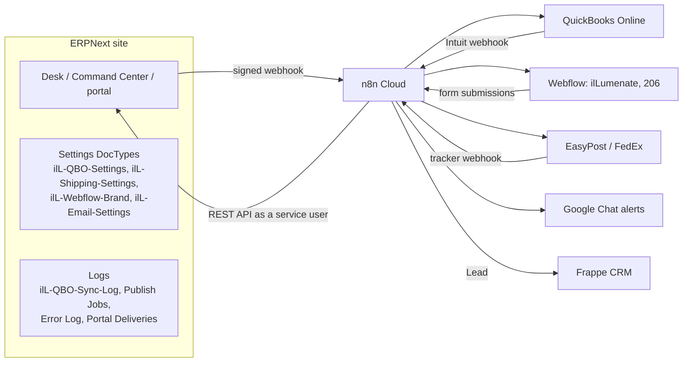

# Module 13: Integrations & third-party apps

**Audience:** systems administrator (all lessons); accounting (13.4); shipping lead (13.3); marketing & web, catalog publisher (13.5); support and sales (13.6); everyone (13.1 overview). **Length:** 30 minutes overview + 30 minutes per role lesson + 60 minutes admin deep dive (13.2, 13.7 to 13.10).
**Roles used:** System Manager, Accounts Manager, Stock Manager, ilL Catalog Publisher, ilL Support, ilL Integration (service users only).

## Purpose

Everyone understands which outside systems the ERP talks to, how each one connects (which workflow, which settings record, which service user, which log), and what they themselves must do in each. Admins and leads can check that each integration is healthy and fix the common failures.

> **Sources:** the repo code and settings DocTypes, the n8n workflow exports in `n8n_workflows/`, read-only checks on staging, and the n8n workflow list (names and active flags, read 2026-11-24). Values marked "staging" are staging's, not production's.

## Map of the systems

| System | What it does for us | How it connects | Who touches it | Status |
|---|---|---|---|---|
| **ERPNext (Frappe v16)** | Core ERP: quotes, orders, stock, manufacturing, purchasing, accounting | — | Everyone | Live |
| **Command Center** | The staff cockpit on top of ERPNext | Same site (`/command-center`) | Everyone | Live |
| **Dealer portal** | Dealers' projects, quotes, orders, drawings | Same site (`/portal`); emails through the portal outbox | Dealers; staff for support | Live |
| **Frappe Helpdesk** | Customer tickets (sales@) | Same site (`/helpdesk`); app fields on HD Ticket | Support, sales | Live |
| **Frappe CRM** | Website leads → deals → customers | Same site (`/crm`); Webflow forms through n8n | Sales, marketing | Live |
| **Frappe HRMS** | Leave, expenses | Same site (`/hrms`); Module 12 | Everyone | Live (setup pending, Module 12) |
| **n8n** (n8n Cloud) | The integration hub: every outbound connection goes through it | ERPNext calls n8n webhooks with a shared secret; n8n calls ERPNext's API as a service user | Admin | Live |
| **QuickBooks Online** | Payables and receivables system of record; payments | n8n workflows "QBO 1" to "QBO 4"; ilL-QBO-Settings; HMAC-signed callbacks | Accounting | Rolling out: setup steps pending |
| **EasyPost (FedEx)** | Shipping labels and tracking | n8n "ilL Shipping" workflows (in the repo, not yet in n8n); ilL-Shipping-Settings | Shipping | Rolling out: not piloted |
| **Webflow** (ilLumenate, 206 Lighting) | Public websites and product listings | n8n publication, taxonomy and gallery workflows; ilL-Webflow-Brand | Marketing & web, catalog publisher | Live (auto-push and galleries gated) |
| **Gmail / Google** | Kevin's Desk email triage (metadata only); Google Chat error alerts from n8n | Kevin's Desk cache job; n8n "Error Handler - Google Chat" | Kevin, admin | Live |
| **Postmark** | Email campaigns, customer training emails | n8n "Email Campaign Scheduler V2" and "Customer Trainings Emails" (both active in n8n); the ERP campaign scheduler was removed | Marketing | Confirm with marketing (the ERP side is dormant) |
| **Bluebeam** | Drawing markup (spike only) | — | — | Planned |

---

## Process map: how a change travels between systems

In words:

1. Something happens in ERPNext (a Purchase Invoice is submitted, a product is approved for staging, labels are requested).
2. ERPNext calls an **n8n webhook**. The URL comes from a settings record or site config; the request carries a **shared secret** (a header, or an HMAC-SHA256 signature over the body).
3. n8n talks to the outside system (QuickBooks, Webflow, EasyPost) with credentials that live **only in n8n**.
4. n8n writes the result back to ERPNext's API as a **service user** (shipping-integration, qbo-integration, webflow-auto-push, publication-worker), or calls a signed callback endpoint.
5. ERPNext records the outcome in a **log** (ilL-QBO-Sync-Log, ilL-Publish-Job, Error Log) and on the record's timeline.
6. Outside events come in the other way: Intuit webhooks (payments), EasyPost tracker events and Webflow form posts reach n8n first, then ERPNext.

---

## Role and permission matrix

| Screen or action | Everyone | Accounts Manager / User | Stock Manager / User | ilL Catalog Publisher | ilL Support | System Manager |
|---|---|---|---|---|---|---|
| ilL-QBO-Settings, ilL-QBO-Sync-Log | No | Read the log (confirm on capture) | No | No | No | Edit |
| Portal Operations → Accounting queues (Bills not in QuickBooks, New customers to set up) | No | Yes (decision 8) | No | No | No | Yes |
| ilL-Shipping-Settings | No | No | Read (confirm) | No | No | Edit |
| Create Labels / Void Label on a Shipment | No | No | Needs Submit permission on Shipment | No | No | Yes |
| Publish jobs, Webflow Product sync | No | No | No | Yes (Module 11) | No | Yes |
| Portal Operations → Publication failures, Email failures | No | No | No | No (ilL Integration only) | No | Yes |
| Helpdesk agent screens, saved replies | No | No | No | Sales inbox | Yes | Yes |
| CRM leads and deals | Sales / marketing | No | No | No | No | Yes |
| Email Templates, Notifications, ilL-Email-Settings | No | No | No | No | No | Edit |
| Scheduled Job Type, Error Log | No | No | No | No | No | Yes |
| n8n editor, QuickBooks, EasyPost, Webflow dashboards | Outside ERPNext: separate logins | Accounting: QuickBooks | Shipping: EasyPost | Marketing: Webflow | No | Admin: all |

---

### Lesson 13.1: How the pieces connect (everyone)

**Objective:** know the four moving parts of every integration: a trigger, a webhook, a service user, a log.

- ERPNext sends events to **n8n**; n8n talks to QuickBooks, EasyPost, Webflow and the spec sheet renderer, then writes results back to ERPNext.
- Each outside system writes into ERPNext as its own **service user**, so changes on the timeline are labelled by source (table below). All five are enabled on staging. A site can point a key at another user with site config `ill_service_users`.
- **No secrets in the repo.** Webhook URLs and shared secrets live in settings DocTypes (password fields) or site config: `n8n_spec_webhook_url`, `n8n_sync_webhook_url`, `n8n_sync_secret`, `n8n_sync_secret_header`, `webflow_environment` (staging or production), `qbo_webhook_secret`, `shipping_webhook_secret`, `webflow_auto_push`, `webflow_notify_users`, `spec_sheet_template_sites`. A missing URL stops the call ("The n8n webhook URL is not configured. Ask your administrator to set {0} in site config.") rather than fall back to production.
- If something "didn't sync", the answer is usually in a log: **Error Log**, **ilL-QBO-Sync-Log**, **Publish Jobs**, **Portal Deliveries** (email), or the **n8n execution list**.

| Service user (email) | Roles | Writes |
|---|---|---|
| `publication-worker@illumenate.lighting` | ilL Integration | Publish job claims and callbacks (Webflow) |
| `webflow-auto-push@illumenate.lighting` | ilL Catalog Publisher | Automatic Webflow pushes 2 minutes after a save |
| `qbo-integration@illumenate.lighting` | ilL Integration, Accounts User | Payment Entries and QuickBooks ids |
| `shipping-integration@illumenate.lighting` | ilL Integration | Shipment tracking status |
| `webflow-marketing-api@illumenate.lighting` | (API user seen on staging publish jobs; confirm its roles) | Requests from the older marketing sync |

**SS-13-01** · n8n workflow list showing the ilL workflows
**URL:** n8n editor · **Role:** n8n admin

**SS-13-02** · A record timeline showing a change by a service user

**SS-13-17** · Publish job list filtered by Requested By = the auto-push or marketing API user
**URL:** `/app/ill-publish-job?requested_by=webflow-marketing-api%40illumenate.lighting` · **Role:** System Manager
**Highlight:** the Requested By column; jobs by a service user, not a person

**SS-13-18** · User list filtered to the service users
**URL:** `/app/user?name=%5B%22like%22%2C%22%25integration%25%22%5D` (or search "integration", "worker", "auto-push") · **Role:** System Manager
**Highlight:** the four service users; Enabled; User Type

**SS-13-19** · Error Log list with an n8n failure ("Could not tell n8n about gallery work for illumenate: 404 ...")
**URL:** `/app/error-log` · **Role:** System Manager · **State:** existing entries on staging (8,494 rows)
**Highlight:** the Method / title column; the newest gallery and Kevin's Desk entries

---

### Lesson 13.2: n8n, the hub (admin)

**Objective:** find any workflow, know whether it is on, and read a failed execution.

#### Workflow inventory (n8n, 2026-11-24)

| Workflow (as named in n8n) | Active | Trigger | ERPNext side | In repo |
|---|---|---|---|---|
| [STAGING] Spec Gen & Webflow Sync | Yes | Webhook from ERPNext | Generate Spec; Webflow publish jobs (W1, W2) | `webflow_product_sync.json` builds the publication part |
| [PROD] Spec Gen & Webflow Sync | No (created 2026-11-24) | Webhook | Same, for production | — |
| Spec Gen & Webflow Sync | No (older) | — | — | — |
| ERPNext → Webflow Product Sync | No (legacy) | — | Legacy product sync | — |
| ERPNext → 206 Webflow Product Sync | No | — | Legacy 206 sync | — |
| ERPNext → Webflow Attributes Sync | Yes | Schedule + manual | Attribute DocTypes marked Pending | `webflow_attribute_sync.json` |
| ERPNext → Webflow Category Sync | Yes | Schedule + manual | ilL-Webflow-Category | `webflow_category_sync.json` |
| ERPNext → Webflow Product-Attribute Reference Sync | No | Schedule + manual | Product filter references | `webflow_product_attribute_filter_sync.json` |
| ilL-Gallery-Publication (ilLumenate) | Yes | Webhook `ill-gallery-sync` | ilL-Webflow-Gallery, Gallery Publish Jobs | `webflow_gallery_sync*.json` |
| Webflow Forms → Frappe CRM Lead | Yes | Webhook | `create_lead_from_webflow` | `webflow_lead_form.json`, `_206.json` |
| Forms → ERPNext | Yes | Webhook | Web form intake (confirm target) | — |
| QBO 1 · ERPNext Customer → QuickBooks Customer | Yes | Webhook | Customer | — |
| QBO 2 · QuickBooks Events → ERPNext (customers, payments, bill payments) | Yes | Intuit webhook | `qbo_sync.receive_payment_event`, `receive_bill_payment_event` | `quickbooks_payment_sync.json` |
| QBO 3 · ERPNext Sales Invoice → QuickBooks Invoice | Yes | Webhook | `qbo_invoices.receive_invoice_link` (id and pay link) | — |
| QBO 4 · ERPNext Purchase Invoice → QuickBooks Bill | **No** | Webhook | `qbo_bills` (Bill Webhook URL) | `purchase_invoice_qbo_bill.json` |
| 1. to 5. (older QBO set: Customer, Invoice, Payment, Error Handler) | No | — | Superseded by QBO 1 to 4 | — |
| ilL Shipping: EasyPost labels / EasyPost tracker → ERPNext | **Not in n8n yet** | Webhooks `ill-shipping-labels`, `ill-shipping-tracker` | `api/shipping.py` | `shipping_easypost_labels.json`, `shipping_easypost_tracker.json` |
| Error Handler - Google Chat | Yes | Error trigger | — | — |
| Email Campaign Scheduler V2, Customer Trainings Emails | Yes | Schedule / trigger | Postmark campaigns | — |
| Email Campaign Scheduler, (206) Newsletter Signup | No | — | — | — |
| [STAGING] Webflow ID remap | No (one-off, manual) | Manual | `remap_webflow_ids` dry run | — |

**Health routine (weekly, admin):**

1. n8n → Executions, filter Status = Error, last 7 days. Open each failed run; the red node shows the error.
2. ERPNext Error Log: filter titles starting "QBO", "Could not tell n8n", "Kevin's Desk".
3. Publish jobs FAILED (Module 11), QBO Sync Log Failed (13.4), Portal Operations → Publication failures and Email failures.
4. Check that each workflow that should be active is active (table above).

**SS-13-03** · n8n EasyPost labels workflow canvas

**SS-13-20** · n8n Executions list filtered to Error
**URL:** n8n → Executions · **Role:** n8n admin · **State:** last 7 days
**Highlight:** the Status filter; the workflow name column

**SS-13-21** · n8n "[STAGING] Spec Gen & Webflow Sync" canvas with the Active toggle
**URL:** n8n editor → that workflow · **Role:** n8n admin
**Highlight:** the webhook trigger; the Active toggle; the ERPNext HTTP nodes

**SS-13-22** · n8n Credentials list (names only; never open a credential for a screenshot)
**URL:** n8n → Credentials · **Role:** n8n admin
**Highlight:** the ERPNext, QuickBooks and Webflow credential names

---

### Lesson 13.3: EasyPost (shipping lead, admin) (Rolling out)

**Objective:** know how labels will be bought and where to look when one fails.

- **Flow (from `docs/SHIPPING_EASYPOST_INTEGRATION.md`):** Delivery Note → **Create Shipment** → add parcels (inches, pounds) → **Submit** the Shipment → **Create Labels** (rate, then **Confirm** to buy) → submit the Delivery Note → tracking events update the Shipment → **Void Label** refunds.
- Workflows: **ilL Shipping: EasyPost labels** (rate, buy, void; webhook `ill-shipping-labels`) and **ilL Shipping: EasyPost tracker → ERPNext** (webhook `ill-shipping-tracker`). Both are in the repo; **neither is in n8n yet**.
- The EasyPost API key lives **only in n8n**. Use a test key on staging.
- ERPNext side: **ilL-Shipping-Settings** (Module 06, Lesson 6.9). Staging: **Enabled off**, no Label Webhook URL, Carrier FedEx, Service FEDEX_GROUND, Residential Service GROUND_HOME_DELIVERY, Maximum weight 150 lb. 0 Shipments on staging.
- **Setup order:** migrate → warehouse address and box templates → EasyPost account and FedEx connection → n8n workflows and variables → settings → permissions → test.
- **Health checks:** Label Status "Error" on Shipments; "Shipping exception" emails to the Exception Alert Email; n8n executions for failed runs.
- **Phase 0 to finish before go-live:** staging spike, connect EasyPost and FedEx accounts, test keys, confirm FedEx surcharge thresholds, choose label printer (decisions 5 and 7: staging test week of 30 Nov, pilot 7 to 18 Dec, full go-live 4 Jan 2027; 4x6 thermal printer).

#### Field reference: ilL-Shipping-Settings (confirmed on staging)

| Section | Fields | Notes |
|---|---|---|
| EasyPost Labels | Enabled; Label Webhook URL; Webhook Shared Secret (HMAC); EasyPost Carrier Account ID; Carrier; Service; Residential Service | Create Labels and Void Label refuse while Enabled is off |
| Shipment Defaults | Pickup Address; Pickup From; Pickup To; Description of Content; Default Parcel Template | Filled into each new Shipment |
| Notifications | Exception Alert Email; Send Delivered Email | Delivered email off by default (decision 2: on at go-live) |
| Surcharge Thresholds (inches, pounds) | Additional Handling: Longest Side, Second Longest Side, Weight, Length + Girth; Oversize: Longest Side, Length + Girth; Maximum: Longest Side, Weight, Length + Girth | Over a maximum is refused; over a threshold is flagged |

**SS-13-04** · EasyPost dashboard: a test shipment (test mode)

**SS-13-23** · ilL-Shipping-Settings form (secret masked)
**URL:** `/app/ill-shipping-settings` · **Role:** System Manager · **State:** staging values (Enabled off)
**Highlight:** Enabled; Label Webhook URL; Carrier and Service; the Surcharge Thresholds section

**SS-13-24** · Create Labels refused while settings are off: "Label buying is switched off in ilL-Shipping-Settings."
**URL:** `/app/shipment/<name>` → Create Labels · **Role:** Stock Manager · **State:** needs a submitted Shipment on staging (none yet); the lead decides
**Highlight:** the message

---

### Lesson 13.4: QuickBooks Online (accounting, admin) (Rolling out)

**Objective:** know which direction each record travels, and read the sync log.

| Direction | What | How | n8n workflow |
|---|---|---|---|
| ERPNext → QuickBooks | Customer → QBO Customer | n8n | QBO 1 (active) |
| ERPNext → QuickBooks | Sales Invoice → QBO Invoice, then the QBO id and the pay-now link come back (`custom_qbo_id`, `custom_qbo_payment_link`) | n8n → `qbo_invoices.receive_invoice_link` | QBO 3 (active) |
| ERPNext → QuickBooks | Purchase Invoice → QBO Bill (DocNumber = the ERPNext bill number); cancel deletes the Bill; hourly resend of bills with no QuickBooks id | `qbo_bills`, Bill Webhook URL | QBO 4 (**inactive**) |
| QuickBooks → ERPNext | Customer Payment → Receive Payment Entry against Sales Invoices | Intuit webhook → n8n → `qbo_sync.receive_payment_event` | QBO 2 (active) |
| QuickBooks → ERPNext | Bill Payment → Pay Payment Entry against Purchase Invoices | Intuit webhook → n8n → `qbo_sync.receive_bill_payment_event` | QBO 2 |
| Not synced | Landed cost vouchers (true up QuickBooks inventory periodically); HR expense reimbursements (mark paid by hand, Module 12) | — | — |

- **Rules for staff:** record payments in QuickBooks; never type a payment in ERPNext unless the sync log says it's a manual case. Payments only sync when they match an invoice: a deposit with no invoice fails (decision 1).
- **Every inbound event is logged first** (ilL-QBO-Sync-Log), and nothing is logged before the HMAC signature (`X-QBO-Signature`) checks out.
- **Bills are not sent** until ilL-QBO-Settings has both a **Bill Webhook URL** and a **Send Bills Posted On or After** date (decision 6: 1 Jan 2027), so bills already typed into QuickBooks are not duplicated. Debit notes are not sent.
- **Staging today:** Sync Enabled on, secret set; Paid To Account, Paid From Account, Mode of Payment, Bill Webhook URL and Send Bills Posted On or After all empty. 18 sync log rows: 6 Payment Created, 1 Payment Failed, 11 BillPayment Failed ("No Purchase Invoice with custom_qbo_id=..."), because bills were never pushed from staging.
- **Rollout steps still open** (decision 6): deploy confirmation, settings secret, Intuit webhook registration, sandbox end-to-end test, cutover 1 Jan 2027; company invoice payment instructions; enable invoice Notifications after 5 live invoices carry pay links.

#### Field reference: ilL-QBO-Settings (confirmed on staging)

| Field (as shown) | Meaning | Who sets it | Effect |
|---|---|---|---|
| Sync Enabled | "When unchecked, inbound QBO payment and bill payment events are logged as Skipped-NoOp and no Payment Entries are created or cancelled." | Admin | Kill switch for inbound payments |
| Webhook Shared Secret (HMAC) | Shared with n8n; site config `qbo_webhook_secret` wins | Admin | Signature check |
| Paid To Account | Bank / cash account customer payments post to (default "1010 - ilLumenate Lighting WA Trust - ilL" when blank) | Accounting | Payment Entries |
| Paid From Account | Bank account bill payments are paid from. "Bill payments fail until this is set." | Accounting | Bill payment Payment Entries |
| Mode of Payment | Default "QuickBooks Online" | Accounting | Payment Entries |
| Bill Webhook URL | n8n webhook that creates the Bill and deletes it on cancel | Admin | Bills sent at all |
| Send Bills Posted On or After | Bills posted before it are never sent | Accounting | Avoids duplicates |
| Endpoint (help) | The three callback URLs n8n posts to | — | Reference |

#### QBO Sync Log statuses (`ilL-QBO-Sync-Log`)

| Status | Meaning | What you do |
|---|---|---|
| Received | Logged, not processed yet | Wait |
| Matched | The event matched an existing Payment Entry (no change) | Nothing |
| Created | A Payment Entry was created and submitted | Check the invoice is paid |
| Superseded | An Update replaced an earlier Payment Entry | Nothing |
| Cancelled | A QuickBooks delete cancelled the Payment Entry | Nothing |
| Skipped-Duplicate | Already applied | Nothing |
| Skipped-NoOp | Sync disabled, or nothing to do | Turn Sync Enabled on if it should be |
| Failed | Could not apply; Error Message says why | Fix the cause (table below), or record it by hand |

#### Failure codes from `qbo_sync.py` (Error Message text)

| Code | Error Message (as written) | Fix |
|---|---|---|
| invoice_not_matched | "No {Sales Invoice / Purchase Invoice} with custom_qbo_id={id}" | The invoice or bill never reached QuickBooks from ERPNext (bills off on staging), or was keyed in QuickBooks directly. Link it or record the payment by hand |
| invoice_not_linked | "QBO Payment {id} has no linked Invoice (unapplied payment) — review manually" | Apply the payment to an invoice in QuickBooks |
| invoice_not_submitted | "{doctype} {name} (custom_qbo_id={id}) is not submitted (docstatus=0)" | Submit the invoice; replay the event |
| multiple_invoices_linked | "... is applied to N invoices ... without per-invoice amounts; send allocations or review manually" | Check the n8n payload |
| allocation_exceeds_payment | "QBO {Payment} {id} applies {x} but totals {y}" | Fix the payment in QuickBooks |
| draft_payment_entry_exists | "A draft Payment Entry already carries custom_qbo_id={id}; submit or delete it first" | Submit or delete the draft |
| mixed_parties | "One QBO payment is applied to invoices of different parties or companies: ..." | Split the payment in QuickBooks |
| paid_from_account_missing / paid_to_account_missing | "Account '' does not exist; set ... in ilL-QBO-Settings" | Fill the account in settings |

**SS-13-05** · ilL-QBO-Settings form (secret masked)

**SS-13-06** · n8n QuickBooks payment sync workflow canvas

**SS-13-07** · QuickBooks bill showing the ERPNext bill number as DocNumber (sandbox)

**SS-13-25** · ilL-QBO-Sync-Log list grouped by Status
**URL:** `/app/ill-qbo-sync-log` · **Role:** System Manager · **State:** 18 rows on staging
**Highlight:** Status column (Created, Failed); QBO Entity column

**SS-13-26** · A Failed BillPayment log: "No Purchase Invoice with custom_qbo_id=1920"
**URL:** `/app/ill-qbo-sync-log/ILL-QBOSYNC-2026-00018` · **Role:** System Manager
**Highlight:** Status Failed; Error Message; the empty ERPNext Documents section

**SS-13-27** · A Created Payment log with its Payment Entry and Sales Invoice
**URL:** `/app/ill-qbo-sync-log?status=Created` → open one · **Role:** System Manager
**Highlight:** Sales Invoice; Payment Entry; Applied To

**SS-13-28** · ilL-QBO-Settings, lower half: Supplier Bills section and the Endpoint help
**URL:** `/app/ill-qbo-settings` (scroll down) · **Role:** System Manager
**Highlight:** Bill Webhook URL and Send Bills Posted On or After (empty on staging); the three POST endpoints

**SS-13-29** · Portal Operations → Accounting: Bills not in QuickBooks
**URL:** `/app/ill-portal-operations` · **Role:** Accounts Manager · **State:** submitted Purchase Invoices on staging without a QuickBooks id
**Highlight:** the Accounting section and its count

**DATA-13-01** · QuickBooks sync log by status and entity
**API:** `GET /api/resource/ilL-QBO-Sync-Log?fields=["status","qbo_entity",{"COUNT":"*"}]&group_by=status,qbo_entity`
**Use:** the staging health discussion

---

### Lesson 13.5: Webflow and n8n publishing (marketing & web, catalog publisher)

**Objective:** know every Webflow connection and its health check.

- **Product publication** (per brand): ERPNext publish jobs (STAGE, PUBLISH, RETIRE) are claimed by the n8n worker, which stages, publishes or retires CMS items (Module 11, Lesson 11.5). ERPNext calls `n8n_sync_webhook_url` with the shared secret.
- **Spec sheets**: ERPNext → `n8n_spec_webhook_url` → n8n renders the PDF → uploads it back and attaches it (Module 11, Lesson 11.4). Spec sheet pages per brand come from site config `spec_sheet_template_sites` or the brand's Webflow Public Site URL.
- **Attribute, category and product filter syncs**: saving one of the 24 ilL-Attribute DocTypes, a category or a brand flips its per-brand sync rows to Pending (`webflow_sync_events`); the scheduled n8n syncs push the Pending rows (Attributes and Category active; Product-Attribute Reference inactive).
- **Gallery sync**: started from ERPNext (ilL-Webflow-Gallery, 7 on staging; 10 Gallery Publish Jobs). Rolling out. Staging Error Log shows "Could not tell n8n about gallery work for illumenate: 404 Client Error: Not Found for url: https://illumenatelighting.app.n8n.cloud/webhook/": the gallery webhook URL is incomplete on staging.
- **Lead forms**: Webflow form → n8n → `create_lead_from_webflow` → Frappe CRM Lead, one workflow per brand (webhook paths `webflow-lead-form` and `webflow-lead-form-206`); the brand's label becomes the Lead source.
- **Brands**: `ilL-Webflow-Brand` (illumenate, lighting_206): Webflow Site ID, n8n Webhook URL, Sync Enabled, n8n Webflow Credential Name, Include Configurator Payload, ERPNext Base URL Override, Webflow Public Site URL, Collections.
- **Health checks:** Publish Job list, Portal Operations → Publication failures, failure notifications (`webflow_notify_users`). A read-only drift check exists (`tools/reconcile_webflow.cjs`) but hasn't been run against the live site.

**SS-13-08** · n8n Webflow product sync workflow canvas

**SS-13-09** · Webflow CMS item updated by the sync (staging site)

**SS-13-30** · Webflow Brand form (lighting_206) with the n8n / Webflow Configuration section
**URL:** `/app/ill-webflow-brand/lighting_206` · **Role:** System Manager · **State:** blur IDs and URLs
**Highlight:** Sync Enabled; n8n Webhook URL; Include Configurator Payload; Webflow Public Site URL

**SS-13-31** · Gallery Publish Job list
**URL:** `/app/ill-gallery-publish-job` · **Role:** System Manager · **State:** 10 jobs on staging
**Highlight:** the state column

**SS-13-32** · An attribute record's Webflow sync rows (Pending per brand)
**URL:** `/app/ill-attribute-finish/<any>` (scroll to the Webflow sync table) · **Role:** System Manager
**Highlight:** Brand; Sync Status Pending / Synced

**SS-13-33** · n8n "Webflow Forms → Frappe CRM Lead" canvas
**URL:** n8n editor · **Role:** n8n admin
**Highlight:** the webhook node; the ERPNext call

---

### Lesson 13.6: Frappe apps (Helpdesk, CRM, HRMS)

**Objective:** know what each app adds and how it ties to ERPNext records.

- **Helpdesk** (`/helpdesk`; 79 tickets on staging): tickets carry ilL link fields to the **project** (ilL-Project), **fixture schedule**, **Quotation**, **Sales Order** and **Sales Invoice**. Those documents list their tickets under Connections and have a **Link Helpdesk Tickets** button (it hides itself when Helpdesk is not installed). Saved replies can use `{{ ill_quotation }}`; HD Settings emails can use `{{ doc.ill_quotation }}`. The fields are created on the first migrate after Helpdesk is installed.
- **Six "ilL - …" saved replies** (HD Saved Reply on staging): ilL - Damaged in transit; ilL - Invoice copy and payment link; ilL - Order status; ilL - Quote copy; ilL - Resolved, anything else?; ilL - Warranty claim: what we need. Desk list: `/app/hd-saved-reply` (the capture tried `/helpdesk/canned-responses`, which doesn't exist).
- Ticket types (Quotation, Design, Sales Order, Service, Issue), teams and the knowledge base are configured in Helpdesk itself (decision 3).
- **CRM** (`/crm`; 604 leads and 38 deals on staging): leads from the Webflow forms; job titles from **ilL-Job-Title-Master** (13 on staging: Architect, Builder, Dealer, Developer, Distributor, Electrical Contractor, Electrical Engineer, Homeowner, Integrator, Interior Designer, Lighting Designer, Rep, Other; System Manager edits); Won deal → ERPNext Customer.
- **HRMS** (`/hrms`): Module 12.

**SS-13-10** · Helpdesk saved replies list

**SS-13-11** · CRM deal marked Won and the created Customer

**SS-13-34** · HD Saved Reply list in the desk
**URL:** `/app/hd-saved-reply` · **Role:** System Manager
**Highlight:** the six "ilL - …" titles

**SS-13-35** · A Quotation's Connections showing linked Helpdesk tickets, and the Link Helpdesk Tickets button
**URL:** `/app/quotation/<one with a linked ticket>` · **Role:** ilL Sales Review · **State:** a quotation with a ticket linked (confirm one exists on staging)
**Highlight:** the button; the HD Ticket connection count

**SS-13-36** · ilL-Job-Title-Master list
**URL:** `/app/ill-job-title-master` · **Role:** System Manager
**Highlight:** the 13 titles

**SS-13-37** · CRM leads list filtered by source (brand label)
**URL:** `/crm/leads` · **Role:** System Manager · **State:** blur names, emails and phones
**Highlight:** the Source column showing the brand

---

### Lesson 13.7: Email setup, templates and the purchasing mailbox (admin)

**Objective:** know which emails are automatic, which are off, and where supplier email goes.

- **Email Templates** named "ilL - <DocType> - <purpose>" (three generic ones "ilL - <purpose>"). The repo ships 43 (`docs/EMAIL_TEMPLATES.md`); staging lists **44** under the "ilL -" filter. Keep "Use HTML editor" on. Restore the shipped wording with `email_templates.seed.restore`.
- **13 Notifications** named "ilL - …", all shipped **disabled** (confirmed on staging: PO late shipment, PO confirmation, Payment received, Invoice past due x3, Invoice due soon, Invoice, Delivery check-in, Ship date update, Quote expired, Quote expiring, Quote follow-up). Enable each with a Sender when the team is ready (decision 2).
- **ilL-Email-Settings** sections: **Point of Contact Fallback** (Sales Contact Name / Email / Phone, Purchasing Contact Name / Email / Phone); **Purchasing Mailbox** (Purchasing Email Account; "Send All Purchasing Email From This Account"; "Link New Supplier Email to the Document It Mentions"); **Will Call Pickup** (Pickup Address, Pickup Hours, printed in the Ready for Pickup email); **Automatic Emails** (Email Order Confirmation on Sales Order Submit; Email Shipment Notice on Delivery Note Submit; Also Email Dealer Portal Users; Send From Email Account; BCC Every Automatic Email To; Attach the PDF); **Content** (Lines Listed in an Email: 15; Days Suppliers Have to Answer an RFQ: 7).
- **Purchasing mailbox:** the mailbox is the Purchasing Email Account, or the Email Account whose address is the Purchasing Contact Email. Outgoing: purchasing documents leave from it, so supplier replies land there. Incoming: a new email that names a document number (PUR-ORD-2026-00059...) is linked to that document and its Supplier. **Until such an Email Account exists, none of this runs.** Staging has five Email Accounts (hi@, info@ (default outgoing), notifications@, reigine@, sales@) and **no purchasing@**; the Purchasing Contact Email is set to sales@.
- **Mailboxes:** sales@ (Helpdesk / shared inbox, incoming on), purchasing@ (planned).
- Portal emails go through an outbox sent every 5 minutes (ilL-Portal-Delivery); failures show in Portal Operations → Email failures.

**SS-13-12** · Email Template list filtered "ilL -"

**SS-13-13** · Notification list showing disabled ilL notifications

**SS-13-14** · ilL-Email-Settings

**SS-13-38** · ilL-Email-Settings: Purchasing Mailbox and Automatic Emails sections
**URL:** `/app/ill-email-settings` (scroll) · **Role:** System Manager · **State:** don't save
**Highlight:** Purchasing Email Account (empty); the two link / sender checkboxes; the two automatic-email checkboxes (off)

**SS-13-39** · Email Account list
**URL:** `/app/email-account` · **Role:** System Manager
**Highlight:** sales@ with incoming on; info@ default outgoing; no purchasing@

**SS-13-40** · One Notification form (ilL - Invoice past due) showing Enabled off, Send Alert On, Condition and the Email Template link
**URL:** `/app/notification/<ilL - Invoice past due ...>` · **Role:** System Manager · **State:** don't enable
**Highlight:** Enabled; Days After; Condition; Sender

**SS-13-41** · Portal Delivery list filtered to FAILED
**URL:** `/app/ill-portal-delivery?state=FAILED` · **Role:** System Manager
**Highlight:** the state and detail columns

---

### Lesson 13.8: Roles reference (admin)

| Role | Unlocks |
|---|---|
| Dealer | Portal only, own company |
| ilL Sales Review | Quotations (submit / amend / cancel), SO create / write, projects and schedules, order intake read; Request Quote for Dealer; sales, account review and inbox queues |
| ilL Order Approver | Sales Review + SO submit / cancel / amend |
| ilL Engineering | Drawing requests, tasks, export jobs; authoring specs, attributes, templates, submittal mappings |
| ilL Applications Engineer | System Designer design review |
| ilL Catalog Publisher | Engineering authoring + Item, Item Price, Webflow; Catalog Builder; CC Catalog tab; the shared sales inbox |
| ilL Support | Issue queue, account requests, sales inbox |
| ilL Operations | Drawing holds (read), materials to order |
| ilL Product Finder Manager | Finder content and verification |
| ilL Integration | Service users only; Portal Operations → Publication failures and Email failures |
| Command Center Viewer / Editor / Finance | Read / write / dollars in the Command Center |
| Accounts Manager / Accounts User (standard ERPNext) | Also open the Accounting queues in Portal Operations (bills not in QuickBooks, customers to set up) |

- ilL roles **add to** standard ERPNext roles (Purchase, Stock, Accounts, Manufacturing, HR…); they never replace them. No role is assigned automatically. Decision 8 sets who holds which (Kevin is Systems Administrator).
- Capabilities behind the queues (`portal/staff.py`): finder, accounts, bookkeeping, catalog, integration, sales, engineering, design_review, support, operations, inbox. System Manager passes every check.
- Audit with `portal.role_audit.report`, `.dealers`, `.hr`.

**SS-13-15** · User form roles section for a typical sales user

**SS-13-42** · Role list filtered to "ilL"
**URL:** `/app/role?name=%5B%22like%22%2C%22ilL%25%22%5D` · **Role:** System Manager
**Highlight:** the ilL roles

---

### Lesson 13.9: Background jobs to know (admin)

All ten are present and running on staging (last runs 2026-11-24).

| Schedule | Job (method) | What it does |
|---|---|---|
| Every minute | `webflow_auto_push.tick` | Due Webflow pushes and publish retries (Module 11) |
| Every minute | `gallery_publication.tick` | Gallery publication work |
| Every 5 minutes | `portal.outbox.dispatch` | Sends portal emails |
| Every 5 minutes | `portal.packet_jobs.recover` | Restarts stuck submittal packet jobs |
| Every 10 minutes, weekdays 6:00 to 17:59 | `kevins_desk.tasks.warm` | Kevin's Desk cache (Gmail metadata, queues) |
| Every 15 minutes | `api.order_stage.refresh_all` | Order and quote stage refresh |
| Hourly | `api.qbo_bills.send_pending` | Resends bills with no QuickBooks id |
| Daily | `portal.offers.remind_expiring` | Offer expiry reminders |
| Daily | `portal.staff_notifications.overdue_digest` | Overdue staff digest |
| Daily | `portal.product_finder.sessions.expire_sessions` | Finder session expiry |
| After every deploy | Workspace merge, Helpdesk fields, Command Center sync | Overwrites desk edits to the Command Center page |

**SS-13-16** · Scheduled Job Type list filtered to illumenate_lighting

**SS-13-43** · Scheduled Job Log filtered to `qbo_bills.send_pending`
**URL:** `/app/scheduled-job-log?scheduled_job_type=<the send_pending job>` · **Role:** System Manager
**Highlight:** Status Complete / Failed; times on the hour

**SS-13-44** · Scheduled Job Type form for `webflow_auto_push.tick` (Cron `* * * * *`, Stopped off, Last Execution)
**URL:** `/app/scheduled-job-type/<id>` · **Role:** System Manager
**Highlight:** Frequency; Cron Format; Stopped; Last Execution

---

### Lesson 13.10: Troubleshooting integrations (admin)

| Symptom | Where to look | Likely cause | Fix |
|---|---|---|---|
| "The n8n webhook URL is not configured. Ask your administrator to set {key} in site config." | The message names the key | Site config missing | Set it in Frappe Cloud site config |
| "Site config {key} must be an absolute https:// URL." | Same | http or relative URL | Fix the URL |
| Error Log "Could not tell n8n about gallery work for illumenate: 404 ..." | Error Log | Gallery webhook URL points at the bare `/webhook/` path | Set the full gallery webhook URL for the brand |
| Error Log "QBO bill push failed (PINV-...)" | Error Log; Portal Operations → Bills not in QuickBooks | n8n or QuickBooks error | Check n8n executions; the hourly job resends |
| Error Log "QBO bill push: no webhook secret" | Error Log | Secret missing in ilL-QBO-Settings / site config | Set it |
| Sync log Failed "No Purchase Invoice with custom_qbo_id=..." | ilL-QBO-Sync-Log | Bill never pushed from ERPNext | Turn on bills (cutover) or record by hand |
| Sync log Skipped-NoOp "Sync disabled in ilL-QBO-Settings" | Sync log | Sync Enabled off | Turn it on |
| Payment not in ERPNext, no log row | n8n executions (QBO 2) | Intuit webhook not registered, or signature mismatch (nothing is logged before the signature passes) | Check the Intuit webhook and the shared secret |
| "Label buying is switched off in ilL-Shipping-Settings." | Shipment | Enabled off | Turn on at go-live |
| "Set the Label Webhook URL in ilL-Shipping-Settings." / "Set the Webhook Shared Secret in ilL-Shipping-Settings." | Shipment | Settings incomplete | Fill them |
| "The label service could not be reached." / "The label service returned HTTP {code}." | Shipment; n8n | n8n down or workflow inactive | Check the workflow is imported and active |
| "This rate is out of date. Click Create Labels again." | Shipment | Rate expired | Create Labels again |
| "Void the label before cancelling this Shipment." | Shipment | Bought labels | Void Label first |
| Publish job FAILED | Module 11 troubleshooting | — | — |
| Kevin's Desk shows stale numbers; Error Log "Kevin's Desk: warm failed" | Error Log | Cache job error | Check the traceback |
| Dealer email not received | Portal Operations → Email failures; Email Queue | SMTP or address | Fix and resend |
| Desk edits to the Command Center page vanished | — | Overwritten by the after-deploy sync | Change it in the repo |

## Behind the scenes

| Trigger | Integration call | Writes back | Log |
|---|---|---|---|
| Customer saved (QBO 1 active) | n8n → QuickBooks Customer | QuickBooks id (confirm field) | n8n executions |
| Sales Invoice submitted | n8n QBO 3 → QuickBooks Invoice | `custom_qbo_id`, `custom_qbo_payment_link` | n8n executions |
| Purchase Invoice submitted (bills on) | `qbo_bills` → Bill Webhook URL | Bill and Vendor ids via `receive_bill_link` | Error Log on failure; hourly resend |
| Purchase Invoice cancelled | Bill Webhook URL (delete) | — | Error Log |
| Payment in QuickBooks | Intuit → n8n QBO 2 → `receive_payment_event` / `receive_bill_payment_event` | Payment Entry (as qbo-integration) | ilL-QBO-Sync-Log |
| Shipment → Create Labels / Confirm / Void Label | Label Webhook URL (rate / buy / void) | Tracking numbers, labels PDF, cost | Shipment timeline |
| EasyPost tracker event | n8n → `receive_tracking_event` | Box status, Shipment Completed, exception emails | Shipment |
| Approve and Stage / Publish Live / Sync to Webflow / auto push | `n8n_sync_webhook_url` | Job state, Sync Targets | Publish Job |
| Generate Spec | `n8n_spec_webhook_url` | Spec sheet PDF, stable link | Template; Error Log |
| Attribute / category / brand saved | Sync rows set Pending | Scheduled n8n syncs | Sync rows |
| Webflow form submitted | n8n → `create_lead_from_webflow` | CRM Lead | n8n executions |
| Any n8n workflow error | Error Handler - Google Chat | — | Google Chat |

## Worked examples

### A. A dealer pays an invoice in QuickBooks

1. Charlotte receives the payment in QuickBooks against invoice ACC-SINV-... (which QBO 3 created when the Sales Invoice was submitted).
2. Intuit calls n8n; QBO 2 fetches the Payment and posts it, signed, to ERPNext.
3. ERPNext logs it (Received), finds the Sales Invoice by `custom_qbo_id`, creates and submits a Receive Payment Entry as qbo-integration, and marks the log **Created**.
4. The invoice shows Paid; the order's stage can move to Completed (Module 09).

### B. Reading the staging bill-payment failures

1. Open `/app/ill-qbo-sync-log?status=Failed`. Eleven BillPayment rows say "No Purchase Invoice with custom_qbo_id=...".
2. Open ilL-QBO-Settings: Bill Webhook URL and Send Bills Posted On or After are empty, and QBO 4 is inactive in n8n. So no bill was ever created in QuickBooks from staging, and QuickBooks bill payments can't find a match.
3. Conclusion: expected until the 1 Jan 2027 cutover (decision 6). On production, any such row is a manual case.

### C. "The 206 site didn't update"

1. Module 11: open the product's publish jobs; look for FAILED or SUPERSEDED.
2. n8n: Executions for "[STAGING] Spec Gen & Webflow Sync" (or the production workflow), filter errors.
3. Error Log: "Could not tell n8n ...".
4. Brand record: lighting_206 Sync Enabled and its n8n Webhook URL.

## Tips and shortcuts

- Keep a browser bookmark folder: n8n Executions, Error Log, ilL-QBO-Sync-Log, Publish Jobs, Portal Operations.
- Filter Error Log titles by the integration name ("QBO", "n8n", "Kevin's Desk").
- A Failed sync log row is a to-do for Accounting, not an alarm: the payment exists in QuickBooks.
- Never paste a secret into a ticket or chat; settings fields are password fields for a reason.

## Common mistakes

- Typing a payment in ERPNext that QuickBooks will also sync (double payment).
- Keying a bill into QuickBooks after the cutover date (duplicate bill).
- Editing the Command Center page in the desk.
- Testing EasyPost with the live key.
- Turning on a Notification without setting a Sender.
- Assuming a workflow in the repo is running: check its Active toggle in n8n (EasyPost and QBO 4 are not).

## Exercises (staging, as Administrator unless noted)

1. **Service users.** Open SS-13-18's list. *Expected:* publication-worker, webflow-auto-push, qbo-integration, shipping-integration, all enabled.
2. **QBO health.** Use DATA-13-01. *Expected:* 6 Payment Created, 1 Payment Failed, 11 BillPayment Failed; explain why (Worked example B).
3. **Settings tour.** Open ilL-QBO-Settings, ilL-Shipping-Settings and ilL-Email-Settings. *Expected:* QBO sync on with no accounts; shipping off; purchasing mailbox empty.
4. **Jobs.** Open Scheduled Job Type filtered to `illumenate_lighting`. *Expected:* ten jobs; name the one that resends bills (hourly) and the one that sends portal email (every 5 minutes).
5. **Saved replies.** Open `/app/hd-saved-reply`. *Expected:* six "ilL - …" replies.
6. **Notifications.** Open `/app/notification?name=%5B%22like%22%2C%22%25ilL%25%22%5D`. *Expected:* 13, all Disabled.

## Slide deck beats

1. The system map
2. n8n: the hub, service users and shared secrets
3. The n8n workflow inventory: what is on, what is not
4. EasyPost: what's ready, what's left
5. QuickBooks: who holds what, directions, the sync log and its failure codes
6. Webflow: publication, taxonomy, galleries and leads
7. Frappe apps around the ERP: Helpdesk links and saved replies, CRM
8. Emails, notifications and the purchasing mailbox
9. Roles reference and audits
10. Background jobs and where to look when something didn't sync

## Check yourself

1. A Webflow listing didn't update. Name three places to look. *(Publish jobs, n8n executions, Error Log, the brand record, Publication History.)*
2. Where does the EasyPost API key live? *(Only in n8n.)*
3. Which direction do payments flow between QuickBooks and ERPNext? *(QuickBooks → ERPNext, through n8n QBO 2.)*
4. Why do your desk edits to the Command Center page disappear after a deploy? *(The after-deploy sync overwrites them.)*
5. Why does the staging sync log show "No Purchase Invoice with custom_qbo_id"? *(Bills were never pushed from staging: no Bill Webhook URL, no cutover date, QBO 4 inactive.)*
6. What has to exist before the purchasing mailbox features do anything? *(An Email Account for purchasing@, or one set as Purchasing Email Account.)*
7. Which user does an automatic Webflow push run as, and why that role? *(webflow-auto-push, with ilL Catalog Publisher, because publishing needs the catalog capability.)*
